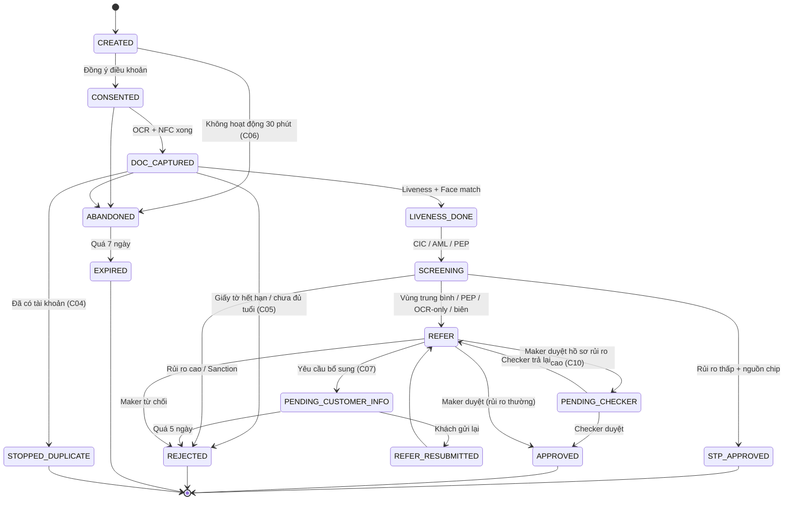

# C03 · Requirements Addendum v1.3 & RTM – eKYC

| | |
|---|---|
| Jira | [SCRUM-72](https://baohandao2303.atlassian.net/browse/SCRUM-72) |
| Bổ sung cho | BAS-BRD-v1.2 · BAS-FSD-v1.2 · BAS-SRS-v1.2 |
| Trạng thái | **Bản nháp v1.3-draft – chờ PO & Compliance duyệt** |
| Đầu vào | [C02 Compliance Mapping](../01-ekyc/1.2-compliance-legal/C02-compliance-mapping.md) |
| Chuẩn tham chiếu | ISO/IEC/IEEE 29148:2018 (đặc tả và truy vết yêu cầu), IIBA BABOK v3 – đánh giá ở [Q01](Q01-standards-conformance.md) |

Tài liệu này chỉ chứa **phần thay đổi** so với baseline v1.2. Khi được duyệt, nội dung được gộp vào BRD/FSD/SRS v1.3.

## 1. Mô hình trạng thái hồ sơ eKYC (thay thế mục trạng thái trong FSD v1.2)

Sơ đồ tổng thể. Chi tiết từng nhánh nằm trong tài liệu nghiệp vụ tương ứng.

## 2. Business Requirements mới

| Mã | Yêu cầu | Nguồn | Ưu tiên | Jira |
|---|---|---|---|---|
| BR-EKYC-12 | Không tạo hồ sơ / tài khoản trùng cho cùng một người (số định danh, hoặc số hộ chiếu + quốc tịch với người nước ngoài) | Gap-01 | Must | SCRUM-73 |
| BR-EKYC-13 | Chỉ chấp nhận giấy tờ còn hiệu lực và khách đủ tuổi theo sản phẩm | CR-14, CR-15 | Must | SCRUM-74 |
| BR-EKYC-14 | Khách tiếp tục được phiên dở; phiên quá hạn tự đóng và xoá dữ liệu tạm | Gap-03, CR-08 | Should | SCRUM-75 |
| BR-EKYC-15 | Compliance yêu cầu khách bổ sung thay vì chỉ duyệt / từ chối | Gap-04 | Must | SCRUM-76 |
| BR-EKYC-16 | Khách được thông báo mọi thay đổi trạng thái hồ sơ | Gap-05 | Must | SCRUM-77 |
| BR-EKYC-17 | Hồ sơ REFER được xử lý trong 24 giờ, có phân công và leo thang | Gap-06 | Should | SCRUM-78 |
| BR-EKYC-18 | Quyết định rủi ro cao cần người thứ hai; mọi thao tác được lưu vết | CR-11, CR-13 | Must | SCRUM-79 |
| BR-EKYC-19 | Đối chiếu khuôn mặt với ảnh gốc trong chip / CSDL dân cư | CR-02, CR-03, CR-04 | Must | SCRUM-80 |
| BR-EKYC-20 | Khách rút lại được đồng ý; dữ liệu lưu đúng thời hạn | CR-07, CR-08, CR-12 | Must | SCRUM-81 |
| BR-EKYC-21 | Phát hiện thiết bị / người mở nhiều hồ sơ bất thường | Gap-10 | Must | SCRUM-82 |
| BR-EKYC-22 | Khách mở được tài khoản bằng hộ chiếu gắn chip; người nước ngoài luôn được nhân viên xem xét | Yêu cầu PO 23/11/2026 | Should | SCRUM-74 |

## 3. Functional Requirements mới

| Mã | Mô tả | BR | Tài liệu chi tiết | Kiểm chứng (T02) |
|---|---|---|---|---|
| FR-EKYC-09 | Kiểm tra trùng theo số định danh (hoặc số hộ chiếu + quốc tịch) sau OCR/NFC, trước Liveness | BR-12 | [C04–C05](../01-ekyc/1.1-business/C04-C05-identity-validation.md) | TC-APP-17, 18 |
| FR-EKYC-10 | Kiểm tra hạn giấy tờ, tuổi, lệch OCR–chip | BR-13 | [C04–C05](../01-ekyc/1.1-business/C04-C05-identity-validation.md) | TC-APP-14 → 16, 22 |
| FR-EKYC-11 | Quản lý trạng thái phiên, tiếp tục phiên, job hết hạn | BR-14 | [C06](../01-ekyc/1.1-business/C06-session-lifecycle.md) | TC-APP-34 → 36, TC-JOB-01, 02 |
| FR-EKYC-12 | Luồng yêu cầu bổ sung giấy tờ | BR-15 | [C07–C09](../01-ekyc/1.1-business/C07-C09-refer-handling.md) | TC-APP-37, 38, TC-CO-13 → 17 |
| FR-EKYC-13 | Gửi thông báo SMS / Push theo ma trận sự kiện | BR-16 | [C07–C09](../01-ekyc/1.1-business/C07-C09-refer-handling.md) | TC-CO-13, TC-APP-24 |
| FR-EKYC-14 | SLA, nhận xử lý, leo thang hàng đợi | BR-17 | [C07–C09](../01-ekyc/1.1-business/C07-C09-refer-handling.md) | TC-CO-02, 05, 07 → 09, TC-JOB-04, 05 |
| FR-EKYC-15 | Maker-Checker và audit log bất biến | BR-18 | [C10](../01-ekyc/1.1-business/C10-maker-checker-audit.md) | TC-CO-18 → 23, TC-NFR-01 |
| FR-EKYC-16 | Chọn nguồn ảnh so khớp, xác thực chip | BR-19 | [C11](../01-ekyc/1.2-compliance-legal/C11-biometric-source.md) | TC-APP-19 → 21 |
| FR-EKYC-17 | Rút lại đồng ý, job lưu trữ / xoá | BR-20 | [C12](../01-ekyc/1.2-compliance-legal/C12-consent-retention.md) | TC-APP-39 → 41, TC-JOB-06 |
| FR-EKYC-18 | Velocity rules theo thiết bị / số điện thoại | BR-21 | [C13–C14](../01-ekyc/1.2-compliance-legal/C13-C14-fraud-controls.md) | TC-APP-30, TC-API-06 |
| FR-EKYC-19 | Chọn hộ chiếu ở eKYC-02; chụp một trang thông tin; đọc chip hộ chiếu; kiểm tra số hộ chiếu, quốc tịch; hộ chiếu Việt Nam phải kèm số định danh | BR-22 | [C04–C05](../01-ekyc/1.1-business/C04-C05-identity-validation.md), [U01](../01-ekyc/1.3-ui/U01-customer-app-ui-spec.md) | TC-APP-08, 13, 18, 25, 31, TC-API-11 |

## 4. Business Rules mới

| Mã | Tên | FR |
|---|---|---|
| RULE-EKYC-09 | Bảng quyết định trùng khách hàng | FR-09 |
| RULE-EKYC-10 | Bảng quyết định hợp lệ giấy tờ & tuổi | FR-10 |
| RULE-EKYC-11 | Thời gian hết hạn phiên T1 / T2 | FR-11 |
| RULE-EKYC-12 | SLA 24 giờ, ngưỡng cảnh báo, leo thang | FR-14 |
| RULE-EKYC-13 | Điều kiện bắt buộc Checker | FR-15 |
| RULE-EKYC-14 | Thứ tự ưu tiên nguồn ảnh so khớp | FR-16 |
| RULE-EKYC-15 | Rút lại đồng ý theo trạng thái hồ sơ | FR-17 |
| RULE-EKYC-16 | Ngưỡng velocity | FR-18 |
| RULE-EKYC-17 | Hộ chiếu nước ngoài (quốc tịch ≠ VNM) → tối đa REFER, cờ `FOREIGN_NATIONAL` | FR-19 |

## 5. Non-functional Requirements bổ sung

| Mã | Yêu cầu | Đo bằng | Kiểm chứng (T02) |
|---|---|---|---|
| NFR-PERF-03 | Toàn luồng từ Consent đến kết quả STP ≤ 3 phút (P90, không tính thời gian khách thao tác) | [C15](../01-ekyc/1.4-testing/C15-performance-test-plan.md) | TC-NFR-15 |
| NFR-AUD-03 | Audit log append-only, không sửa/xoá ở tầng service và DB | Test C10 | TC-NFR-01 |
| NFR-RET-01 | Job retention chạy hằng ngày, có báo cáo số bản ghi xoá | Test C12 | TC-JOB-06 |
| NFR-SEC-05 | Cấu hình ngưỡng thay đổi cần phê duyệt hai người | Test C10 | TC-CO-27 → 31 |

## 6. Ma trận truy vết (RTM)

| BR | FR | RULE | Story | UI (repo) | UAT | Test case (T02) |
|---|---|---|---|---|---|---|
| BR-12 | FR-09 | RULE-09 | SCRUM-73 | `Duplicate` | UAT-EKYC-12 | TC-APP-17, 18 |
| BR-13 | FR-10 | RULE-10 | SCRUM-74 | `ExpiredDoc`, `OcrReview` | UAT-EKYC-13, 14 | TC-APP-14 → 16, 22 |
| BR-14 | FR-11 | RULE-11 | SCRUM-75 | `Resume` | UAT-EKYC-15 | TC-APP-34 → 36 |
| BR-15 | FR-12 | — | SCRUM-76 | `RequestInfo`, modal "Yêu cầu bổ sung" | UAT-EKYC-16 | TC-APP-37, 38, TC-CO-13 → 17 |
| BR-16 | FR-13 | — | SCRUM-77 | `Refer`, chuông thông báo | UAT-EKYC-17 | TC-CO-13, TC-APP-24 |
| BR-17 | FR-14 | RULE-12 | SCRUM-78 | Hàng đợi, badge SLA | UAT-EKYC-18 | TC-CO-02, 05, 07 → 09 |
| BR-18 | FR-15 | RULE-13 | SCRUM-79 | Maker-Checker, lịch sử hồ sơ | UAT-EKYC-08, 19 | TC-CO-18 → 23 |
| BR-19 | FR-16 | RULE-14 | SCRUM-80 | Thẻ "Khuôn mặt", màn NFC | UAT-EKYC-20 | TC-APP-19 → 21 |
| BR-20 | FR-17 | RULE-15 | SCRUM-81 | Màn Consent | UAT-EKYC-21 | TC-APP-39 → 41 |
| BR-21 | FR-18 | RULE-16 | SCRUM-82 | Thẻ "Thiết bị" | UAT-EKYC-22 | TC-APP-30, TC-API-06 |
| BR-22 | FR-19 | RULE-17 | SCRUM-74 | `DocType`, `PassportArt`, `OcrReview` | UAT-EKYC-25, 26 | TC-APP-08, 13, 18, 25, 31 |
| NFR | NFR-PERF-03, AUD-03, RET-01, SEC-05 | — | SCRUM-84, 79, 81 | — | — | TC-NFR-15, 01, TC-JOB-06, TC-CO-27 → 31 |

Bộ UAT chi tiết: [C17 UAT Pack](../01-ekyc/1.4-testing/C17-uat-pack.md).

## 7. Nhật ký thay đổi

| Phiên bản | Ngày | Người | Nội dung | Trạng thái |
|---|---|---|---|---|
| v1.2 | 08/2026 | BA | Baseline (SCRUM-15) | Approved |
| v1.3-draft | 21/11/2026 | Han Dao | Thêm BR-12→21, FR-09→18, RULE-09→16, NFR mới, RTM | Chờ duyệt |
| v1.3-draft2 | 23/11/2026 | Han Dao | Thêm BR-22, FR-19, RULE-17 (hộ chiếu); BR-12, FR-09 không còn chỉ nói CCCD; thêm cột kiểm chứng và test case T02 vào FR, NFR, RTM (theo ISO 29148 – Q01) | Chờ duyệt |
