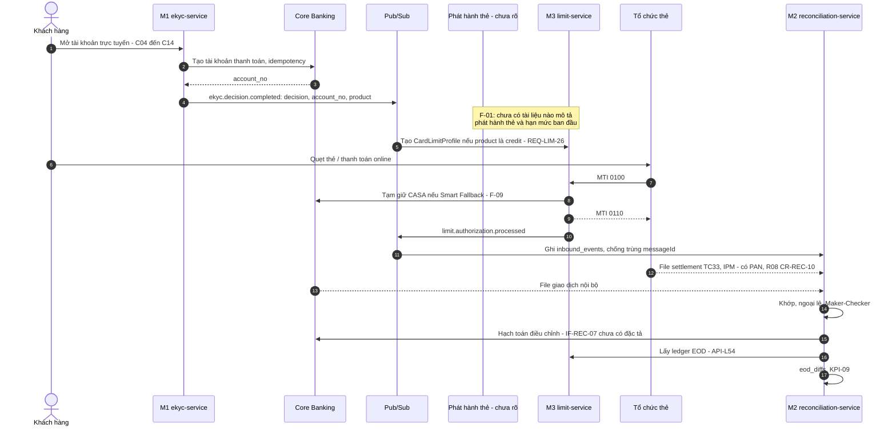

# X01 · Kiểm tra luồng end-to-end và độ đầy đủ tài liệu 3 module

| | |
|---|---|
| Mã tài liệu | AEG-GEN-X01 |
| Phiên bản | 1.3 |
| Ngày phát hành | 26/11/2026 |
| Trạng thái | 🔧 Đã sửa 6 điểm ngay trong tài liệu; 8 điểm chờ quyết định |
| Phân loại | Nội bộ |
| Tác giả | Han Dao (BA) |
| Người duyệt | Product Owner · Solution Owner / Tech Lead · Kế toán trưởng · InfoSec / DPO – chưa duyệt |
| Mục đích và phạm vi | Kiểm tra hành trình end-to-end qua 3 module, phát hiện điểm lệch giữa tài liệu, UI và thiết kế |
| Chuẩn tham chiếu | ISO/IEC/IEEE 29148:2018 §5.2.5 (tính nhất quán, đầy đủ của bộ yêu cầu) · BABOK v3 *Trace Requirements*, *Verify Requirements* · ISO/IEC/IEEE 42010 (góc nhìn kiến trúc) |
| Thuật ngữ | [G02 Thuật ngữ và chữ viết tắt](G02-glossary.md) |
| Phạm vi | Module 1 eKYC (`01-ekyc/`), Module 2 Đối soát (`02-reconciliation/`), Module 3 Hạn mức (`03-credit-limit/`), tổng quan [A01](A01-solution-overview.md) |
| Cách làm | Đi theo hành trình một khách từ mở tài khoản tới đối soát cuối ngày; ở mỗi điểm nối giữa hai module, so tài liệu hai bên và mã nguồn đang có (`server/src`, `src/`) |

## 1. Bộ tài liệu đã đủ như Module 1 chưa

Đối chiếu theo nhóm nội dung của Module 1. ✅ có tài liệu riêng · ➕ gộp trong tài liệu khác · ❌ chưa có.

| Nhóm nội dung | Module 1 eKYC | Module 2 Đối soát | Module 3 Hạn mức |
|---|---|---|---|
| Luồng nghiệp vụ, trạng thái, kiểm soát | ✅ C04 → C10 | ✅ R01 | ✅ L01 |
| Yêu cầu bổ sung, điểm lệch baseline, RTM | ✅ C03 | ✅ R02 | ✅ L02 |
| Tuân thủ, cơ sở pháp lý | ✅ C02, C11 → C14 | ✅ **R08 (mới)** | ✅ **L08 (mới)** |
| Điều khoản, quyền riêng tư cho khách | ✅ P01 | ➕ R08 §3 (không có giao diện khách) | ✅ **L08 §3 → §4 (mới)** |
| Đặc tả giao diện có ảnh | ✅ U01, U02 | ✅ R03 | ✅ L03 |
| Kế hoạch, test case, kết quả UI | ✅ T01, T02, T03 | ✅ R04 (25/25 đạt) | ✅ L04 (vòng 2: 34/36 đạt) |
| SIT, hiệu năng, UAT, biên bản | ✅ C15, C16, C17 | ✅ R07 | ✅ L07 |
| NFR, KPI | ✅ C18 (+ NFR ở C03) | ✅ R06 | ✅ L06 |
| API, mã lỗi | ✅ A03 | ✅ R05 | ✅ L05 |
| Từ điển dữ liệu, thời hạn lưu | ✅ D01 | ✅ R05 §3, §4.3 | ✅ L05 §3, §4 |
| Kiểm soát tài liệu (phiên bản, lịch sử, phê duyệt) | ✅ | ✅ | ✅ |
| Đối chiếu chuẩn quốc tế | ✅ Q01 | ✅ Q01 v1.1 §2.2 (mới) | ✅ Q01 v1.1 §2.2 (mới) |
| Backend chạy được + test tự động | ✅ `ekyc-service`, 59 test | ✅ `reconciliation-service`, 56 test (27/11) | ❌ chưa thấy `limit-service` (F-14) |

**Kết luận phần tài liệu:** sau khi thêm R08, L08 và cập nhật Q01, cả 3 module có cùng bộ nội dung. Khác biệt còn lại **không phải tài liệu** mà là backend: Module 2 và 3 mới có UI mẫu và thiết kế đề xuất.

## 2. Hành trình end-to-end

### 2.1 Kiểm tra từng chặng

| # | Chặng | Module | Tài liệu | UI | Backend | Kết luận |
|---|---|---|---|---|---|---|
| 1 | Mở tài khoản, quyết định STP / REFER / REJECTED | M1 | C03 → C14, A03 | ✅ | ✅ | ✅ |
| 2 | Tạo tài khoản CBS, chống tạo trùng | M1 | A03, C16 | — | ✅ (mô phỏng CBS) | ✅ |
| 3 | Phát `ekyc.decision.completed` | M1 → M3 | A01, L05 §5.6 | — | ✅ (`server/src/service.ts`) | ⚠️ F-03 |
| 4 | Phát hành thẻ, hạn mức ban đầu | ? → M3 | **Không có** | — | — | ❌ F-01 |
| 5 | Khách mở app, xem thẻ | M3 | L03 §6 | ⚠️ F-02 | — | ⚠️ |
| 6 | Authorization, chống trùng, đồng thời, reversal | M3 | L01, L05, L06 | ✅ W1, W2 | ❌ | ⚠️ chờ D-LIM-02, 03 |
| 7 | Smart Fallback: giữ tiền CASA, hạch toán | M3 ↔ CBS ↔ M2 | L05 §3.3, R05 | ✅ M1, W2 | ❌ | ⚠️ F-09 |
| 8 | Boost, gian lận, thông báo | M3 ↔ Notification | L01, L05, L08 §4.3 | ✅ W3, W4, M2, M3 | ❌ | ⚠️ chờ D-LIM-01, ISS-03 |
| 9 | Sự kiện sang Đối soát | M3 → M2 | L05 §5.6 = R05 §5.8 | — | ❌ | ✅ khớp payload (sau F-11) |
| 10 | Nạp file đối tác, khớp, ngoại lệ | M2 | R01 → R05 | ✅ | ❌ | ⚠️ R08 CR-REC-10 |
| 11 | Hạch toán GL, Maker-Checker | M2 → CBS | R01, R05, R07 IF-REC-07 | ✅ | ❌ | ❌ chưa có đặc tả hạch toán |
| 12 | Đối chiếu chéo EOD | M2 ↔ M3 | R05 §5.7, L05 API-L54, KPI-09 | — | ❌ | ✅ thiết kế khớp hai phía |
| 13 | KPI, báo cáo | M1, M2, M3 | C18, R06, L06 | ✅ | ✅ M1 | ✅ mã KPI theo BRD §1.9 |
| 14 | Dữ liệu cá nhân, audit, che số | M1, M2, M3 | P01, D01, R08, L08 | ✅ | ✅ M1 | ⚠️ F-06, F-07 |

## 3. Điểm lệch tìm thấy

| Mã | Mức | Điểm lệch | Bằng chứng | Xử lý | Trạng thái |
|---|---|---|---|---|---|
| F-01 | High | Không tài liệu nào mô tả bước **phát hành thẻ tín dụng và cấp hạn mức ban đầu**. eKYC chỉ mở tài khoản thanh toán (mặc định `product = payment`); A01 vẽ "Khởi tạo hạn mức" nhưng không nói hạn mức bao nhiêu, ai thẩm định, PAN lấy từ đâu. BRD UC-LIM-01 lấy "CardLimitProfile tồn tại" làm tiền điều kiện | `server/src/db.ts` (`product` mặc định `payment`), A01 §3, BRD §4.3 | PO xác định: phát hành thẻ thuộc hệ thống quản lý thẻ (CMS) ngoài Aegis, hay thêm vào phạm vi. Nếu ngoài phạm vi: ghi giao diện CMS → `limit-service` vào L05 | ⏳ Chờ PO |
| F-02 | Medium | Màn "Mở tài khoản thành công" luôn dẫn tới M1 với một thẻ tín dụng đang dùng 46 triệu, kể cả khách chỉ mở tài khoản thanh toán | `src/mobile/screens.tsx` – nút "Vào trang chủ" → `cardHome` | M1 cần trạng thái "chưa có thẻ" (giới thiệu sản phẩm thẻ); ghi DEF-LIM-08 ở L04 | ✅ Đã ghi lỗi |
| F-03 | Medium | `ekyc.decision.completed` phát cả khi `REJECTED`; payload chỉ có `decision`, `account_no`, `product`, không có `customer_id` và mã sự kiện duy nhất; bảng `events` dùng số tự tăng | `server/src/service.ts` dòng 366, 380; `server/src/db.ts` bảng `events` | Thống nhất phong bì sự kiện chung (§4); `limit-service` lọc theo REQ-LIM-26 | ✅ Đã đưa vào L08 REQ-LIM-26 · ⏳ phong bì chờ Tech Lead |
| F-04 | Medium | A01 (tổng quan) chỉ vẽ eKYC: thiếu topic `limit.*`, `rec.*`, CSDL của 2 service mới, tổ chức thẻ, CASA / sổ cái; vẽ Hạn mức → Đối soát nối thẳng thay vì qua Pub/Sub | A01 §1, §2 | Cập nhật A01 v1.1 | ✅ Đã sửa |
| F-05 | Medium | Hạ tầng sự kiện: A01, R05, L05 dùng Pub/Sub; BRD UC-LIM-05, 06 nói Kafka | BRD §4.3, RAID ISS-06 | Ghi rõ MVP Pub/Sub, mục tiêu Kafka theo ISS-06; thiết kế phong bì sự kiện không phụ thuộc bus | ⏳ Chờ Solution Owner (ACT-07) |
| F-06 | Low | Tên bảng nhật ký khác nhau: D01 `audit_event`, R05 / L05 `audit_events` | D01 §3.5, R05 §3.9, L05 §3.6 | Thống nhất `audit_event` theo bảng đang chạy ở `ekyc-service` | ✅ Đã sửa R05, L05, R08 |
| F-07 | Medium | Bảng `consents` của Module 1 khoá theo `session_id`; đồng ý của Module 3 (`limit_scoring`, `smart_fallback`) phát sinh sau khi đã có tài khoản | D01 §3.2, L08 §3 | Thêm `customer_id` vào `consents` dùng chung | ⏳ Chờ DPO, Tech Lead |
| F-08 | Low | Vai trò nhân viên mỗi module một kiểu: M1 `OFFICER` / `LEAD` / `CS`, M2 `REC_*` / `FIN_VIEWER`, M3 `CARD_OPS` / `CREDIT_RISK` / `LIM_VIEWER` | D01 §3.6, R05 §1.1, L05 §1.1 | Ma trận vai trò SSO chung ở §5; M1 đổi tên thành `EKYC_*` khi nối SSO | ⏳ Chờ InfoSec |
| F-09 | Medium | Bút toán đối ứng thẻ ↔ CASA khi Smart Fallback: L05 có `gl_ref` nhưng không ai được giao lập bút toán; BRD UC-LIM-03 bước 3 nói Limit Engine sinh bút toán; Module 2 chỉ đối chiếu | L05 §3.3, R05, BRD §4.3 | Đề xuất: `limit-service` gửi lệnh hạch toán qua cùng giao diện sổ cái IF-REC-07; Module 2 chỉ đối chiếu, không lập bút toán này | ⏳ Chờ Kế toán trưởng |
| F-10 | Low | L06 dẫn Nghị định 13/2023 trong khi C02, P01 đã chuyển sang Luật 91/2025 + NĐ 356/2025 (hiệu lực 01/01/2026) | L06 bảng đầu, NFR-LIM-18 | Sửa L06 | ✅ Đã sửa |
| F-11 | Low | Payload `limit.authorization.processed` ở R05 thiếu `card_id` và chưa nêu giá trị `result` như L05 | R05 §5.8 vs L05 §5.6 | Sửa R05 | ✅ Đã sửa |
| F-12 | Low | Mã mẫu thông báo khác quy ước: M1 `EKYC_APPROVED`, M3 `LIM-N01` | `server/src/service.ts`, L08 §4.3 | Dùng mã `LIM_BOOST_LOCKED`… trong Notification Service, giữ `LIM-N0x` làm mã tài liệu | ✅ Đã ghi ở L08 |
| F-13 | Medium | IF-REC-07 (hạch toán vào sổ cái) chưa có đặc tả – chặn chặng 7 và 11 | R07 câu hỏi 1 | Kế toán trưởng + đội Core Banking | ⏳ Đã có trong R07 |
| F-14 | Medium | Jira ghi SCRUM-27 → 30 *Testing*, SCRUM-38 *Done* nhưng repo không có mã `limit-service` | L02 §1 | Tech Lead xác minh | ⏳ Đã có trong L02 |

**Tổng:** 14 điểm (1 High · 8 Medium · 5 Low) · 6 đã sửa trong tài liệu · 8 chờ quyết định.

### 3.1 Chạy thử hành trình trên app (26/11/2026)

Đi lại các chặng có UI bằng app thật (web local + `ekyc-service`), không chỉ đọc tài liệu:

| Chặng | Cách chạy | Kết quả | Ghi ở |
|---|---|---|---|
| 1–3 Mở tài khoản eKYC, tạo tài khoản | TD-01 qua backend thật, 5 bước | ✅ STP, tài khoản `1903 6688 0001` | T03 §3.6 |
| 1 Compliance xét REFER | Nhận và phê duyệt `EKS-2611-0050` | ✅ Có nhật ký, che tên | T03 §3.6 |
| 4–5 Chuyển sang Hạn mức, xem thẻ | Nút "Vào trang chủ" | ⚠️ M1 hiện thẻ tín dụng mẫu đã dùng 61%, Smart Fallback bật sẵn, CASA khác tài khoản vừa mở | F-01, F-02 · L04 DEF-LIM-08, 09, 10 |
| 6–8 Authorization, Smart Fallback, Boost, gian lận | `lim-screens.mjs`, 36 ca | 34 đạt · 2 không đạt chờ D-LIM-01, 03 | L04 vòng 2 |
| 10–11 Đối soát, Maker-Checker | `rec-screens.mjs`, 25 ca | 25 đạt | R04 |

Chặng 9, 12 chỉ có thiết kế, chưa chạy được vì chưa có backend Module 2, 3. Kết quả khẳng định F-01, F-02 là điểm đứt thật trên sản phẩm, không chỉ trên giấy.

## 4. Đề xuất phong bì sự kiện chung (F-03, F-05)

Áp dụng cho mọi sự kiện giữa các module, bus là Pub/Sub (MVP) hay Kafka (mục tiêu):

| Trường | Kiểu | Ý nghĩa |
|---|---|---|
| `messageId` | UUID | Duy nhất, dùng để chống xử lý trùng (TC-REC-B09, SCRUM-38) |
| `type` | TEXT | `ekyc.decision.completed`, `limit.authorization.processed`, `limit.updated`, `limit.boost.*`, `rec.*` |
| `source` | TEXT | `ekyc-service` · `limit-service` · `reconciliation-service` |
| `occurredAt` | ms | Thời điểm xảy ra nghiệp vụ |
| `customerId` | TEXT | Khi sự kiện gắn với một khách |
| `payload` | JSON | Dữ liệu riêng của loại sự kiện; số tài khoản / số thẻ chỉ ở dạng che hoặc token |
| `schemaVersion` | INT | Để đổi payload không vỡ bên nhận |

## 5. Ma trận vai trò SSO chung (F-08, đề xuất)

| Vai trò SSO | Module | Tương ứng hiện nay |
|---|---|---|
| `EKYC_OFFICER` / `EKYC_LEAD` / `EKYC_CS` | M1 | `OFFICER` / `LEAD` / `CS` (D01) |
| `REC_OFFICER` / `REC_CHECKER` / `REC_LEAD` / `FIN_VIEWER` | M2 | R05 §1.1 |
| `CARD_OPS` / `CREDIT_RISK` / `LIM_VIEWER` | M3 | L05 §1.1 |
| `AUDITOR` | Cả 3 – chỉ đọc, xem nhật ký | *Đề xuất mới* |

Một người có thể giữ nhiều vai trò, nhưng không được giữ cùng lúc vai trò lập và duyệt của cùng một luồng (SoD ở C10, R05, L05).

## 6. Việc tiếp theo

1. PO trả lời F-01 trước khi chốt phạm vi UAT Module 3.
2. Kế toán trưởng chốt F-09 cùng đặc tả IF-REC-07 (F-13).
3. Tech Lead chốt phong bì sự kiện (§4), F-05, F-14.
4. DPO, InfoSec chốt F-07, F-08.
5. FE sửa DEF-LIM-08 (F-02) và DEF-LIM-10 sau khi có câu trả lời F-01; DEF-LIM-03, 04, 06, 07 đã sửa 26/11 (L04 vòng 2).

## 7. Kiểm soát tài liệu

### Tài liệu tham chiếu

| Mã | Tài liệu |
|---|---|
| A01 | [A01 · Tổng quan giải pháp Aegis – kiến trúc, luồng và điều hướng UI](A01-solution-overview.md) |

Chuẩn quốc tế: xem trường *Chuẩn tham chiếu* ở đầu trang.

### Lịch sử phiên bản

| Phiên bản | Ngày | Người sửa | Commit | Thay đổi |
|---|---|---|---|---|
| 1.0 | 26/11/2026 | Han Dao | f5d9316 | Bản đầu: ma trận độ đầy đủ 3 module, hành trình end-to-end 14 chặng, 14 điểm lệch, phong bì sự kiện, ma trận vai trò |
| 1.1 | 26/11/2026 | Han Dao | — | Thêm §3.1 chạy thử hành trình trên app; cập nhật số liệu L04 vòng 2 |
| 1.2 | 26/11/2026 | Han Dao | — | Cập nhật số liệu L04 (34/36) sau khi sửa DEF-LIM-03 |
| 1.3 | 26/11/2026 | Han Dao | — | Chuẩn hoá cấu trúc theo ISO/IEC/IEEE 15289: khối thuộc tính đầu trang, tài liệu tham chiếu, thuật ngữ dùng chung (G02), mục kiểm soát tài liệu thống nhất |

### Phê duyệt

| Vai trò | Người | Ngày | Kết luận |
|---|---|---|---|
| BA (soạn) | Han Dao | 26/11/2026 | Trình duyệt |
| Product Owner |  |  |  |
| Solution Owner / Tech Lead |  |  |  |
| Kế toán trưởng |  |  |  |
| InfoSec / DPO |  |  |  |
