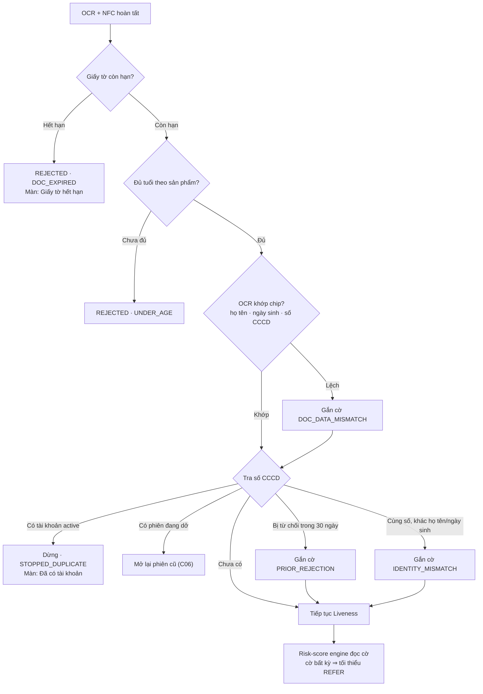

# C04–C05 · Kiểm tra trùng khách hàng & hợp lệ giấy tờ

| | |
|---|---|
| Jira | [SCRUM-73](https://baohandao2303.atlassian.net/browse/SCRUM-73) (C04) · [SCRUM-74](https://baohandao2303.atlassian.net/browse/SCRUM-74) (C05) |
| BR / FR / RULE | BR-12, BR-13 · FR-09, FR-10 · RULE-09, RULE-10 |
| UI | `Duplicate`, `ExpiredDoc`, `OcrReview` trong [screens.tsx](../../src/mobile/screens.tsx) |

Hai kiểm tra này chạy **ngay sau OCR/NFC và trước Liveness**. Mục đích là dừng sớm hồ sơ không hợp lệ, không tốn chi phí gọi Liveness và CIC.

## 1. Luồng kiểm tra

## 2. RULE-EKYC-10 · Hợp lệ giấy tờ & tuổi

| # | Điều kiện | Kết quả | Lý do hiển thị cho khách |
|---|---|---|---|
| 1 | `expiry_date < hôm nay` | REJECTED | Giấy tờ đã hết hạn |
| 2 | Còn hạn < 30 ngày | Tiếp tục + cảnh báo | Giấy tờ sắp hết hạn, vui lòng cập nhật |
| 3 | Tuổi < ngưỡng sản phẩm | REJECTED | Chưa đủ điều kiện độ tuổi |
| 4 | Loại giấy tờ không thuộc danh sách cho phép | Chặn ở màn chọn giấy tờ | Vui lòng mở tài khoản tại quầy |
| 5 | OCR ≠ chip ở trường định danh | Cờ `DOC_DATA_MISMATCH` → REFER | (không hiển thị) |

Ngưỡng tuổi chờ Compliance trả lời câu hỏi số 1 trong [C02](../00-governance/C02-compliance-mapping.md). Giá trị đề xuất: tài khoản thanh toán **15**, sản phẩm có hạn mức tín dụng **18**. Đây là tham số cấu hình, không viết cố định trong code.

## 3. RULE-EKYC-09 · Trùng khách hàng

| # | Tình huống theo số CCCD | Kết quả | Gọi Liveness/CIC? |
|---|---|---|---|
| 1 | Không có bản ghi | Tiếp tục | Có |
| 2 | Tài khoản đang hoạt động | Dừng – mời đăng nhập | **Không** |
| 3 | Phiên khác chưa kết thúc | Mở lại phiên đó | Không |
| 4 | REJECTED trong N ngày (mặc định 30) | Cờ `PRIOR_REJECTION` → REFER | Có |
| 5 | Cùng số nhưng khác họ tên / ngày sinh | Cờ `IDENTITY_MISMATCH` → REFER | Có |

**Chuẩn hoá trước khi so:** bỏ khoảng trắng, đủ 12 chữ số, ưu tiên giá trị đọc từ chip.

## 4. Dữ liệu

| Bảng | Trường thêm | Ghi chú |
|---|---|---|
| `ekyc_sessions` | `id_number_hash` | SHA-256 + salt, có index để tra trùng, không lưu số thô |
| `ekyc_sessions` | `validation_flags[]` | `DOC_DATA_MISMATCH`, `PRIOR_REJECTION`, `IDENTITY_MISMATCH` |
| `config_thresholds` | `min_age_payment`, `min_age_credit`, `prior_rejection_days`, `expiry_warning_days` | Đổi qua màn Cấu hình ngưỡng (C10) |

## 5. Ngoại lệ

| Tình huống | Xử lý |
|---|---|
| CBS lookup lỗi / quá thời gian | Không chặn khách, gắn cờ `DEDUP_UNAVAILABLE` → REFER |
| Chip không đọc được (OCR-only) | Dùng số CCCD từ OCR để tra trùng; mất kiểm tra lệch OCR–chip ⇒ tối đa REFER (C11) |

## 6. Tiêu chí nghiệm thu (rút gọn)

Xem ticket để có đầy đủ. UAT: UAT-EKYC-12, 13, 14 trong [C17](../03-quality/C17-uat-pack.md).
