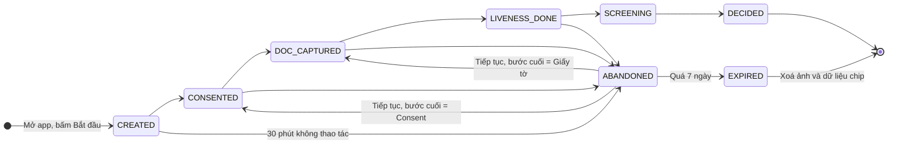
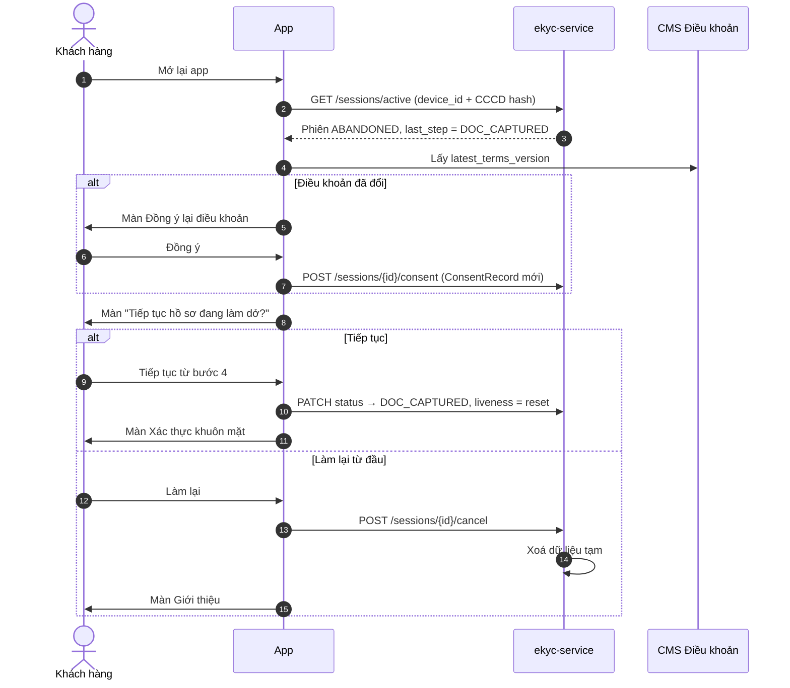

# C06 · Vòng đời phiên eKYC

| | |
|---|---|
| Jira | [SCRUM-75](https://baohandao2303.atlassian.net/browse/SCRUM-75) |
| BR / FR / RULE | BR-14 · FR-11 · RULE-11 |
| UI | `Resume`, `Consent` (chế độ re-consent) |

## 1. Sơ đồ trạng thái phiên

Phần "trong quá trình làm" của hồ sơ. Kết quả quyết định nằm ở sơ đồ tổng trong [C03](../00-governance/C03-requirements-addendum-v1.3.md).

## 2. RULE-EKYC-11

| Tham số | Mặc định | Cấu hình được |
|---|---|---|
| T1 – không thao tác → ABANDONED | 30 phút | Có |
| T2 – ABANDONED → EXPIRED | 7 ngày | Có |
| Bước được giữ khi tiếp tục | Bước cuối cùng đã hoàn tất | — |
| Liveness | **Luôn làm lại** khi tiếp tục | Không |
| Điều khoản đổi trong lúc phiên dở | Bắt buộc re-consent trước khi đi tiếp | Không |

**Vì sao Liveness luôn làm lại:** kết quả liveness chỉ chứng minh có người thật **tại thời điểm đó**. Dùng lại kết quả cũ cho phép người khác cầm máy hoàn tất hồ sơ.

## 3. Luồng tiếp tục phiên

## 4. Job nền

| Job | Lịch | Việc làm | Ghi nhận |
|---|---|---|---|
| `session-abandon-scan` | Mỗi 5 phút | Phiên quá T1 không thao tác → ABANDONED | Sự kiện `ekyc.session.abandoned` cho funnel (C18) |
| `session-expire` | Hằng ngày 02:00 | ABANDONED quá T2 → EXPIRED, gọi retention (C12) xoá ảnh/chip | Số phiên hết hạn, số file xoá |

## 5. Ngoại lệ

| Tình huống | Xử lý |
|---|---|
| Khách đổi thiết bị | Tìm phiên theo CCCD hash sau khi chụp giấy tờ; nếu thấy phiên trên thiết bị khác → hỏi khách, đồng thời tăng bộ đếm velocity (C13) |
| CMS không trả `latest_terms_version` | Không cho đi tiếp (theo IF-02), hiển thị lỗi thử lại |
