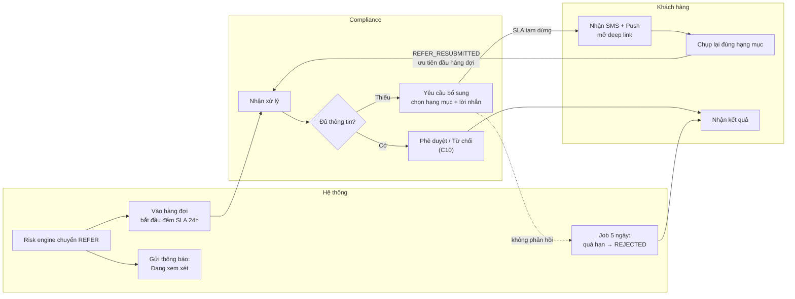
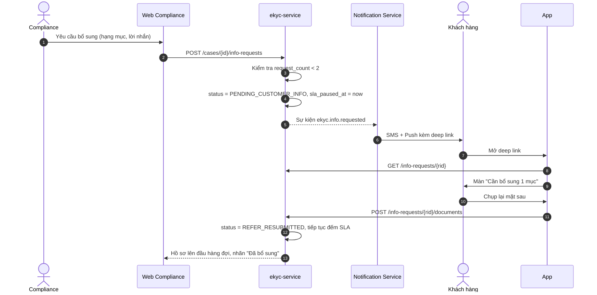
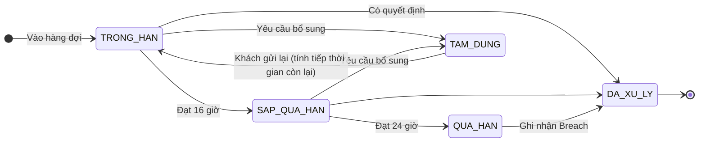

# C07–C09 · Xử lý hồ sơ REFER: bổ sung giấy tờ, thông báo, SLA

| | |
|---|---|
| Jira | [SCRUM-76](https://baohandao2303.atlassian.net/browse/SCRUM-76) (C07) · [SCRUM-77](https://baohandao2303.atlassian.net/browse/SCRUM-77) (C08) · [SCRUM-78](https://baohandao2303.atlassian.net/browse/SCRUM-78) (C09) |
| BR / FR / RULE | BR-15/16/17 · FR-12/13/14 · RULE-12 |
| UI | App: `Refer`, `RequestInfo` · Compliance: hàng đợi, badge SLA, modal "Yêu cầu bổ sung", chuông thông báo |

Ba ticket gộp một tài liệu vì chúng là **một quy trình liền mạch**: hồ sơ vào hàng đợi → nhân viên xử lý trong SLA → có thể yêu cầu khách bổ sung → khách được thông báo ở mỗi bước.

## 1. Quy trình (swimlane)

## 2. C07 · Yêu cầu bổ sung giấy tờ

### Quy tắc

| # | Quy tắc |
|---|---|
| 1 | Phải chọn ít nhất 1 hạng mục chuẩn: ảnh mặt trước mờ · ảnh mặt sau mờ/MRZ · thiếu mặt sau · OCR khác chip · khác |
| 2 | Tối đa **2 lần** yêu cầu cho một hồ sơ; lần thứ 3 nút bị khoá |
| 3 | Hạn bổ sung **5 ngày** (cấu hình được); quá hạn → REJECTED lý do `NO_RESPONSE` |
| 4 | Trong thời gian chờ khách, **SLA của Compliance tạm dừng** |
| 5 | Lời nhắn **không được** nhắc PEP, AML, CIC |
| 6 | Hồ sơ khách gửi lại đứng **đầu hàng đợi** |

### Trình tự

## 3. C08 · Ma trận thông báo

| Sự kiện | Kênh | Mẫu | Nội dung tóm tắt |
|---|---|---|---|
| STP_APPROVED | Push + SMS | `EKYC_APPROVED` | Mở tài khoản thành công |
| Chuyển REFER | Push | `EKYC_UNDER_REVIEW` | Đang xem xét, kết quả trong 24 giờ |
| Compliance APPROVE (hoặc Checker) | Push + SMS | `EKYC_APPROVED` | Mở tài khoản thành công |
| Compliance REJECT | Push + SMS | `EKYC_REJECTED` | Chưa thể mở tài khoản + kênh hỗ trợ |
| Yêu cầu bổ sung | Push + SMS | `EKYC_INFO_REQUESTED` | Cần bổ sung [hạng mục] trước [hạn] + deep link |
| Còn 1 ngày hạn bổ sung | Push | `EKYC_INFO_REMINDER` | Nhắc nhở |
| Quá hạn bổ sung | Push + SMS | `EKYC_EXPIRED` | Hồ sơ đã bị huỷ |

**Quy tắc gửi:** qua Pub/Sub → Notification Service · retry 3 lần (backoff 1s/5s/30s) · thất bại → dead-letter + cảnh báo vận hành · **không rollback** quyết định KYC khi gửi lỗi · log: `session_id`, `template_id`, kênh, thời gian, trạng thái.

## 4. C09 · SLA hàng đợi

### Trạng thái SLA của một hồ sơ

### RULE-EKYC-12

| Hạng mục | Quy tắc |
|---|---|
| SLA | 24 giờ tính từ lúc vào hàng đợi, **trừ** thời gian tạm dừng |
| Hiển thị | Trong hạn < 16h · Sắp quá hạn 16–24h · Quá SLA > 24h (chữ + icon + màu, không chỉ màu) |
| Nhận xử lý | Một hồ sơ chỉ một người giữ; người khác chỉ xem; tự nhả sau 2 giờ không thao tác |
| Leo thang | 20h → thông báo trưởng nhóm · 24h → đánh dấu Breach trong báo cáo |
| Thứ tự hàng đợi | Đã bổ sung → Sắp quá SLA → Cũ nhất |
| Báo cáo | Số hồ sơ xử lý, % đúng SLA, trung vị thời gian xử lý, số Breach (màn Báo cáo SLA, C18) |

**Câu hỏi mở cho PO:** SLA tính theo giờ lịch (24/7) hay giờ làm việc? Bản mẫu đang tính theo giờ lịch.
