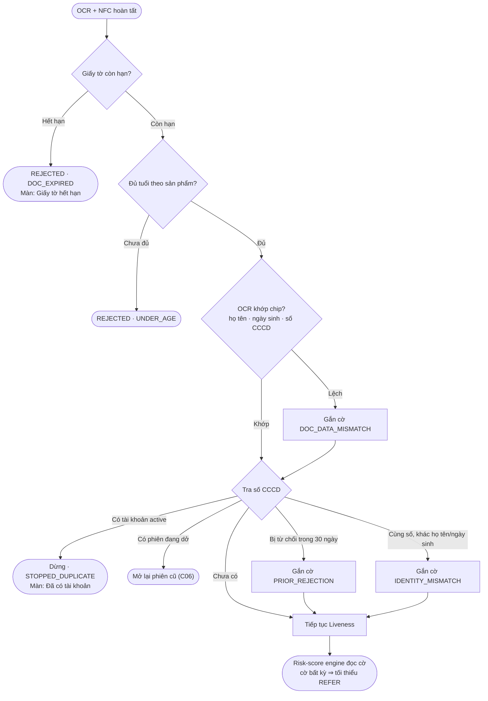

# C04–C05 · Kiểm tra trùng khách hàng & hợp lệ giấy tờ

| | |
|---|---|
| Phiên bản | 0.5 · 25/11/2026 · Han Dao (BA) |
| Trạng thái | ✅ Hoàn tất đặc tả + UI + backend, có test UAT · chờ PO, Compliance duyệt |
| Jira | [SCRUM-73](https://baohandao2303.atlassian.net/browse/SCRUM-73) (C04) · [SCRUM-74](https://baohandao2303.atlassian.net/browse/SCRUM-74) (C05) |
| BR / FR / RULE | BR-12, BR-13 · FR-09, FR-10 · RULE-09, RULE-10 |
| UI | `Duplicate`, `ExpiredDoc`, `OcrReview` trong [screens.tsx](../../../src/mobile/screens.tsx) |
| Chuẩn tham chiếu | IIBA BABOK v3 (bảng quyết định, quy tắc nghiệp vụ) · ISO/IEC/IEEE 29148:2018 – đánh giá ở [Q01](../../00-overview/Q01-standards-conformance.md) |

Hai kiểm tra này chạy **ngay sau OCR/NFC và trước Liveness**. Mục đích là dừng sớm hồ sơ không hợp lệ, không tốn chi phí gọi Liveness và CIC.

## 1. Luồng kiểm tra

## 2. RULE-EKYC-10 · Hợp lệ giấy tờ & tuổi

| # | Điều kiện | Kết quả | Lý do hiển thị cho khách |
|---|---|---|---|
| 1 | `expiry_date < hôm nay` | REJECTED | Giấy tờ đã hết hạn |
| 2 | Còn hạn < 30 ngày | Tiếp tục + cảnh báo | Giấy tờ sắp hết hạn, vui lòng cập nhật |
| 3 | Tuổi < ngưỡng sản phẩm | REJECTED | Chưa đủ điều kiện độ tuổi |
| 4 | Loại giấy tờ không thuộc danh sách cho phép (CCCD gắn chip, thẻ Căn cước 2024, hộ chiếu gắn chip) | Chặn ở màn chọn giấy tờ | Vui lòng mở tài khoản tại quầy |
| 5 | OCR ≠ chip ở trường định danh | Cờ `DOC_DATA_MISMATCH` → REFER | (không hiển thị) |
| 6 | Hộ chiếu nước ngoài | Cờ `FOREIGN_NATIONAL` → REFER để kiểm tra thị thực / thẻ tạm trú | Hồ sơ được nhân viên xem xét |

Ngưỡng tuổi chờ Compliance trả lời câu hỏi số 1 trong [C02](../1.2-compliance-legal/C02-compliance-mapping.md). Giá trị đang dùng: tài khoản thanh toán **16** (đổi từ 15 ngày 25/11 vì người dưới 16 tuổi là trẻ em – xem [P01](../1.2-compliance-legal/P01-terms-privacy.md) PR-02), sản phẩm có hạn mức tín dụng **18**. Đây là tham số cấu hình, không viết cố định trong code.

## 3. RULE-EKYC-09 · Trùng khách hàng

| # | Tình huống theo số CCCD | Kết quả | Gọi Liveness/CIC? |
|---|---|---|---|
| 1 | Không có bản ghi | Tiếp tục | Có |
| 2 | Tài khoản đang hoạt động | Dừng – mời đăng nhập | **Không** |
| 3 | Phiên khác chưa kết thúc | Mở lại phiên đó | Không |
| 4 | REJECTED trong N ngày (mặc định 30) | Cờ `PRIOR_REJECTION` → REFER | Có |
| 5 | Cùng số nhưng khác họ tên / ngày sinh | Cờ `IDENTITY_MISMATCH` → REFER | Có |

**Chuẩn hoá trước khi so:** bỏ khoảng trắng, đủ 12 chữ số, ưu tiên giá trị đọc từ chip.

**Khoá tra trùng theo loại giấy tờ:**

| Giấy tờ | Khoá | Ghi chú |
|---|---|---|
| CCCD / thẻ Căn cước | Số định danh 12 số | — |
| Hộ chiếu Việt Nam | Số định danh in trên trang thông tin | Người đã mở tài khoản bằng CCCD dùng hộ chiếu vẫn bị phát hiện trùng |
| Hộ chiếu nước ngoài | Quốc tịch + số hộ chiếu | Không có số định danh Việt Nam |

Hộ chiếu chỉ chụp **trang thông tin** (MRZ 2 dòng × 44 ký tự, TD3); chip nằm ở bìa. So khớp OCR–chip thêm trường số hộ chiếu.

## 4. Dữ liệu

| Bảng | Trường thêm | Ghi chú |
|---|---|---|
| `ekyc_sessions` | `id_number_hash` | SHA-256 + salt, có index để tra trùng, không lưu số thô |
| `ekyc_sessions` | `validation_flags[]` | `DOC_DATA_MISMATCH`, `PRIOR_REJECTION`, `IDENTITY_MISMATCH` |
| `config_thresholds` | `min_age_payment`, `min_age_credit`, `prior_rejection_days`, `expiry_warning_days` | Đổi qua màn Cấu hình ngưỡng (C10) |

## 5. Ngoại lệ

| Tình huống | Xử lý |
|---|---|
| CBS lookup lỗi / quá thời gian | Không chặn khách, gắn cờ `DEDUP_UNAVAILABLE` → REFER |
| Chip không đọc được (OCR-only) | Dùng số CCCD từ OCR để tra trùng; mất kiểm tra lệch OCR–chip ⇒ tối đa REFER (C11) |

## 6. Tiêu chí nghiệm thu (rút gọn)

Xem ticket để có đầy đủ. UAT: UAT-EKYC-12, 13, 14, 25, 26 trong [C17](../1.4-testing/C17-uat-pack.md).

## 7. Kiểm soát tài liệu

### Lịch sử phiên bản

| Phiên bản | Ngày | Người sửa | Commit | Thay đổi |
|---|---|---|---|---|
| 0.1 | 21/11/2026 | Han Dao | `51eaebb` | Bản đầu kèm diagram (Epic SCRUM-69) |
| 0.2 | 23/11/2026 | Han Dao | `c70e906` | Bổ sung luồng hộ chiếu gắn chip (Việt Nam và nước ngoài) |
| 0.3 | 23/11/2026 | Han Dao | `ffb0ba3` | Sắp xếp lại bảng; thêm kịch bản hộ chiếu |
| 0.4 | 25/11/2026 | Han Dao | `d93f67e` | Tuổi tối thiểu tài khoản thanh toán trực tuyến 15 → 16, giới hạn 16–25 (P01 PR-02) |
| 0.5 | 25/11/2026 | Han Dao | — | Thêm mục kiểm soát tài liệu (phiên bản, lịch sử, phê duyệt) theo ISO/IEC/IEEE 29148 và 29119-3 |

### Phê duyệt

| Vai trò | Người | Ngày | Kết luận |
|---|---|---|---|
| BA (soạn) | Han Dao | 25/11/2026 | Trình duyệt |
| Product Owner | | | |
| Compliance | | | |
