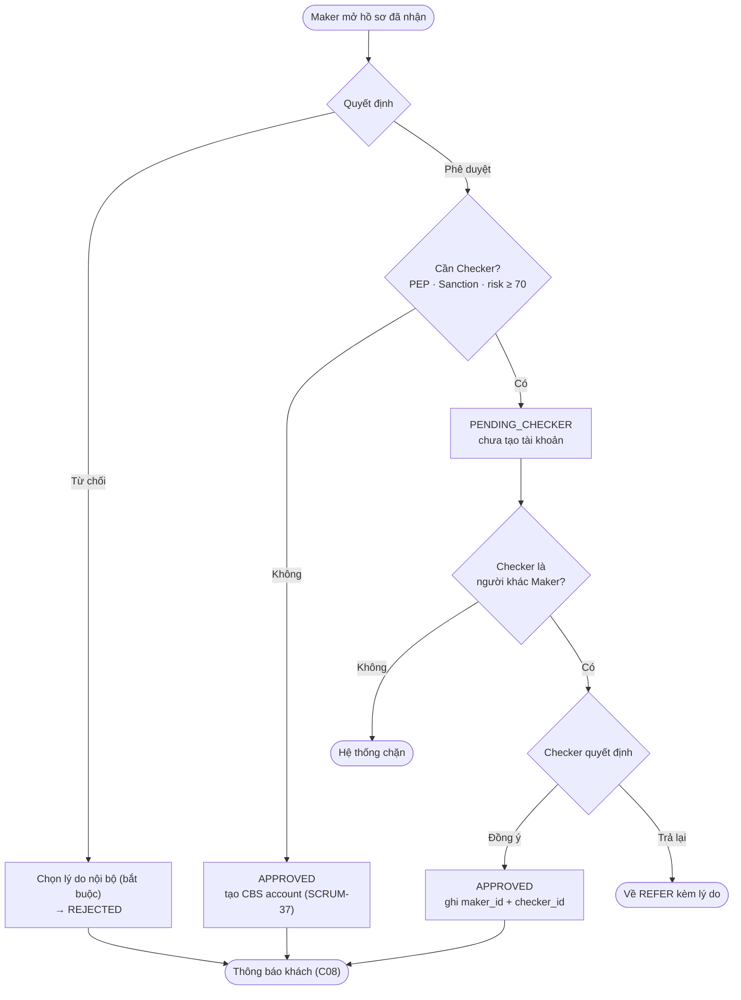
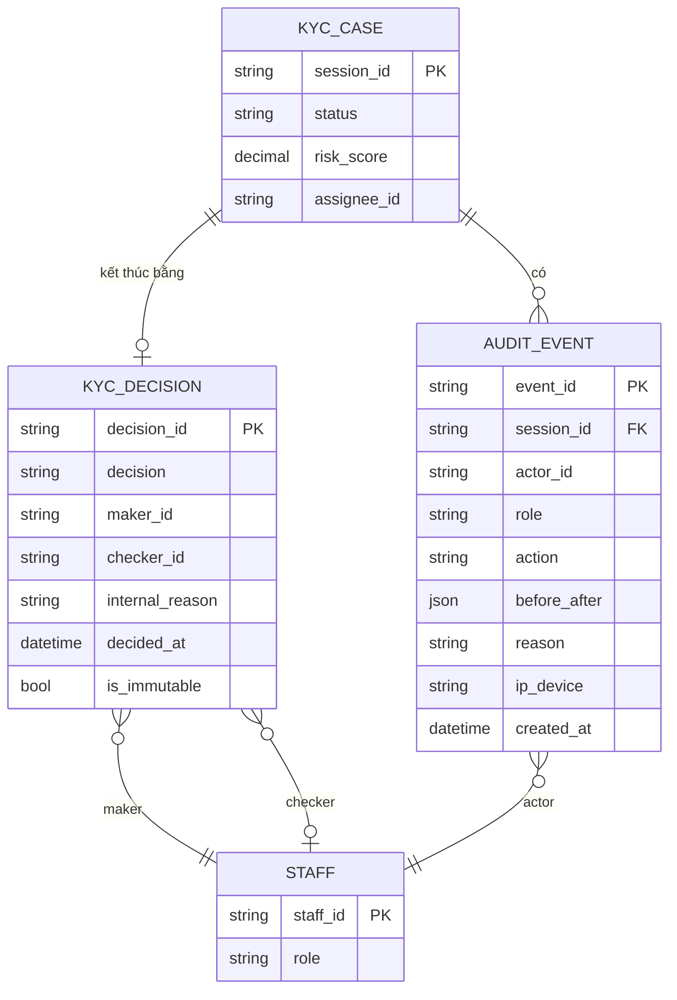

# C10 · Maker-Checker & Audit trail

| | |
|---|---|
| Phiên bản | 0.2 · 25/11/2026 · Han Dao (BA) |
| Trạng thái | ✅ Hoàn tất đặc tả + UI + backend, có test UAT · chờ PO, Compliance duyệt |
| Jira | [SCRUM-79](https://baohandao2303.atlassian.net/browse/SCRUM-79) |
| BR / FR / RULE | BR-18 · FR-15 · RULE-13 · NFR-AUD-03, NFR-SEC-05 |
| UI | Chi tiết hồ sơ (nút "Phê duyệt · gửi Checker", "Xem họ tên đầy đủ"), lịch sử hồ sơ, Cấu hình ngưỡng |
| Chuẩn tham chiếu | IIBA BABOK v3 · UML 2.5 / ERD – đánh giá ở [Q01](../../00-overview/Q01-standards-conformance.md) |

## 1. Quy trình ra quyết định

## 2. RULE-EKYC-13 · Khi nào cần Checker

| Quyết định | Điều kiện | Cần Checker |
|---|---|---|
| APPROVE | `pep_flag = true` | ✅ |
| APPROVE | `sanction_match = true` | ✅ |
| APPROVE | `risk_score ≥ 70` | ✅ |
| APPROVE | Còn lại | — |
| REJECT | Mọi trường hợp | — (lưu audit đầy đủ) |
| Đổi ngưỡng cấu hình | Mọi trường hợp | ✅ (NFR-SEC-05) |
| Maker = Checker | — | **Bị chặn** |

## 3. Audit log

### Sự kiện cần ghi

| Mã sự kiện | Khi nào |
|---|---|
| `CASE_VIEW` | Mở chi tiết hồ sơ |
| `VIEW_PII` | Bấm "Xem họ tên đầy đủ" |
| `VIEW_SENSITIVE` | Mở phần sàng lọc rủi ro (PEP/AML/CIC) |
| `CASE_CLAIM` / `CASE_RELEASE` | Nhận / nhả hồ sơ (kể cả tự nhả sau 2 giờ) |
| `INFO_REQUESTED` | Yêu cầu bổ sung |
| `DECISION_APPROVE` / `DECISION_REJECT` | Maker quyết định |
| `CHECKER_APPROVE` / `CHECKER_RETURN` | Checker quyết định |
| `CONFIG_CHANGE_REQUESTED` / `CONFIG_CHANGE_APPROVED` | Đổi ngưỡng |

### Cấu trúc bản ghi

**Bất biến:** bảng `audit_event` chỉ cho `INSERT`. Quyền `UPDATE`/`DELETE` bị thu hồi ở DB role của service; tầng service không có API sửa/xoá. Kiểm thử bằng cách cố cập nhật trực tiếp và kỳ vọng bị từ chối.

## 4. Phân quyền liên quan

| Vai trò | Xem hàng đợi | Xem PII đầy đủ | Xem sàng lọc rủi ro | Maker | Checker | Đổi ngưỡng |
|---|---|---|---|---|---|---|
| Compliance Officer | ✅ | ✅ (có audit) | ✅ | ✅ | ✅ (không phải hồ sơ mình làm Maker) | Đề xuất |
| Trưởng nhóm Compliance | ✅ | ✅ | ✅ | ✅ | ✅ | Phê duyệt |
| CS / Vận hành | ✅ (che PII) | — | — | — | — | — |

Chi tiết RBAC/ABAC: SCRUM-55.

## 5. Kiểm soát tài liệu

### Lịch sử phiên bản

| Phiên bản | Ngày | Người sửa | Commit | Thay đổi |
|---|---|---|---|---|
| 0.1 | 21/11/2026 | Han Dao | `51eaebb` | Bản đầu kèm diagram (Epic SCRUM-69) |
| 0.2 | 25/11/2026 | Han Dao | — | Thêm mục kiểm soát tài liệu (phiên bản, lịch sử, phê duyệt) theo ISO/IEC/IEEE 29148 và 29119-3 |

### Phê duyệt

| Vai trò | Người | Ngày | Kết luận |
|---|---|---|---|
| BA (soạn) | Han Dao | 25/11/2026 | Trình duyệt |
| Product Owner | | | |
| Compliance | | | |
