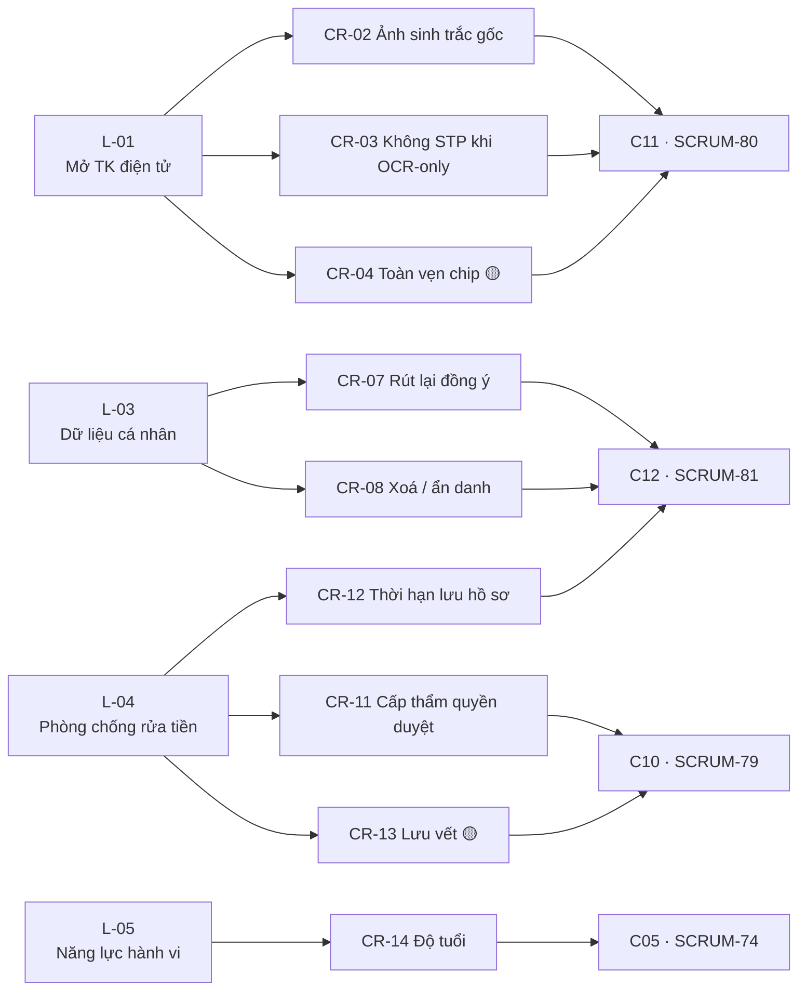

# C02 · Compliance Mapping – eKYC

| | |
|---|---|
| Jira | [SCRUM-71](https://baohandao2303.atlassian.net/browse/SCRUM-71) · Spike |
| Trạng thái tài liệu | **Bản nháp v0.1 – chờ Compliance xác nhận** |
| Đầu ra cho | C03 (BRD v1.3), C05, C11, C12 |

> ⚠️ Số hiệu và nội dung văn bản dưới đây là **điểm khởi đầu để rà soát**, viết dựa trên hiểu biết chung về quy định Việt Nam. Trước khi đưa vào BRD, phải đối chiếu bản gốc và tình trạng hiệu lực trên cổng văn bản chính thức (vbpl.vn, sbv.gov.vn). Cột "Cần xác minh" đánh dấu những chỗ chưa chắc chắn.

## 1. Phạm vi văn bản

| Mã | Văn bản | Chủ đề liên quan eKYC | Cần xác minh |
|---|---|---|---|
| L-01 | Quy định NHNN về mở tài khoản thanh toán (vd. Thông tư 17/2024/TT-NHNN) | Mở tài khoản bằng phương thức điện tử, đối chiếu sinh trắc học với dữ liệu chip / CSDL dân cư | Điều khoản cụ thể, ngày hiệu lực, các sửa đổi |
| L-02 | Quy định NHNN về an toàn giao dịch trực tuyến (vd. Quyết định 2345/QĐ-NHNN) | Xác thực sinh trắc học khi giao dịch | Phạm vi áp dụng cho bước mở tài khoản |
| L-03 | Luật Bảo vệ dữ liệu cá nhân số 91/2025/QH15 và Nghị định 356/2025/NĐ-CP (cùng hiệu lực 01/01/2026; NĐ 356 thay Nghị định 13/2023/NĐ-CP) | Đồng ý, rút lại đồng ý, dữ liệu nhạy cảm (sinh trắc học), dữ liệu trẻ em, đánh giá tác động, chuyển dữ liệu xuyên biên giới | Số điều cụ thể, thời hạn lưu trữ – xem P01 mục 0 |
| L-04 | Luật Phòng, chống rửa tiền 2022 và văn bản hướng dẫn | Nhận biết khách hàng, PEP, danh sách cấm, lưu trữ hồ sơ | Thời hạn lưu hồ sơ KYC |
| L-05 | Bộ luật Dân sự (năng lực hành vi) và quy định sản phẩm | Độ tuổi tối thiểu mở tài khoản / dùng sản phẩm tín dụng | Ngưỡng tuổi cho từng sản phẩm |

## 2. Ma trận đối chiếu

Sơ đồ truy vết: văn bản → yêu cầu còn thiếu → tài liệu xử lý. Chỉ vẽ các yêu cầu ❌ và 🟡.

Trạng thái: ✅ Đáp ứng · 🟡 Một phần · ❌ Chưa có

| Mã yêu cầu | Nguồn | Yêu cầu (tóm tắt) | Hiện trạng Aegis | Trạng thái | Hành động |
|---|---|---|---|---|---|
| CR-01 | L-01 | Thu thập thông tin định danh từ giấy tờ có chip | OCR + NFC (SCRUM-18) | ✅ | — |
| CR-02 | L-01 | Đối chiếu khuôn mặt với **dữ liệu sinh trắc học gốc** (chip / CSDL dân cư) | So với ảnh in trên thẻ (SCRUM-19) | ❌ | C11 – SCRUM-80 |
| CR-03 | L-01 | Không mở tài khoản tự động khi chưa xác thực được nguồn sinh trắc học | Fallback OCR-only vẫn có thể STP (CR-001) | ❌ | C11 – OCR-only tối đa REFER |
| CR-04 | L-01 | Xác thực tính toàn vẹn của chip (chữ ký số) | `integrity_check` (SCRUM-18) | 🟡 | C11 – lưu `chip_auth_result` |
| CR-05 | L-03 | Đồng ý rõ ràng, theo từng mục đích | ConsentRecord theo scope (SCRUM-17) | ✅ | — |
| CR-06 | L-03 | Đồng ý lại khi điều khoản thay đổi | Re-consent (SCRUM-46) | ✅ | — |
| CR-07 | L-03 | Chủ thể dữ liệu được rút lại đồng ý | Chưa có | ❌ | C12 – SCRUM-81 |
| CR-08 | L-03 | Xoá / ẩn danh dữ liệu khi hết mục đích | Chưa có chính sách | ❌ | C12 + C06 |
| CR-09 | L-03 | Đánh giá tác động xử lý dữ liệu (DPIA) | DPIA (SCRUM-32) | ✅ | Cập nhật cho C11–C13 |
| CR-10 | L-04 | Sàng lọc PEP, danh sách cấm | AML/PEP/Sanction (SCRUM-20) | ✅ | — |
| CR-11 | L-04 | Quyết định với khách rủi ro cao cần cấp có thẩm quyền | Chưa có Maker-Checker | ❌ | C10 – SCRUM-79 |
| CR-12 | L-04 | Lưu hồ sơ nhận biết khách hàng đủ thời hạn | Chưa có retention | ❌ | C12 |
| CR-13 | L-04 | Lưu vết truy cập và quyết định | Audit một phần | 🟡 | C10 |
| CR-14 | L-05 | Kiểm tra độ tuổi theo sản phẩm | Chưa có | ❌ | C05 – SCRUM-74 |
| CR-15 | L-01 | Giấy tờ còn hiệu lực | Chưa kiểm tra hạn | ❌ | C05 |

### Cập nhật 23/11/2026 – sau khi có backend mẫu

Trạng thái trong bảng trên là lúc lập tài liệu (21/11). Sau khi xây `ekyc-service` và chạy kiểm thử ([T03](../1.4-testing/T03-test-report.md)):

| Mã | Trạng thái mới | Bằng chứng |
|---|---|---|
| CR-02 | 🟡 | Chọn nguồn so khớp ảnh chip DG2 (C11) đã có; chưa nối nhà cung cấp so khớp khuôn mặt và CSDL dân cư |
| CR-03 | ✅ | Không có chip hợp lệ → tối đa REFER (`NFC_SKIPPED`, `CHIP_AUTH_FAILED`) – UAT-EKYC-02, 20 |
| CR-04 | 🟡 | Kiểm tra SOD có; chưa xác minh chữ ký tới CSCA (A02) |
| CR-07 | ✅ | Màn eKYC-14 + API rút lại đồng ý – UAT-EKYC-21 |
| CR-08 | ✅ | Job xoá phiên hết hạn, xoá sau rút đồng ý, retention – TC-JOB-02, 06 |
| CR-11 | ✅ | Maker-Checker cho PEP/Sanction/rủi ro ≥ 70 – UAT-EKYC-19 |
| CR-12 | 🟡 | Tham số lưu trữ đã có (`retention_rejected_days`); chờ Compliance chốt thời hạn |
| CR-13 | ✅ | Audit chỉ ghi thêm, ghi xem hồ sơ / xem PII / quyết định – NFR-AUD-03 |
| CR-14 | 🟡 | Tuổi theo sản phẩm (15 / 18, cấu hình được) – UAT-EKYC-14. **25/11:** khách 15 tuổi là trẻ em theo Luật Trẻ em 2016; Luật 91/2025 Điều 19 về dữ liệu của trẻ em – cần Pháp chế chốt tuổi tối thiểu kênh trực tuyến (P01 PR-02) |
| CR-15 | ✅ | Chặn giấy tờ hết hạn, cảnh báo còn < 30 ngày – UAT-EKYC-13 |

Sau cập nhật: **11 ✅ · 4 🟡 · 0 ❌** (25/11: CR-14 về 🟡). Còn chặn go-live: CR-02 (nhà cung cấp sinh trắc), CR-12 (thời hạn lưu – chờ trả lời câu hỏi 3), CR-14 (tuổi tối thiểu và dữ liệu trẻ em).

## 3. Tổng hợp

| Trạng thái | Số yêu cầu |
|---|---|
| ✅ Đáp ứng | 5 (sau 23/11: 12; sau 25/11: 11) |
| 🟡 Một phần | 2 (sau 23/11: 3; sau 25/11: 4) |
| ❌ Chưa có | 8 (sau 23/11: 0) |

**Ưu tiên chặn go-live (21/11):** CR-02, CR-03, CR-07, CR-08, CR-11, CR-12. **Còn lại sau 25/11:** CR-02, CR-12, CR-14.

## 4. Câu hỏi mở cho Compliance

1. Ngưỡng tuổi tối thiểu cho tài khoản thanh toán và cho sản phẩm hạn mức tín dụng là bao nhiêu?
2. Aegis có được kết nối CSDL dân cư (C06/VNeID) không, hay chỉ dùng ảnh DG2 trong chip?
3. Thời hạn lưu hồ sơ KYC sau khi đóng tài khoản, và với hồ sơ bị từ chối?
4. Thay đổi ngưỡng rủi ro có cần phê duyệt hai người không? (Đề xuất: có – xem C10.)

## 5. Phê duyệt

| Vai trò | Người | Ngày | Kết luận |
|---|---|---|---|
| BA | Han Dao | 21/11/2026 | Soạn bản nháp |
| Compliance | | | |
