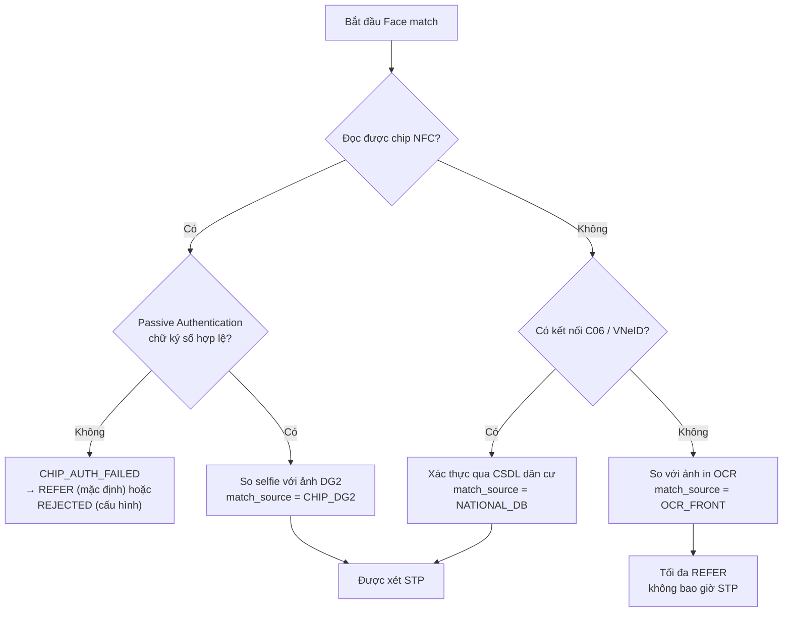

# C11 · Nguồn ảnh đối chiếu sinh trắc học

| | |
|---|---|
| Jira | [SCRUM-80](https://baohandao2303.atlassian.net/browse/SCRUM-80) · bị chặn bởi [SCRUM-71](https://baohandao2303.atlassian.net/browse/SCRUM-71) |
| BR / FR / RULE | BR-19 · FR-16 · RULE-14 · đáp ứng CR-02, CR-03, CR-04 |
| UI | Màn Quét chip (cảnh báo khi bỏ qua NFC), thẻ "Khuôn mặt" trong chi tiết hồ sơ |

## 1. Vấn đề

Hiện selfie được so với **ảnh in trên mặt trước CCCD** (chụp qua camera). Ảnh in có thể bị thay hoặc làm giả. Ảnh **DG2 trong chip** được ký số bởi cơ quan cấp, nên đáng tin hơn nhiều.

## 2. Quyết định nguồn ảnh

## 3. RULE-EKYC-14

| Ưu tiên | Nguồn | Điều kiện dùng | Kết quả tối đa |
|---|---|---|---|
| 1 | `CHIP_DG2` | NFC đọc được + Passive Authentication hợp lệ | STP_APPROVED |
| 2 | `NATIONAL_DB` | Không NFC, có kết nối C06/VNeID (chờ C02 xác nhận) | STP_APPROVED |
| 3 | `OCR_FRONT` | Không có hai nguồn trên | **REFER** |

**Thay đổi so với CR-001 (fallback OCR-only):** vẫn cho khách đi tiếp để không chặn người dùng máy không có NFC, nhưng hồ sơ luôn vào hàng đợi duyệt tay. Khách được báo trước điều này trên màn Quét chip.

## 4. Dữ liệu lưu cho mỗi phiên

| Trường | Kiểu | Ghi chú |
|---|---|---|
| `match_source` | enum | `CHIP_DG2` · `NATIONAL_DB` · `OCR_FRONT` |
| `face_match_score` | decimal(4,3) | |
| `chip_auth_result` | enum | `PASSED` · `FAILED` · `NOT_READ` |
| `chip_auth_certificate` | string | Mã chứng thư dùng để xác thực (phục vụ audit) |

## 5. Phụ thuộc mới

| Mã | Phụ thuộc | Chủ | Thêm vào |
|---|---|---|---|
| DEP-08 | Kết nối C06/VNeID (nếu được phép) | Solution Owner | SCRUM-56 |
| DEP-09 | Bộ chứng thư CSCA để xác thực chip | Security | SCRUM-56 |

## 6. Rủi ro

| Rủi ro | Ứng phó |
|---|---|
| Tỷ lệ máy không NFC cao → nhiều REFER, quá tải hàng đợi | Theo dõi KPI "Tỷ lệ NFC fallback" (C18); nếu > 25% cân nhắc ưu tiên DEP-08 |
| Dự án cá nhân không có quyền truy cập C06 | Dùng DG2 làm nguồn chính; C06 mô phỏng bằng mock có ghi rõ giới hạn (RAID R-02) |
