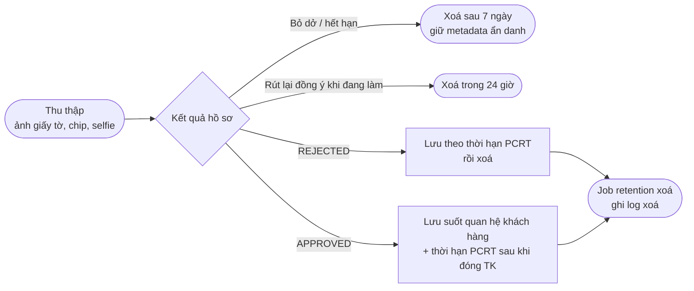
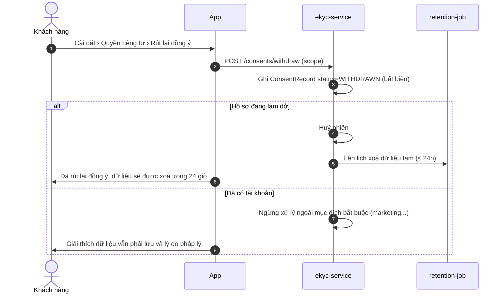

# C12 · Rút lại đồng ý & lưu trữ dữ liệu

| | |
|---|---|
| Mã tài liệu | AEG-EKYC-C12 |
| Phiên bản | 0.3 |
| Ngày phát hành | 26/11/2026 |
| Trạng thái | ✅ Đặc tả + màn Quyền riêng tư + backend · chờ Compliance chốt thời hạn lưu (C02 câu 3) |
| Phân loại | Nội bộ |
| Tác giả | Han Dao (BA) |
| Người duyệt | Compliance · Pháp chế – chưa duyệt |
| Mục đích và phạm vi | Đặc tả rút lại đồng ý và chính sách lưu trữ, xoá dữ liệu cá nhân trong eKYC |
| Chuẩn tham chiếu | ISO/IEC 29100 (đồng ý, giới hạn lưu trữ) · Luật 91/2025/QH15 – đánh giá ở [Q01](../../00-overview/Q01-standards-conformance.md) |
| Thuật ngữ | [G02 Thuật ngữ và chữ viết tắt](../../00-overview/G02-glossary.md) |
| Jira | [SCRUM-81](https://baohandao2303.atlassian.net/browse/SCRUM-81) · bị chặn bởi [SCRUM-71](https://baohandao2303.atlassian.net/browse/SCRUM-71) |
| BR / FR / RULE | BR-20 · FR-17 · RULE-15 · NFR-RET-01 · đáp ứng CR-07, CR-08, CR-12 |

## 1. Vòng đời dữ liệu cá nhân trong eKYC

## 2. Chính sách lưu trữ (đề xuất – chờ C02 chốt thời hạn)

| Loại dữ liệu | Tình huống | Thời hạn | Sau thời hạn |
|---|---|---|---|
| Ảnh giấy tờ, dữ liệu chip, selfie | Phiên bỏ dở / EXPIRED | 7 ngày | Xoá file, ẩn danh metadata |
| Ảnh giấy tờ, dữ liệu chip, selfie | REJECTED | Theo PCRT (*cần xác minh*) | Xoá |
| Toàn bộ hồ sơ KYC | APPROVED | Suốt quan hệ + thời hạn PCRT sau đóng TK | Xoá |
| Kết quả AML/PEP/CIC | Mọi trường hợp | Theo PCRT | Xoá; chỉ Compliance truy cập |
| Audit log | Mọi trường hợp | Không ngắn hơn thời hạn hồ sơ liên quan | Xoá theo lô |
| Metadata thống kê (đã ẩn danh) | Mọi trường hợp | Không giới hạn | — |

## 3. RULE-EKYC-15 · Rút lại đồng ý

| Scope | Rút lại được? | Hệ quả |
|---|---|---|
| `identity` (bắt buộc) | Được khi chưa có tài khoản | Huỷ hồ sơ, xoá dữ liệu tạm |
| `identity` (bắt buộc) | Đã có tài khoản | Không xoá dữ liệu thuộc nghĩa vụ lưu trữ; giải thích cho khách |
| `screening` (bắt buộc) | Như `identity` | Như `identity` |
| `marketing` (tuỳ chọn) | Luôn được | Ngừng gửi ưu đãi |

## 4. Job retention

| Thuộc tính | Giá trị |
|---|---|
| Lịch | Hằng ngày 03:00 |
| Phạm vi | Bản ghi có `retention_until < hôm nay` |
| Cách xoá | Xoá file trên Storage + xoá/ẩn danh cột PII trong DB |
| Báo cáo | Số bản ghi theo loại, thời gian chạy, lỗi; gửi kênh vận hành |
| Kiểm thử | Tạo dữ liệu có `retention_until` quá khứ → chạy job → kiểm tra file không còn, metadata đã ẩn danh, có log xoá |

## 5. Kiểm soát tài liệu

### Tài liệu tham chiếu

| Mã | Tài liệu |
|---|---|
| Q01 | [Q01 · Đối chiếu tài liệu 3 module với chuẩn quốc tế](../../00-overview/Q01-standards-conformance.md) |

Chuẩn quốc tế: xem trường *Chuẩn tham chiếu* ở đầu trang.

### Lịch sử phiên bản

| Phiên bản | Ngày | Người sửa | Commit | Thay đổi |
|---|---|---|---|---|
| 0.1 | 21/11/2026 | Han Dao | `51eaebb` | Bản đầu kèm diagram (Epic SCRUM-69) |
| 0.2 | 25/11/2026 | Han Dao | — | Thêm mục kiểm soát tài liệu (phiên bản, lịch sử, phê duyệt) theo ISO/IEC/IEEE 29148 và 29119-3 |
| 0.3 | 26/11/2026 | Han Dao | — | Chuẩn hoá cấu trúc theo ISO/IEC/IEEE 15289: khối thuộc tính đầu trang, tài liệu tham chiếu, thuật ngữ dùng chung (G02), mục kiểm soát tài liệu thống nhất |

### Phê duyệt

| Vai trò | Người | Ngày | Kết luận |
|---|---|---|---|
| BA (soạn) | Han Dao | 25/11/2026 | Trình duyệt |
| Compliance |  |  |  |
| Pháp chế |  |  |  |
