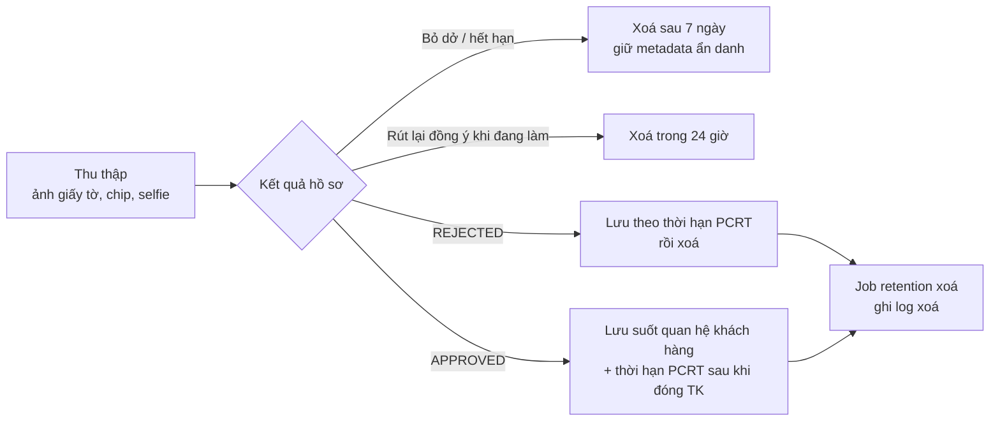
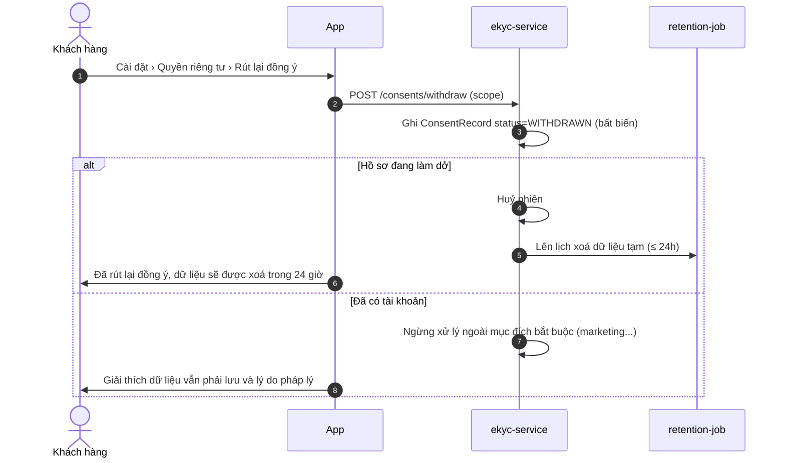

# C12 · Rút lại đồng ý & lưu trữ dữ liệu

| | |
|---|---|
| Jira | [SCRUM-81](https://baohandao2303.atlassian.net/browse/SCRUM-81) · bị chặn bởi [SCRUM-71](https://baohandao2303.atlassian.net/browse/SCRUM-71) |
| BR / FR / RULE | BR-20 · FR-17 · RULE-15 · NFR-RET-01 · đáp ứng CR-07, CR-08, CR-12 |

## 1. Vòng đời dữ liệu cá nhân trong eKYC

## 2. Chính sách lưu trữ (đề xuất – chờ C02 chốt thời hạn)

| Loại dữ liệu | Tình huống | Thời hạn | Sau thời hạn |
|---|---|---|---|
| Ảnh giấy tờ, dữ liệu chip, selfie | Phiên bỏ dở / EXPIRED | 7 ngày | Xoá file, ẩn danh metadata |
| Ảnh giấy tờ, dữ liệu chip, selfie | REJECTED | Theo PCRT (*cần xác minh*) | Xoá |
| Toàn bộ hồ sơ KYC | APPROVED | Suốt quan hệ + thời hạn PCRT sau đóng TK | Xoá |
| Kết quả AML/PEP/CIC | Mọi trường hợp | Theo PCRT | Xoá; chỉ Compliance truy cập |
| Audit log | Mọi trường hợp | Không ngắn hơn thời hạn hồ sơ liên quan | Xoá theo lô |
| Metadata thống kê (đã ẩn danh) | Mọi trường hợp | Không giới hạn | — |

## 3. RULE-EKYC-15 · Rút lại đồng ý

| Scope | Rút lại được? | Hệ quả |
|---|---|---|
| `identity` (bắt buộc) | Được khi chưa có tài khoản | Huỷ hồ sơ, xoá dữ liệu tạm |
| `identity` (bắt buộc) | Đã có tài khoản | Không xoá dữ liệu thuộc nghĩa vụ lưu trữ; giải thích cho khách |
| `screening` (bắt buộc) | Như `identity` | Như `identity` |
| `marketing` (tuỳ chọn) | Luôn được | Ngừng gửi ưu đãi |

## 4. Job retention

| Thuộc tính | Giá trị |
|---|---|
| Lịch | Hằng ngày 03:00 |
| Phạm vi | Bản ghi có `retention_until < hôm nay` |
| Cách xoá | Xoá file trên Storage + xoá/ẩn danh cột PII trong DB |
| Báo cáo | Số bản ghi theo loại, thời gian chạy, lỗi; gửi kênh vận hành |
| Kiểm thử | Tạo dữ liệu có `retention_until` quá khứ → chạy job → kiểm tra file không còn, metadata đã ẩn danh, có log xoá |
