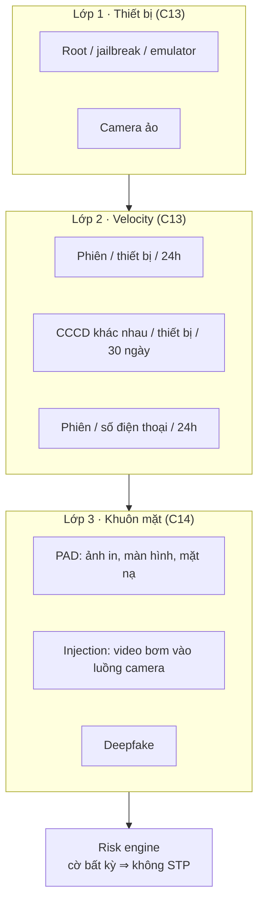
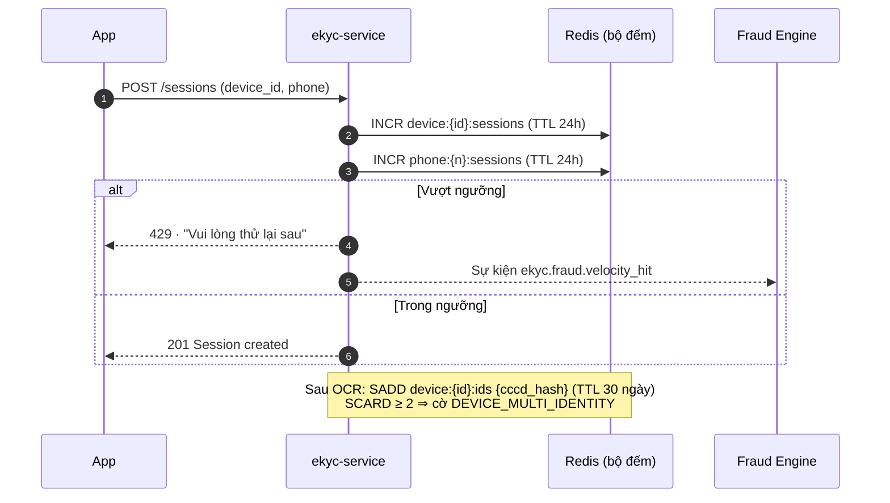

# C13–C14 · Chống gian lận: thiết bị, velocity & giả mạo khuôn mặt

| | |
|---|---|
| Phiên bản | 0.2 · 25/11/2026 · Han Dao (BA) |
| Trạng thái | 🔧 C13 velocity có backend · spike C14 chưa chạy |
| Jira | [SCRUM-82](https://baohandao2303.atlassian.net/browse/SCRUM-82) (C13 – Story) · [SCRUM-83](https://baohandao2303.atlassian.net/browse/SCRUM-83) (C14 – Spike) |
| BR / FR / RULE | BR-21 · FR-18 · RULE-16 |
| UI | Thẻ "Thiết bị" và lý do `DEVICE_MULTI_IDENTITY` trong Compliance; ngưỡng phiên/thiết bị trong Cấu hình ngưỡng |
| Chuẩn tham chiếu | IIBA BABOK v3 · ISO/IEC 30107-3 (spike C14) – đánh giá ở [Q01](../../00-overview/Q01-standards-conformance.md) |

Hai lớp phòng thủ bổ sung cho nhau: **C13** chặn người mở **nhiều hồ sơ**, **C14** chặn **một hồ sơ dùng khuôn mặt giả**.

## 1. Các lớp kiểm soát

## 2. C13 · RULE-EKYC-16

| Quy tắc | Ngưỡng mặc định | Hành động | Lý do (nội bộ) |
|---|---|---|---|
| Số phiên trên 1 thiết bị | Hơn 3 / 24h | Chặn tạo phiên 24h | `DEVICE_VELOCITY` |
| Số CCCD khác nhau trên 1 thiết bị | Từ 2 / 30 ngày | REFER | `DEVICE_MULTI_IDENTITY` |
| Số phiên trên 1 số điện thoại | Hơn 3 / 24h | Chặn tạm thời | `PHONE_VELOCITY` |
| Liveness thất bại liên tiếp trên 1 thiết bị | Từ 5 / 24h | Chặn thiết bị 24h, cảnh báo Fraud | `LIVENESS_ABUSE` |
| Root / jailbreak / emulator | Phát hiện | REFER, không STP | `DEVICE_RISK` |

**Khách chỉ thấy:** "Vui lòng thử lại sau" — không tiết lộ quy tắc nào đã kích hoạt.

**Dữ liệu thu thập** (`device_id` fingerprint, OS, phiên bản app, cờ root/emulator, IP, số điện thoại) phải nằm trong `consent_scope = identity` và được nêu trong DPIA.

### Luồng đánh giá velocity

## 3. C14 · Kế hoạch Spike chống giả mạo khuôn mặt

**Timebox:** 3 ngày · **Đầu ra:** báo cáo kết quả + quyết định G-03 + story khắc phục (nếu cần)

### Bộ mẫu kiểm thử

| Nhóm | Kịch bản | Số mẫu tối thiểu |
|---|---|---|
| Presentation – 2D | Ảnh in giấy A4, ảnh in giấy ảnh | 6 |
| Presentation – màn hình | Ảnh/video trên điện thoại, tablet, laptop | 6 |
| Presentation – 3D | Mặt nạ giấy cắt, mặt nạ silicon (nếu có) | 2 |
| Injection | Camera ảo (OBS/virtual cam), app đã sửa trên máy root | 4 |
| Deepfake | Video face-swap tạo sẵn | 2 |
| Người thật (đối chứng) | 10 người, nhiều điều kiện sáng | 20 |

### Chỉ số

| Chỉ số | Định nghĩa | Mục tiêu đề xuất |
|---|---|---|
| APCER | % tấn công bị chấp nhận nhầm | ≤ 5% |
| BPCER | % người thật bị từ chối nhầm | ≤ 5% |

### Tiêu chuẩn tham chiếu
ISO/IEC 30107-3 (đánh giá PAD); chứng nhận iBeta của nhà cung cấp liveness nếu có.

### Quyết định cần đưa ra
- G-03: có cần màn **Liveness Challenge** riêng (active liveness) không. Bản mẫu UI đang dùng active liveness với 4 thử thách ngẫu nhiên.
- Có bật phát hiện camera ảo ở lớp thiết bị (C13) không.

### Mẫu ghi kết quả

| # | Nhóm | Kịch bản | Thiết bị | Kết quả (PASS/FAIL hệ thống) | Kỳ vọng | Ghi chú |
|---|---|---|---|---|---|---|
| 1 | 2D | Ảnh in A4 | | | Bị chặn | |

## 4. Kiểm soát tài liệu

### Lịch sử phiên bản

| Phiên bản | Ngày | Người sửa | Commit | Thay đổi |
|---|---|---|---|---|
| 0.1 | 21/11/2026 | Han Dao | `51eaebb` | Bản đầu kèm diagram (Epic SCRUM-69) |
| 0.2 | 25/11/2026 | Han Dao | — | Thêm mục kiểm soát tài liệu (phiên bản, lịch sử, phê duyệt) theo ISO/IEC/IEEE 29148 và 29119-3 |

### Phê duyệt

| Vai trò | Người | Ngày | Kết luận |
|---|---|---|---|
| BA (soạn) | Han Dao | 25/11/2026 | Trình duyệt |
| Compliance | | | |
| Pháp chế | | | |
