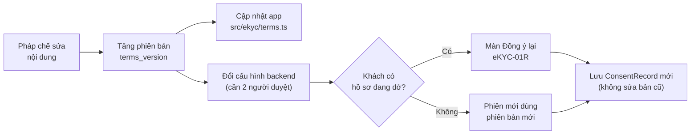

# P01 · Điều khoản, quyền riêng tư và cơ sở pháp lý – Module 1 eKYC

| | |
|---|---|
| Trạng thái | **Bản nháp v0.2 – chờ Pháp chế và Compliance duyệt** |
| Phiên bản điều khoản | `2026.11` · hiệu lực dự kiến 01/11/2026 |
| Dùng ở | Màn eKYC-01 / 01R (hộp thoại điều khoản), eKYC-14 (quyền riêng tư), thông báo SMS/Push (C08) |
| Nguồn trong code | `src/ekyc/terms.ts` (nội dung hiển thị) · `server/src/config.ts` → `terms_version` |
| Liên quan | [C02 Compliance Mapping](C02-compliance-mapping.md) · [C12 Rút lại đồng ý & lưu trữ](C12-consent-retention.md) · [C07–C09 Thông báo](../1.1-business/C07-C09-refer-handling.md) |
| Jira | SCRUM-17, 46, 71, 81 |

> ⚠️ Nội dung điều khoản là bản BA soạn để làm giao diện và kiểm thử. Số hiệu văn bản ở mục 4 lấy theo C02 và **phải được Pháp chế đối chiếu bản gốc, tình trạng hiệu lực** trước khi phát hành.

## 1. Quy trình quản lý điều khoản

| Quy tắc | Chi tiết |
|---|---|
| Phiên bản | Dạng `YYYY.MM`; mỗi lần sửa nội dung là một phiên bản mới |
| Khớp nhau | Phiên bản hiển thị trên app phải bằng `terms_version` của backend; nếu lệch, backend từ chối (`TERMS_OUTDATED`) |
| Bằng chứng | Mỗi lần đồng ý / rút lại là một bản ghi `consents` mới: phạm vi, trạng thái, phiên bản, thời điểm. Không sửa, không xoá |
| Lưu bản cũ | Giữ nguyên văn mọi phiên bản đã phát hành để đối chiếu khi có tranh chấp |

## 2. Điều khoản mở tài khoản trực tuyến (phiên bản 2026.11)

**1. Phạm vi.** Điều khoản này áp dụng khi bạn mở tài khoản thanh toán Aegis Bank qua ứng dụng, bằng CCCD gắn chip, thẻ Căn cước hoặc hộ chiếu gắn chip. Bạn phải là chủ giấy tờ, tự thực hiện các bước và đủ tuổi theo quy định của sản phẩm.

**2. Dữ liệu chúng tôi thu thập.** Ảnh giấy tờ; dữ liệu đọc từ chip (họ tên, số định danh, ngày sinh, ảnh khuôn mặt trong chip); ảnh và video khuôn mặt khi xác thực; thông tin thiết bị và số điện thoại. Dữ liệu sinh trắc học là dữ liệu cá nhân nhạy cảm và chỉ dùng để xác minh danh tính.

**3. Mục đích và phạm vi đồng ý.**
- *Bắt buộc – Xử lý dữ liệu định danh:* xác minh giấy tờ, đối chiếu khuôn mặt, phát hiện gian lận.
- *Bắt buộc – Tra cứu tín dụng và kiểm tra tuân thủ:* tra cứu CIC, sàng lọc phòng, chống rửa tiền, danh sách cấm và người có ảnh hưởng chính trị.
- *Tuỳ chọn – Nhận ưu đãi:* gửi thông tin sản phẩm phù hợp. Không chọn mục này không ảnh hưởng đến việc mở tài khoản.

**4. Kết quả xét duyệt.** Hồ sơ có thể được duyệt tự động, chuyển nhân viên xem xét (thường trong 24 giờ) hoặc chưa được chấp nhận. Chúng tôi có thể đề nghị bạn chụp bổ sung giấy tờ; nếu không bổ sung trong 5 ngày, hồ sơ sẽ bị huỷ. Vì lý do an ninh, chúng tôi không nêu chi tiết lý do của một số quyết định.

**5. Thời gian lưu trữ.** Hồ sơ bỏ dở: xoá sau 7 ngày. Rút lại đồng ý khi chưa có tài khoản: xoá trong 24 giờ. Hồ sơ đã mở tài khoản hoặc bị từ chối: lưu theo thời hạn pháp luật về phòng, chống rửa tiền, sau đó xoá hoặc ẩn danh.

**6. Quyền của bạn.** Bạn có quyền xem, yêu cầu sửa, rút lại đồng ý và yêu cầu xoá dữ liệu trong phạm vi pháp luật cho phép, tại Cài đặt › Quyền riêng tư hoặc qua tổng đài 1900 6868. Khi đã có tài khoản, dữ liệu định danh vẫn phải được lưu theo quy định; chúng tôi ngừng mọi xử lý ngoài mục đích bắt buộc.

**7. Bảo mật.** Dữ liệu được mã hoá khi truyền và khi lưu, chỉ nhân viên được phân quyền mới xem được, mọi lần xem đều được ghi nhật ký. Ngân hàng không bao giờ yêu cầu bạn cung cấp mật khẩu hay mã OTP qua điện thoại hoặc tin nhắn.

**8. Liên hệ.** Tổng đài 1900 6868 (8:00–20:00) hoặc bất kỳ chi nhánh Aegis Bank nào.

Bản tiếng Anh nằm trong `src/ekyc/terms.ts` và phải được dịch thuật chính thức trước khi phát hành.

## 3. Thông báo quyền riêng tư – bảng phạm vi đồng ý

| Phạm vi (`scope`) | Bắt buộc | Mục đích | Dữ liệu | Rút lại được? | Hệ quả khi rút |
|---|---|---|---|---|---|
| `identity` | Có | Xác minh danh tính, chống gian lận | Ảnh giấy tờ, dữ liệu chip, ảnh/video khuôn mặt, thiết bị, số điện thoại | Có | Chưa có TK: huỷ hồ sơ, xoá trong 24h. Đã có TK: giữ theo nghĩa vụ lưu trữ, ngừng xử lý ngoài mục đích bắt buộc |
| `screening` | Có | Tra cứu tín dụng, phòng chống rửa tiền | Họ tên, số định danh, ngày sinh, kết quả CIC/AML/PEP | Không tách riêng trên app (đi cùng `identity`) | Như `identity` |
| `marketing` | Không | Gửi ưu đãi | Số điện thoại, sản phẩm đang dùng | Có, bất kỳ lúc nào | Ngừng gửi ưu đãi |

### Thời hạn lưu trữ (đề xuất – chờ C02 chốt)

| Loại dữ liệu | Tình huống | Thời hạn | Tham số hệ thống |
|---|---|---|---|
| Ảnh, dữ liệu chip, ảnh khuôn mặt | Phiên bỏ dở / hết hạn | 7 ngày | `expire_after_days` |
| Toàn bộ hồ sơ | Rút lại đồng ý khi chưa có TK | 24 giờ | `retention_withdrawn_hours` |
| Toàn bộ hồ sơ | Bị từ chối | Theo luật PCRT (*đề xuất 5 năm – cần xác minh*) | `retention_rejected_days` = 1825 |
| Toàn bộ hồ sơ | Đã mở tài khoản | Suốt quan hệ + thời hạn PCRT sau khi đóng TK | — |
| Nhật ký thao tác | Mọi trường hợp | Không ngắn hơn hồ sơ liên quan | — |
| Số liệu thống kê đã ẩn danh | Mọi trường hợp | Không giới hạn | — |

## 4. Cơ sở pháp lý

| Mã | Văn bản (theo C02) | Nội dung áp dụng cho module 1 | Đáp ứng trong hệ thống | Cần xác minh |
|---|---|---|---|---|
| L-01 | Quy định NHNN về mở và sử dụng tài khoản thanh toán (vd. Thông tư 17/2024/TT-NHNN) | Mở TK bằng phương thức điện tử; giấy tờ còn hiệu lực; đối chiếu sinh trắc với dữ liệu chip / CSDL dân cư; người nước ngoài cần giấy tờ hợp lệ | Chip DG2 là nguồn so khớp (C11); OCR-only tối đa REFER; kiểm tra hạn giấy tờ; hộ chiếu nước ngoài luôn REFER | Điều khoản cụ thể; yêu cầu thị thực/thẻ tạm trú với người nước ngoài |
| L-02 | Quy định NHNN về an toàn giao dịch trực tuyến, xác thực sinh trắc (vd. Quyết định 2345/QĐ-NHNN) | Xác thực sinh trắc khi giao dịch | Ngoài phạm vi bước mở TK; dữ liệu DG2 lưu để dùng sau | Phạm vi áp dụng cho bước mở TK |
| L-03 | Nghị định 13/2023/NĐ-CP về bảo vệ dữ liệu cá nhân và Luật Bảo vệ dữ liệu cá nhân | Đồng ý theo mục đích; dữ liệu sinh trắc là dữ liệu nhạy cảm; quyền rút lại; xoá khi hết mục đích; đánh giá tác động (DPIA) | Đồng ý theo 3 phạm vi; đồng ý lại khi đổi điều khoản; màn eKYC-14; job xoá dữ liệu; nhật ký | Văn bản đang có hiệu lực; thời hạn phản hồi yêu cầu của chủ thể dữ liệu |
| L-04 | Luật Phòng, chống rửa tiền 2022 và văn bản hướng dẫn | Nhận biết khách hàng; PEP, danh sách cấm; cấp có thẩm quyền duyệt khách rủi ro cao; lưu hồ sơ | Sàng lọc AML/PEP; Maker-Checker cho PEP/Sanction/rủi ro ≥ 70; audit bất biến; tham số lưu trữ | Thời hạn lưu hồ sơ KYC |
| L-05 | Bộ luật Dân sự và quy định sản phẩm | Độ tuổi tối thiểu | Tham số `min_age_payment` 15, `min_age_credit` 18 | Ngưỡng tuổi từng sản phẩm |
| L-06 | Luật Căn cước 2023 | Thẻ Căn cước mẫu mới dùng song song với CCCD | eKYC-02 chấp nhận cả hai loại thẻ | Giá trị của CCCD cũ còn hạn |
| L-07 | Quy định về hộ chiếu gắn chip của công dân Việt Nam | Hộ chiếu có in số định danh cá nhân | Tra trùng hộ chiếu VN theo số định danh | Cách đọc số định danh từ chip hộ chiếu |

## 5. Nội dung gửi khách (C08)

| Mẫu | Kênh | Nội dung tiếng Việt (bản nháp) |
|---|---|---|
| `EKYC_APPROVED` | Push + SMS | Aegis Bank: Mở tài khoản thành công. Số tài khoản {account_no}. Không chia sẻ mã OTP cho bất kỳ ai. |
| `EKYC_UNDER_REVIEW` | Push | Hồ sơ mở tài khoản của bạn đang được xem xét. Chúng tôi sẽ báo kết quả trong vòng 24 giờ. |
| `EKYC_REJECTED` | Push + SMS | Aegis Bank: Hiện chưa thể mở tài khoản trực tuyến cho bạn. Vui lòng đến chi nhánh gần nhất hoặc gọi 1900 6868. |
| `EKYC_INFO_REQUESTED` | Push + SMS | Aegis Bank: Vui lòng bổ sung {hạng mục} trước {hạn} để hoàn tất mở tài khoản: {deep link} |
| `EKYC_INFO_REMINDER` | Push | Còn 1 ngày để bổ sung hồ sơ mở tài khoản. Quá hạn, hồ sơ sẽ bị huỷ. |
| `EKYC_EXPIRED` | Push + SMS | Aegis Bank: Hồ sơ mở tài khoản đã bị huỷ do quá hạn bổ sung. Bạn có thể đăng ký lại bất cứ lúc nào. |

Quy tắc: không nhắc AML, PEP, CIC, "gian lận"; không chứa số giấy tờ; SMS ≤ 160 ký tự không dấu hoặc 70 ký tự có dấu mỗi tin.

## 6. Câu hỏi cho Pháp chế / Compliance

| # | Câu hỏi | Ảnh hưởng |
|---|---|---|
| 1 | Văn bản và điều khoản chính xác ở mục 4 còn hiệu lực không? | P01, C02, C03 |
| 2 | Thời hạn lưu hồ sơ KYC sau khi đóng TK và với hồ sơ bị từ chối? | `retention_rejected_days`, C12 |
| 3 | Người nước ngoài mở TK trực tuyến cần thêm giấy tờ gì (thị thực, thẻ tạm trú)? Có được mở hoàn toàn trực tuyến không? | Luồng hộ chiếu nước ngoài, eKYC-11 |
| 4 | Nội dung điều khoản mục 2 cần bổ sung gì (giới hạn trách nhiệm, giải quyết tranh chấp, luật áp dụng)? | `src/ekyc/terms.ts` |
| 5 | Có cần lưu bản ký số / dấu thời gian cho mỗi lần đồng ý không? | Bảng `consents` |
| 6 | Danh sách bên nhận dữ liệu cần nêu trong thông báo quyền riêng tư (CIC, nhà cung cấp AML, nhà cung cấp sinh trắc, Core Banking, nhà mạng gửi SMS)? | Mục 3, `terms.ts` §3 |
| 7 | Nếu đặt database hoặc nhà cung cấp sinh trắc ngoài Việt Nam (vd. cloud Singapore), cần hồ sơ đánh giá tác động chuyển dữ liệu ra nước ngoài và nêu trong điều khoản không? | Chọn nơi lưu dữ liệu, mục 2 |
| 8 | Đầu mối bảo vệ dữ liệu cá nhân là ai, và thời hạn trả lời yêu cầu của khách (xem, sửa, xoá) là bao lâu? | Mục 2 §6, §8; màn eKYC-14 |

## 7. Phê duyệt

| Vai trò | Họ tên | Ngày | Kết luận |
|---|---|---|---|
| Pháp chế | | | |
| Compliance | | | |
| Product Owner | | | |
