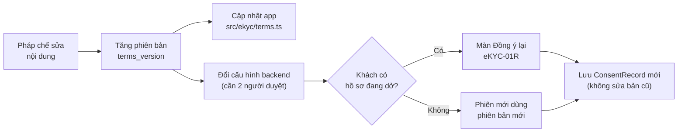

# P01 · Điều khoản, quyền riêng tư và cơ sở pháp lý – Module 1 eKYC

| | |
|---|---|
| Trạng thái | **Bản nháp v0.4 – chờ Pháp chế và Compliance duyệt** (25/11: rà soát lại theo Luật 91/2025/QH15 và NĐ 356/2025, xem mục 0) |
| Phiên bản điều khoản | Đang hiển thị trên app: `2026.11` (bản cũ, chưa duyệt). Bản đề xuất trong tài liệu này: **`2026.12`**, hiệu lực từ ngày Pháp chế duyệt |
| Dùng ở | Màn eKYC-01 / 01R (hộp thoại điều khoản), eKYC-14 (quyền riêng tư), thông báo SMS/Push (C08) |
| Nguồn trong code | `src/ekyc/terms.ts` (nội dung hiển thị) · `server/src/config.ts` → `terms_version` |
| Liên quan | [C02 Compliance Mapping](C02-compliance-mapping.md) · [C12 Rút lại đồng ý & lưu trữ](C12-consent-retention.md) · [C07–C09 Thông báo](../1.1-business/C07-C09-refer-handling.md) |
| Jira | SCRUM-17, 46, 71, 81 |

> ⚠️ Nội dung điều khoản là bản BA soạn để làm giao diện và kiểm thử. Số hiệu và điều khoản văn bản ở mục 4 **phải được Pháp chế đối chiếu bản gốc, tình trạng hiệu lực** trước khi phát hành. Mục 0 dựa trên tóm tắt của các trang pháp luật và công ty luật, chưa đối chiếu toàn văn.

## 0. Kết quả rà soát 25/11/2026

Rà soát toàn bộ P01 và bản điều khoản đang chạy trên app (`src/ekyc/terms.ts`, phiên bản `2026.11`) với: Luật Bảo vệ dữ liệu cá nhân số 91/2025/QH15 (hiệu lực 01/01/2026), Nghị định 356/2025/NĐ-CP (hiệu lực 01/01/2026, thay Nghị định 13/2023/NĐ-CP), hành vi thật của `ekyc-service` và từ điển dữ liệu D01.

| Mã | Mức | Vấn đề | Bằng chứng | Đã sửa trong bản 2026.12 | Ai chốt |
|---|---|---|---|---|---|
| PR-01 | 🔴 Nghiêm trọng | Cơ sở pháp lý đã lỗi thời: P01, C02, D01, Q01 vẫn dẫn **Nghị định 13/2023**, văn bản này không còn hiệu lực từ 01/01/2026. Điều khoản phát hành tháng 11–12/2026 phải dẫn luật mới | Luật 91/2025/QH15 hiệu lực 01/01/2026; NĐ 356/2025/NĐ-CP thay NĐ 13/2023 từ cùng ngày | §4 L-03, §4.1, §6; sửa tham chiếu trong C02, D01, Q01 | Pháp chế xác nhận số điều |
| PR-02 | 🔴 Nghiêm trọng | Khách **15 tuổi** được mở tài khoản (`min_age_payment = 15`) nhưng người dưới 16 tuổi là trẻ em (Luật Trẻ em 2016). Theo Luật 91/2025 (Điều 19), với trẻ em, người đại diện theo pháp luật thực hiện quyền của chủ thể dữ liệu. App không có bước nào cho người đại diện, và sinh trắc là dữ liệu nhạy cảm | `server/src/config.ts`: `min_age_payment: 15`; C04–C05 RULE-EKYC-10 | Điều khoản §1 tạm ghi "từ đủ 16 tuổi"; đề xuất đổi tham số thành 16 cho kênh trực tuyến tới khi có luồng người đại diện | Pháp chế + PO |
| PR-03 | 🟠 Cao | Tra cứu CIC, sàng lọc AML/PEP và việc lưu hồ sơ theo luật phòng, chống rửa tiền được trình bày là **"đồng ý bắt buộc"**, nhưng khách lại không rút được – trái với bản chất của sự đồng ý. Đây là xử lý để thực hiện **nghĩa vụ pháp luật**, nên thông báo thay vì xin đồng ý | P01 §3 dòng `screening` "Không tách riêng trên app" | §2 mục 3 tách "Căn cứ xử lý": đồng ý (sinh trắc, ưu đãi) và nghĩa vụ pháp luật (PCRT, CIC, lưu hồ sơ); §3 thêm cột căn cứ | Pháp chế xác nhận trường hợp xử lý không cần đồng ý trong Luật 91 |
| PR-04 | 🟠 Cao | Điều khoản hứa "hồ sơ bỏ dở **xoá** sau 7 ngày", "rút lại đồng ý **xoá** trong 24 giờ", nhưng hệ thống vẫn giữ `device_id`, `id_number_hash` (chống mở hồ sơ lặp lại), bộ đếm velocity 30 ngày và nhật ký thao tác. Khách không được báo | D01 §5 (24/11); `purgePersonalData` trong `server/src/service.ts` | §2 mục 6 nêu rõ dữ liệu còn giữ, mục đích và thời hạn (đề xuất 30 ngày, khớp cửa sổ dài nhất của C13) | DPO (D01 §7 câu 1–2) |
| PR-05 | 🟠 Cao | Điều khoản **không nêu bên nhận dữ liệu** và việc gửi dữ liệu ra nước ngoài. Ít nhất thông báo Push đi qua Apple/Google (máy chủ ở nước ngoài); nơi đặt database và nhà cung cấp AML/sinh trắc chưa chốt | §4.1 R-01 → R-07 chưa đưa vào §2 | §2 thêm mục 5 "Chia sẻ dữ liệu" và câu về chuyển dữ liệu ra nước ngoài | Pháp chế + Solution Owner |
| PR-06 | 🟡 Trung bình | Danh sách quyền của khách thiếu: **hạn chế xử lý, phản đối xử lý, nhận bản sao dữ liệu, khiếu nại/khởi kiện, yêu cầu bồi thường** | Luật 91/2025 Điều 4 (quyền của chủ thể dữ liệu) | §2 mục 7 | Pháp chế |
| PR-07 | 🟡 Trung bình | Danh sách dữ liệu thu thập thiếu: quốc tịch, ngày hết hạn giấy tờ, địa chỉ IP, mã thiết bị, cờ máy đã root / giả lập (C13), kết quả CIC và sàng lọc | C13 §2; D01 bảng `ekyc_sessions`, `velocity_events` | §2 mục 2 | — |
| PR-08 | 🟡 Trung bình | Hồ sơ có thể bị **từ chối tự động** nhưng điều khoản không cho khách cách yêu cầu người xem xét lại. Không phải nghĩa vụ đã xác định trong Luật 91 – đề xuất theo thông lệ tốt (ISO/IEC 29100, nguyên tắc minh bạch) | P01 §2 mục 4 cũ | §2 mục 4: khách được yêu cầu nhân viên xem xét lại qua tổng đài hoặc chi nhánh | PO + Compliance |
| PR-09 | 🟡 Trung bình | Chưa có **đầu mối bảo vệ dữ liệu cá nhân** (bộ phận/nhân sự, email). NĐ 356/2025 có quy định về nhân sự bảo vệ dữ liệu; ngân hàng xử lý dữ liệu sinh trắc và tín dụng | §4.1 "Chờ ngân hàng chỉ định" | §2 mục 9 để chỗ trống `{email DPO}` | Ngân hàng |
| PR-10 | 🟡 Trung bình | Thời hạn trả lời yêu cầu của khách vẫn ghi "theo luật định". NĐ 356/2025 quy định thời hạn cụ thể theo từng loại yêu cầu, thay mốc 72 giờ của NĐ 13 | Câu hỏi 8 mục 6 | Chưa điền – chờ Pháp chế đưa con số | Pháp chế |
| PR-11 | 🟡 Trung bình | NĐ 356/2025 mở rộng danh mục **dữ liệu nhạy cảm** (theo các bản tóm tắt: thêm tài khoản, lịch sử giao dịch tài chính). Số tài khoản trong SMS `EKYC_APPROVED` và bảng `accounts` có thể phải nâng mức nhạy cảm | Mục 5 mẫu `EKYC_APPROVED`; D01 | Thêm câu hỏi 12 ở mục 6 và câu hỏi cho DPO ở D01 | Pháp chế + DPO |
| PR-12 | ⚪ Thấp | Ngày hiệu lực "01/11/2026" đã qua mà bản này chưa được duyệt | Thông tin đầu trang | Bản 2026.12 hiệu lực theo ngày duyệt | — |
| PR-13 | ⚪ Thấp | Thiếu luật áp dụng, cách giải quyết tranh chấp, cách báo khi điều khoản thay đổi | Câu hỏi 4 mục 6 | §2 mục 10 | Pháp chế |

**App chưa đổi.** Màn eKYC-01 vẫn hiện bản `2026.11`. Khi Pháp chế duyệt bản 2026.12: cập nhật `src/ekyc/terms.ts` và `terms_version` (cần 2 người duyệt, mục 1), đổi `min_age_payment` nếu PR-02 được chốt, rồi khách có hồ sơ dở sẽ được hỏi đồng ý lại (eKYC-01R).

## 1. Quy trình quản lý điều khoản

| Quy tắc | Chi tiết |
|---|---|
| Phiên bản | Dạng `YYYY.MM`; mỗi lần sửa nội dung là một phiên bản mới |
| Khớp nhau | Phiên bản hiển thị trên app phải bằng `terms_version` của backend; nếu lệch, backend từ chối (`TERMS_OUTDATED`) |
| Bằng chứng | Mỗi lần đồng ý / rút lại là một bản ghi `consents` mới: phạm vi, trạng thái, phiên bản, thời điểm. Không sửa, không xoá |
| Lưu bản cũ | Giữ nguyên văn mọi phiên bản đã phát hành để đối chiếu khi có tranh chấp |

## 2. Điều khoản mở tài khoản trực tuyến (bản đề xuất 2026.12)

Chữ trong `{…}` là chỗ Pháp chế hoặc ngân hàng điền. So với bản 2026.11 trên app: mục 1, 2, 3, 4, 6, 7 sửa; mục 5, 9, 10 mới.

**1. Phạm vi.** Điều khoản này áp dụng khi bạn mở tài khoản thanh toán Aegis Bank qua ứng dụng, bằng CCCD gắn chip, thẻ Căn cước hoặc hộ chiếu gắn chip. Bạn phải là chủ giấy tờ, tự thực hiện các bước và **từ đủ 16 tuổi** *(chờ Pháp chế chốt – PR-02)*. Người chưa đủ tuổi vui lòng mở tài khoản tại chi nhánh cùng người đại diện theo pháp luật.

**2. Dữ liệu chúng tôi thu thập.**
- Từ giấy tờ và chip: họ tên, số định danh hoặc số hộ chiếu, ngày sinh, giới tính, quốc tịch, ngày hết hạn, ảnh khuôn mặt lưu trong chip.
- Khi xác thực: ảnh giấy tờ, ảnh và video khuôn mặt, điểm so khớp khuôn mặt.
- Từ thiết bị: mã thiết bị, hệ điều hành, phiên bản ứng dụng, địa chỉ IP, dấu hiệu máy đã bị can thiệp (root, jailbreak, giả lập).
- Số điện thoại bạn nhập.
- Kết quả tra cứu tín dụng (CIC) và kết quả sàng lọc phòng, chống rửa tiền.

Dữ liệu sinh trắc học và thông tin tín dụng là **dữ liệu cá nhân nhạy cảm**.

**3. Mục đích và căn cứ xử lý.**
- *Cần bạn đồng ý – Xác minh danh tính bằng sinh trắc học:* đối chiếu khuôn mặt với ảnh trong chip, phát hiện giả mạo và gian lận. Không đồng ý thì không mở được tài khoản trực tuyến; bạn vẫn có thể mở tại chi nhánh.
- *Theo quy định pháp luật, không cần bạn đồng ý – Nhận biết khách hàng:* tra cứu CIC; sàng lọc phòng, chống rửa tiền, danh sách cấm vận và người có ảnh hưởng chính trị; lưu hồ sơ nhận biết khách hàng theo thời hạn luật định. *(Pháp chế xác nhận căn cứ – PR-03)*
- *Tuỳ chọn – Nhận ưu đãi:* gửi thông tin sản phẩm phù hợp. Không chọn mục này không ảnh hưởng việc mở tài khoản; bạn tắt được bất kỳ lúc nào.

**4. Kết quả xét duyệt.** Hồ sơ có thể được hệ thống duyệt tự động, chuyển nhân viên xem xét (thường trong 24 giờ) hoặc chưa được chấp nhận. Chúng tôi có thể đề nghị bạn chụp bổ sung giấy tờ; nếu không bổ sung trong 5 ngày, hồ sơ bị huỷ. Vì lý do an ninh, chúng tôi không nêu chi tiết lý do của một số quyết định. Nếu hồ sơ bị từ chối, bạn có thể đề nghị nhân viên xem xét lại qua tổng đài hoặc tại chi nhánh.

**5. Chia sẻ dữ liệu.** Chúng tôi chỉ gửi dữ liệu cần thiết cho: Trung tâm Thông tin tín dụng Quốc gia (CIC); nhà cung cấp dịch vụ sàng lọc phòng, chống rửa tiền `{tên}`; nhà cung cấp công nghệ xác thực khuôn mặt `{tên}`; nhà cung cấp hạ tầng lưu trữ `{tên, nơi đặt}`; nhà mạng gửi tin nhắn; Apple và Google để gửi thông báo trên ứng dụng. Mỗi bên chỉ được dùng dữ liệu cho mục đích chúng tôi giao và phải xoá khi hết mục đích. Thông báo trên ứng dụng đi qua máy chủ của Apple/Google ở nước ngoài nên **không chứa** họ tên, số giấy tờ hay số tài khoản. `{Nếu dữ liệu được lưu hoặc xử lý ở nước ngoài: nêu nước, bên nhận và việc đã lập hồ sơ đánh giá tác động chuyển dữ liệu theo quy định – PR-05}`

**6. Thời gian lưu trữ.**
- Hồ sơ bỏ dở: xoá ảnh, dữ liệu giấy tờ và sinh trắc sau 7 ngày.
- Rút lại đồng ý khi chưa có tài khoản: xoá trong 24 giờ.
- Để ngăn một người mở nhiều hồ sơ, chúng tôi giữ mã thiết bị và mã băm một chiều của số giấy tờ (không khôi phục được số gốc) trong `{30 ngày – chờ DPO, PR-04}`; nhật ký thao tác được giữ theo thời hạn của hồ sơ liên quan.
- Hồ sơ đã mở tài khoản hoặc bị từ chối: lưu theo thời hạn pháp luật về phòng, chống rửa tiền, sau đó xoá hoặc ẩn danh.

**7. Quyền của bạn.** Bạn có quyền: được biết về việc xử lý dữ liệu; đồng ý, không đồng ý hoặc rút lại đồng ý; xem và nhận bản sao dữ liệu; yêu cầu sửa; yêu cầu xoá; yêu cầu hạn chế xử lý; phản đối xử lý; khiếu nại, tố cáo, khởi kiện và yêu cầu bồi thường theo quy định. Thực hiện tại Cài đặt › Quyền riêng tư, tổng đài 1900 6868 hoặc chi nhánh. Chúng tôi trả lời trong `{thời hạn theo NĐ 356/2025 – PR-10}`. Dữ liệu xử lý theo nghĩa vụ pháp luật (mục 3) vẫn được lưu theo thời hạn luật định dù bạn rút lại đồng ý; khi đó chúng tôi ngừng mọi xử lý khác.

**8. Bảo mật.** Dữ liệu được mã hoá khi truyền và khi lưu; chỉ nhân viên được phân quyền mới xem được và mọi lần xem đều được ghi nhật ký. Nếu xảy ra sự cố lộ dữ liệu ảnh hưởng đến bạn, chúng tôi sẽ thông báo theo quy định. Ngân hàng không bao giờ yêu cầu bạn cung cấp mật khẩu hay mã OTP qua điện thoại hoặc tin nhắn.

**9. Liên hệ.** Tổng đài 1900 6868 (8:00–20:00), chi nhánh Aegis Bank, hoặc bộ phận bảo vệ dữ liệu cá nhân: `{email DPO – PR-09}`.

**10. Thay đổi điều khoản và luật áp dụng.** Khi điều khoản thay đổi, ứng dụng sẽ hiện bản mới và hỏi bạn đồng ý lại trước khi tiếp tục. Điều khoản này tuân theo pháp luật Việt Nam; `{cách giải quyết tranh chấp – PR-13}`.

Bản tiếng Anh phải được dịch thuật chính thức trước khi phát hành. Bản 2026.11 đang chạy trên app nằm ở `src/ekyc/terms.ts`.

## 3. Thông báo quyền riêng tư – bảng phạm vi đồng ý

| Phạm vi (`scope`) | Căn cứ xử lý (đề xuất 2026.12) | Bắt buộc để mở TK trực tuyến | Mục đích | Dữ liệu | Rút lại được? | Hệ quả khi rút |
|---|---|---|---|---|---|---|
| `identity` | Đồng ý của khách | Có | Xác minh danh tính bằng sinh trắc, chống gian lận | Ảnh giấy tờ, dữ liệu chip, ảnh/video khuôn mặt, thiết bị, IP, số điện thoại | Có | Chưa có TK: huỷ hồ sơ, xoá trong 24h (trừ dữ liệu chống gian lận ở §2 mục 6). Đã có TK: giữ theo nghĩa vụ lưu trữ, ngừng xử lý khác |
| `screening` | **Nghĩa vụ pháp luật** (PCRT, nhận biết khách hàng) – không xin đồng ý, chỉ thông báo (PR-03) | Có | Tra cứu tín dụng, phòng chống rửa tiền | Họ tên, số định danh, ngày sinh, quốc tịch, kết quả CIC/AML/PEP | Không áp dụng (không dựa trên đồng ý) | — |
| `marketing` | Đồng ý của khách | Không | Gửi ưu đãi | Số điện thoại, sản phẩm đang dùng | Có, bất kỳ lúc nào | Ngừng gửi ưu đãi |

Nếu Pháp chế chốt PR-03: app bỏ ô tick `screening` ở màn đồng ý và thay bằng một đoạn thông báo; backend vẫn ghi nhận khách đã được thông báo (phiên bản điều khoản, thời điểm) để làm bằng chứng.

### Thời hạn lưu trữ (đề xuất – chờ C02 chốt)

| Loại dữ liệu | Tình huống | Thời hạn | Tham số hệ thống |
|---|---|---|---|
| Ảnh, dữ liệu chip, ảnh khuôn mặt | Phiên bỏ dở / hết hạn | 7 ngày | `expire_after_days` |
| Mã thiết bị, mã băm số giấy tờ, bộ đếm velocity | Mọi phiên (chống mở hồ sơ lặp lại – C13) | Velocity: 30 ngày (đã chạy). Mã thiết bị, mã băm: *đề xuất 30 ngày – chờ DPO* | Job `retention` |
| Toàn bộ hồ sơ | Rút lại đồng ý khi chưa có TK | 24 giờ | `retention_withdrawn_hours` |
| Toàn bộ hồ sơ | Bị từ chối | Theo luật PCRT (*đề xuất 5 năm – cần xác minh*) | `retention_rejected_days` = 1825 |
| Toàn bộ hồ sơ | Đã mở tài khoản | Suốt quan hệ + thời hạn PCRT sau khi đóng TK | — |
| Nhật ký thao tác | Mọi trường hợp | Không ngắn hơn hồ sơ liên quan | — |
| Số liệu thống kê đã ẩn danh | Mọi trường hợp | Không giới hạn | — |

## 4. Cơ sở pháp lý

| Mã | Văn bản (theo C02) | Nội dung áp dụng cho module 1 | Đáp ứng trong hệ thống | Cần xác minh |
|---|---|---|---|---|
| L-01 | Quy định NHNN về mở và sử dụng tài khoản thanh toán (vd. Thông tư 17/2024/TT-NHNN) | Mở TK bằng phương thức điện tử; giấy tờ còn hiệu lực; đối chiếu sinh trắc với dữ liệu chip / CSDL dân cư; người nước ngoài cần giấy tờ hợp lệ | Chip DG2 là nguồn so khớp (C11); OCR-only tối đa REFER; kiểm tra hạn giấy tờ; hộ chiếu nước ngoài luôn REFER | Điều khoản cụ thể; yêu cầu thị thực/thẻ tạm trú với người nước ngoài |
| L-02 | Quy định NHNN về an toàn giao dịch trực tuyến, xác thực sinh trắc (vd. Quyết định 2345/QĐ-NHNN) | Xác thực sinh trắc khi giao dịch | Ngoài phạm vi bước mở TK; dữ liệu DG2 lưu để dùng sau | Phạm vi áp dụng cho bước mở TK |
| L-03 | **Luật Bảo vệ dữ liệu cá nhân số 91/2025/QH15** (hiệu lực 01/01/2026) và **Nghị định 356/2025/NĐ-CP** hướng dẫn (hiệu lực 01/01/2026, thay Nghị định 13/2023/NĐ-CP) | Quyền của chủ thể dữ liệu (Điều 4); căn cứ xử lý có và không cần đồng ý; dữ liệu nhạy cảm (sinh trắc, tín dụng, tài khoản – danh mục mở rộng ở NĐ 356); dữ liệu trẻ em (Điều 19); đánh giá tác động xử lý; chuyển dữ liệu xuyên biên giới; nhân sự bảo vệ dữ liệu; thời hạn trả lời yêu cầu | Đồng ý theo phạm vi; đồng ý lại khi đổi điều khoản; màn eKYC-14; job xoá dữ liệu; nhật ký | Số điều cụ thể; thời hạn trả lời từng loại yêu cầu; căn cứ xử lý không cần đồng ý cho PCRT (PR-03); trẻ em 15 tuổi (PR-02) |
| L-03a | Nghị định 330/2026/NĐ-CP về xử phạt vi phạm hành chính về bảo vệ dữ liệu cá nhân (*theo tóm tắt, hiệu lực 19/8/2026 – cần xác minh*) | Mức phạt khi vi phạm | — | Số hiệu, hiệu lực |
| L-04 | Luật Phòng, chống rửa tiền 2022 và văn bản hướng dẫn | Nhận biết khách hàng; PEP, danh sách cấm; cấp có thẩm quyền duyệt khách rủi ro cao; lưu hồ sơ | Sàng lọc AML/PEP; Maker-Checker cho PEP/Sanction/rủi ro ≥ 70; audit bất biến; tham số lưu trữ | Thời hạn lưu hồ sơ KYC |
| L-05 | Bộ luật Dân sự và quy định sản phẩm | Độ tuổi tối thiểu | Tham số `min_age_payment` 15, `min_age_credit` 18 | Ngưỡng tuổi từng sản phẩm |
| L-06 | Luật Căn cước 2023 | Thẻ Căn cước mẫu mới dùng song song với CCCD | eKYC-02 chấp nhận cả hai loại thẻ | Giá trị của CCCD cũ còn hạn |
| L-07 | Quy định về hộ chiếu gắn chip của công dân Việt Nam | Hộ chiếu có in số định danh cá nhân | Tra trùng hộ chiếu VN theo số định danh | Cách đọc số định danh từ chip hộ chiếu |
| L-08 | Luật Trẻ em 2016 | Trẻ em là người dưới 16 tuổi – kết hợp Luật 91/2025 Điều 19 về dữ liệu của trẻ em | `min_age_payment` hiện là 15 (PR-02) | Khách 15 tuổi có được tự đồng ý xử lý sinh trắc khi mở TK trực tuyến không |

### 4.1 Bên nhận dữ liệu và chuyển dữ liệu ra nước ngoài (dự thảo – chờ trả lời câu 6–8 ở mục 6; đã đưa vào §2 mục 5 bản 2026.12)

> ⚠️ Mục này do BA lập từ kiến trúc A01 và luồng dữ liệu D01 để Pháp chế có danh sách cụ thể mà rà. Bên nhận, nơi đặt dữ liệu và nghĩa vụ pháp lý **chưa được Pháp chế xác nhận**. Bản điều khoản 2026.12 (mục 2 §5) đã nêu các bên nhận này, tên nhà cung cấp và nơi đặt dữ liệu còn để trống.

**Danh sách bên nhận dữ liệu**

| # | Bên nhận | Dữ liệu gửi đi | Mục đích | Phạm vi đồng ý | Vị trí xử lý | Cần chốt |
|---|---|---|---|---|---|---|
| R-01 | Trung tâm Thông tin tín dụng (CIC) – NHNN | Số định danh / hộ chiếu, họ tên, ngày sinh | Tra cứu tín dụng | `screening` | Việt Nam | — |
| R-02 | Nhà cung cấp sàng lọc AML / PEP / cấm vận | Họ tên, ngày sinh, quốc tịch, số giấy tờ | Phòng, chống rửa tiền | `screening` | **Chưa biết** – nhiều nhà cung cấp danh sách đặt máy chủ ở nước ngoài | Tên nhà cung cấp, nơi xử lý, hợp đồng xử lý dữ liệu |
| R-03 | Nhà cung cấp OCR / liveness / face match (SDK) | Ảnh giấy tờ, ảnh / video khuôn mặt | Xác minh danh tính | `identity` | **Chưa biết** – xử lý trên máy thì không gửi đi; xử lý trên cloud của đối tác thì có | SDK chạy trên máy hay gọi cloud; nếu cloud thì ở nước nào |
| R-04 | Hạ tầng cloud (A01: Google Cloud – Cloud SQL, Cloud Storage) | Toàn bộ hồ sơ | Lưu trữ, vận hành | `identity`, `screening` | **Chưa chốt vùng** (Việt Nam hay nước ngoài, vd. Singapore) | Vùng đặt dữ liệu – quyết định chính của mục này |
| R-05 | Core Banking (nội bộ ngân hàng) | Họ tên, ngày sinh, số định danh | Mở tài khoản, tra trùng | `identity` | Nội bộ | — |
| R-06 | Nhà mạng / cổng SMS | Số điện thoại, nội dung tin | Gửi thông báo | `identity` | Việt Nam | — |
| R-07 | Dịch vụ Push của Apple (APNs) và Google (FCM) | Mã thiết bị, nội dung thông báo | Gửi thông báo trên app | `identity` | **Nước ngoài** | Xem quy tắc bên dưới |

**Các lựa chọn về nơi đặt dữ liệu (R-04)**

| Phương án | Ưu | Nhược / nghĩa vụ | Ảnh hưởng tài liệu |
|---|---|---|---|
| A. Đặt toàn bộ ở Việt Nam (vùng cloud tại Việt Nam hoặc trung tâm dữ liệu của ngân hàng) | Không phát sinh chuyển dữ liệu ra nước ngoài cho phần lưu trữ chính | Phụ thuộc dịch vụ cloud có sẵn tại Việt Nam; A01 phải đổi nếu không dùng Google Cloud | A01 §2 |
| B. Đặt ở nước ngoài (vd. Singapore) | Dùng được kiến trúc A01 hiện tại | Phải lập hồ sơ đánh giá tác động chuyển dữ liệu cá nhân xuyên biên giới theo Luật 91/2025 và NĐ 356/2025 (*theo tóm tắt: báo cáo theo Mẫu số 09, nộp trong 60 ngày kể từ khi bắt đầu chuyển, cập nhật định kỳ 6 tháng – Pháp chế đối chiếu toàn văn*); điều khoản phải nêu việc chuyển; cần xác minh thêm quy định lưu trữ dữ liệu tại Việt Nam của luật an ninh mạng và quy định ngành ngân hàng | P01 mục 2 §5, mục 3; D01; C02 |

**Quy tắc áp dụng ngay, không phụ thuộc phương án**

1. Nội dung Push (R-07) **không** chứa họ tên, số giấy tờ, số tài khoản. Chỉ gửi câu chung và deep link; app tự tải chi tiết qua API sau khi mở. *(✅ 24/11: `EKYC_APPROVED` đã tách thành 2 bản – Push không có số tài khoản, SMS có số tài khoản. Bản SMS chờ Pháp chế đồng ý.)*
2. Mỗi bên nhận R-02, R-03, R-06 phải có hợp đồng xử lý dữ liệu nêu mục đích, thời hạn lưu, nghĩa vụ xoá và báo sự cố.
3. Danh sách bên nhận sau khi chốt được điền vào mục 2 §5 và màn eKYC-14, đổi `terms_version` và yêu cầu khách đồng ý lại.

**Đầu mối và thời hạn trả lời yêu cầu của khách (câu 8)** – đề xuất để Pháp chế duyệt:

| Mục | Đề xuất | Trạng thái |
|---|---|---|
| Đầu mối bảo vệ dữ liệu cá nhân | Bộ phận hoặc người được ngân hàng chỉ định, có email và địa chỉ riêng, nêu ở mục 2 §9 | Chờ ngân hàng chỉ định |
| Kênh nhận yêu cầu | App (Cài đặt › Quyền riêng tư), tổng đài 1900 6868, chi nhánh | Đã có trên app và điều khoản |
| Thời hạn trả lời | Theo thời hạn luật định cho từng loại yêu cầu (xem, sửa, xoá, rút đồng ý) | Pháp chế điền con số cụ thể |

## 5. Nội dung gửi khách (C08)

| Mẫu | Kênh | Nội dung tiếng Việt (bản nháp) |
|---|---|---|
| `EKYC_APPROVED` | Push | Mở tài khoản thành công. Mở ứng dụng để xem số tài khoản. |
| `EKYC_APPROVED` | SMS | Aegis Bank: Mở tài khoản thành công. Số tài khoản {account_no}. Không chia sẻ mã OTP cho bất kỳ ai. |
| `EKYC_UNDER_REVIEW` | Push | Hồ sơ mở tài khoản của bạn đang được xem xét. Chúng tôi sẽ báo kết quả trong vòng 24 giờ. |
| `EKYC_REJECTED` | Push + SMS | Aegis Bank: Hiện chưa thể mở tài khoản trực tuyến cho bạn. Vui lòng đến chi nhánh gần nhất hoặc gọi 1900 6868. |
| `EKYC_INFO_REQUESTED` | Push + SMS | Aegis Bank: Vui lòng bổ sung {hạng mục} trước {hạn} để hoàn tất mở tài khoản: {deep link} |
| `EKYC_INFO_REMINDER` | Push | Còn 1 ngày để bổ sung hồ sơ mở tài khoản. Quá hạn, hồ sơ sẽ bị huỷ. |
| `EKYC_EXPIRED` | Push + SMS | Aegis Bank: Hồ sơ mở tài khoản đã bị huỷ do quá hạn bổ sung. Bạn có thể đăng ký lại bất cứ lúc nào. |

Quy tắc: không nhắc AML, PEP, CIC, "gian lận"; không chứa số giấy tờ; SMS ≤ 160 ký tự không dấu hoặc 70 ký tự có dấu mỗi tin.

## 6. Câu hỏi cho Pháp chế / Compliance

| # | Câu hỏi | Ảnh hưởng |
|---|---|---|
| 1 | Văn bản và điều khoản chính xác ở mục 4 còn hiệu lực không? | P01, C02, C03 |
| 2 | Thời hạn lưu hồ sơ KYC sau khi đóng TK và với hồ sơ bị từ chối? | `retention_rejected_days`, C12 |
| 3 | Người nước ngoài mở TK trực tuyến cần thêm giấy tờ gì (thị thực, thẻ tạm trú)? Có được mở hoàn toàn trực tuyến không? | Luồng hộ chiếu nước ngoài, eKYC-11 |
| 4 | Nội dung điều khoản mục 2 cần bổ sung gì (giới hạn trách nhiệm, giải quyết tranh chấp, luật áp dụng)? | `src/ekyc/terms.ts` |
| 5 | Có cần lưu bản ký số / dấu thời gian cho mỗi lần đồng ý không? | Bảng `consents` |
| 6 | Danh sách bên nhận dữ liệu cần nêu trong thông báo quyền riêng tư (CIC, nhà cung cấp AML, nhà cung cấp sinh trắc, Core Banking, nhà mạng gửi SMS)? | Mục 3, `terms.ts` §3 |
| 7 | Nếu đặt database hoặc nhà cung cấp sinh trắc ngoài Việt Nam (vd. cloud Singapore), hồ sơ đánh giá tác động chuyển dữ liệu xuyên biên giới theo NĐ 356/2025 gồm gì, và điều khoản phải nêu những gì? | Chọn nơi lưu dữ liệu, mục 2 |
| 8 | Đầu mối bảo vệ dữ liệu cá nhân là ai, và thời hạn trả lời yêu cầu của khách (xem, sửa, xoá) theo NĐ 356/2025 là bao lâu? | Mục 2 §7, §9; màn eKYC-14 |
| 9 | Khách từ đủ 15 đến dưới 16 tuổi có được tự mở tài khoản trực tuyến và đồng ý xử lý sinh trắc không, hay phải có người đại diện theo pháp luật (Luật 91/2025 Điều 19, Luật Trẻ em 2016)? | `min_age_payment`, §2 mục 1 (PR-02) |
| 10 | Tra cứu CIC, sàng lọc AML/PEP và lưu hồ sơ KYC có thuộc trường hợp xử lý không cần đồng ý theo Luật 91/2025 không? | Màn đồng ý eKYC-01, bảng `consents` (PR-03) |
| 11 | Có được giữ mã thiết bị và mã băm số giấy tờ của hồ sơ bỏ dở / đã rút đồng ý để chống gian lận không? Thời hạn tối đa? | §2 mục 6, D01 (PR-04) |
| 12 | Số tài khoản và kết quả CIC có thuộc danh mục dữ liệu nhạy cảm theo NĐ 356/2025 không? Nếu có, SMS `EKYC_APPROVED` có được chứa số tài khoản không? | Mục 5, D01 (PR-11) |

## 7. Phê duyệt

| Vai trò | Họ tên | Ngày | Kết luận |
|---|---|---|---|
| Pháp chế | | | |
| Compliance | | | |
| Product Owner | | | |

## Lịch sử phiên bản

| Phiên bản | Ngày | Người | Thay đổi |
|---|---|---|---|
| 0.3 | 24/11/2026 | Han Dao | Thêm mục 4.1 bên nhận dữ liệu, chuyển dữ liệu ra nước ngoài; tách Push / SMS |
| 0.4 | 25/11/2026 | Han Dao | Rà soát theo Luật 91/2025/QH15 và NĐ 356/2025 (thay NĐ 13): 13 phát hiện (mục 0); bản điều khoản đề xuất 2026.12; căn cứ xử lý; trẻ em; dữ liệu giữ lại để chống gian lận; câu hỏi 9–12 |
