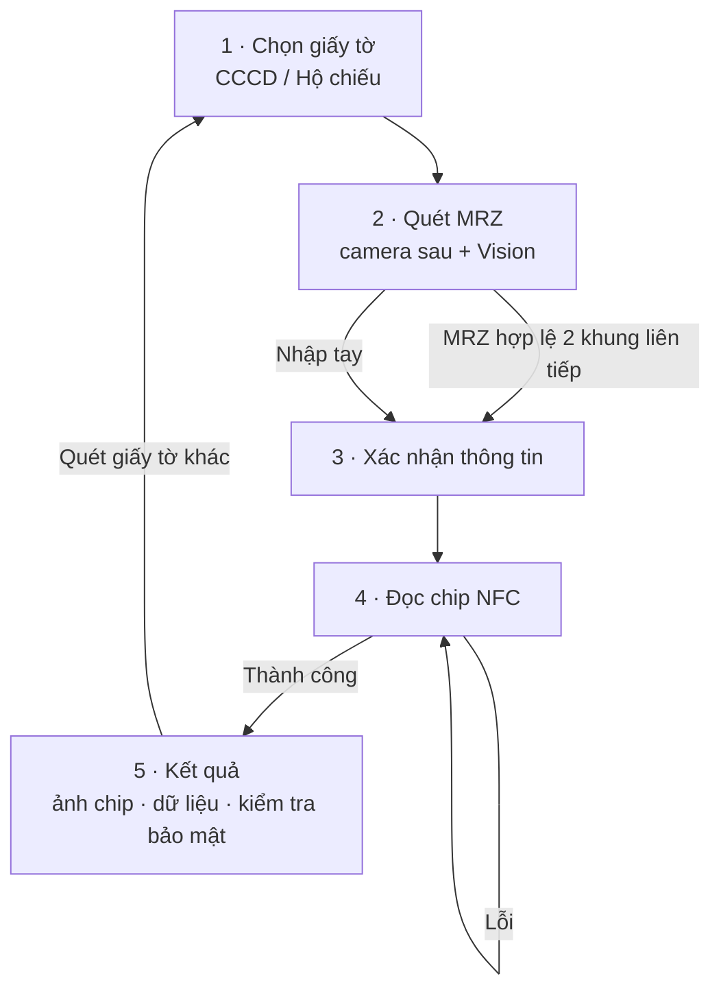
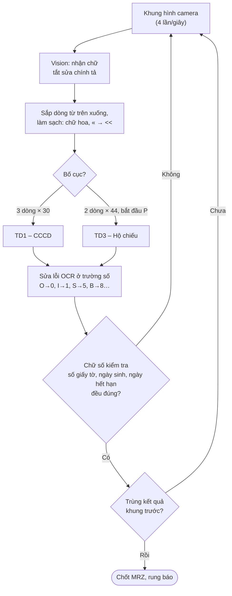
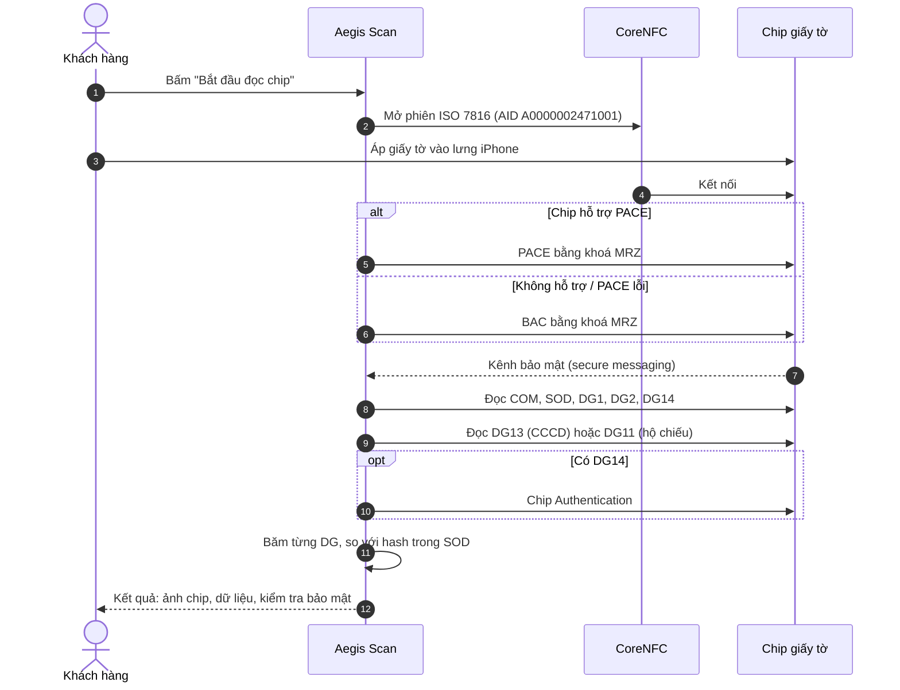
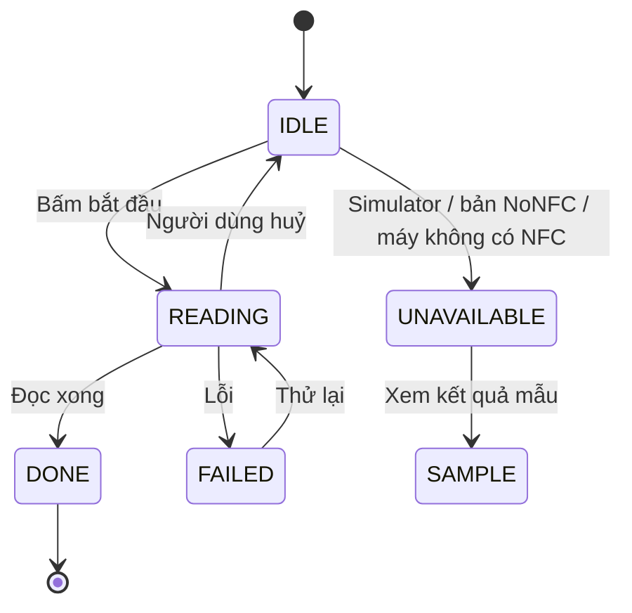

# A02 · App iPhone Aegis Scan – quét MRZ và đọc chip CCCD / hộ chiếu

| | |
|---|---|
| Mã tài liệu | AEG-EKYC-A02 |
| Phiên bản | 0.4 |
| Ngày phát hành | 28/11/2026 |
| Trạng thái | Bản mẫu chạy được trên iPhone, đã có bước khuôn mặt (liveness + so khớp, bản thử nghiệm). Chưa có xác thực CSCA; ngưỡng sinh trắc chưa hiệu chỉnh, chưa chứng nhận chống giả mạo |
| Phân loại | Nội bộ |
| Tác giả | Han Dao (BA) |
| Người duyệt | Product Owner · Tech Lead – chưa duyệt |
| Mục đích và phạm vi | Mô tả app iPhone Aegis Scan: quét MRZ, đọc chip NFC CCCD / hộ chiếu, xác thực khuôn mặt (liveness, so khớp với ảnh chip) và giới hạn hiện tại |
| Chuẩn tham chiếu | ICAO 9303: MRZ TD1/TD3, BAC, PACE, Passive Authentication (SOD), Chip Authentication · ISO/IEC 30107-3 (PAD – chống giả mạo khuôn mặt, **chưa đạt**, xem §7.6) |
| Thuật ngữ | [G02 Thuật ngữ và chữ viết tắt](../../00-overview/G02-glossary.md) |
| Liên quan | SCRUM-18 (OCR/NFC), SCRUM-19 (liveness & face match), [SCRUM-80](https://baohandao2303.atlassian.net/browse/SCRUM-80) (C11 nguồn sinh trắc học), [SCRUM-83](https://baohandao2303.atlassian.net/browse/SCRUM-83) (C14 chống giả mạo khuôn mặt), C15 (hiệu năng) |
| Mã nguồn | [`ios/AegisScan`](../../../ios/AegisScan/README.md) – SwiftUI, iOS 16+, NFCPassportReader 3.0.1 (MIT) |

## 1. Vì sao cần app native

| | Web (PWA) | App native (Swift) |
|---|---|---|
| Camera | Có (`getUserMedia`) | Có, kèm Vision OCR trên máy |
| Đọc chip NFC | **Không** – Safari trên iPhone không có Web NFC | Có (CoreNFC, ISO 7816) |
| Ảnh khuôn mặt trong chip (DG2) | Không lấy được | Lấy được, dùng để so selfie (C11) |
| Kiểm tra người thật, chụp selfie | Có, nhưng camera web giới hạn | Có: Vision chạy trên máy, chọn khung hình nét nhất |

## 2. Luồng màn hình

Từ v0.4, giữa bước 4 và 5 có thêm bước **Khuôn mặt** (§7): đọc chip xong (hoặc chọn "Xem kết quả mẫu" ở bản không NFC) → giới thiệu 4 bước → camera trước kiểm tra người thật và chụp selfie → kết quả. Thanh bước trong app có 5 bước: Giấy tờ · Quét MRZ · Đọc chip · Khuôn mặt · Kết quả. *Sơ đồ trên chưa vẽ lại bước này.*

## 3. Đọc MRZ bằng camera

| Trường | TD1 (CCCD) | TD3 (hộ chiếu) |
|---|---|---|
| Số giấy tờ | Dòng 1, ký tự 6–14 (9 số cuối của số CCCD) | Dòng 2, ký tự 1–9 |
| Ngày sinh (YYMMDD) | Dòng 2, ký tự 1–6 | Dòng 2, ký tự 14–19 |
| Ngày hết hạn | Dòng 2, ký tự 9–14 | Dòng 2, ký tự 22–27 |
| Số định danh 12 số | Dòng 1, vùng tuỳ chọn | — |

Khoá mở chip = số giấy tờ + chữ số kiểm tra + ngày sinh + chữ số kiểm tra + ngày hết hạn + chữ số kiểm tra (đã kiểm bằng mẫu ICAO trong unit test).

## 4. Đọc chip NFC

| Nhóm dữ liệu | Nội dung | Dùng ở đâu |
|---|---|---|
| DG1 | Dữ liệu MRZ trong chip | Đối chiếu với MRZ đã quét |
| DG2 | Ảnh khuôn mặt (JPEG2000) | Hiển thị; ảnh đối chiếu cho bước khuôn mặt (§7, C11) |
| DG11 | Họ tên đầy đủ, nơi sinh (hộ chiếu) | Màn kết quả |
| DG13 | Dữ liệu riêng CCCD Việt Nam: quê quán, nơi thường trú… | Màn kết quả. Nhãn trường cần đối chiếu đặc tả chính thức |
| DG14 | Khoá cho Chip Authentication | Chống chip nhân bản |
| SOD | Hash các DG + chữ ký của nước cấp | Kiểm tra dữ liệu không bị sửa |

## 5. Trạng thái màn đọc chip

| Lỗi | Thông báo cho người dùng | Cách xử lý |
|---|---|---|
| `InvalidMRZKey` | Chip không chấp nhận thông tin MRZ | Kiểm tra lại số giấy tờ, ngày sinh, ngày hết hạn |
| `ConnectionError`, `TimeOutError`, `TagNotValid` | Mất kết nối với chip | Giữ yên thẻ sát phần trên lưng máy, thử lại |
| `MoreThanOneTagFound` | Phát hiện nhiều thẻ | Chỉ để 1 thẻ gần máy |
| `NFCNotSupported` | Máy không hỗ trợ NFC | Cần iPhone 7 trở lên |
| `UserCanceled` | (không báo lỗi) | Quay về trạng thái chờ |

## 6. Kiểm tra bảo mật trên màn kết quả

| Kiểm tra | Ý nghĩa | Trạng thái bản mẫu |
|---|---|---|
| Mở khoá chip | PACE hoặc BAC thành công | Có |
| Dữ liệu không bị sửa | Hash từng DG khớp SOD | Có |
| Chữ ký số tới CSCA | SOD được ký bởi chứng thư gốc của nước cấp | **Chưa** – cần danh sách CSCA (master list); với CCCD, ngân hàng xác thực thêm qua hệ thống của Bộ Công an |
| Chip Authentication | Chip có khoá riêng, chống nhân bản | Có nếu chip hỗ trợ |

## 7. Xác thực khuôn mặt (từ v0.4)

Mã nguồn: `Core/Liveness.swift` (logic thuần, có unit test), `Core/FaceCamera.swift`, `Core/FaceMatch.swift`, `Views/FaceViews.swift`. Mọi xử lý chạy trên máy; ảnh selfie chỉ nằm trong bộ nhớ, không lưu, không gửi đi.

### 7.1 Các bước người dùng thấy

| # | Bước | Linh vật Khiên Aegis diễn | Điều kiện qua bước |
|---|---|---|---|
| 1 | Đưa khuôn mặt vào vòng tròn | Đứng trong vòng tròn, nghiêng qua lại | Đạt mọi kiểm tra tư thế §7.2 |
| 2 | Chớp mắt (luôn có) | Nhắm hẳn mắt rồi mở | Mắt nhắm < 62% rồi mở lại > 85% mức mở bình thường |
| 3 | Quay đầu trái **hoặc** phải (ngẫu nhiên) | Xoay đúng hướng rồi quay lại | Quay ≥ 18°, giữ ≥ 2 khung hình, rồi quay lại nhìn thẳng (≤ 7°) |
| 4 | Nhìn thẳng – app tự chụp | Gật đầu, lấp lánh | Đạt điều kiện chụp §7.3 |

Thứ tự bước 2 và 3 ngẫu nhiên. Mỗi bước xong có dấu ✓ và rung nhẹ; vòng tiến độ quanh khung tròn đầy dần; thanh đếm ngược 30 giây. Vòng tròn trên màn hình vẽ đúng vùng app dùng để kiểm tra vị trí (quy đổi từ toạ độ ảnh camera 9:16 qua phép phóng aspect-fill).

### 7.2 Kiểm tra tư thế (trước mọi thử thách)

| Kiểm tra | Ngưỡng | Lời nhắc |
|---|---|---|
| Có đúng một khuôn mặt | 1 | "Chỉ một người trong khung" – có người thứ hai thì làm lại từ đầu |
| Độ sáng trung bình | ≥ 0,22 | "Hơi tối – ra chỗ sáng hơn" |
| Cỡ khuôn mặt (so với bề rộng ảnh) | 0,32 – 0,70 | "Đưa máy lại gần hơn" / "ra xa một chút" |
| Lệch tâm vòng tròn | ≤ 0,11 bề rộng ảnh | "Dịch mặt sang trái / phải / lên / xuống" |
| Nghiêng đầu (roll) | ≤ 15° | "Giữ đầu thẳng" |

### 7.3 Chống gian lận trong lúc làm

| Tình huống | Xử lý |
|---|---|
| Ảnh in / ảnh trên màn hình | Không chớp mắt được → hết 30 giây báo "Không qua kiểm tra người thật" |
| Giật đầu nhanh 1 khung hình | Không tính – phải giữ hướng quay ≥ 2 khung hình |
| Một động tác tính cho hai thử thách | Phải quay lại nhìn thẳng mới xong bước quay đầu |
| Đổi người / đổi ảnh giữa chừng | Mặt nhảy vị trí hoặc đổi cỡ > 0,22 giữa 2 khung hình, mất mặt > 1,5 giây, hoặc có 2 mặt → làm lại từ đầu |
| Selfie không phải người vừa làm thử thách | Chỉ chụp ngay sau thử thách, trong cùng phiên camera, khi vẫn thấy liên tục một khuôn mặt |

**Điều kiện chụp:** đúng tư thế §7.2, nhìn thẳng (yaw ≤ 7°, pitch ≤ 17°), mắt mở ≥ 80% mức bình thường. Trong tối đa 1,5 giây app giữ 3 khung hình có điểm chất lượng khuôn mặt (Vision face capture quality) cao nhất; ảnh tốt nhất là selfie chính.

### 7.4 So khớp và quyết định

1. Tìm khuôn mặt và hai mắt ở cả selfie và ảnh đối chiếu; xoay cho đường nối hai mắt nằm ngang.
2. Cắt vuông quanh mặt (nới 30%), đưa về ảnh xám 256 × 256.
3. Tính khoảng cách đặc trưng ảnh (Vision feature print) giữa từng selfie (tối đa 3) và ảnh đối chiếu, đổi thành điểm tương đồng 0–100%, lấy điểm cao nhất.

| Nguồn ảnh đối chiếu | Điểm ≥ 80% | 60–79% | < 60% |
|---|---|---|---|
| Ảnh chip DG2 | **Khớp** → luồng eKYC: được xét STP | Cần xem lại → REFER | Không khớp → REJECTED hoặc REFER |
| Ảnh in trên mặt trước giấy tờ (bản không NFC) | Cần xem lại → REFER (C11 RULE-EKYC-14) | Cần xem lại | Không khớp |
| Không có ảnh | Chỉ kiểm tra người thật, kết quả "Cần xem lại" | | |
| Không qua liveness | "Không qua kiểm tra người thật" – không so khớp | | |

### 7.5 Màn kết quả

Thêm mục **Sinh trắc học**: selfie đặt cạnh ảnh đối chiếu, kết luận, kiểm tra người thật (đạt / không), thử thách đã làm, chất lượng ảnh selfie, điểm tương đồng, nguồn ảnh đối chiếu.

### 7.6 Giới hạn – chưa dùng cho production

| Giới hạn | Ảnh hưởng | Hướng xử lý |
|---|---|---|
| Apple Vision không có mô hình nhận diện khuôn mặt chuyên dụng; điểm tương đồng dựa trên đặc trưng ảnh tổng quát | Có thể sai cả hai chiều (người khác điểm cao / đúng người điểm thấp) | Dùng nhà cung cấp eKYC đã chứng nhận (C14) |
| Ngưỡng (80/60%, độ mở mắt, góc quay, độ sáng) đặt theo ước lượng | Chưa đo FAR/FRR | Hiệu chỉnh trên bộ dữ liệu thử có đồng ý của người tham gia |
| Liveness chủ động (chớp mắt, quay đầu) chưa chống được video phát lại / deepfake / camera ảo | Không đạt ISO/IEC 30107-3 | Spike C14 (SCRUM-83); thêm passive liveness / TrueDepth |
| Bản Apple ID miễn phí không đọc được chip | Không có ảnh DG2 → tối đa "Cần xem lại" | Dùng tài khoản Apple Developer trả phí |

### 7.7 Kiểm thử tự động

27 unit test (`AegisScanTests`): máy trạng thái liveness (chớp mắt, quay đầu phải quay lại, giật 1 khung không tính, ảnh tĩnh không qua, hết giờ, mất mặt, nhiều mặt, mặt nhảy đột ngột), lời nhắc tư thế, điều kiện chụp, ngưỡng quyết định, quy tắc C11; `MascotRenderTests` xuất ảnh các tư thế linh vật để xem nhanh.

## 8. Ký và cài đặt

| Scheme | Tài khoản Apple | Đọc NFC |
|---|---|---|
| AegisScan | Apple Developer Program (trả phí) | Có |
| AegisScan-NoNFC | Apple ID miễn phí | Không – vẫn quét MRZ, nhập tay, xem kết quả mẫu |

Toàn bộ xử lý nằm trên máy, không lưu và không gửi ảnh hay dữ liệu chip đi đâu.

## 9. Việc tiếp theo

1. Nạp master list CSCA để xác minh chữ ký (`PassportReader(masterListURL:)`).
2. Thử bước khuôn mặt với người thật trên nhiều dòng máy; hiệu chỉnh ngưỡng (§7.6). Thay so khớp bằng nhà cung cấp eKYC đã chứng nhận trước khi dùng thật (C14).
3. Gửi kết quả đọc chip lên `ekyc-service` (thay cho bước OCR/NFC của web).
4. Đo P95 thời gian đọc chip trên 2 dòng máy (C15, đóng SCRUM-57).

## 10. Kiểm soát tài liệu

### Tài liệu tham chiếu

| Mã | Tài liệu |
|---|---|
| C11 | [C11 · Nguồn ảnh sinh trắc học](../1.2-compliance-legal/C11-biometric-source.md) |
| C13–C14 | [C13–C14 · Chống gian lận](../1.2-compliance-legal/C13-C14-fraud-controls.md) |

Chuẩn quốc tế: xem trường *Chuẩn tham chiếu* ở đầu trang.

### Lịch sử phiên bản

| Phiên bản | Ngày | Người sửa | Commit | Thay đổi |
|---|---|---|---|---|
| 0.1 | 22/11/2026 | Han Dao | `8a99253` | Bản đầu |
| 0.2 | 25/11/2026 | Han Dao | — | Thêm mục kiểm soát tài liệu (phiên bản, lịch sử, phê duyệt) theo ISO/IEC/IEEE 29148 và 29119-3 |
| 0.3 | 26/11/2026 | Han Dao | — | Chuẩn hoá cấu trúc theo ISO/IEC/IEEE 15289: khối thuộc tính đầu trang, tài liệu tham chiếu, thuật ngữ dùng chung (G02), mục kiểm soát tài liệu thống nhất |
| 0.4 | 28/11/2026 | Han Dao | `3b55cce` | §7 mới: xác thực khuôn mặt – kiểm tra tư thế, liveness chủ động, chống gian lận, chọn selfie, so khớp và quyết định theo nguồn ảnh (C11), giới hạn; linh vật Khiên Aegis; bước Khuôn mặt trong luồng; tham chiếu C11, C13–C14 |

### Phê duyệt

| Vai trò | Người | Ngày | Kết luận |
|---|---|---|---|
| BA (soạn) | Han Dao | 25/11/2026 | Trình duyệt |
| Product Owner |  |  |  |
| Tech Lead |  |  |  |
