# U01 · Đặc tả giao diện – App khách hàng mở tài khoản (eKYC)

| | |
|---|---|
| Phạm vi | 20 màn eKYC (eKYC-00 → eKYC-14) và hộp thoại Điều khoản. Màn Hạn mức thẻ (LIM-M) xem [L01](../../03-credit-limit/L01-credit-limit-flow.md) |
| Jira | SCRUM-47 (UX), SCRUM-17 → 19, 39 → 41, 46; SCRUM-73 → 81 |
| Bản chạy | [Bản demo](https://handao2303.github.io/aegis-ekyc-ui/app/) · bản nối backend: `npm run dev:all` rồi mở `/app/` |
| Mã nguồn | `src/mobile/screens.tsx`, `src/ekyc/EkycContext.tsx` (gọi API), `src/ekyc/terms.ts` (điều khoản) |
| Ảnh | Chụp tự động bằng `tools/diagrams/screens.mjs`, khung iPhone 390 × 844 |
| Phiên bản | 1.1 · 25/11/2026 · Han Dao |
| Chuẩn tham chiếu | WCAG 2.2 mức AA, ISO 9241-110 – đánh giá ở [Q01](../../00-overview/Q01-standards-conformance.md) |

## 1. Quy ước chung

### 1.1 Khung màn hình

| Thành phần | Quy định |
|---|---|
| Thanh trên | Nút Quay lại (trừ màn đầu và màn kết quả) · tiêu đề màn · chuyển ngôn ngữ VI/EN · nút Hỗ trợ |
| Thanh tiến trình | 5 bước: Điều khoản → Giấy tờ → Chip NFC → Khuôn mặt → Kết quả. Bước hiện tại tô gradient |
| Chân màn | Nút chính (cao 56px, bo tròn, gradient tím–hổ phách); nút phụ dạng chữ. Dòng "Dữ liệu của bạn được mã hoá và bảo vệ" |
| Màn camera | Nền tối, khung ngắm 4 góc đổi sang màu hổ phách khi căn chỉnh xong |
| Font, màu | Lexend; skin Aurora (`src/styles/tokens.css`). Trạng thái luôn có chữ đi kèm màu |

### 1.2 Nguyên tắc nội dung

| # | Nguyên tắc |
|---|---|
| 1 | Không nhắc AML, PEP, CIC, "gian lận" với khách. Dùng "kiểm tra hồ sơ theo quy định", "giao dịch khác thường" |
| 2 | Lỗi luôn kèm cách khắc phục hoặc lối đi tiếp (chụp lại, quầy giao dịch, tổng đài 1900 6868) |
| 3 | Số tài khoản, số giấy tờ hiển thị theo nhóm 3–4 chữ số; số giấy tờ ở màn ngoại lệ luôn che giữa |
| 4 | Song ngữ VI/EN cho toàn bộ chữ; lựa chọn ngôn ngữ được nhớ (`?lang=` có ưu tiên cao hơn) |

### 1.3 Trợ năng

| Hạng mục | Quy định |
|---|---|
| Vùng chạm | Tối thiểu 44 × 44 pt (cao hơn mức 24 × 24 px của WCAG 2.2 SC 2.5.8, theo hướng dẫn của Apple) |
| Tương phản | Chữ thường ≥ 4.5:1, chữ lớn ≥ 3:1 |
| Trình đọc màn hình | Nút chụp có `aria-label`; hướng dẫn liveness và tiến độ đọc chip dùng `aria-live`; nhóm lựa chọn dùng `role="radiogroup"` |
| Chuyển động | Hiệu ứng chỉ mang tính gợi ý; không chứa thông tin mà chỉ thấy được qua chuyển động |
| Giới hạn thời gian (SC 2.2.1) | Trước khi phiên hết hạn (30 phút không thao tác) phải báo trước ít nhất 20 giây và cho bấm "Tiếp tục"; thử thách liveness không giới hạn giờ cứng, khách được làm lại – **chưa làm** |
| Phóng to chữ (SC 1.4.4) | Chữ phóng to 200% (Dynamic Type / zoom trình duyệt) không mất nội dung, nút chính không bị che – **chưa kiểm** |
| Báo lỗi (SC 3.3.1) | Mọi lỗi hiện bằng chữ, gần chỗ lỗi, không chỉ đổi màu |
| Ngôn ngữ (SC 3.1.1) | `lang` của trang đổi theo VI/EN |
| Cách thay thế (SC 3.3.8) | Khách không làm được xác thực khuôn mặt hoặc đọc chip được chuyển sang nhân viên xem xét (REFER) hoặc hướng dẫn ra quầy, không bị kẹt |

### 1.4 Bản đồ màn hình

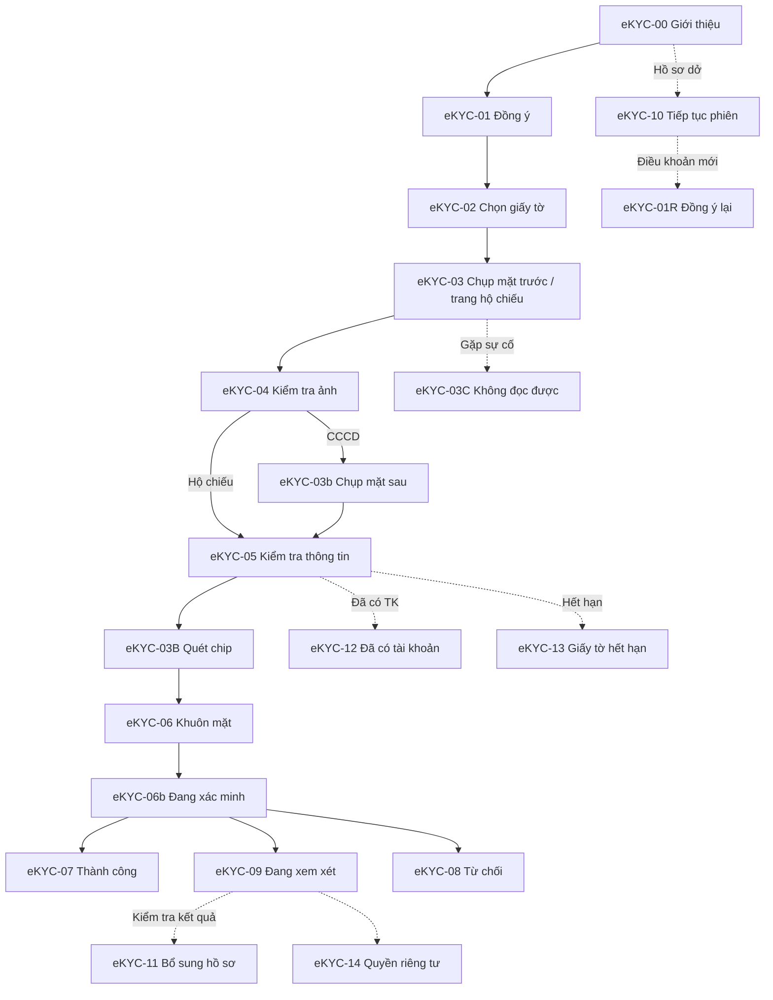

## 2. Đặc tả từng màn

Cột **API** ghi lời gọi tới `ekyc-service` khi app có backend ([server/README](../../../server/README.md)). Không có backend thì app chạy chế độ demo, giữ nguyên điều hướng.

### eKYC-00 · Giới thiệu

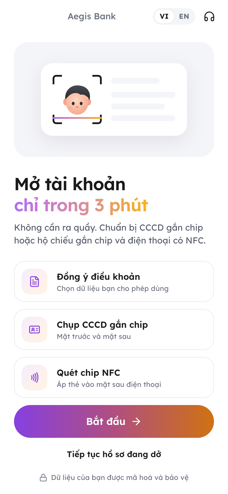

| Mục | Nội dung |
|---|---|
| Mục đích | Đặt kỳ vọng: cần chuẩn bị gì, mất bao lâu (~3 phút) |
| Thành phần | Hình minh hoạ · tiêu đề "Mở tài khoản chỉ trong 3 phút" · 4 bước (Đồng ý, Chụp giấy tờ, Quét chip, Khuôn mặt) · nút **Bắt đầu** · nút **Tiếp tục hồ sơ đang dở** |
| Bản test | Khi có backend hiện ô **Bản test · hồ sơ mẫu** (TD-01 → TD-16) và dòng "Kỳ vọng" |
| Điều hướng | Bắt đầu → eKYC-01 · Tiếp tục hồ sơ → eKYC-10 (không có hồ sơ dở: thông báo "Không có hồ sơ đang làm dở trên máy này") |
| API | Tiếp tục hồ sơ: `GET /api/sessions/resume?device_id=` |

### eKYC-01 · Đồng ý điều khoản

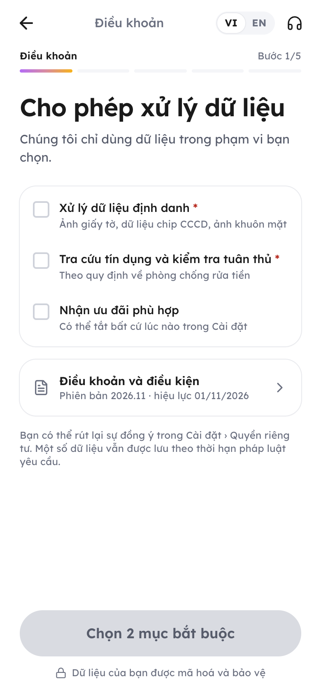 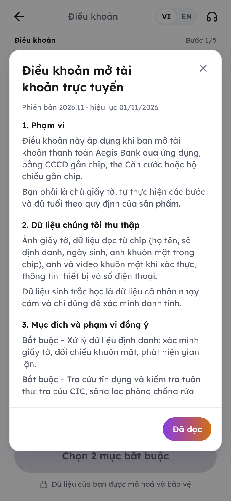

| Mục | Nội dung |
|---|---|
| Mục đích | Thu thập đồng ý theo từng phạm vi, ghi lại phiên bản điều khoản |
| Thành phần | 3 ô chọn: **Xử lý dữ liệu định danh** (bắt buộc) · **Tra cứu tín dụng và kiểm tra tuân thủ** (bắt buộc) · **Nhận ưu đãi phù hợp** (tuỳ chọn). Ô không được chọn sẵn |
| Điều khoản | Thẻ "Điều khoản và điều kiện · Phiên bản 2026.11 · hiệu lực 01/11/2026" mở hộp thoại 8 mục (nội dung: [P01 §2](../1.2-compliance-legal/P01-terms-privacy.md)) |
| Kiểm tra | Nút chính bị khoá và ghi "Chọn 2 mục bắt buộc" cho tới khi đủ 2 mục bắt buộc |
| Điều hướng | **Đồng ý và tiếp tục** → eKYC-02 |
| API | `POST /api/sessions` (thiết bị, số điện thoại, sản phẩm) rồi `POST /api/sessions/:id/consent` (`scopes`, `terms_version`) |
| Lỗi | Quá ngưỡng phiên/thiết bị (C13): "Vui lòng thử lại sau." – không nêu lý do |

### eKYC-01R · Đồng ý lại điều khoản

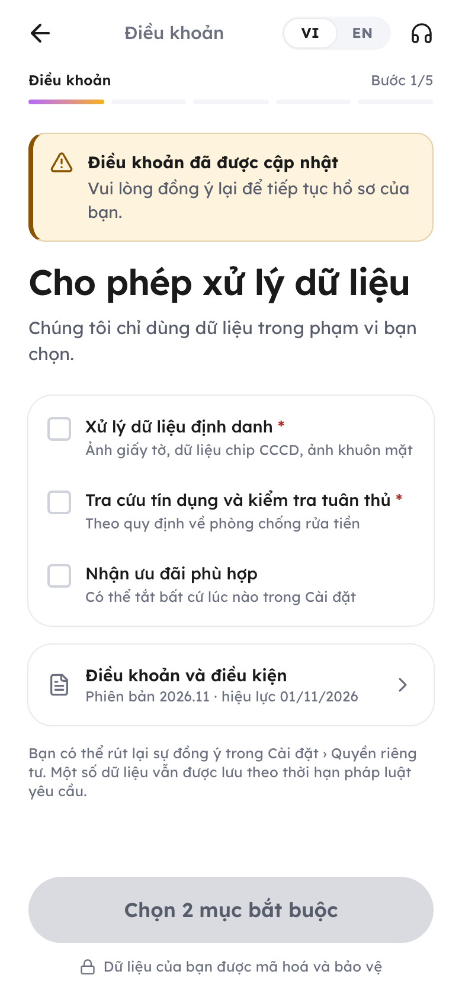

| Mục | Nội dung |
|---|---|
| Khi nào | Khách tiếp tục hồ sơ dở mà điều khoản đã đổi phiên bản (backend trả `TERMS_OUTDATED`) |
| Khác eKYC-01 | Banner cảnh báo "Điều khoản đã được cập nhật" ở đầu màn |
| Điều hướng | Đồng ý → quay về đúng bước đang dở (thường là eKYC-06 vì liveness luôn làm lại) |
| API | `GET /api/meta` lấy phiên bản mới → `POST …/consent` → `POST …/resume` |

### eKYC-02 · Chọn giấy tờ

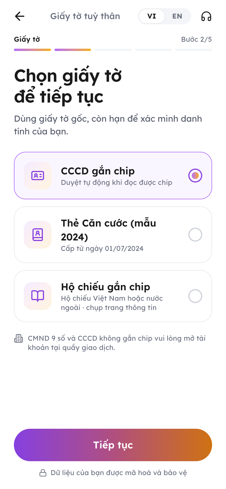 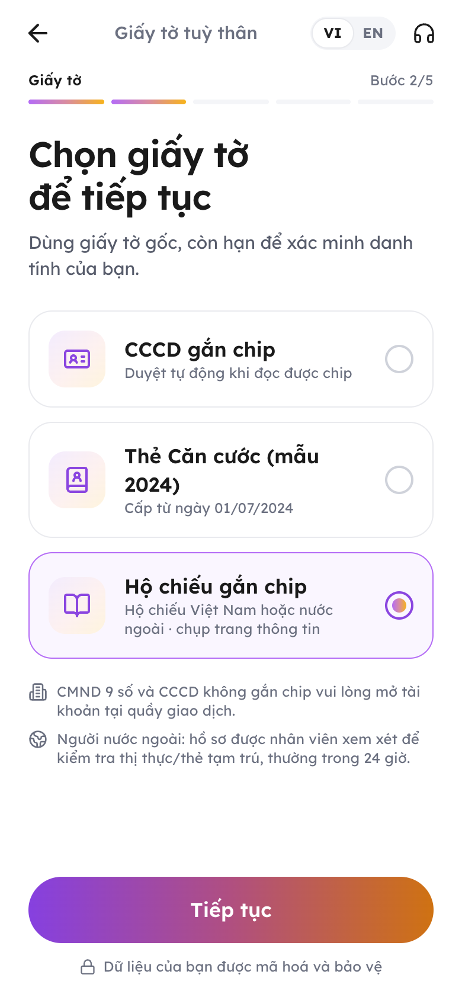

| Mục | Nội dung |
|---|---|
| Lựa chọn | **CCCD gắn chip** (mặc định) · **Thẻ Căn cước (mẫu 2024)** · **Hộ chiếu gắn chip** (Việt Nam hoặc nước ngoài) |
| Ghi chú | Luôn hiện: "CMND 9 số và CCCD không gắn chip vui lòng mở tài khoản tại quầy". Chọn hộ chiếu hiện thêm: người nước ngoài được nhân viên xem xét trong 24 giờ |
| Điều hướng | Tiếp tục → eKYC-03 |
| Bản test | Chọn hộ chiếu mà hồ sơ mẫu là CCCD → app tự đổi sang TD-14 (và ngược lại sang TD-01), giữ nguyên phiên |

### eKYC-03 / 03b · Chụp giấy tờ

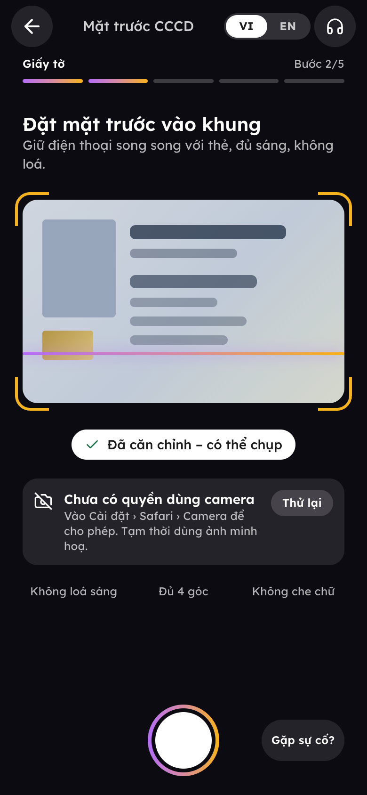 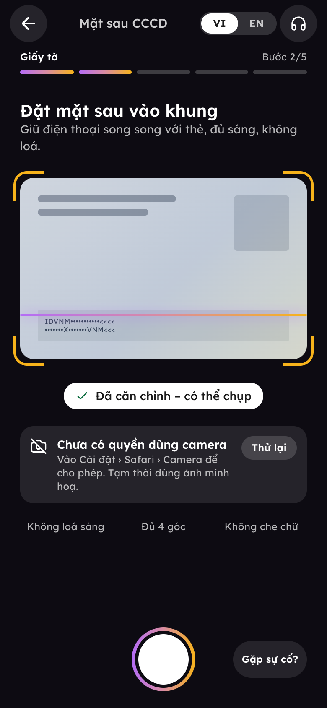

| Mục | Nội dung |
|---|---|
| Tiêu đề | "Mặt trước CCCD" / "Mặt sau CCCD" · hộ chiếu: "Trang thông tin hộ chiếu" (chỉ 1 lần chụp) |
| Camera | Camera sau (`getUserMedia`, cần HTTPS). Không có quyền / không có camera → thông báo "Chưa có quyền dùng camera…", nút **Thử lại**, tạm dùng ảnh minh hoạ |
| Căn chỉnh | Khung 4 góc theo tỉ lệ thẻ 1.586; nhãn "Đã căn chỉnh – có thể chụp" khi đạt. Nút chụp bị khoá tới khi căn chỉnh xong |
| Checklist | Không loá sáng · Đủ 4 góc · Không che chữ |
| Nút | Chụp (tròn, `aria-label="Chụp ảnh"`) · **Gặp sự cố?** → eKYC-03C |
| Dữ liệu | Ảnh chỉ giữ trong bộ nhớ phiên trên máy, không tải lên (bản mẫu) |

### eKYC-04 · Kiểm tra ảnh

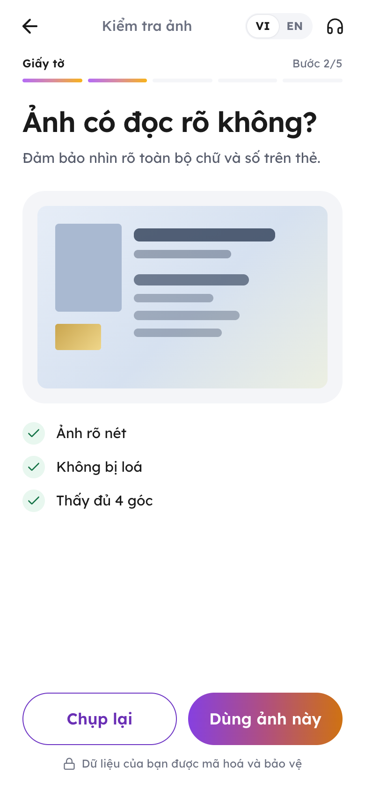

| Mục | Nội dung |
|---|---|
| Thành phần | Ảnh vừa chụp · checklist chất lượng tự động (rõ nét, không loá, đủ 4 góc) |
| Nút | **Chụp lại** và **Dùng ảnh này** ngang hàng |
| Điều hướng | Dùng ảnh này → CCCD: eKYC-03b · Hộ chiếu: eKYC-05 |

### eKYC-05 · Kiểm tra thông tin

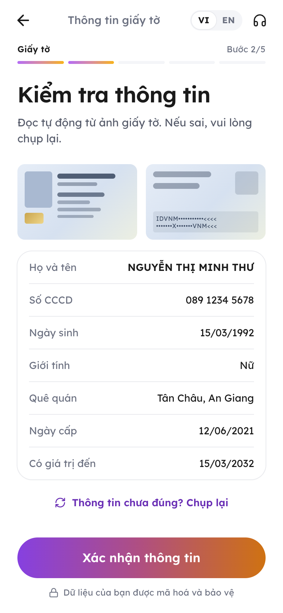

| Mục | Nội dung |
|---|---|
| Trường – CCCD | Họ và tên · Số CCCD · Ngày sinh · Giới tính · Quê quán · Ngày cấp · Có giá trị đến |
| Trường – Hộ chiếu | Họ và tên · Số hộ chiếu · Quốc tịch · Số định danh (nếu có) · Ngày sinh · Giới tính · Nơi sinh · Ngày cấp · Có giá trị đến |
| Quy tắc | **Không cho sửa tay** – sai thì chụp lại (chống gian lận). Số hiển thị chia nhóm |
| Nút | **Xác nhận thông tin** · "Thông tin chưa đúng? Chụp lại" |
| API | `POST /api/sessions/:id/document` → kiểm tra hạn, tuổi, trùng khách (C04–C05) |
| Kết quả API | `NFC` → eKYC-03B · `DUPLICATE` → eKYC-12 · `EXPIRED_DOC` → eKYC-13 · `REJECTED` (chưa đủ tuổi) → eKYC-08 · `RESUME` → eKYC-10 |

### eKYC-03B · Quét chip NFC

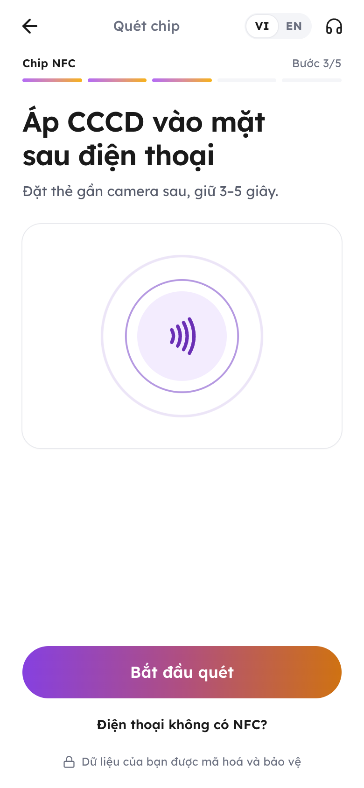

| Mục | Nội dung |
|---|---|
| Trạng thái | Chờ → Đang đọc (thanh tiến độ %, `aria-live`) → Thành công ("Chữ ký số trên chip hợp lệ") |
| Hướng dẫn | CCCD: "Áp CCCD vào mặt sau điện thoại". Hộ chiếu: "Áp bìa sau hộ chiếu vào điện thoại", gập hộ chiếu, đặt bìa có biểu tượng chip sát phần trên lưng máy |
| Cảnh báo | Giấy tờ còn hạn dưới 30 ngày: "Giấy tờ sắp hết hạn" – vẫn đi tiếp |
| Bỏ qua | "Điện thoại không có NFC?" → cảnh báo "Hồ sơ sẽ được duyệt thủ công" + **Vẫn bỏ qua** / **Thử quét lại** |
| API | `POST /api/sessions/:id/chip` (DG1 + kết quả SOD) hoặc `{ skipped: true }` |
| Giới hạn | Safari trên iPhone không có Web NFC: bản web mô phỏng bước đọc; đọc chip thật dùng app Aegis Scan ([A02](A02-ios-document-scan.md)) |

### eKYC-06 · Xác thực khuôn mặt

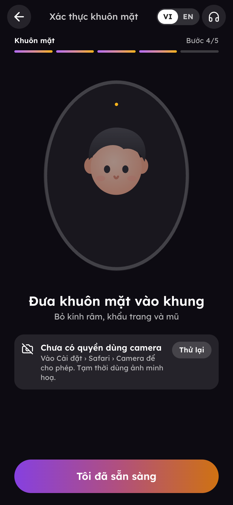

| Mục | Nội dung |
|---|---|
| Thành phần | Khung mặt tròn với vòng tiến trình; hướng dẫn "Bỏ kính râm, khẩu trang và mũ"; nút **Tôi đã sẵn sàng** |
| Thử thách | 4 thử thách ngẫu nhiên (quay trái/phải, chớp mắt, cười), đọc qua `aria-live` |
| Camera | Camera trước; không có quyền → thông báo như eKYC-03 |
| API | `POST /api/sessions/:id/liveness` (điểm liveness, face match) – backend sàng lọc và ra quyết định |

### eKYC-06b · Đang xác minh

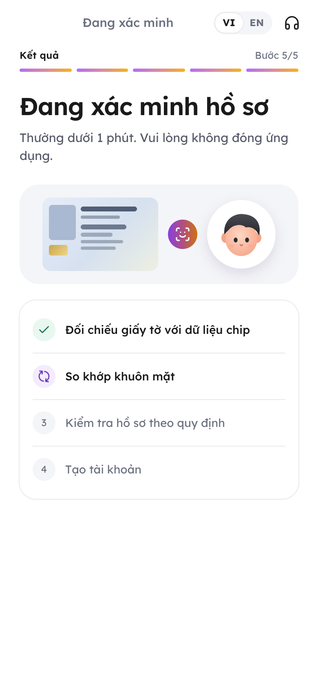

| Mục | Nội dung |
|---|---|
| Thành phần | Ảnh giấy tờ cạnh ảnh khuôn mặt · 4 bước có trạng thái: Đối chiếu giấy tờ với chip → So khớp khuôn mặt → Kiểm tra hồ sơ theo quy định → Tạo tài khoản |
| Quy tắc | Không dùng spinner vô định; không nhắc AML/PEP |
| Điều hướng | Theo kết quả backend: `approved` → eKYC-07 · `refer` → eKYC-09 · `rejected` → eKYC-08 |

### eKYC-07 · Thành công

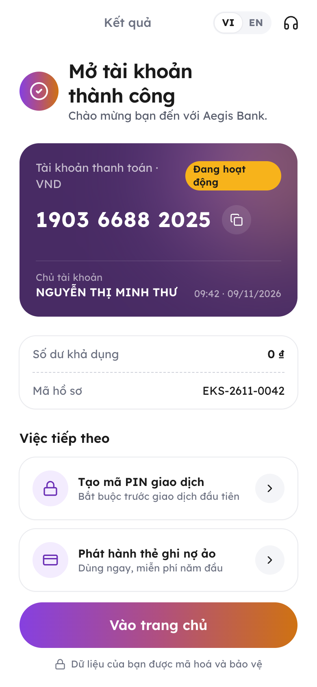

| Mục | Nội dung |
|---|---|
| Thành phần | Thẻ tài khoản: loại tài khoản, nhãn "Đang hoạt động", **số tài khoản** (nhóm 4 số, nút sao chép), chủ tài khoản, thời điểm duyệt · Biên lai: số dư khả dụng, **mã hồ sơ** · 2 việc tiếp theo (tạo mã PIN, thẻ ghi nợ ảo) |
| Dữ liệu | `account_no`, `holder`, `decided_at`, `session_id` từ backend |
| Nút | **Vào trang chủ** → LIM-M1 |

### eKYC-09 · Đang xem xét

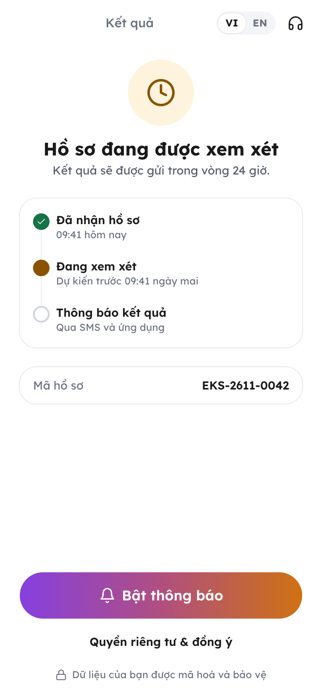

| Mục | Nội dung |
|---|---|
| Thành phần | Biểu tượng chờ · "Kết quả sẽ được gửi trong vòng 24 giờ" · dòng thời gian 3 mốc (Đã nhận – Đang xem xét, dự kiến trước [giờ vào hàng đợi + 24h] – Thông báo kết quả) · mã hồ sơ |
| Đã bổ sung | Mốc 2 đổi thành "Đã nhận ảnh bổ sung · Hồ sơ được ưu tiên xem lại" |
| Nút | **Kiểm tra kết quả** (có backend; chuyển màn theo trạng thái mới) hoặc **Bật thông báo** · **Quyền riêng tư & đồng ý** |
| Quy tắc | Không tiết lộ lý do nhạy cảm |

### eKYC-08 · Từ chối

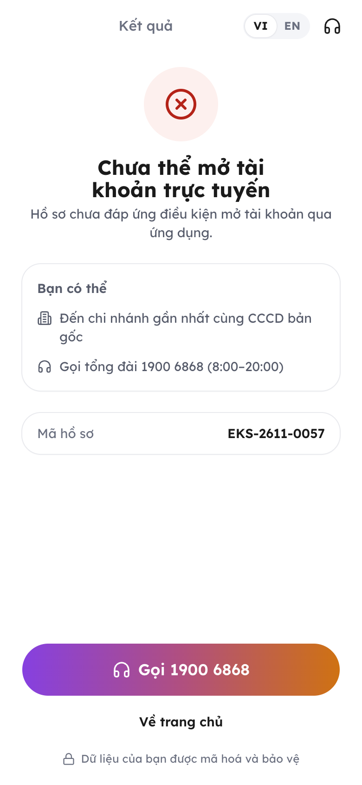

| Mục | Nội dung |
|---|---|
| Thành phần | "Chưa thể mở tài khoản trực tuyến" · lý do: chỉ hiện cụ thể với `DOC_EXPIRED`, `UNDER_AGE`, `NO_RESPONSE`; còn lại dùng câu chung · "Bạn có thể": đến chi nhánh, gọi 1900 6868 · mã hồ sơ |
| Nút | **Gọi 1900 6868** · Về trang chủ |

### eKYC-03C · Không đọc được giấy tờ

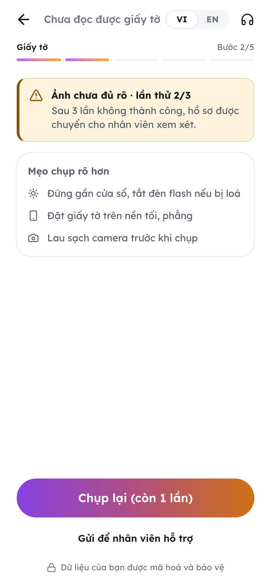

| Mục | Nội dung |
|---|---|
| Thành phần | Nguyên nhân thường gặp và cách khắc phục · số lần thử còn lại |
| Quy tắc | RULE-EKYC-07: lần lỗi thứ 3 chuyển REFER |
| Nút | **Chụp lại (còn n lần)** · **Gửi để nhân viên hỗ trợ** → eKYC-09 |
| API | `POST /api/sessions/:id/capture-failures` |

### eKYC-10 · Tiếp tục phiên

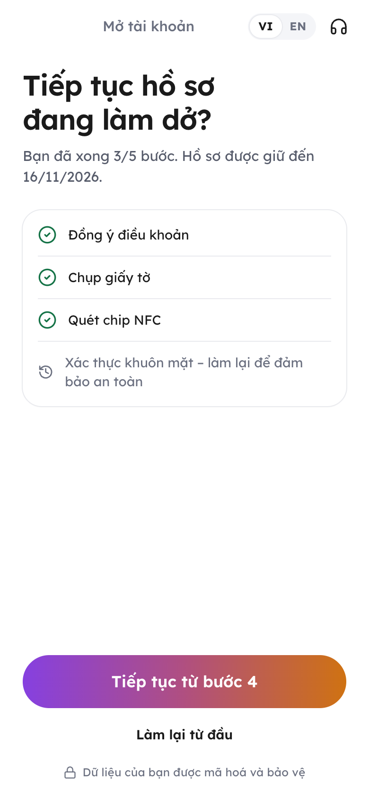

| Mục | Nội dung |
|---|---|
| Thành phần | "Bạn đã xong n/5 bước. Hồ sơ được giữ đến [ngày]" · danh sách bước đã xong · dòng "Xác thực khuôn mặt – làm lại để đảm bảo an toàn" · cảnh báo nếu điều khoản đã đổi |
| Nút | **Tiếp tục từ bước n** · **Làm lại từ đầu** (huỷ phiên, xoá dữ liệu tạm) |
| API | `POST …/resume` hoặc `POST …/cancel` |

### eKYC-11 · Bổ sung hồ sơ

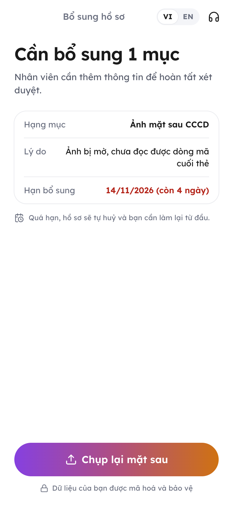

| Mục | Nội dung |
|---|---|
| Khi nào | Compliance yêu cầu bổ sung (C07); mở qua deep link trong SMS/Push hoặc nút Kiểm tra kết quả |
| Thành phần | "Cần bổ sung n mục" · hạng mục · lời nhắn của nhân viên · hạn bổ sung (ngày, còn n ngày, chữ đỏ) · cảnh báo quá hạn hồ sơ tự huỷ |
| Nút | **Chụp lại mặt sau** hoặc **Chụp lại giấy tờ** (theo hạng mục) → chụp xong gửi luôn → eKYC-09 |
| API | `POST /api/sessions/:id/info-request/submit` |

### eKYC-12 · Đã có tài khoản

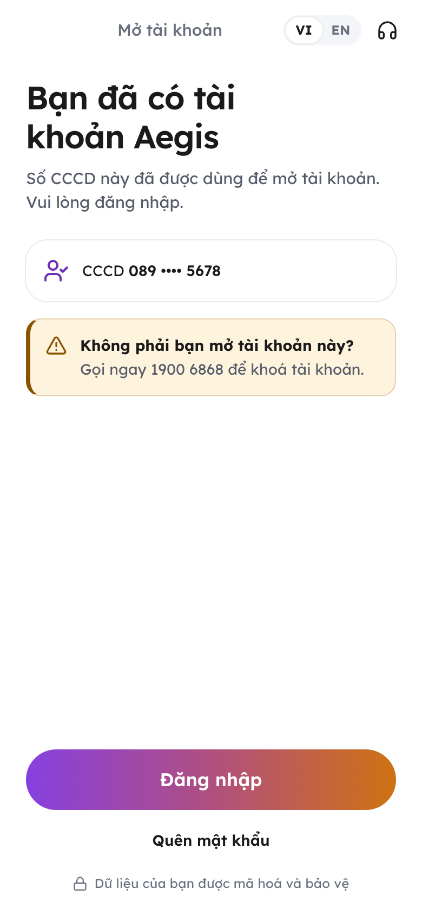

| Mục | Nội dung |
|---|---|
| Khi nào | Số định danh đã có tài khoản active (C04 #2), kể cả khi khách dùng hộ chiếu Việt Nam |
| Thành phần | Số giấy tờ đã che · cảnh báo "Không phải bạn mở tài khoản này? Gọi 1900 6868" |
| Nút | **Đăng nhập** · Quên mật khẩu |
| Quy tắc | Dừng trước Liveness/CIC để không tốn chi phí |

### eKYC-13 · Giấy tờ hết hạn

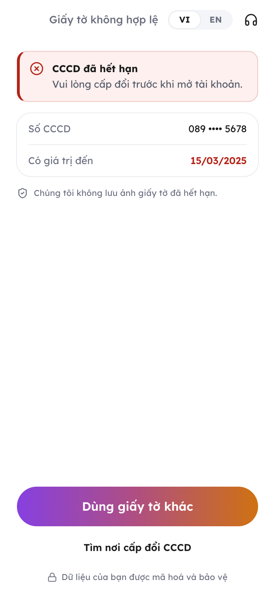

| Mục | Nội dung |
|---|---|
| Thành phần | Cảnh báo "CCCD đã hết hạn" / "Hộ chiếu đã hết hạn" · số giấy tờ đã che · ngày hết hạn (đỏ) · "Chúng tôi không lưu ảnh giấy tờ đã hết hạn" |
| Nút | **Dùng giấy tờ khác** (tạo phiên mới) · Tìm nơi cấp đổi CCCD |

### eKYC-14 · Quyền riêng tư

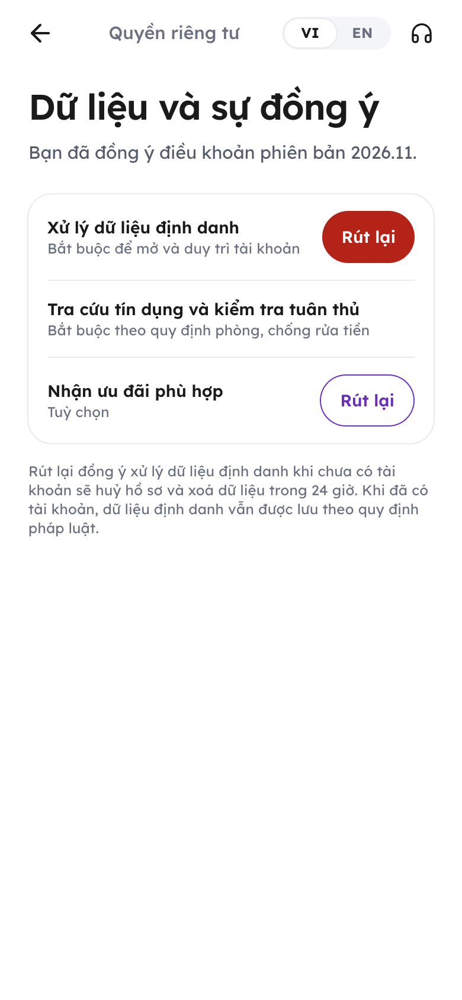

| Mục | Nội dung |
|---|---|
| Mục đích | Khách xem phạm vi đã đồng ý và rút lại đồng ý (C12, RULE-EKYC-15) |
| Thành phần | Phiên bản điều khoản đã đồng ý · 3 phạm vi; nút **Rút lại** ở mục định danh (đỏ) và ưu đãi; mục tra cứu tuân thủ không rút riêng được |
| Xác nhận | Hộp thoại nêu rõ hệ quả: chưa có tài khoản → huỷ hồ sơ, xoá trong 24 giờ; đã có tài khoản → dữ liệu vẫn phải lưu theo pháp luật |
| API | `POST /api/sessions/:id/consents/withdraw` (`scope`) |

## 3. Thông điệp hệ thống

| Mã / tình huống | Màn | Nội dung tiếng Việt |
|---|---|---|
| `TRY_LATER` (velocity) | Mọi màn | Vui lòng thử lại sau. |
| `TERMS_OUTDATED` | eKYC-10 | Điều khoản đã được cập nhật – vui lòng đồng ý lại để tiếp tục hồ sơ của bạn. |
| `NETWORK` | Mọi màn | Không kết nối được máy chủ. Kiểm tra mạng rồi thử lại. |
| `DOC_EXPIRED` | eKYC-13, 08 | Giấy tờ đã hết hạn. Vui lòng cập nhật giấy tờ mới. |
| `UNDER_AGE` | eKYC-08 | Chưa đủ điều kiện độ tuổi cho sản phẩm này. |
| `STOPPED_DUPLICATE` | eKYC-12 | Số CCCD này đã có tài khoản. Vui lòng đăng nhập. |
| `NO_RESPONSE` | eKYC-08 | Hồ sơ đã bị huỷ do quá hạn bổ sung. |
| `GENERAL` | eKYC-08 | Hiện chưa thể mở tài khoản trực tuyến. Vui lòng liên hệ quầy giao dịch hoặc tổng đài 1900 6868. |
| Không có hồ sơ dở | eKYC-00 | Không có hồ sơ đang làm dở trên máy này. |
| Camera bị chặn | eKYC-03, 06 | Chưa có quyền dùng camera. Vào Cài đặt › Safari › Camera để cho phép. Tạm thời dùng ảnh minh hoạ. |

## 4. Truy vết

| Màn | Story | Quy tắc | UAT ([C17](../1.4-testing/C17-uat-pack.md)) | Test case ([T02](../1.4-testing/T02-test-cases.md)) |
|---|---|---|---|---|
| eKYC-01, 01R | SCRUM-17, 46 | Đồng ý theo phạm vi | 03 | TC-APP-01 → 06 |
| eKYC-02 → 05 | SCRUM-18, 73, 74 | RULE-09, 10 | 12, 13, 14, 25, 26 | TC-APP-07 → 18 |
| eKYC-03B | SCRUM-18, 80 | RULE-14 | 02, 20 | TC-APP-19 → 22 |
| eKYC-06 → 09 | SCRUM-19, 39, 40 | Cây quyết định A01 §4 | 01, 04 → 07, 22 | TC-APP-23 → 32 |
| eKYC-03C | SCRUM-41 | RULE-07 | 10 | TC-APP-33 |
| eKYC-10 | SCRUM-75 | RULE-11 | 15 | TC-APP-34 → 36 |
| eKYC-11 | SCRUM-76 | C07 | 16 | TC-APP-37 → 38 |
| eKYC-14 | SCRUM-81 | RULE-15 | 21 | TC-APP-39 → 41 |

## 5. Kiểm soát tài liệu

### Lịch sử phiên bản

| Phiên bản | Ngày | Người sửa | Commit | Thay đổi |
|---|---|---|---|---|
| 0.8 | 23/11/2026 | Han Dao | `95fb7b1` | Bản đầu |
| 0.9 | 23/11/2026 | Han Dao | `4813f91` | Đồng bộ với Confluence: hồ sơ mẫu TD-16, cảnh báo giấy tờ sắp hết hạn |
| 1.0 | 23/11/2026 | Han Dao | `a435c61` | Bổ sung theo rà soát chuẩn Q01 (ISO/IEC/IEEE 29119-3, WCAG 2.2) |
| 1.1 | 25/11/2026 | Han Dao | — | Thêm mục kiểm soát tài liệu (phiên bản, lịch sử, phê duyệt) theo ISO/IEC/IEEE 29148 và 29119-3 |

### Phê duyệt

| Vai trò | Người | Ngày | Kết luận |
|---|---|---|---|
| BA (soạn) | Han Dao | 25/11/2026 | Trình duyệt |
| Product Owner | | | |
| Tech Lead | | | |
