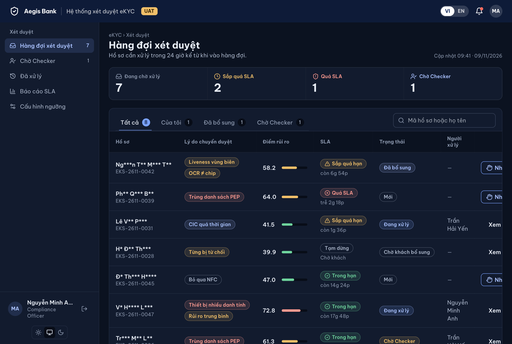
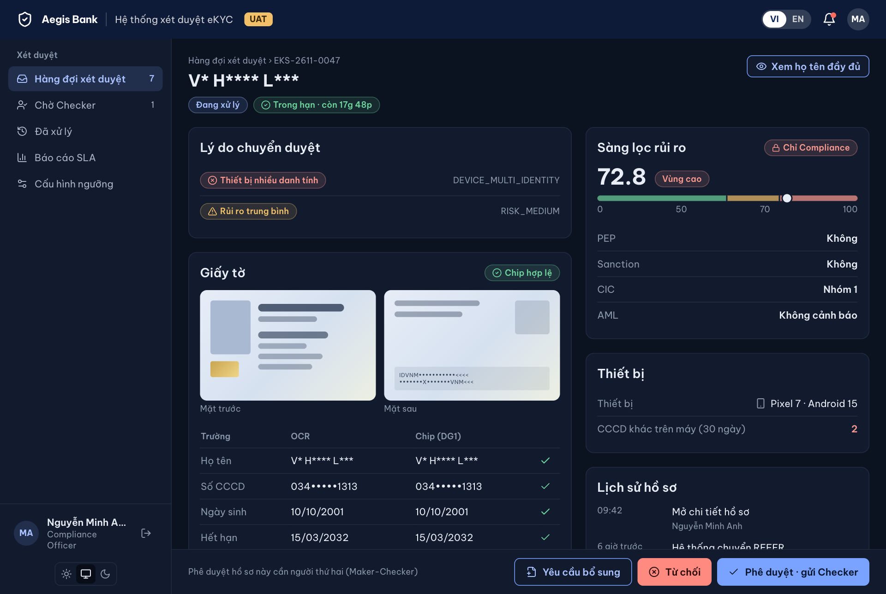
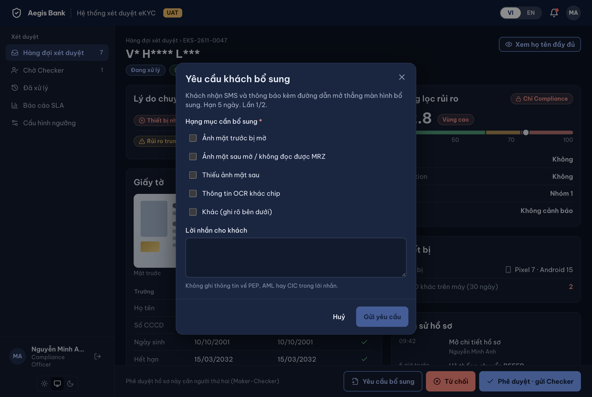
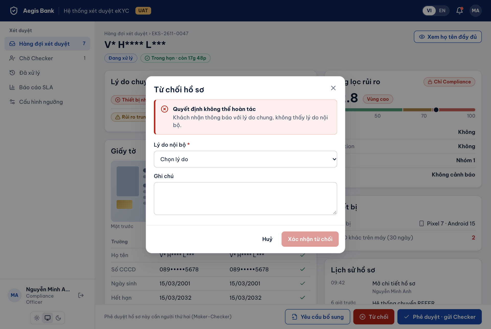
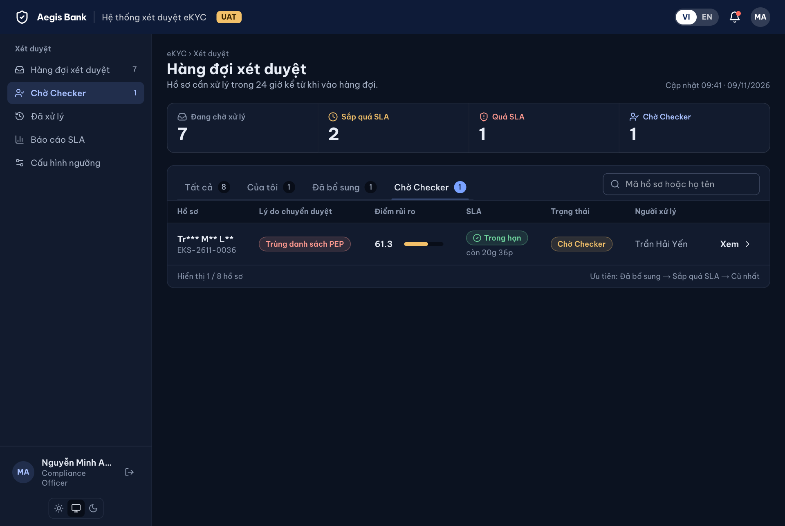
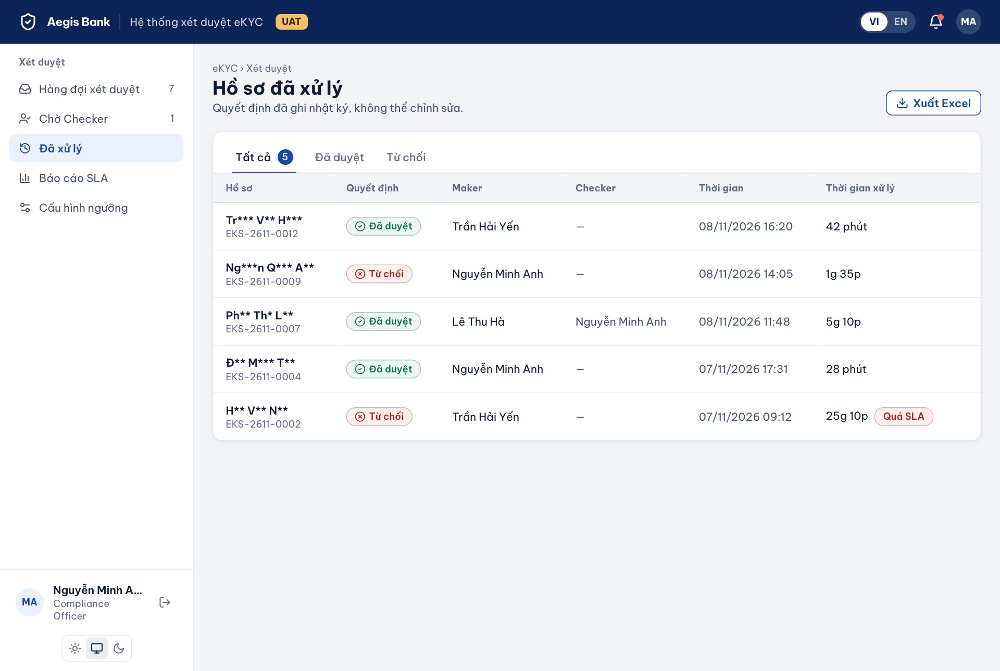
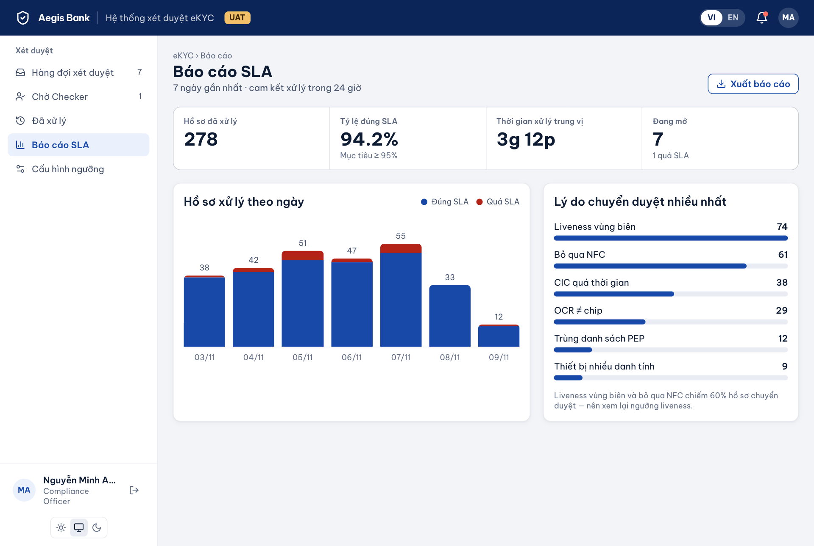
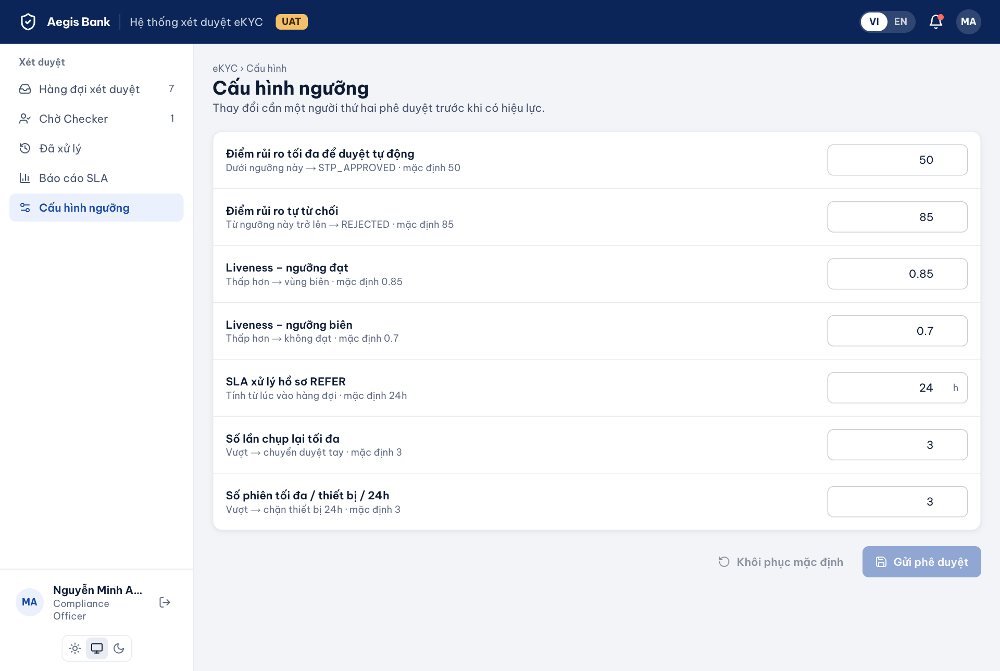

# U02 · Đặc tả giao diện – Aegis Compliance (xét duyệt eKYC)

| | |
|---|---|
| Người dùng | Compliance Officer (Maker/Checker), Trưởng nhóm Compliance, CS/Vận hành (chỉ xem) |
| Jira | SCRUM-48 (FE Compliance), SCRUM-76 → 79, SCRUM-87 |
| Bản chạy | [Bản demo](https://handao2303.github.io/aegis-ekyc-ui/compliance/) · bản nối backend: `/compliance/` khi chạy `npm run dev:all` |
| Mã nguồn | `src/web/CompliancePage.tsx`, `src/web/pages.tsx`, `src/web/store.tsx` (gọi API) |
| Ảnh | Màn hình 1280 × 860, chế độ demo |
| Phiên bản | 1.0 · 23/11/2026 · Han Dao |

## 1. Khung ứng dụng

| Vùng | Nội dung |
|---|---|
| Thanh trên | Logo Aegis Bank · "Hệ thống xét duyệt eKYC" · nhãn môi trường **UAT** · VI/EN · chuông thông báo · ảnh đại diện (chữ viết tắt tên) |
| Menu trái (≥ 1024px) | Hàng đợi xét duyệt (số hồ sơ) · Chờ Checker (số) · Đã xử lý · Báo cáo SLA · Cấu hình ngưỡng · ô **Đăng nhập UAT với vai trò** (chỉ khi có backend) · thẻ người dùng + đăng xuất · chọn giao diện sáng/tối |
| Màn hẹp | Menu chuyển thành thanh ngang cuộn được dưới thanh trên |
| Đăng xuất | Hộp thoại xác nhận: hồ sơ đang nhận được giữ thêm 2 giờ rồi tự nhả |

### Phân quyền hiển thị

| Chức năng | Officer | Trưởng nhóm | CS |
|---|---|---|---|
| Xem hàng đợi | ✅ | ✅ | ✅ (tên che, không có điểm rủi ro) |
| Xem họ tên đầy đủ (ghi audit) | ✅ | ✅ | — |
| Xem sàng lọc rủi ro | ✅ | ✅ | — (thẻ hiện "Chỉ nhóm Compliance được xem") |
| Nhận xử lý, yêu cầu bổ sung, Maker | ✅ | ✅ | — |
| Checker (khác Maker) | ✅ | ✅ | — |
| Đề xuất đổi ngưỡng | ✅ | ✅ | — |
| Phê duyệt đổi ngưỡng (khác người đề xuất) | — | ✅ | — |

## 2. Hàng đợi xét duyệt

| Mục | Nội dung |
|---|---|
| Đầu trang | Breadcrumb "eKYC › Xét duyệt" · mô tả SLA 24 giờ · thời điểm dữ liệu · nút **Làm mới** (có backend; tự làm mới mỗi 20 giây) |
| Thẻ số liệu | Đang chờ xử lý · Sắp quá SLA · Quá SLA · Chờ Checker |
| Tab lọc | Tất cả · Của tôi · Đã bổ sung · Chờ Checker (kèm số lượng) |
| Tìm kiếm | Theo mã hồ sơ hoặc họ tên |
| Cột | Hồ sơ (tên đã che + mã) · Lý do chuyển duyệt (nhãn màu) · Điểm rủi ro (số + thanh) · SLA (nhãn + thời gian còn/trễ) · Trạng thái · Người xử lý · Hành động (**Nhận** / **Xem**) |
| Thứ tự | Đã bổ sung → Sắp/Quá SLA → Cũ nhất (RULE-EKYC-12) |
| SLA | Trong hạn < 16h (xanh) · Sắp quá hạn 16–24h (hổ phách) · Quá SLA > 24h (đỏ) · Tạm dừng khi chờ khách (xám) |
| Trống | "Không có hồ sơ phù hợp bộ lọc." |
| API | `GET /api/cases?view=queue` · `POST /api/cases/:id/claim` |

### Nhãn lý do chuyển duyệt

| Mã | Nhãn | Màu |
|---|---|---|
| `LIVENESS_BORDERLINE` | Liveness vùng biên | Hổ phách |
| `PEP_MATCH` | Trùng danh sách PEP | Đỏ |
| `SANCTION_MATCH` | Nghi trùng Sanction | Đỏ |
| `CIC_TIMEOUT` | CIC quá thời gian | Tím |
| `DOC_DATA_MISMATCH` | OCR ≠ chip | Hổ phách |
| `NFC_SKIPPED` | Bỏ qua NFC | Xám |
| `CHIP_AUTH_FAILED` | Chip sai chữ ký số | Đỏ |
| `DEVICE_MULTI_IDENTITY` | Thiết bị nhiều danh tính | Đỏ |
| `DEVICE_RISK` | Thiết bị rủi ro | Đỏ |
| `PRIOR_REJECTION` | Từng bị từ chối | Hổ phách |
| `IDENTITY_MISMATCH` | Cùng số, khác danh tính | Đỏ |
| `DEDUP_UNAVAILABLE` | Chưa tra trùng được | Tím |
| `OCR_UNREADABLE` | Không đọc được giấy tờ | Xám |
| `FOREIGN_NATIONAL` | Người nước ngoài – kiểm tra thị thực | Tím |
| `RISK_MEDIUM` | Rủi ro trung bình | Hổ phách |

## 3. Chi tiết hồ sơ

| Khối | Nội dung |
|---|---|
| Đầu trang | Breadcrumb · họ tên (che) · trạng thái · SLA · số lần đã yêu cầu bổ sung · nút **Xem họ tên đầy đủ** (ghi `VIEW_PII`) · **Nhận xử lý** / **Nhả hồ sơ** |
| Thông báo | Người khác đang xử lý (chỉ xem) · Chờ Checker (tên Maker) · cần nhận xử lý · kết quả thao tác · lỗi từ backend |
| Lý do chuyển duyệt | Danh sách nhãn + mã |
| Giấy tờ | Nhãn loại (CCCD / Hộ chiếu · quốc tịch) · trạng thái chip · ảnh mặt trước/sau · bảng **OCR vs Chip (DG1)**: họ tên, số hộ chiếu, quốc tịch, số định danh, ngày sinh, hết hạn; dòng lệch tô hổ phách + nhãn "Lệch" |
| Khuôn mặt | Liveness · Face match (dưới ngưỡng tô hổ phách) · nguồn so khớp (ảnh trong chip / ảnh in trên thẻ) · ngưỡng đạt / biên. Nguồn ảnh in → cảnh báo không được duyệt tự động |
| Sàng lọc rủi ro | Nhãn "Chỉ Compliance" · điểm rủi ro + vùng (thấp < 50, trung bình 50–70, cao ≥ 70) · PEP · Sanction · CIC (nhóm) · AML · nút **Tra cứu lại CIC** khi CIC quá thời gian |
| Thiết bị | Model · số CCCD khác trên máy trong 30 ngày |
| Lịch sử hồ sơ | 12 sự kiện gần nhất từ audit log: thời gian, hành động, người thực hiện |
| Thanh quyết định (cố định đáy) | Dòng nhắc (Maker-Checker / chỉ xem / đã có quyết định) · **Yêu cầu bổ sung** · **Từ chối** (Checker: **Trả lại Maker**) · **Phê duyệt** / **Phê duyệt · gửi Checker** / **Checker phê duyệt** |
| API | `GET /api/cases/:id` (ghi `CASE_VIEW`, `VIEW_SENSITIVE`, không ghi trùng trong 1 phút) · `?pii=1` |

### Điều kiện bật nút

| Nút | Bật khi |
|---|---|
| Yêu cầu bổ sung | Mình đang giữ hồ sơ · chưa quá 2 lần · không phải màn Checker · chưa có quyết định |
| Từ chối / Phê duyệt | Mình đang giữ hồ sơ, hoặc hồ sơ chờ Checker · chưa có quyết định · không phải CS |
| Checker phê duyệt | Hồ sơ chờ Checker. Nếu người bấm là Maker, backend chặn và hiện "Checker phải là người khác Maker" |

### Hộp thoại

 

| Hộp thoại | Trường | Kiểm tra | Kết quả |
|---|---|---|---|
| Phê duyệt | Ghi chú nội bộ (khuyến nghị) | Hồ sơ PEP/Sanction/rủi ro ≥ 70 → cảnh báo cần Checker | Duyệt: tạo tài khoản, thông báo khách · hoặc chuyển Chờ Checker |
| Yêu cầu bổ sung | Hạng mục (≥ 1): ảnh mặt trước mờ · mặt sau mờ/MRZ · thiếu mặt sau · OCR khác chip · khác; lời nhắn | Chọn "Khác" phải có lời nhắn; lời nhắn không nhắc PEP/AML/CIC | Chờ khách bổ sung, SLA tạm dừng, hạn 5 ngày |
| Từ chối | Lý do nội bộ (bắt buộc, danh sách) · ghi chú | Cảnh báo không hoàn tác | REJECTED; khách nhận lý do chung |
| Trả lại Maker | Lý do (bắt buộc) | — | Về REFER, giao lại Maker |

## 4. Chờ Checker

Hàng đợi lọc sẵn hồ sơ `PENDING_CHECKER`; cột Người xử lý hiện tên Maker.

## 5. Đã xử lý

| Mục | Nội dung |
|---|---|
| Tab | Tất cả · Đã duyệt · Từ chối |
| Cột | Hồ sơ · Quyết định · Maker · Checker · Thời gian · Thời gian xử lý (> 24h có nhãn Quá SLA) |
| Hành động | Bấm dòng để xem chi tiết (chỉ xem) · Xuất Excel |
| API | `GET /api/cases?view=done` |

## 6. Báo cáo SLA

| Mục | Nội dung |
|---|---|
| Thẻ số liệu | Hồ sơ đã xử lý (7 ngày) · Tỷ lệ đúng SLA (mục tiêu ≥ 95%) · Thời gian xử lý trung vị · Đang mở (số quá SLA) |
| Biểu đồ | Cột theo ngày, tách đúng SLA / quá SLA |
| Lý do chuyển duyệt nhiều nhất | 6 lý do, thanh ngang; ghi chú STP và tỷ lệ dùng ảnh in trên thẻ trong 30 ngày |
| API | `GET /api/reports/sla?days=7` · `GET /api/reports/kpi?days=30` (định nghĩa chỉ số: [C18](../1.5-analytics/C18-kpi-metric-dictionary.md)) |

## 7. Cấu hình ngưỡng

| Mục | Nội dung |
|---|---|
| Tham số | Điểm rủi ro tối đa để duyệt tự động (50) · Điểm tự từ chối (80) · Điểm cần Checker (70) · Liveness đạt (0.85) · Liveness biên (0.70) · SLA (24h) · Hạn khách bổ sung (5 ngày) · Số lần chụp lại (3) · Phiên/thiết bị/24h (3) · Tuổi tối thiểu tín dụng (18) |
| Sửa | Ô số; dòng đã sửa có nhãn "Đã sửa"; hiện ô **Lý do thay đổi** (≥ 10 ký tự) |
| Gửi | **Gửi phê duyệt** tạo 1 đề xuất cho mỗi tham số đã sửa |
| Đề xuất chờ duyệt | Giá trị cũ → mới, người đề xuất, lý do; nút Phê duyệt / Từ chối chỉ bật cho Trưởng nhóm khác người đề xuất |
| Lịch sử | 20 thay đổi gần nhất: tham số, cũ → mới, kết quả, người đề xuất → người duyệt |
| Kiểm tra | Giá trị trong khoảng cho phép (vd. SLA 1–168h); khác giá trị hiện tại |
| API | `GET /api/config` · `POST /api/config/changes` · `POST /api/config/changes/:id/approve` hoặc `/reject` |

## 8. Truy vết

| Màn | Story | Quy tắc | UAT | Test case ([T02](../1.4-testing/T02-test-cases.md)) |
|---|---|---|---|---|
| Hàng đợi | SCRUM-78 | RULE-12 | 18 | TC-CO-01 → 06 |
| Chi tiết, PII, sàng lọc | SCRUM-79 | C10 §3–4 | 09 | TC-CO-07 → 12 |
| Yêu cầu bổ sung | SCRUM-76 | C07 | 16 | TC-CO-13 → 17 |
| Maker-Checker | SCRUM-79 | RULE-13 | 08, 19 | TC-CO-18 → 24 |
| Báo cáo SLA | SCRUM-78, 87 | C18 | — | TC-CO-25 → 26 |
| Cấu hình ngưỡng | SCRUM-79 | NFR-SEC-05 | 23 | TC-CO-27 → 31 |
