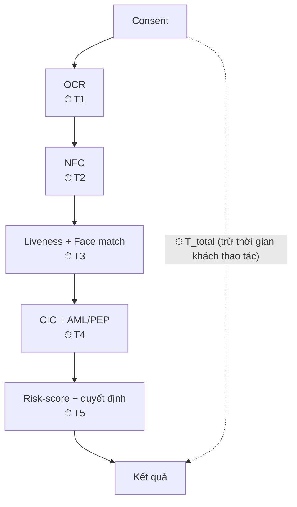

# C15 · Kế hoạch kiểm thử hiệu năng end-to-end

| | |
|---|---|
| Phiên bản | 0.2 · 25/11/2026 · Han Dao (BA) |
| Trạng thái | 🔧 Kế hoạch xong · chờ thiết bị NFC thứ hai và môi trường |
| Jira | [SCRUM-84](https://baohandao2303.atlassian.net/browse/SCRUM-84) · liên quan [SCRUM-57](https://baohandao2303.atlassian.net/browse/SCRUM-57) |
| Yêu cầu | NFR-PERF-02 (mỗi bước < 3s P95) · NFR-PERF-03 (toàn luồng ≤ 3 phút P90) |

## 1. Điểm đo trên luồng

## 2. Kịch bản đo

| Mã | Bước | Cách đo | Mẫu tối thiểu | Ngưỡng | Môi trường |
|---|---|---|---|---|---|
| P-01 | OCR | Log `confirmFrontPhoto()` trên thiết bị | 30 | < 3s P95 | Android thật |
| P-02 | NFC (BAC → DG1/DG2) | Log `[LATENCY-NFC]` | 30 | < 3s P95 | 2 máy NFC khác hãng |
| P-03 | Liveness + Face match | `POST /sessions/:id/liveness` | 30 | < 3s P95 | Cloud Run dev |
| P-04 | CIC + AML/PEP | Span tracing của screening | 30 | Trong timeout budget | Sandbox thật (C16) |
| P-05 | Quyết định | `POST /sessions/:id/submit` | 30 | < 3s P95 | Cloud Run dev |
| P-06 | Toàn luồng | Từ Consent đến kết quả | 20 | ≤ 3 phút P90 | Thiết bị thật |
| P-07 | Tải đồng thời | k6: 50 phiên đồng thời bước P-03 & P-05 | 5 phút | Lỗi < 1%, P95 < 3s | Cloud Run dev |
| P-08 | Cold start | Gọi P-05 sau 15 phút không tải | 10 | Ghi nhận, không chặn | Cloud Run dev |

## 3. Quy tắc đánh giá

- Báo cáo **P50 / P95 / P99 (ms)** và **số mẫu thực tế** cho mỗi kịch bản, không chỉ "đạt / không đạt".
- Vượt ngưỡng: ghi root cause và tạo ticket khắc phục; **không** tự coi là đạt.
- Thiết bị lỗi phần cứng (như máy Sony SO-51A ở SCRUM-57): đổi máy và ghi rõ model.
- Kết thúc: cập nhật và đóng đúng SCRUM-57.

## 4. Mẫu báo cáo

| Mã | Thiết bị / môi trường | Số mẫu | P50 | P95 | P99 | Ngưỡng | Kết luận |
|---|---|---|---|---|---|---|---|
| P-01 | Sony SO-51A | 4 | — | 306 ms | — | 3000 ms | Chưa đủ mẫu (từ SCRUM-57) |
| P-01 | | | | | | 3000 ms | |
| P-02 | | | | | | 3000 ms | |

## 5. Kiểm soát tài liệu

### Lịch sử phiên bản

| Phiên bản | Ngày | Người sửa | Commit | Thay đổi |
|---|---|---|---|---|
| 0.1 | 21/11/2026 | Han Dao | `51eaebb` | Bản đầu kèm diagram (Epic SCRUM-69) |
| 0.2 | 25/11/2026 | Han Dao | — | Thêm mục kiểm soát tài liệu (phiên bản, lịch sử, phê duyệt) theo ISO/IEC/IEEE 29148 và 29119-3 |

### Phê duyệt

| Vai trò | Người | Ngày | Kết luận |
|---|---|---|---|
| BA (soạn) | Han Dao | 25/11/2026 | Trình duyệt |
| QA Lead | | | |
| Product Owner | | | |
