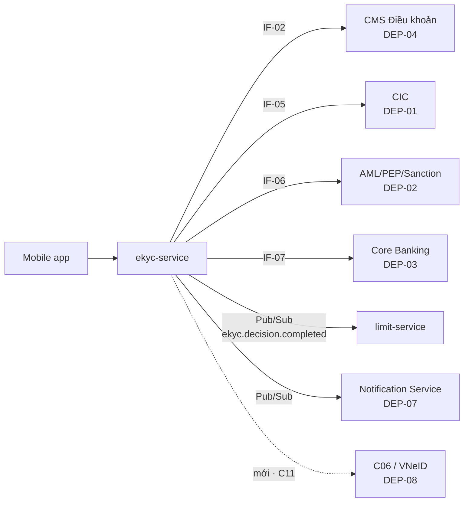
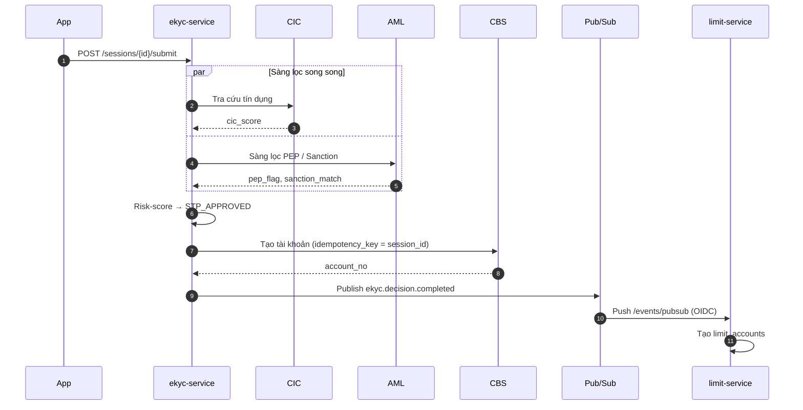

# C16 · Kế hoạch kiểm thử tích hợp (SIT) với sandbox thật

| | |
|---|---|
| Mã tài liệu | AEG-EKYC-C16 |
| Phiên bản | 0.3 |
| Ngày phát hành | 26/11/2026 |
| Trạng thái | ⛔ Kế hoạch xong · bị chặn bởi SCRUM-56 (sandbox đối tác) |
| Phân loại | Nội bộ |
| Tác giả | Han Dao (BA) |
| Người duyệt | QA Lead · Product Owner – chưa duyệt |
| Mục đích và phạm vi | Lập kế hoạch kiểm thử tích hợp (SIT) eKYC với sandbox đối tác thật |
| Chuẩn tham chiếu | ISO/IEC/IEEE 29119-3:2021 – đánh giá ở [Q01](../../00-overview/Q01-standards-conformance.md) |
| Thuật ngữ | [G02 Thuật ngữ và chữ viết tắt](../../00-overview/G02-glossary.md) |
| Jira | [SCRUM-85](https://baohandao2303.atlassian.net/browse/SCRUM-85) · bị chặn bởi [SCRUM-56](https://baohandao2303.atlassian.net/browse/SCRUM-56) · chặn [SCRUM-86](https://baohandao2303.atlassian.net/browse/SCRUM-86) |

## 1. Bản đồ tích hợp

## 2. Trình tự happy path cần chứng minh trên sandbox

## 3. Kịch bản

| Mã | Hệ thống | Kịch bản | Kỳ vọng | Bằng chứng |
|---|---|---|---|---|
| SIT-01 | CIC | Khách không nợ xấu | Nhận `cic_score`, tiếp tục | Log + response |
| SIT-02 | CIC | Khách có nợ xấu | Điểm rủi ro tăng đúng bảng | Log |
| SIT-03 | CIC | Sandbox trả chậm > timeout | Circuit Breaker mở, hồ sơ vào hàng đợi (SCRUM-42) | Log + hàng đợi |
| SIT-04 | AML | Không trùng | Tiếp tục | Log |
| SIT-05 | AML | Trùng PEP | REFER bất kể điểm (RULE-EKYC-04) | KYCDecision |
| SIT-06 | AML | Trùng Sanction | REJECTED / REFER theo cấu hình | KYCDecision |
| SIT-07 | AML | Timeout | Circuit Breaker | Log |
| SIT-08 | CBS | Tạo tài khoản | `account_no` trả về | DB |
| SIT-09 | CBS | Gọi lại cùng `idempotency_key` | Chỉ 1 tài khoản (TC2-1) | DB |
| SIT-10 | CBS | CBS lỗi 5xx | Retry; không publish sự kiện khi chưa có tài khoản | Log + Pub/Sub |
| SIT-11 | CMS | Version không đổi | Không hỏi re-consent | UI |
| SIT-12 | CMS | Version mới | Re-consent (SCRUM-46) | ConsentRecord |
| SIT-13 | CMS | CMS lỗi | Không thu thập dữ liệu mới | UI + log |
| SIT-14 | Pub/Sub | STP_APPROVED | `limit_accounts` tự tạo (SCRUM-62) | DB |
| SIT-15 | Notification | Duyệt / từ chối / yêu cầu bổ sung | SMS + Push đúng mẫu (C08) | Log NS |

## 4. Điều kiện vào / ra SIT

| | Tiêu chí |
|---|---|
| **Vào** | DEP-01→04, 07 ở trạng thái Confirmed hoặc có mock contract-test được đối tác xác nhận · build ổn định trên môi trường dev |
| **Ra** | 100% kịch bản chạy · không còn lỗi Critical/High · lỗi Medium có kế hoạch xử lý · cập nhật trạng thái DEP trong SCRUM-56 |

Dependency nào chưa có sandbox thì ghi vào RAID và **đánh dấu là điều kiện của UAT**, không bỏ qua.

## 5. Kiểm soát tài liệu

### Tài liệu tham chiếu

| Mã | Tài liệu |
|---|---|
| Q01 | [Q01 · Đối chiếu tài liệu 3 module với chuẩn quốc tế](../../00-overview/Q01-standards-conformance.md) |

Chuẩn quốc tế: xem trường *Chuẩn tham chiếu* ở đầu trang.

### Lịch sử phiên bản

| Phiên bản | Ngày | Người sửa | Commit | Thay đổi |
|---|---|---|---|---|
| 0.1 | 21/11/2026 | Han Dao | `51eaebb` | Bản đầu kèm diagram (Epic SCRUM-69) |
| 0.2 | 25/11/2026 | Han Dao | — | Thêm mục kiểm soát tài liệu (phiên bản, lịch sử, phê duyệt) theo ISO/IEC/IEEE 29148 và 29119-3 |
| 0.3 | 26/11/2026 | Han Dao | — | Chuẩn hoá cấu trúc theo ISO/IEC/IEEE 15289: khối thuộc tính đầu trang, tài liệu tham chiếu, thuật ngữ dùng chung (G02), mục kiểm soát tài liệu thống nhất |

### Phê duyệt

| Vai trò | Người | Ngày | Kết luận |
|---|---|---|---|
| BA (soạn) | Han Dao | 25/11/2026 | Trình duyệt |
| QA Lead |  |  |  |
| Product Owner |  |  |  |
