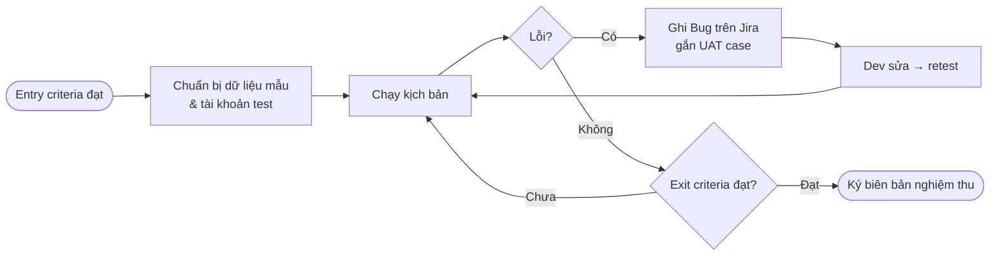

# C17 · Bộ UAT eKYC & biên bản nghiệm thu

| | |
|---|---|
| Phiên bản | 0.3 · 25/11/2026 · Han Dao (BA) |
| Trạng thái | ⛔ Bộ kịch bản xong · chờ C03 duyệt và SIT (C16) |
| Jira | [SCRUM-86](https://baohandao2303.atlassian.net/browse/SCRUM-86) · bị chặn bởi [SCRUM-72](https://baohandao2303.atlassian.net/browse/SCRUM-72), [SCRUM-85](https://baohandao2303.atlassian.net/browse/SCRUM-85) |
| Người soạn | BA · Người nghiệm thu: PO + Compliance |
| Dữ liệu | Hồ sơ mẫu có nhãn kỳ vọng; **không dùng dữ liệu thật của khách** |
| Chuẩn tham chiếu | ISO/IEC/IEEE 29119-3:2021 – đánh giá ở [Q01](../../00-overview/Q01-standards-conformance.md) |

## 1. Quy trình UAT

## 2. Điều kiện

| | Tiêu chí |
|---|---|
| **Entry** | SIT đạt (C16) · không còn lỗi Critical/High · BRD/FSD/SRS v1.3 đã duyệt (C03) · môi trường UAT ổn định · dữ liệu mẫu sẵn sàng |
| **Exit** | 100% case Must chạy · ≥ 95% case pass · 0 lỗi Critical/High mở · lỗi Medium/Low được PO chấp nhận bằng văn bản |

## 3. Danh sách kịch bản

Ký hiệu nguồn: hồ sơ mẫu `TD-xx` chuẩn bị theo bảng ở mục 4.

| Mã | Kịch bản | Dữ liệu | Kỳ vọng | BR | Ưu tiên |
|---|---|---|---|---|---|
| UAT-EKYC-01 | Happy path có NFC | TD-01 | STP_APPROVED, nhận số TK + thông báo | BR-01→08 | Must |
| UAT-EKYC-02 | Máy không NFC (OCR-only) | TD-02 | Cảnh báo duyệt tay → REFER, không STP | BR-19 | Must |
| UAT-EKYC-03 | Điều khoản đổi giữa chừng | TD-01 | Bắt đồng ý lại | BR-11 | Must |
| UAT-EKYC-04 | Liveness vùng biên | TD-03 | REFER, lý do `LIVENESS_BORDERLINE` | BR-05 | Must |
| UAT-EKYC-05 | Trùng PEP, điểm thấp | TD-04 | REFER (override) | BR-05 | Must |
| UAT-EKYC-06 | Rủi ro cao | TD-05 | REJECTED, lý do chung cho khách | BR-05 | Must |
| UAT-EKYC-07 | CIC quá thời gian | TD-06 | Vào hàng đợi, không treo | BR-10 | Must |
| UAT-EKYC-08 | Compliance duyệt REFER | TD-03 | Tài khoản được tạo, `decided_by` đúng | BR-07 | Must |
| UAT-EKYC-09 | Người ngoài Compliance xem rủi ro | — | Bị chặn | BR-07 | Must |
| UAT-EKYC-10 | Chụp lỗi 3 lần | TD-07 | Lần 3 chuyển REFER | BR-06 | Should |
| UAT-EKYC-11 | Tạo tài khoản gọi lại 2 lần | TD-01 | 1 tài khoản | BR-08 | Must |
| UAT-EKYC-12 | CCCD đã có tài khoản | TD-08 | Dừng trước Liveness, mời đăng nhập | BR-12 | Must |
| UAT-EKYC-13 | CCCD hết hạn | TD-09 | REJECTED `DOC_EXPIRED` | BR-13 | Must |
| UAT-EKYC-14 | Chưa đủ tuổi (sản phẩm tín dụng) | TD-10 | REJECTED `UNDER_AGE` | BR-13 | Must |
| UAT-EKYC-15 | Tiếp tục phiên dở | TD-01 | Về đúng bước, Liveness làm lại | BR-14 | Should |
| UAT-EKYC-16 | Yêu cầu bổ sung → khách gửi lại | TD-03 | SLA tạm dừng, hồ sơ lên đầu hàng đợi | BR-15 | Must |
| UAT-EKYC-17 | Thông báo theo ma trận C08 | TD-01, 03, 05 | Đúng kênh, đúng mẫu, không lộ AML/PEP | BR-16 | Must |
| UAT-EKYC-18 | SLA 16h / 24h | TD-11 | Badge đổi màu, leo thang 20h, Breach 24h | BR-17 | Should |
| UAT-EKYC-19 | Maker-Checker hồ sơ PEP | TD-04 | Maker không tự duyệt; Checker khác duyệt mới tạo TK | BR-18 | Must |
| UAT-EKYC-20 | Chip sai chữ ký số | TD-12 | `CHIP_AUTH_FAILED` → REFER | BR-19 | Must |
| UAT-EKYC-21 | Rút lại đồng ý khi đang làm | TD-01 | Huỷ phiên, xoá dữ liệu ≤ 24h | BR-20 | Must |
| UAT-EKYC-22 | Một máy, hai CCCD | TD-13 | REFER `DEVICE_MULTI_IDENTITY` | BR-21 | Must |
| UAT-EKYC-23 | Đổi ngưỡng cấu hình | — | Cần người thứ hai duyệt; có audit | NFR-SEC-05 | Should |
| UAT-EKYC-24 | Song ngữ VI/EN | — | Toàn bộ màn hình đổi ngôn ngữ, giữ lựa chọn | — | Should |
| UAT-EKYC-25 | Hộ chiếu Việt Nam gắn chip | TD-14 | Chụp 1 trang, đọc chip ở bìa → STP_APPROVED | BR-12, 13 | Must |
| UAT-EKYC-26 | Hộ chiếu nước ngoài | TD-15 | REFER `FOREIGN_NATIONAL`; Compliance thấy quốc tịch, số hộ chiếu đã che | BR-12 | Must |
| UAT-EKYC-27 | Khách dưới 16 tuổi mở tài khoản thanh toán trực tuyến | Ngày sinh 01/03/2011 (15 tuổi) | REJECTED `UNDER_AGE`; khách tròn 16 tuổi đi tiếp bình thường | BR-13, P01 PR-02 | Must |

## 4. Dữ liệu mẫu

| Mã | Mô tả | Đặc điểm |
|---|---|---|
| TD-01 | Khách chuẩn | CCCD còn hạn, chip hợp lệ, liveness 0.97, CIC nhóm 1 |
| TD-02 | Máy không NFC | Như TD-01, thiết bị không NFC |
| TD-03 | Liveness biên | liveness 0.74 |
| TD-04 | PEP | `pep_flag = true`, risk 45 |
| TD-05 | Rủi ro cao | risk 88 |
| TD-06 | CIC chậm | Sandbox CIC cấu hình trễ 30s |
| TD-07 | Ảnh xấu | Ảnh mờ, loá |
| TD-08 | Khách cũ | CCCD đã có tài khoản active |
| TD-09 | Hết hạn | `expiry_date` = 15/03/2025 |
| TD-10 | 17 tuổi | Sinh 2009 – bị chặn sản phẩm tín dụng (18), được mở tài khoản thanh toán (16) |
| TD-11 | Hồ sơ cũ | Tạo lùi thời gian vào hàng đợi 17h / 25h |
| TD-12 | Chip giả | Chữ ký số không hợp lệ |
| TD-13 | Nhiều danh tính | Cùng `device_id`, 2 CCCD khác nhau |
| TD-14 | Hộ chiếu Việt Nam | Số hộ chiếu C1414141, có số định danh, chip hợp lệ |
| TD-15 | Hộ chiếu nước ngoài | Quốc tịch GBR, không có số định danh Việt Nam |

## 5. Mẫu ghi kết quả

| Mã | Ngày chạy | Người chạy | Kết quả | Bug | Ghi chú |
|---|---|---|---|---|---|
| UAT-EKYC-01 | | | ☐ Pass ☐ Fail | | |

## 6. Biên bản nghiệm thu

> **BIÊN BẢN NGHIỆM THU UAT – MODULE eKYC (Aegis)**
>
> Phiên bản phát hành: ______ · Môi trường: UAT · Thời gian: từ ……/……/………… đến ……/……/…………
>
> | Chỉ số | Kết quả |
> |---|---|
> | Tổng số case / đã chạy | ___ / ___ |
> | Pass / Fail | ___ / ___ |
> | Lỗi mở (Critical / High / Medium / Low) | ___ / ___ / ___ / ___ |
>
> Lỗi được chấp nhận chuyển sang phiên bản sau: ___________________
>
> Kết luận: ☐ Đồng ý phát hành ☐ Đồng ý có điều kiện ☐ Không đồng ý
>
> | Vai trò | Họ tên | Chữ ký | Ngày |
> |---|---|---|---|
> | Product Owner | | | |
> | Compliance | | | |
> | BA | | | |

## 7. Kiểm soát tài liệu

### Lịch sử phiên bản

| Phiên bản | Ngày | Người sửa | Commit | Thay đổi |
|---|---|---|---|---|
| 0.1 | 21/11/2026 | Han Dao | `51eaebb` | Bản đầu kèm diagram (Epic SCRUM-69) |
| 0.2 | 23/11/2026 | Han Dao | `c70e906` | Bổ sung luồng hộ chiếu gắn chip (Việt Nam và nước ngoài) |
| 0.3 | 25/11/2026 | Han Dao | — | Thêm UAT-EKYC-27 (dưới 16 tuổi, tài khoản thanh toán); làm rõ TD-10; thêm mục kiểm soát tài liệu (phiên bản, lịch sử, phê duyệt) theo ISO/IEC/IEEE 29148 và 29119-3 |

### Phê duyệt

| Vai trò | Người | Ngày | Kết luận |
|---|---|---|---|
| BA (soạn) | Han Dao | 25/11/2026 | Trình duyệt |
| QA Lead | | | |
| Product Owner | | | |
