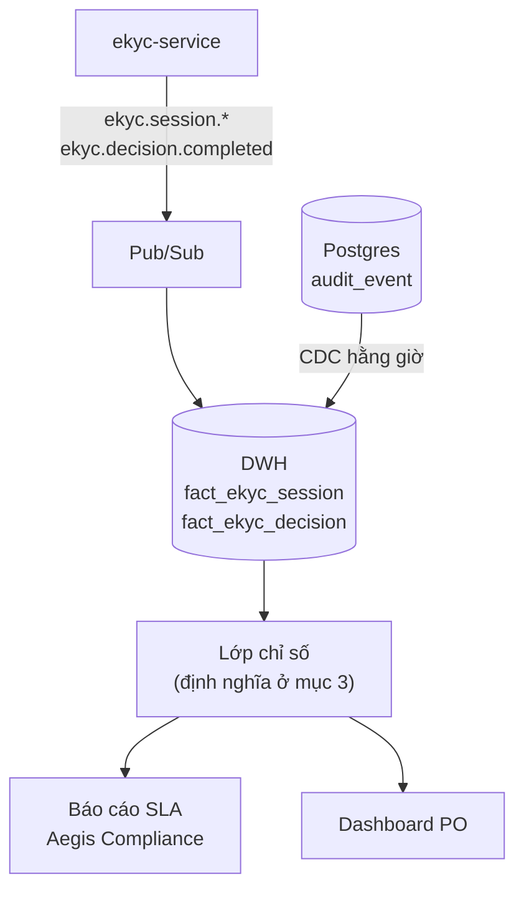
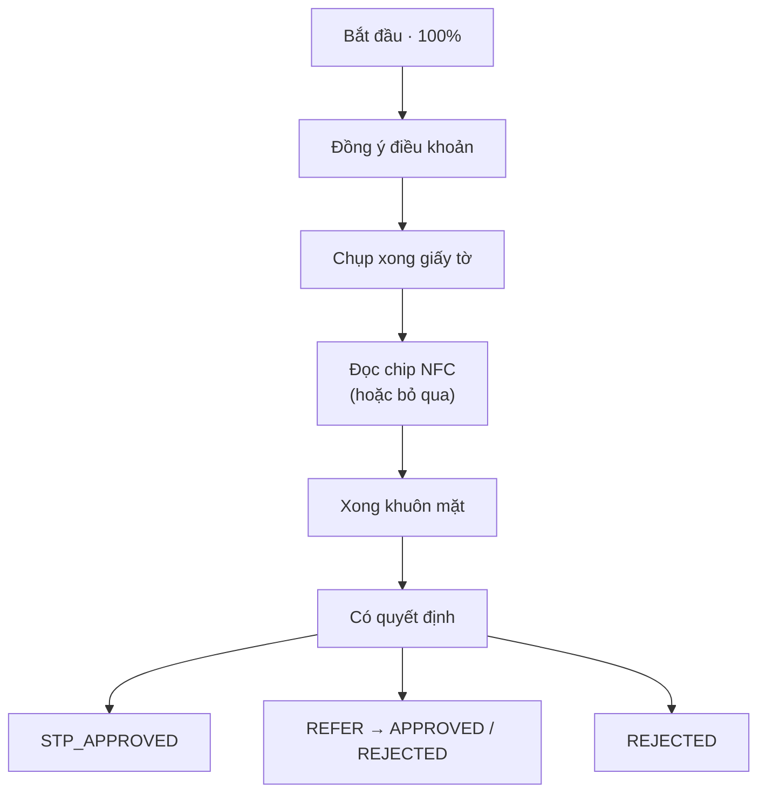

# C18 · Dashboard KPI eKYC & từ điển chỉ số

| | |
|---|---|
| Phiên bản | 0.2 · 25/11/2026 · Han Dao (BA) |
| Trạng thái | ✅ Đặc tả + báo cáo SLA/KPI có backend · chờ PO duyệt |
| Jira | [SCRUM-87](https://baohandao2303.atlassian.net/browse/SCRUM-87) |
| UI | Màn **Báo cáo SLA** trong Aegis Compliance (bản mẫu: [pages.tsx](../../../src/web/pages.tsx)) |
| Nguồn dữ liệu | Sự kiện trạng thái phiên (C06), `kyc_decisions`, `audit_event` (C10) → DWH |
| Chuẩn tham chiếu | ISO/IEC 25010 (đặc tính chất lượng đo được) · không có chuẩn bắt buộc cho từ điển chỉ số – [Q01](../../00-overview/Q01-standards-conformance.md) |

## 1. Luồng dữ liệu



## 2. Phễu mở tài khoản



Mỗi mũi tên là một bước đo tỷ lệ rơi rụng: `phiên tới bước n+1 ÷ phiên tới bước n`.

## 3. Từ điển chỉ số

| Chỉ số | Định nghĩa | Công thức | Mục tiêu (PO chốt) | Chiều cắt |
|---|---|---|---|---|
| **STP rate** | Tỷ lệ hồ sơ được duyệt tự động trong số hồ sơ có quyết định | `count(STP_APPROVED) / count(decided)` | ≥ 70% | Ngày, nền tảng, có/không NFC |
| **Tỷ lệ hoàn tất** | Phiên có quyết định trên phiên bắt đầu | `count(decided) / count(CREATED)` | ≥ 60% | Ngày, nền tảng |
| **Rơi rụng theo bước** | Phiên dừng ở mỗi bước | `1 − reached(n+1) / reached(n)` | Theo dõi | Bước, thiết bị |
| **Tỷ lệ REFER / REJECTED** | Theo mã lý do | `count(reason = x) / count(decided)` | Theo dõi | Lý do |
| **% đúng SLA** | Hồ sơ REFER có quyết định trong 24h (trừ thời gian tạm dừng) | `count(handling_h ≤ 24) / count(refer_decided)` | ≥ 95% | Ngày, nhân viên |
| **Thời gian xử lý trung vị** | Từ vào hàng đợi đến quyết định, trừ tạm dừng | `median(handling_h)` | ≤ 4h | Ngày |
| **Tỷ lệ cứu hồ sơ** | Hồ sơ được yêu cầu bổ sung rồi được duyệt | `count(info_requested ∧ approved) / count(info_requested)` | Theo dõi | — |
| **Tỷ lệ NFC fallback** | Phiên OCR-only | `count(match_source = OCR_FRONT) / count(liveness_done)` | ≤ 25% | Thiết bị |
| **Velocity hits** | Số lần kích hoạt quy tắc C13 | `count(ekyc.fraud.velocity_hit)` | Theo dõi | Quy tắc |
| **P95 latency** | Theo bước | Từ tracing (C15) | < 3s | Bước |

## 4. SQL tham chiếu

```sql
-- STP rate theo ngày
SELECT
  date_trunc('day', decided_at)                                   AS day,
  count(*) FILTER (WHERE decision = 'STP_APPROVED')::numeric
    / nullif(count(*), 0)                                          AS stp_rate
FROM fact_ekyc_decision
GROUP BY 1
ORDER BY 1;

-- % đúng SLA cho hồ sơ REFER (đã trừ thời gian chờ khách)
SELECT
  date_trunc('day', decided_at) AS day,
  avg((extract(epoch FROM decided_at - queued_at) - paused_seconds) / 3600 <= 24)::numeric AS sla_rate
FROM fact_ekyc_decision
WHERE entered_refer = true
GROUP BY 1;
```

## 5. Quy tắc hiển thị

- Dashboard chỉ hiện **số tổng hợp**, không hiện dữ liệu định danh.
- Chỉ nhóm PO và Compliance được xem.
- Số liệu phải khớp truy vấn kiểm chứng ở mục 4 (sai lệch 0%).
- Trạng thái luôn có chữ đi kèm màu (đúng nguyên tắc design system).

## 6. Kiểm soát tài liệu

### Lịch sử phiên bản

| Phiên bản | Ngày | Người sửa | Commit | Thay đổi |
|---|---|---|---|---|
| 0.1 | 21/11/2026 | Han Dao | `51eaebb` | Bản đầu kèm diagram (Epic SCRUM-69) |
| 0.2 | 25/11/2026 | Han Dao | — | Thêm mục kiểm soát tài liệu (phiên bản, lịch sử, phê duyệt) theo ISO/IEC/IEEE 29148 và 29119-3 |

### Phê duyệt

| Vai trò | Người | Ngày | Kết luận |
|---|---|---|---|
| BA (soạn) | Han Dao | 25/11/2026 | Trình duyệt |
| Product Owner | | | |
| Data/BI | | | |
