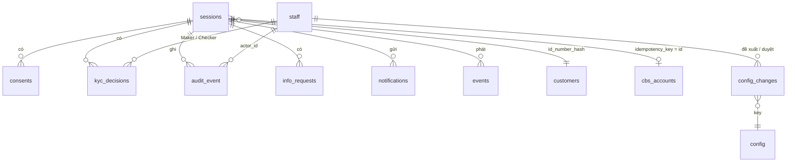

# D01 · Từ điển dữ liệu – Module 1 eKYC

| | |
|---|---|
| Phiên bản | 1.1 |
| Trạng thái | 📝 Bản nháp, chờ Tech Lead và DPO (đầu mối bảo vệ dữ liệu) xác nhận |
| Người soạn | Han Dao (BA) |
| Ngày | 24/11/2026 |
| Jira | [SCRUM-69](https://baohandao2303.atlassian.net/browse/SCRUM-69), [SCRUM-81](https://baohandao2303.atlassian.net/browse/SCRUM-81) (lưu trữ) |
| Nguồn | Lược đồ `server/src/db.ts`, tham số `server/src/config.ts`, đối chiếu ngày 24/11/2026 |
| Chuẩn tham chiếu | BABOK v3 §10.15 Data Dictionary; phân loại dữ liệu theo Nghị định 13/2023/NĐ-CP (dữ liệu cá nhân cơ bản / nhạy cảm) và ISO/IEC 29100 |
| Liên quan | [A03](A03-api-specification.md) (API), [C10](../1.1-business/C10-maker-checker-audit.md) (audit), [C12](../1.2-compliance-legal/C12-consent-retention.md) (lưu trữ), [P01](../1.2-compliance-legal/P01-terms-privacy.md) (quyền riêng tư) |

Tài liệu định nghĩa **mỗi trường dữ liệu**: ý nghĩa, kiểu, nguồn, mức nhạy cảm và thời hạn lưu. Dùng cho Dev (lược đồ), QA (dữ liệu test), Compliance và Pháp chế (hồ sơ xử lý dữ liệu cá nhân theo NĐ 13).

## 1. Quy ước

**Mức phân loại**

| Mức | Ý nghĩa | Theo NĐ 13 | Ví dụ |
|---|---|---|---|
| 🔴 **S** – Nhạy cảm | Dữ liệu sinh trắc, tín dụng, kết quả sàng lọc | Dữ liệu cá nhân nhạy cảm (Điều 2 khoản 4: sinh trắc học, thông tin tín dụng) | Ảnh khuôn mặt, điểm liveness, kết quả CIC, cờ PEP |
| 🟠 **P** – Cá nhân | Xác định được một người | Dữ liệu cá nhân cơ bản (Điều 2 khoản 3) | Họ tên, ngày sinh, số định danh, số điện thoại |
| 🟡 **I** – Nội bộ | Không xác định người nhưng không công khai | — | Trạng thái, lý do REFER, mã nhân viên |
| ⚪ **N** – Không nhạy cảm | Cấu hình, mã kỹ thuật | — | Ngưỡng SLA, mã template |

**Kiểu dữ liệu:** `TEXT`, `INTEGER`, `REAL` (lược đồ SQLite dùng chung được với Postgres). `ms` = epoch mili-giây UTC. `bool` = `INTEGER` 0/1. `json` = `TEXT` chứa JSON.

**Bảo vệ:** `hash` = SHA-256 có salt, không đảo ngược được · `mask` = che một phần trước khi hiển thị · `enc` = **cần** mã hoá cột ở production (chưa làm, xem §6).

## 2. Sơ đồ quan hệ

## 3. Bảng và trường

### 3.1 `sessions` – phiên mở tài khoản (một dòng mỗi lần khách bắt đầu)

| Trường | Kiểu | Bắt buộc | Ý nghĩa | Nguồn | Mức | Bảo vệ | Ví dụ |
|---|---|---|---|---|---|---|---|
| `id` | TEXT | ✅ | Mã hồ sơ `EKS-YYMM-NNNN` | Hệ thống | I | — | `EKS-2611-0007` |
| `token` | TEXT | ✅ | Token phiên của app, duy nhất | Hệ thống (18 byte ngẫu nhiên) | I | Không trả cho nhân viên | — |
| `status` | TEXT | ✅ | Trạng thái (A03 §5.1) | Hệ thống | I | — | `REFER` |
| `last_step` | TEXT | | Bước cuối đã xong, dùng để tiếp tục phiên | Hệ thống | I | — | `DOC_CAPTURED` |
| `product` | TEXT | ✅ | `payment` hoặc `credit`, quyết định tuổi tối thiểu | App | N | — | `payment` |
| `device_id` | TEXT | ✅ | Mã thiết bị | App | P | — | — |
| `device_model` | TEXT | | Dòng máy | App | I | — | `iPhone 15` |
| `device_rooted` | bool | ✅ | Máy đã root / jailbreak | App | I | — | 0 |
| `phone` | TEXT | | Số điện thoại nhận thông báo | Khách nhập | P | mask khi hiển thị; enc | — |
| `terms_version` | TEXT | | Phiên bản điều khoản đã đồng ý | App | N | — | `2026.11` |
| `doc_type` | TEXT | ✅ | `CCCD` hoặc `PASSPORT` | Khách chọn | I | — | `CCCD` |
| `nationality` | TEXT | | Quốc tịch ISO 3166-1 alpha-3 | OCR / chip | P | — | `VNM` |
| `passport_masked` | TEXT | | Số hộ chiếu đã che | Hệ thống | P | mask | `C•••567` |
| `id_number_hash` | TEXT | | Khoá tra trùng: hash số định danh, hoặc `P:quốc tịch:số hộ chiếu` | Hệ thống | P | hash | — |
| `id_number_masked` | TEXT | | Số định danh đã che | Hệ thống | P | mask | `079•••••1234` |
| `full_name` | TEXT | | Họ tên theo giấy tờ | OCR | P | mask khi hiển thị; enc | — |
| `dob` | TEXT | | Ngày sinh `YYYY-MM-DD` | OCR | P | Hàng đợi chỉ hiện năm; enc | — |
| `sex` | TEXT | | Giới tính | OCR | P | enc | `F` |
| `doc_expiry` | TEXT | | Ngày hết hạn giấy tờ | OCR | P | — | `2031-05-20` |
| `ocr_json` | json | | Toàn bộ dữ liệu OCR, **gồm số định danh, số hộ chiếu đầy đủ** | App (OCR SDK) | P | enc | — |
| `chip_json` | json | | DG1 và kết quả xác thực chip | App (NFC) | P | enc | — |
| `chip_verified` | bool | | Chip hợp lệ (SOD đúng) | Hệ thống | I | — | 1 |
| `match_source` | TEXT | | Nguồn ảnh so khớp: `CHIP_DG2` hoặc `OCR_FRONT` | Hệ thống (RULE-14) | I | — | `CHIP_DG2` |
| `liveness` | REAL | | Điểm liveness 0–1 | SDK sinh trắc | 🔴 S | — | 0.93 |
| `face_match` | REAL | | Điểm so khớp khuôn mặt 0–1 | SDK sinh trắc | 🔴 S | — | 0.91 |
| `risk_score` | REAL | | Điểm rủi ro 0–100 | Hệ thống (CIC + AML) | 🔴 S | Ẩn với CS | 42 |
| `pep` | bool | ✅ | Trúng danh sách PEP | AML | 🔴 S | Ẩn với CS, không gửi khách | 0 |
| `sanction` | bool | ✅ | Trúng danh sách cấm vận | AML | 🔴 S | Ẩn với CS, không gửi khách | 0 |
| `cic_json` | json | | Kết quả tra CIC hoặc `{timeout:true}` | CIC | 🔴 S | Ẩn với CS; enc | — |
| `flags_json` | json | ✅ | Cờ phát sinh trước sàng lọc (A03 §5.2) | Hệ thống | I | — | `["NFC_SKIPPED"]` |
| `reasons_json` | json | ✅ | Lý do REFER | Hệ thống | I | Không gửi khách | `["PEP_MATCH"]` |
| `warnings_json` | json | ✅ | Cảnh báo không chặn (vd. giấy tờ sắp hết hạn) | Hệ thống | I | — | — |
| `customer_reason` | TEXT | | Lý do từ chối (mã nội bộ) | Hệ thống | I | Khách chỉ thấy mã an toàn (A03 §5.3) | `RISK_HIGH` |
| `capture_failures` | INTEGER | ✅ | Số lần đọc giấy tờ lỗi | App | I | — | 1 |
| `info_request_count` | INTEGER | ✅ | Số lần đã yêu cầu bổ sung | Hệ thống | I | — | 1 |
| `resubmitted` | bool | ✅ | Khách vừa gửi bổ sung | Hệ thống | I | — | 1 |
| `queued_at` | ms | | Lúc vào hàng đợi, mốc tính SLA | Hệ thống | I | — | — |
| `sla_paused_at`, `sla_paused_ms` | ms | | Lúc dừng SLA và tổng thời gian dừng khi chờ khách | Hệ thống | I | — | — |
| `escalated_at`, `breached_at` | ms | | Lúc báo trưởng nhóm (20h) và lúc quá SLA (24h) | Job | I | — | — |
| `assignee_id`, `claimed_at`, `staff_activity_at` | TEXT / ms | | Người đang giữ, lúc nhận, lần thao tác cuối | Hệ thống | I | — | `u-anh` |
| `pending_maker_id` | TEXT | | Maker đang chờ Checker | Hệ thống | I | — | `u-anh` |
| `account_no` | TEXT | | Số tài khoản đã mở | Core Banking | P | enc | — |
| `decided_at` | ms | | Lúc có quyết định cuối | Hệ thống | I | — | — |
| `retention_until` | ms | | Hạn xoá dữ liệu cá nhân (§5) | Hệ thống | I | — | — |
| `purged_at` | ms | | Lúc đã xoá dữ liệu cá nhân | Job retention | I | — | — |
| `created_at`, `updated_at`, `last_activity_at` | ms | ✅ | Mốc tạo, sửa, thao tác cuối của khách | Hệ thống | I | — | — |

### 3.2 `consents` – đồng ý (chỉ thêm, không sửa)

| Trường | Kiểu | Ý nghĩa | Mức |
|---|---|---|---|
| `id` | INTEGER | Khoá | I |
| `session_id` | TEXT | Hồ sơ | I |
| `scope` | TEXT | `identity`, `screening`, `marketing` (P01 §3) | I |
| `status` | TEXT | `GRANTED` hoặc `WITHDRAWN`. Rút lại = thêm dòng mới, không sửa dòng cũ | I |
| `terms_version` | TEXT | Phiên bản điều khoản lúc đồng ý / rút | N |
| `created_at` | ms | Thời điểm | I |

### 3.3 `customers` – khách đã có tài khoản (tra trùng)

| Trường | Kiểu | Ý nghĩa | Mức | Bảo vệ |
|---|---|---|---|---|
| `id_number_hash` | TEXT | Khoá, cùng cách hash với `sessions` | P | hash |
| `full_name`, `dob` | TEXT | So khớp khi trùng số (cờ `IDENTITY_MISMATCH`) | P | enc |
| `account_no` | TEXT | Số tài khoản | P | enc |
| `status` | TEXT | `ACTIVE` … | I | — |
| `opened_at` | ms | Ngày mở | I | — |

> Production: bảng này là **bản sao từ Core Banking** hoặc thay bằng API tra cứu. Không phải nguồn gốc dữ liệu khách hàng.

### 3.4 `kyc_decisions` – quyết định (bất biến)

| Trường | Kiểu | Ý nghĩa | Mức |
|---|---|---|---|
| `session_id` | TEXT | Hồ sơ | I |
| `decision` | TEXT | `STP_APPROVED`, `APPROVED`, `REJECTED` | I |
| `decided_by` | TEXT | `system` hoặc mã nhân viên | I |
| `maker_id`, `checker_id` | TEXT | Người đề xuất và người phê duyệt | I |
| `internal_reason` | TEXT | Mã lý do nội bộ | I |
| `note` | TEXT | Ghi chú của nhân viên. **Không được ghi số giấy tờ** | I |
| `decided_at` | ms | Thời điểm | I |

### 3.5 `audit_event` – nhật ký thao tác (chỉ thêm; trigger chặn sửa, xoá – NFR-AUD-03)

| Trường | Kiểu | Ý nghĩa | Mức |
|---|---|---|---|
| `session_id` | TEXT | Hồ sơ (trống với thao tác cấu hình) | I |
| `actor_id`, `role` | TEXT | Ai làm: mã nhân viên, `customer`, `system` | I |
| `action` | TEXT | Mã thao tác, vd. `CASE_VIEW`, `VIEW_PII`, `CASE_CLAIM`, `DECISION_APPROVE`, `CHECKER_APPROVE`, `CHECKER_BLOCKED_SAME_PERSON`, `INFO_REQUESTED`, `CONSENT_WITHDRAWN`, `DATA_PURGED`, `SLA_ESCALATED`, `CONFIG_CHANGE_*` | I |
| `before_after` | json | Giá trị trước / sau | I – có thể chứa P, **không được** chứa số giấy tờ đầy đủ |
| `reason` | TEXT | Lý do | I |
| `ip_device` | TEXT | IP / thiết bị của người thao tác (chưa ghi ở bản dev) | P |
| `created_at` | ms | Thời điểm | I |

### 3.6 Các bảng còn lại

| Bảng | Mục đích | Trường đáng chú ý | Mức cao nhất |
|---|---|---|---|
| `info_requests` | Yêu cầu khách bổ sung (C07) | `items_json` (A03 §3), `message`, `deadline_at`, `reminded_at`, `status` `OPEN`/`FULFILLED`/`EXPIRED` | I |
| `notifications` | Hộp thư đi (C08) | `template`, `channels` `PUSH`/`SMS`/`INTERNAL`, `recipient` (số điện thoại), `status` `SENT`/`DEAD_LETTER`, `attempts` | P (`recipient`) |
| `events` | Sự kiện phát cho hệ thống khác (A03 §6) | `type`, `payload` | I |
| `velocity_events` | Đếm velocity (C13) | `kind` `device_session`/`phone_session`/`device_ids`/`liveness_fail`, `key` (mã thiết bị / số điện thoại), `value` (hash số định danh) | P |
| `cbs_accounts` | Giả lập Core Banking, khoá idempotency | `idempotency_key` = `session_id`, `account_no` | P |
| `staff` | Nhân viên | `role` `OFFICER`/`LEAD`/`CS` | I |
| `config` / `config_changes` | Tham số đang dùng và đề xuất đổi (NFR-SEC-05) | `old_value`, `new_value`, `requested_by`, `approved_by`, `status` | N |
| `job_runs` | Nhật ký job nền | `job`, `affected`, `ran_at` (báo cáo NFR-RET-01) | N |

## 4. Tham số cấu hình (đổi qua màn Cấu hình ngưỡng, cần hai người duyệt)

| Tham số | Mặc định | Giới hạn | Đơn vị | Nguồn |
|---|---|---|---|---|
| `min_age_payment` / `min_age_credit` | 15 / 18 | 14–25 / 18–25 | tuổi | C05, RULE-10 |
| `expiry_warning_days` | 30 | 0–180 | ngày | C05 |
| `prior_rejection_days` | 30 | 0–365 | ngày | C04, RULE-09 |
| `abandon_after_minutes` (T1) | 30 | 5–240 | phút | C06, RULE-11 |
| `expire_after_days` (T2) | 7 | 1–30 | ngày | C06, RULE-11 |
| `max_info_requests` | 2 | 1–5 | lần | C07 |
| `info_deadline_days` | 5 | 1–30 | ngày | C07 |
| `sla_hours` / `sla_warning_hours` / `sla_escalation_hours` | 24 / 16 / 20 | 1–168 | giờ | C09, RULE-12 |
| `claim_release_hours` | 2 | 1–24 | giờ | RULE-12 |
| `checker_risk_score` | 70 | 0–100 | điểm | C10, RULE-13 |
| `risk_refer_score` / `risk_reject_score` | 50 / 80 | 0–100 | điểm | A01 §4 |
| `liveness_pass` / `liveness_fail` | 0.85 / 0.70 | 0–1 | điểm | A01 §4, C11 |
| `face_match_pass` / `face_match_fail` | 0.85 / 0.70 | 0–1 | điểm | A01 §4, C11 |
| `sanction_action` | `REFER` | `REFER` \| `REJECT` | — | A01 §4 |
| `max_capture_failures` | 3 | 1–10 | lần | RULE-07 |
| `velocity_device_sessions_24h` / `velocity_phone_sessions_24h` | 3 / 3 | 1–50 | phiên | C13, RULE-16 |
| `velocity_device_ids_30d` | 2 | 2–10 | danh tính | C13 |
| `velocity_liveness_failures_24h` | 5 | 1–50 | lần | C13 |
| `retention_withdrawn_hours` | 24 | 1–72 | giờ | C12, RULE-15 |
| `retention_rejected_days` | 1825 | 1–3650 | ngày | C12 (*chờ Pháp chế chốt*) |
| `terms_version` | `2026.11` | — | — | P01 |

## 5. Vòng đời và thời hạn lưu dữ liệu cá nhân

| Tình huống | `retention_until` | Xoá gì | Giữ lại | Job |
|---|---|---|---|---|
| Phiên bỏ dở quá T2 (7 ngày) → `EXPIRED` | Ngay | `ocr_json`, `chip_json`, `full_name`, `dob`, `sex`, `id_number_masked`, `passport_masked`, `phone`, `cic_json`, `liveness`, `face_match`; `recipient` và `payload` của thông báo | Trạng thái, mốc thời gian, `device_id`, `id_number_hash` (cho funnel và chống gian lận lặp lại) | `session-expire` |
| Khách bấm "Làm lại từ đầu" → `CANCELLED` | Ngay | Như trên | Như trên | Gọi trực tiếp (API-10) |
| Rút lại đồng ý khi chưa có TK | +24 giờ | Như trên | Như trên | `retention` |
| Trùng khách → `STOPPED_DUPLICATE` | +7 ngày | Như trên | Như trên | `retention` |
| Bị từ chối | +1825 ngày (*đề xuất*) | Như trên | Như trên + `kyc_decisions`, `audit_event` | `retention` |
| Đã mở tài khoản | Không đặt (giữ suốt quan hệ + thời hạn PCRT) | — | Toàn bộ | — |
| `audit_event`, `kyc_decisions`, `consents` | Không xoá ở tầng ứng dụng | — | Toàn bộ | — |

> ✅ **24/11 đã sửa khoảng trống:** bản 1.0 ghi nhận job xoá bỏ sót `phone`, `cic_json`, `liveness`, `face_match` và người nhận thông báo. Nay mọi đường xoá (huỷ phiên, hết hạn, job `retention`) dùng chung một hàm `purgePersonalData` xoá cả các trường này. `velocity_events` quá 30 ngày (cửa sổ dài nhất của C13) bị xoá mỗi lần chạy job. Còn giữ `device_id` và `id_number_hash` để chống gian lận lặp lại – **chờ DPO trả lời câu 1–2 ở §7**; nếu DPO không đồng ý, chỉ cần thêm 2 trường này vào hàm.

## 6. Kiểm soát cần có ở production

| # | Kiểm soát | Trường áp dụng | Trạng thái |
|---|---|---|---|
| 1 | Mã hoá cột (KMS) | Mọi trường có `enc` ở §3 | Chưa làm |
| 2 | Ảnh giấy tờ, selfie lưu Cloud Storage có TTL, không lưu trong DB | Ảnh | Chưa làm (bản dev không lưu ảnh) |
| 3 | Salt của `id_number_hash` lấy từ Secret Manager, không để mặc định | `id_number_hash` | Chưa làm (đang dùng salt dev) |
| 4 | Ghi `ip_device` cho mọi audit của nhân viên | `audit_event.ip_device` | Chưa làm |
| 5 | Phân quyền mức cột: CS không đọc được trường 🔴 S | §3.1 | Đã làm ở tầng API, chưa làm ở tầng DB |
| 6 | Che dữ liệu khi xuất log, không ghi body request | Toàn bộ | Đã làm (log chỉ ghi phương thức, đường dẫn, mã, thời gian) |

## 7. Câu hỏi cho DPO / Pháp chế

| # | Câu hỏi | Ảnh hưởng |
|---|---|---|
| 1 | Có giữ `phone`, `device_id`, điểm sinh trắc, kết quả CIC sau khi xoá hồ sơ không, với mục đích gì? | §5, job `retention` |
| 2 | `id_number_hash` có còn là dữ liệu cá nhân sau khi xoá họ tên không (có thể dò lại bằng cách hash thử)? | Velocity, chống gian lận lặp lại |
| 3 | Điểm liveness và face match có tính là dữ liệu sinh trắc theo NĐ 13 không, hay chỉ ảnh gốc mới tính? | Phân loại 🔴 S |

## 8. Nhật ký thay đổi

| Phiên bản | Ngày | Người | Nội dung |
|---|---|---|---|
| 1.0 | 24/11/2026 | Han Dao | Bản đầu, lập từ lược đồ ekyc-service |
| 1.1 | 24/11/2026 | Han Dao | Job xoá dữ liệu xoá thêm số điện thoại, điểm sinh trắc, CIC, người nhận thông báo; xoá velocity quá 30 ngày |
