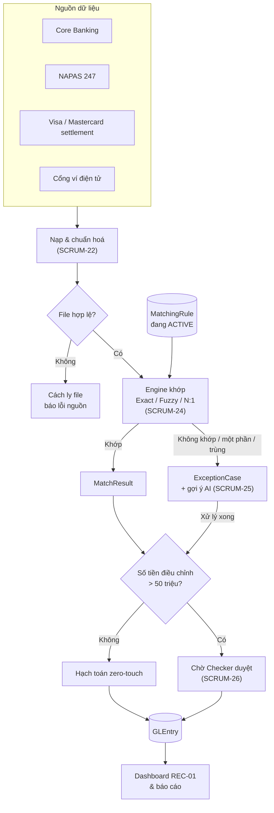
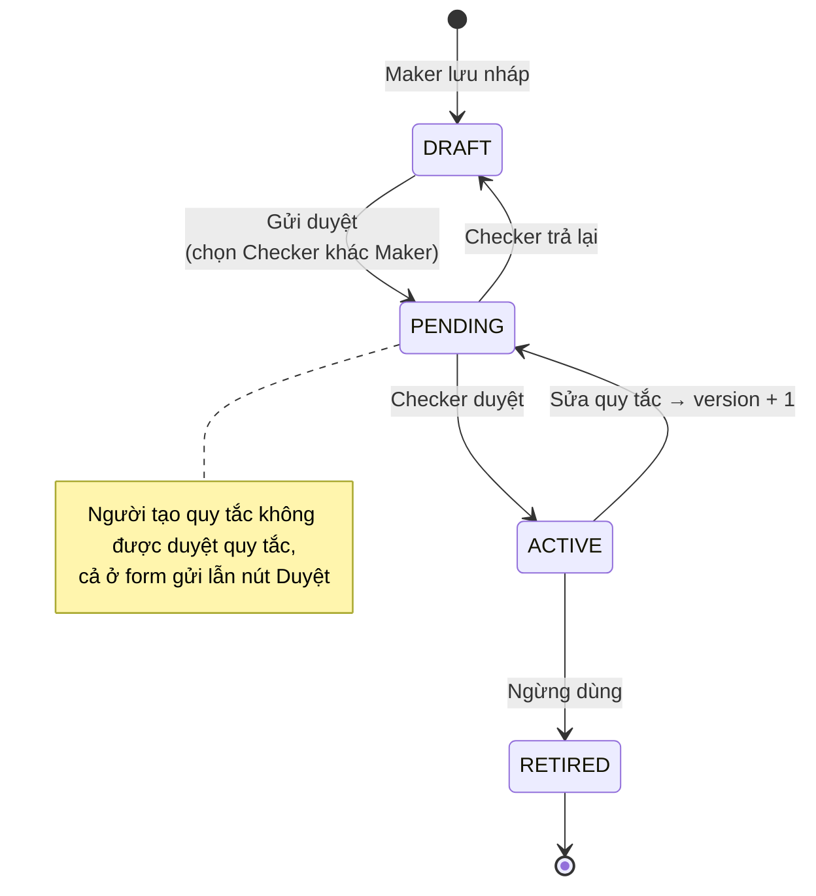
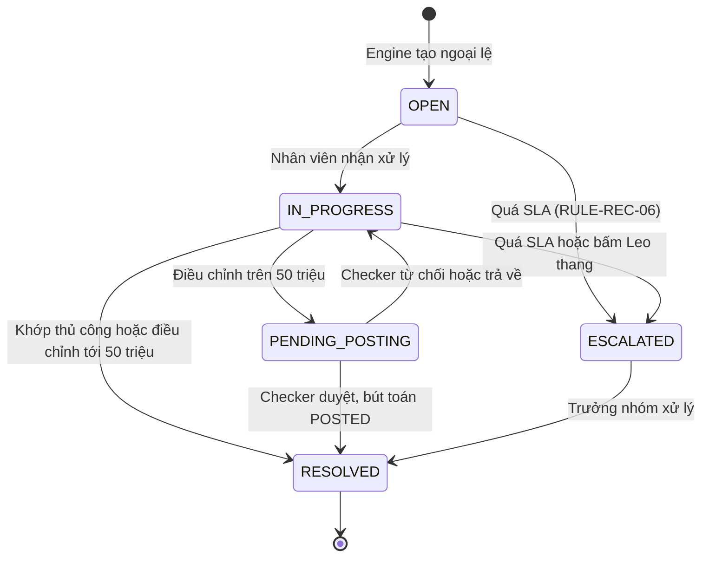
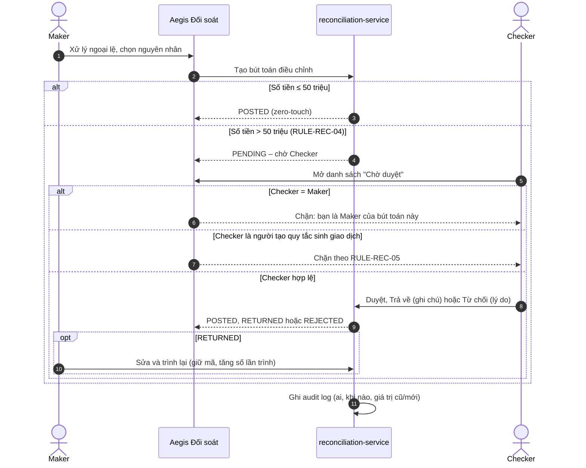
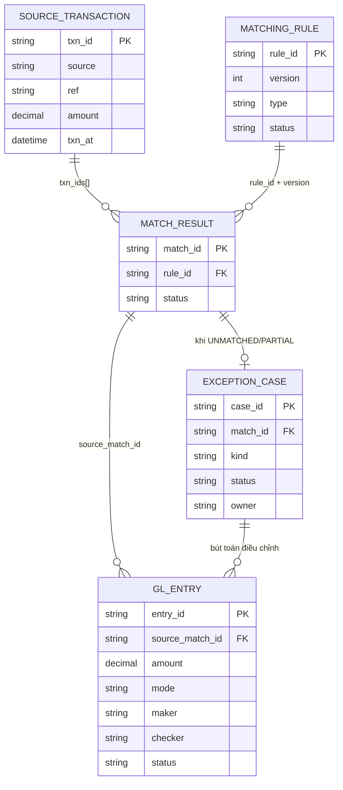
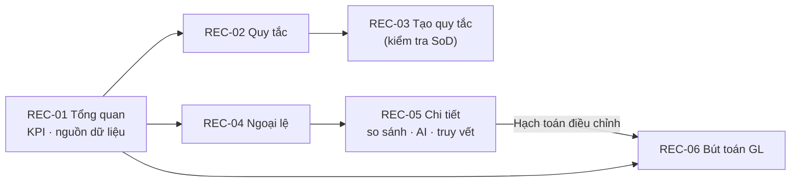

# R01 · Đối soát giao dịch – luồng, trạng thái và kiểm soát

| | |
|---|---|
| Epic | [SCRUM-7](https://baohandao2303.atlassian.net/browse/SCRUM-7) · Reconciliation Capability |
| Story | SCRUM-22 → 26 (backend), [SCRUM-49](https://baohandao2303.atlassian.net/browse/SCRUM-49) (FE REC-01 → 06), [SCRUM-50](https://baohandao2303.atlassian.net/browse/SCRUM-50) (truy vết) |
| UI mẫu | [/reconciliation/](https://handao2303.github.io/aegis-ekyc-ui/reconciliation/) · mã nguồn `src/ops/Reconciliation.tsx` |
| Quy tắc chính | RULE-REC-04 (ngưỡng GL), RULE-REC-05 (phân tách nhiệm vụ), RULE-REC-06 (leo thang), FR-REC-11 (truy vết) |
| Phiên bản | 1.1 · 25/11/2026 · Han Dao (BA) |
| Trạng thái | 🔧 Đặc tả + UI mẫu xong, chờ `reconciliation-service`; 9 điểm lệch baseline chờ Kế toán trưởng (R02 §3) |
| Tài liệu đi kèm | [R02](R02-requirements-gap-rtm.md) yêu cầu bổ sung & RTM · [R03](R03-ui-spec.md) đặc tả giao diện · [R04](R04-test-plan-cases.md) kiểm thử · [R05](R05-api-data-dictionary.md) API & từ điển dữ liệu |
| Chuẩn tham chiếu | BPMN 2.0 · UML 2.5 (state, sequence) · IIBA BABOK v3 – đánh giá ở [Q01](../00-overview/Q01-standards-conformance.md) §2.2 |

> ⚠️ Một số trạng thái và quy tắc trong tài liệu này khác BAS-BRD-v1.2 (trạng thái ngoại lệ, aging, điều kiện leo thang, ý nghĩa RULE-REC-05, trạng thái quy tắc, loại `DUPLICATE`). Danh sách và đề xuất xử lý: [R02 §3](R02-requirements-gap-rtm.md). Các điểm lệch đó giữ nguyên tới khi Kế toán trưởng quyết định. Bản 1.1 (25/11) chỉ cập nhật §2–§4 cho khớp UI mẫu sau R04 vòng 2: 3 cách xử lý ngoại lệ, trạng thái `PENDING_POSTING`, trả về / trình lại bút toán, kiểm RULE-REC-05 theo nghĩa baseline.

## 1. Luồng tổng thể

Từ lúc file/API của các nguồn về tới khi có bút toán GL và báo cáo.

## 2. Trạng thái quy tắc đối soát (REC-02, REC-03)

Mọi thay đổi quy tắc đều cần người thứ hai duyệt. Người tạo không được tự duyệt.

| Kiểm tra | Nơi chặn | Thông báo cho người dùng |
|---|---|---|
| Chọn chính mình làm Checker | Form REC-03, nút "Gửi duyệt" bị khoá | "Vi phạm phân tách nhiệm vụ… RULE-REC-05" |
| Bấm Duyệt quy tắc do mình tạo | Danh sách REC-02 | "Không thể duyệt MR-xxx: bạn là người tạo quy tắc" |
| Người tạo quy tắc duyệt bút toán > 50 triệu sinh từ quy tắc đó | REC-06 | "Không thể duyệt GL-xxx: bạn là người tạo quy tắc MR-xxx sinh ra giao dịch này" – RULE-REC-05 theo nghĩa baseline (REQ-REC-07) |
| Tên quy tắc < 4 ký tự hoặc không có khoá khớp | Form REC-03 | Nút gửi bị khoá |

## 3. Trạng thái ngoại lệ (REC-04, REC-05)

| Thuộc tính | Ý nghĩa |
|---|---|
| Loại | `UNMATCHED` (không có đối ứng), `PARTIAL` (lệch số tiền), `DUPLICATE` (trùng) |
| Aging bucket | 0–1d, 1–3d, 3–7d, >7d – tính từ lúc tạo |
| SLA | Theo loại và giá trị (mẫu: 24h / 48h / 72h). Quá hạn → banner đỏ và leo thang |
| Gợi ý AI | Top 3 nguyên nhân kèm %. Người xử lý chọn 1 nguyên nhân, hoặc **Nguyên nhân khác** (danh mục 7 nhóm + ghi chú ≥ 10 ký tự, lưu cờ override – REQ-REC-01) |
| Cách xử lý | **Hạch toán điều chỉnh** · **Khớp thủ công** (nhập mã đối ứng, không sinh bút toán) · **Yêu cầu chứng từ** (giữ `IN_PROGRESS`, chờ chứng từ) – REQ-REC-02 |
| Chờ hạch toán | Điều chỉnh trên 50 triệu: ngoại lệ ở `PENDING_POSTING`, vẫn nằm trong danh sách đang mở tới khi bút toán `POSTED` (DEF-REC-06) |
| Chống bút toán trùng | Ngoại lệ đã có bút toán `PENDING` hoặc `RETURNED` thì không tạo được bút toán điều chỉnh thứ hai (REQ-REC-08) |

## 4. Hạch toán GL và Maker-Checker (REC-06)

Ngưỡng 50 triệu giữ theo baseline vì CR-002 (đề xuất nâng ngưỡng) chưa được duyệt.

| Trạng thái bút toán | Ý nghĩa | Ngoại lệ liên quan |
|---|---|---|
| `POSTED` | Đã hạch toán (zero-touch hoặc Checker duyệt) | `RESOLVED` |
| `PENDING` | Chờ Checker | `PENDING_POSTING` |
| `RETURNED` | Checker trả về kèm ghi chú ≥ 10 ký tự; chỉ Maker thấy nút Trình lại (REQ-REC-06) | Mở lại `IN_PROGRESS` |
| `REJECTED` | Checker từ chối kèm lý do ≥ 10 ký tự (REQ-REC-05) | Mở lại `IN_PROGRESS` |

## 5. Truy vết dữ liệu (FR-REC-11, SCRUM-50)

Mỗi bút toán phải lần ngược được về giao dịch gốc. Không bản ghi trung gian nào được thiếu khoá liên kết.

Màn REC-05 hiển thị chuỗi 4 bước SourceTransaction → MatchResult → ExceptionCase → GLEntry. Bước chưa có dữ liệu ghi rõ "Không tìm thấy đối ứng" hoặc "Chưa hạch toán".

## 6. Bản đồ màn hình

## 7. Chỉ số trên REC-01

| Chỉ số | Định nghĩa | Mục tiêu |
|---|---|---|
| Tỷ lệ khớp tự động | Giao dịch khớp không cần người ÷ tổng giao dịch | ≥ 95% |
| MTTR | Thời gian trung bình từ lúc tạo đến khi xử lý xong ngoại lệ | ≤ 4h |
| Giá trị chưa khớp | Tổng chênh lệch của ngoại lệ đang mở | Theo dõi |
| Zero-touch | Bút toán tự hạch toán ÷ tổng bút toán | ≥ 30% giai đoạn đầu (KPI-05) |
| Trạng thái nạp nguồn | Đúng lịch / Trễ / Cách ly, kèm `last_updated_at` | UAT-REC-02, UAT-REC-09 |

## 8. Truy vết UAT

| UAT | Kiểm tra trên UI mẫu |
|---|---|
| UAT-REC-02 | Nguồn ví điện tử bị cách ly, có ghi chú lỗi |
| UAT-REC-07 | Bút toán > 50 triệu ở trạng thái "Chờ Checker" |
| UAT-REC-08 | Không gửi được quy tắc khi Checker = Maker |
| UAT-REC-09 | Bảng nguồn có thời điểm cập nhật |
| UAT-REC-10 | Chuỗi truy vết 4 bước ở REC-05 |

Ca kiểm thử chi tiết và kết quả (25/25 đạt): [R04 §3](R04-test-plan-cases.md).

## 9. Kiểm soát tài liệu

### Lịch sử phiên bản

| Phiên bản | Ngày | Người sửa | Commit | Thay đổi |
|---|---|---|---|---|
| 0.1 | 22/11/2026 | Han Dao | `8a99253` | Bản đầu: luồng tổng thể, trạng thái quy tắc và ngoại lệ, Maker-Checker GL, truy vết |
| 1.0 | 24/11/2026 | Han Dao | `7afda2b` | Cảnh báo điểm lệch baseline, liên kết R02–R04 |
| 1.1 | 25/11/2026 | Han Dao | — | §2–§4 khớp UI mẫu sau R04 vòng 2: 3 cách xử lý ngoại lệ, `PENDING_POSTING`, `RETURNED` và trình lại, RULE-REC-05 theo nghĩa baseline; liên kết R05; thêm mục kiểm soát tài liệu (ISO/IEC/IEEE 29148) |

### Phê duyệt

| Vai trò | Người | Ngày | Kết luận |
|---|---|---|---|
| BA (soạn) | Han Dao | 25/11/2026 | Trình duyệt |
| Kế toán trưởng | | | |
| Product Owner | | | |
| Compliance / InfoSec | | | |
