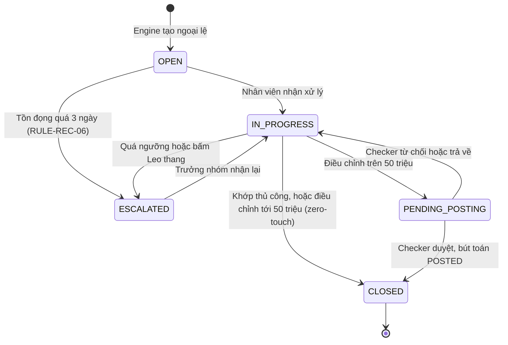

# R02 · Đối soát – yêu cầu bổ sung, điểm lệch baseline & RTM

| | |
|---|---|
| Mã tài liệu | AEG-REC-R02 |
| Phiên bản | 0.10 |
| Ngày phát hành | 27/11/2026 |
| Trạng thái | 📝 Chờ Kế toán trưởng, PO và Compliance quyết định 9 điểm ở §3 |
| Phân loại | Nội bộ |
| Tác giả | Han Dao (BA) |
| Người duyệt | Kế toán trưởng · Product Owner · Compliance / InfoSec – chưa duyệt |
| Mục đích và phạm vi | Đối chiếu baseline BAS-BRD-v1.2 với UI và thiết kế Đối soát: yêu cầu bổ sung, điểm lệch, RTM |
| Chuẩn tham chiếu | — |
| Thuật ngữ | [G02 Thuật ngữ và chữ viết tắt](../00-overview/G02-glossary.md) |
| Epic | [SCRUM-7](https://baohandao2303.atlassian.net/browse/SCRUM-7) · Reconciliation Capability |
| Baseline | BAS-BRD-v1.2 (Phần 2.2, 3.4, 4.2, 5.2, 6.2) · BAS-RAID-v1.2 (RSK-05/06/07/12/15, DEC-01, ASM-07) |
| Đối chiếu với | [R01](R01-reconciliation-flow.md) (luồng & trạng thái) · UI mẫu `/reconciliation/` · kết quả chạy [R04](R04-test-plan-cases.md) |

Cách viết yêu cầu theo ISO/IEC/IEEE 29148:2018: mỗi yêu cầu một câu "Hệ thống phải…", có nguồn, có tiêu chí kiểm được và mã truy vết. Mã mới dùng tiền tố **REQ-REC** để không trùng mã FR-REC trong BAS-FSD-v1.2 (bản FSD chưa có trên Confluence; các mã FR-REC-01, 02, 09, 10, 11 dưới đây lấy từ BAS-RAID-v1.2).

## 1. Phạm vi baseline và mức độ đáp ứng hiện tại

| BR | Nội dung (rút gọn) | Ưu tiên | Đặc tả | UI mẫu | Backend (27/11) |
|---|---|---|---|---|---|
| BR-REC-01 | Nạp và chuẩn hoá nhiều nguồn (ISO 20022 camt.053/054, Visa BASE II/TC33, Mastercard IPM, Napas) | Must | R01 §1 | Bảng trạng thái nạp nguồn (REC-01) | ✅ Nạp CSV, JSON, ISO 20022 camt.053/054; cách ly, chống trùng (TC-REC-B01, B02) |
| BR-REC-02 | Kế toán tự cấu hình Matching Rule no-code | Must | R01 §2 | REC-02, REC-03 | ✅ Quy tắc có version, duyệt khác người tạo (API-10 → 17) |
| BR-REC-03 | Exact theo `reference_no + amount + currency`; Fuzzy weighted scoring, ngưỡng ≥ 0.95 | Must | R01 §1 | Chỉ hiển thị loại quy tắc | ✅ EXACT rồi FUZZY theo ngưỡng / khoảng cách (TC-REC-B03, B04) |
| BR-REC-04 | N:1 / 1:N, subset-sum có giới hạn thời gian | Should | R01 §1 | Quy tắc MR-003 mẫu | 🟡 N:1 có subset-sum giới hạn thời gian (TC-REC-B05); 1:N chưa có |
| BR-REC-05 | Top-3 nguyên nhân kèm xác suất (Explainable AI) | Should | R01 §3 | REC-04, REC-05 | 🟡 Top-3 có xác suất, nhưng do luật viết tay – chưa có mô hình AI (G01 G-CO-04) |
| BR-REC-06 | GLEntry hạch toán kép, bất biến | Must | R01 §4 | Một cặp Nợ/Có mỗi bút toán | ✅ Nợ = Có, bút toán POSTED bất biến bằng trigger (TC-REC-B06) |
| BR-REC-07 | Điều chỉnh > 50 triệu bắt buộc Maker-Checker | Must | R01 §4 | REC-05, REC-06 | ✅ > 50 triệu chờ Checker, SoD-1 (R04 §4.2) |
| BR-REC-08 | Người cấu hình rule không được duyệt Exception giá trị lớn (SoD) | Must | R01 §2 (hiểu khác – xem D-REC-04) | REC-06 chặn người tạo quy tắc duyệt bút toán > 50 triệu sinh từ quy tắc đó (REQ-REC-07) | ✅ SoD-2 kiểm ở server (TC-REC-B07) |
| BR-REC-09 | Dashboard KPI vận hành | Should | R01 §7 | REC-01 | ✅ API KPI, CSV, nguyên nhân (API-50 → 52); xu hướng theo ngày chưa có |
| BR-REC-10 | Truy vết từ giao dịch nguồn tới GL và báo cáo | Should | R01 §5 | REC-05 (4 bước) | ✅ API truy vết có kiểm toàn vẹn (TC-REC-B08, SCRUM-50) |

Khi lập tài liệu (24/11), Module 2 **chỉ có UI mẫu chạy dữ liệu hư cấu**. Từ 26/11 đã có `reconciliation-service` ([services/reconciliation](../../services/reconciliation/README.md)): nạp file, engine khớp, hạch toán đã kiểm bằng 56 test tự động – xem R04 §4.

## 2. Bản đồ tài liệu Module 2

| Tài liệu | Vai trò |
|---|---|
| [R01](R01-reconciliation-flow.md) | Luồng tổng thể, trạng thái, sequence Maker-Checker, ERD truy vết |
| **R02** (tài liệu này) | Điểm lệch so với baseline, yêu cầu bổ sung, dữ liệu cần thêm, RTM |
| [R03](R03-ui-spec.md) | Đặc tả giao diện REC-01 → REC-06, có ảnh |
| [R04](R04-test-plan-cases.md) | Kế hoạch kiểm thử và kết quả 3 vòng: 25 ca giao diện, 56 ca backend tự động (gồm TC-REC-B01 → B09), 4 luồng end-to-end, lỗi |
| [R05](R05-api-data-dictionary.md) | Đặc tả API và từ điển dữ liệu đề xuất cho `reconciliation-service`; dữ liệu ở §5 được chi tiết hoá tại đây |
| [R06](R06-nfr-kpi.md) | Yêu cầu phi chức năng NFR-REC-01 → 23 và từ điển KPI |
| [R07](R07-sit-perf-uat.md) | Kế hoạch SIT, kiểm thử hiệu năng, bộ UAT và biên bản nghiệm thu |
| [R08](R08-compliance-mapping.md) | Đối chiếu tuân thủ, cơ sở pháp lý, dữ liệu cá nhân; yêu cầu mới REQ-REC-21 → 24 |

## 3. Điểm lệch giữa baseline và R01 / UI mẫu – cần quyết định

R01 và UI mẫu được dựng theo Design Spec (SCRUM-49) nên có vài chỗ khác BRD v1.2. BA không tự chọn bên nào; mỗi điểm có đề xuất và người quyết định.

| Mã | Chủ đề | BRD v1.2 | R01 / UI mẫu | Đề xuất của BA | Ai quyết |
|---|---|---|---|---|---|
| D-REC-01 | Trạng thái ExceptionCase | `OPEN`, `IN_PROGRESS`, `CLOSED` | `OPEN`, `IN_PROGRESS`, `ESCALATED`, `RESOLVED` | Giữ 4 trạng thái nhưng đổi `RESOLVED` → `CLOSED` cho khớp BRD. Thêm `PENDING_POSTING` khi bút toán điều chỉnh còn chờ Checker (xem §5 và DEF-REC-06) | Kế toán trưởng |
| D-REC-02 | Aging bucket | `0-1D`, `1-3D`, `>3D` | `0–1d`, `1–3d`, `3–7d`, `>7d` | Theo BRD (3 nhóm) cho dữ liệu và báo cáo. Nếu vận hành cần tách `>7d` thì đưa vào CR | Kế toán trưởng |
| D-REC-03 | Điều kiện leo thang (RULE-REC-06) | Tồn đọng > 3 ngày | SLA theo loại và giá trị (24h / 48h / 72h) | Giữ ngưỡng 3 ngày của BRD làm mặc định. SLA theo loại là yêu cầu mới, cần CR và bảng SLA do Ops chốt | Ops + PO |
| D-REC-04 | Ý nghĩa RULE-REC-05 (SoD) | Người tạo/sửa MatchingRule **không được duyệt Exception giá trị lớn** của case sinh ra từ rule đó | Người tạo rule không được tự duyệt **rule** của mình | Cả hai đều cần. Giữ RULE-REC-05 đúng nghĩa BRD (REQ-REC-07, UI mẫu đã có từ v0.3). Kiểm soát "duyệt rule" là yêu cầu riêng REQ-REC-09 (nguồn: AC của SCRUM-23) | Compliance / InfoSec |
| D-REC-05 | Trạng thái MatchingRule | `ACTIVE`, `INACTIVE` | `DRAFT`, `PENDING`, `ACTIVE`, `RETIRED` | Dùng vòng đời của R01 (cần cho Maker-Checker rule). `INACTIVE` của BRD = `RETIRED` | Kế toán trưởng |
| D-REC-06 | Ngoại lệ loại `DUPLICATE` | MatchResult chỉ có `MATCHED`, `UNMATCHED`, `PARTIAL`; trùng file/message bị loại ở bước nạp theo checksum | Có ngoại lệ `DUPLICATE` | Tách 2 loại: **trùng kỹ thuật** (cùng checksum) loại ở bước nạp, chỉ ghi log; **trùng nghiệp vụ** (khách chuyển 2 lần, khác checksum) thành ngoại lệ `DUPLICATE`. Thêm giá trị này vào `ExceptionCase.kind` | Kế toán trưởng |
| D-REC-07 | Mục tiêu Zero-touch (KPI-05) | ≥ 30% giai đoạn đầu | R01 ghi "Theo dõi"; UI không hiện mục tiêu | Theo BRD: ≥ 30%. **Đã sửa R01 §7** vì đây là lỗi chép, không phải lựa chọn | — (đã sửa) |
| D-REC-08 | Nghĩa của "Zero-touch" | Hai chỗ: tự chữa ngoại lệ lặp lại (RULE-REC-07) và tự post bút toán ≤ ngưỡng (UC-REC-05 bước 2) | UI chỉ dùng nghĩa thứ hai | Định nghĩa KPI-05 = bút toán tự post ÷ tổng bút toán (nguồn GLEntry, đúng bảng KPI). Đặt tên riêng cho RULE-REC-07: "tự chữa" | Kế toán trưởng |
| D-REC-09 | Che số tài khoản trên REC-05 | RULE-GOV-02 (least privilege), RSK-03 | Số tài khoản nội bộ hiện đầy đủ; số thẻ đã che | Che giữa số tài khoản (giữ 4 số cuối) cho mọi vai trò; xem đầy đủ phải ghi audit như Module 1 | InfoSec |

## 4. Yêu cầu bổ sung

Ưu tiên theo MoSCoW. "Nguồn" là chỗ trong baseline đã nói nhưng R01 hoặc UI chưa có.

### 4.1 Xử lý ngoại lệ (UC-REC-04)

| Mã | Yêu cầu | Nguồn | Tiêu chí nghiệm thu | Ưu tiên |
|---|---|---|---|---|
| REQ-REC-01 | Hệ thống phải cho người xử lý chọn một nguyên nhân ngoài top-3 gợi ý (danh mục nguyên nhân chuẩn + "Khác" có ghi chú ≥ 10 ký tự) và lưu cờ `root_cause_override = true`. | UC-REC-04 bước 2 ("hoặc override") | Mở ngoại lệ → chọn "Khác" → không gửi được khi ghi chú < 10 ký tự; sau khi lưu, ngoại lệ ghi nguyên nhân đã chọn và cờ override | Must |
| REQ-REC-02 | Hệ thống phải cho người xử lý chọn một trong ba cách xử lý: khớp thủ công với giao dịch đối ứng, yêu cầu bổ sung chứng từ, hoặc hạch toán điều chỉnh. | UC-REC-04 bước 3 | Ngoại lệ `DUPLICATE` và `UNMATCHED` xử lý được bằng khớp thủ công mà không sinh bút toán điều chỉnh | Must |
| REQ-REC-03 | Hệ thống phải tự leo thang ngoại lệ tồn đọng quá ngưỡng aging (mặc định 3 ngày, cấu hình được) tới quản lý vận hành và ghi thời điểm leo thang. | RULE-REC-06 | Ngoại lệ tạo lùi 73 giờ → trạng thái `ESCALATED`, có `escalated_at`, có thông báo cho quản lý | Must |
| REQ-REC-04 | Hệ thống phải đo MTTR từ `opened_at` tới `closed_at` của từng ngoại lệ và hiển thị trung bình trên REC-01. | UC-REC-04 bước 4, KPI-04 | Số MTTR trên REC-01 khớp truy vấn kiểm chứng trên dữ liệu mẫu | Should |

### 4.2 Hạch toán và Maker-Checker (UC-REC-05)

| Mã | Yêu cầu | Nguồn | Tiêu chí nghiệm thu | Ưu tiên |
|---|---|---|---|---|
| REQ-REC-05 | Hệ thống phải bắt Checker nhập lý do (≥ 10 ký tự) khi từ chối bút toán, lưu vào `reject_reason` và audit log. | UC-REC-05 hậu điều kiện ("bị từ chối kèm lý do") | Không bấm được "Xác nhận từ chối" khi chưa có lý do | Must |
| REQ-REC-06 | Hệ thống phải cho Checker trả bút toán về Maker kèm ghi chú; Maker sửa và trình lại, bút toán giữ nguyên mã và tăng số lần trình. | UC-REC-05 luồng phụ | Trả về → trạng thái `RETURNED`, Maker thấy ghi chú; trình lại → `PENDING_APPROVAL` | Must |
| REQ-REC-07 | Hệ thống phải chặn Checker duyệt bút toán điều chỉnh > ngưỡng nếu Checker là người tạo hoặc người sửa gần nhất của MatchingRule đã sinh ra MatchResult của ngoại lệ đó. | RULE-REC-05, BR-REC-08 | Rule MR-003 do Quân tạo → ngoại lệ từ MR-003 cần điều chỉnh 80 triệu → Quân không duyệt được, thông báo nêu RULE-REC-05 | Must |
| REQ-REC-08 | Hệ thống phải cho mỗi ngoại lệ chỉ có tối đa một bút toán điều chỉnh đang chờ duyệt; khi đã có thì nút hạch toán bị khoá và chỉ ra bút toán đang chờ. | BR-REC-06, RSK-07 · lỗi DEF-REC-01 | Ngoại lệ EXC-1125 đã có GL-90313 chờ duyệt → không tạo được bút toán thứ hai | Must |
| REQ-REC-09 | Hệ thống phải bắt mọi thay đổi MatchingRule (tạo, sửa, ngừng dùng) qua người duyệt khác người tạo; sửa rule đang chạy tạo version mới, version cũ vẫn chạy tới khi version mới được duyệt. | AC SCRUM-23, UC-REC-02 NFR (version hoá) | Sửa MR-001 v7 → có v8 `PENDING`, v7 vẫn `ACTIVE`; duyệt v8 → v7 `RETIRED` | Must |
| REQ-REC-10 | Hệ thống phải cho Checker chuyển bút toán nghi bất thường lên cấp duyệt cao hơn hoặc Compliance, kèm lý do. | UC-REC-05 luồng ngoại lệ | Bút toán chuyển cấp không post được cho tới khi cấp trên quyết định | Should |
| REQ-REC-11 | Hệ thống phải từ chối lưu GLEntry khi tổng Nợ khác tổng Có, và không cho sửa hay xoá GLEntry đã `POSTED` (chỉ đảo bằng bút toán mới). | RULE-REC-08, BR-REC-06 | API trả lỗi khi Nợ ≠ Có; lệnh UPDATE trực tiếp trên bút toán đã post bị DB từ chối | Must |

### 4.3 Quy tắc, nạp dữ liệu và khớp (UC-REC-01 → 03)

| Mã | Yêu cầu | Nguồn | Tiêu chí nghiệm thu | Ưu tiên |
|---|---|---|---|---|
| REQ-REC-12 | Hệ thống phải cho sao chép một rule có sẵn thành bản nháp mới (version 1, người tạo là người sao chép). | UC-REC-02 luồng phụ | Sao chép MR-002 → MR-00x `DRAFT` cùng cấu hình | Could |
| REQ-REC-13 | Hệ thống phải cho xem danh sách file bị cách ly (tên file, nguồn, lý do, thời điểm) và nạp lại sau khi nguồn gửi file đúng. | UC-REC-01 luồng phụ, RSK-05 | Từ dòng "Cách ly" trên REC-01 mở được chi tiết file; nạp lại thành công đổi trạng thái nguồn | Should |
| REQ-REC-14 | Hệ thống phải loại file/message trùng theo `checksum` hoặc `txn_id` trước khi nạp và ghi số bản ghi bị loại vào log nạp. | UC-REC-01 luồng ngoại lệ | Nạp cùng file 2 lần → lần 2 không tạo SourceTransaction mới, log ghi số bản ghi trùng | Must |
| REQ-REC-15 | Hệ thống phải dừng tìm subset-sum khi vượt giới hạn thời gian cấu hình và chuyển giao dịch thành ngoại lệ thay vì chờ. | RULE-REC-03 | Lô 200 giao dịch với giới hạn 2 giây → kết thúc ≤ 2 giây, có ngoại lệ | Must |
| REQ-REC-16 | Hệ thống phải gắn `PARTIAL` khi có từ 2 ứng viên Fuzzy mà điểm cao nhất và nhì cách nhau dưới mức cấu hình (mặc định 0.02). | UC-REC-03 luồng phụ | Hai ứng viên 0.961 và 0.955 → `PARTIAL`, chờ người xác nhận | Should |

### 4.4 Dashboard và truy vết (UC-REC-06, BR-REC-10)

| Mã | Yêu cầu | Nguồn | Tiêu chí nghiệm thu | Ưu tiên |
|---|---|---|---|---|
| REQ-REC-17 | Hệ thống phải cho lọc REC-01 theo khoảng thời gian, nguồn giao dịch và loại rule, và xuất báo cáo theo bộ lọc. | UC-REC-06 bước 2–3 | Lọc "Visa" → các chỉ số chỉ tính nguồn Visa; file xuất có cùng số | Should |
| REQ-REC-18 | Hệ thống phải cho người dùng đặt ngưỡng cảnh báo Giá trị chưa khớp và gửi cảnh báo khi vượt. | UC-REC-06 luồng phụ | Đặt ngưỡng 100 triệu → khi tổng vượt, chuông thông báo có cảnh báo | Could |
| REQ-REC-19 | Hệ thống phải có API trả chuỗi truy vết đầy đủ cho một giao dịch, ngoại lệ hoặc bút toán, và báo lỗi nếu có bản ghi thiếu khoá liên kết. | BR-REC-10, FR-REC-11, SCRUM-50 | Gọi API với `entry_id` → trả đủ SourceTransaction → MatchResult → ExceptionCase → GLEntry | Should |
| REQ-REC-20 | Hệ thống phải đối chiếu cuối ngày Ledger của Hạn mức (AuthorizationLog, FallbackTransaction) với GLEntry, và không tạo GLEntry trùng khi sự kiện `limit.authorization.processed` gửi lại cùng `messageId`. | BR-LIM-10, KPI-09, SCRUM-53 | Báo cáo sai lệch EOD bằng 0 hoặc mọi dòng có người phụ trách; gửi lại sự kiện → 0 bút toán trùng | Must |

## 5. Dữ liệu cần thêm vào mô hình BRD §3.4

| Entity | Thuộc tính thêm | Kiểu | Lý do |
|---|---|---|---|
| ExceptionCase | `match_id` (FK → MatchResult) | UUID | BRD chỉ có `txn_id`; truy vết 4 bước của R01 §5 cần khoá này |
| ExceptionCase | `kind` | Enum(`UNMATCHED`, `PARTIAL`, `DUPLICATE`) | D-REC-06 |
| ExceptionCase | `status` thêm `ESCALATED`, `PENDING_POSTING` | Enum | D-REC-01, DEF-REC-06 |
| ExceptionCase | `escalated_at`, `resolution_type` (`MANUAL_MATCH` / `REQUEST_DOCS` / `ADJUSTMENT`) | DateTime, Enum | REQ-REC-02, 03 |
| ExceptionCase | `root_cause_override`, `root_cause_note` | Boolean, String | REQ-REC-01 |
| GLEntry | `mode` (`ZERO_TOUCH` / `MAKER_CHECKER`), `reject_reason`, `return_note`, `submit_count` | Enum, String, String, Integer | REQ-REC-05, 06; KPI-05 |
| GLEntry | `status` thêm `RETURNED`, `ESCALATED` | Enum | REQ-REC-06, 10 |
| MatchingRule | `name`, `match_keys[]`, `approved_by`, `approved_at`, `status` (`DRAFT`/`PENDING`/`ACTIVE`/`RETIRED`) | — | D-REC-05, REQ-REC-09 |
| SourceTransaction | `file_id` (lô nạp) | String | REQ-REC-13: biết bản ghi thuộc file nào để nạp lại |

Trạng thái ngoại lệ đề xuất (thay R01 §3 sau khi D-REC-01 được duyệt):

Khác biệt chính với R01: ngoại lệ **chỉ đóng khi bút toán đã post**. Bản UI mẫu ngày 24/11 trước đây đóng ngoại lệ ngay khi tạo bút toán chờ duyệt (DEF-REC-06); bản sửa đã làm theo sơ đồ này, giữ tên `RESOLVED` cho tới khi D-REC-01 được quyết định.

## 6. Ma trận truy vết (RTM)

| BR | UC | RULE | REQ / FR | Màn hình | Test case (R04) | UAT |
|---|---|---|---|---|---|---|
| BR-REC-01 | UC-REC-01 | — | FR-REC-01 · REQ-REC-13, 14 | REC-01 | TC-REC-03, 04 · TC-REC-B01, B02 | UAT-REC-01, 02 |
| BR-REC-02 | UC-REC-02 | RULE-REC-05 (D-REC-04) | FR-REC-02 · REQ-REC-09, 12 | REC-02, REC-03 | TC-REC-05, 06, 07 | UAT-REC-08 |
| BR-REC-03 | UC-REC-03 | RULE-REC-01, 02 | REQ-REC-16 | — | TC-REC-B03, B04 | — |
| BR-REC-04 | UC-REC-03 | RULE-REC-03 | REQ-REC-15 | — | TC-REC-B05 | — |
| BR-REC-05 | UC-REC-04 | RULE-REC-06, 07 | REQ-REC-01, 02, 03, 04 | REC-04, REC-05 | TC-REC-08, 09, 10, 12, 15 | — |
| BR-REC-06 | UC-REC-05 | RULE-REC-08 | REQ-REC-08, 11 | REC-06 | TC-REC-20 · TC-REC-B06 | — |
| BR-REC-07 | UC-REC-05 | RULE-REC-04 | FR-REC-09 · REQ-REC-05, 06, 10 | REC-05, REC-06 | TC-REC-13, 14, 16, 17, 18, 19, 24, 25 | UAT-REC-07 |
| BR-REC-08 | UC-REC-02, 05 | RULE-REC-05 | REQ-REC-07 | REC-06 | TC-REC-23 · TC-REC-B07 | — |
| BR-REC-09 | UC-REC-06 | — | FR-REC-10 · REQ-REC-04, 17, 18 | REC-01 | TC-REC-01, 02 | UAT-REC-09 |
| BR-REC-10 | UC-REC-06 | — | FR-REC-11 · REQ-REC-19 | REC-05 | TC-REC-11 · TC-REC-B08 | UAT-REC-10 |
| BR-LIM-10 | — | — | REQ-REC-20 | — | TC-REC-B09 | UAT-LIM-08 |

"—" ở cột UAT: mã UAT-REC tương ứng nằm trong BAS-UTR-v1.2, chưa có bản trên Confluence để đối chiếu. Cần bổ sung khi có UTR.

## 7. Câu hỏi mở

| # | Câu hỏi | Gửi |
|---|---|---|
| 1 | Chốt D-REC-01 → D-REC-06, D-REC-08 ở §3 | Kế toán trưởng |
| 2 | SLA theo loại ngoại lệ (D-REC-03) có cần không, hay chỉ ngưỡng 3 ngày? MTTR mục tiêu 4 giờ có áp dụng cho ngoại lệ chờ dữ liệu đối tác T+1 không? | Ops + PO |
| 3 | Danh mục nguyên nhân chuẩn cho REQ-REC-01 (mô hình AI đang học trên danh mục nào?) | Kế toán + Data |
| 4 | CR-002 (nâng ngưỡng Maker-Checker lên 100 triệu) có lịch duyệt chưa? Đến khi duyệt, UI và test giữ 50 triệu (ASM-07, DEC-01) | PO |
| 5 | Đặc tả file Napas Settlement mới (ISS-01) – cần file mẫu để viết test nạp TC-REC-B01 | Solution Owner |
| 6 | Che số tài khoản trên màn đối soát (D-REC-09) | InfoSec |

## 8. Kiểm soát tài liệu

### Tài liệu tham chiếu

| Mã | Tài liệu |
|---|---|
| R01 | [R01 · Đối soát giao dịch – luồng, trạng thái và kiểm soát](R01-reconciliation-flow.md) |
| R04 | [R04 · Đối soát – kế hoạch kiểm thử, test case và kết quả](R04-test-plan-cases.md) |
| R03 | [R03 · Đặc tả giao diện – Aegis Đối soát (REC-01 → REC-06)](R03-ui-spec.md) |
| R05 | [R05 · Đối soát – đặc tả API và từ điển dữ liệu (thiết kế đề xuất)](R05-api-data-dictionary.md) |
| R06 | [R06 · Đối soát – yêu cầu phi chức năng và từ điển chỉ số KPI](R06-nfr-kpi.md) |
| R07 | [R07 · Đối soát – kế hoạch SIT, kiểm thử hiệu năng, bộ UAT và biên bản nghiệm thu](R07-sit-perf-uat.md) |
| R08 | [R08 · Đối soát – đối chiếu tuân thủ, cơ sở pháp lý và dữ liệu cá nhân](R08-compliance-mapping.md) |

Chuẩn quốc tế: xem trường *Chuẩn tham chiếu* ở đầu trang.

### Lịch sử phiên bản

| Phiên bản | Ngày | Người sửa | Commit | Thay đổi |
|---|---|---|---|---|
| 0.1 | 24/11/2026 | Han Dao | — | Bản đầu: 9 điểm lệch baseline, 20 yêu cầu bổ sung, dữ liệu cần thêm, RTM |
| 0.2 | 24/11/2026 | Han Dao | — | UI mẫu đã đáp ứng REQ-REC-01, 02, 05, 06, 08 và trạng thái `PENDING_POSTING` (R04 vòng 2) |
| 0.3 | 24/11/2026 | Han Dao | — | UI mẫu có 3 vai trò UAT, đáp ứng REQ-REC-07 (RULE-REC-05 đúng nghĩa baseline) |
| 0.4 | 25/11/2026 | Han Dao | — | Thêm R05 (API và từ điển dữ liệu) vào bản đồ tài liệu §2 |
| 0.5 | 25/11/2026 | Han Dao | — | Thêm R06 (NFR, KPI) và R07 (SIT, hiệu năng, UAT) vào bản đồ tài liệu §2 |
| 0.6 | 26/11/2026 | Han Dao | — | Thêm R08 (tuân thủ) vào bản đồ tài liệu; REQ-REC-21 → 24 ở R08 §4 chờ duyệt |
| 0.7 | 26/11/2026 | Han Dao | — | Chuẩn hoá cấu trúc theo ISO/IEC/IEEE 15289: khối thuộc tính đầu trang, tài liệu tham chiếu, thuật ngữ dùng chung (G02), mục kiểm soát tài liệu thống nhất |
| 0.8 | 27/11/2026 | Han Dao | — | Ghi chú §1: từ 26/11 đã có `reconciliation-service`, các yêu cầu xử lý dữ liệu đã kiểm bằng test tự động (R04 §4) |
| 0.9 | 27/11/2026 | Han Dao | — | Cột Backend §1 cập nhật theo `reconciliation-service`: 8 BR có bằng chứng test, BR-REC-04 (1:N) và BR-REC-05 (mô hình AI) còn một phần |
| 0.10 | 27/11/2026 | Han Dao | — | §2: dòng R04 ghi đủ 3 vòng kiểm thử (UI, backend, end-to-end) |

### Phê duyệt

| Vai trò | Người | Ngày | Kết luận |
|---|---|---|---|
| BA | Han Dao | 24/11/2026 | Soạn bản nháp |
| Kế toán trưởng |  |  |  |
| Product Owner |  |  |  |
| Compliance / InfoSec |  |  |  |
