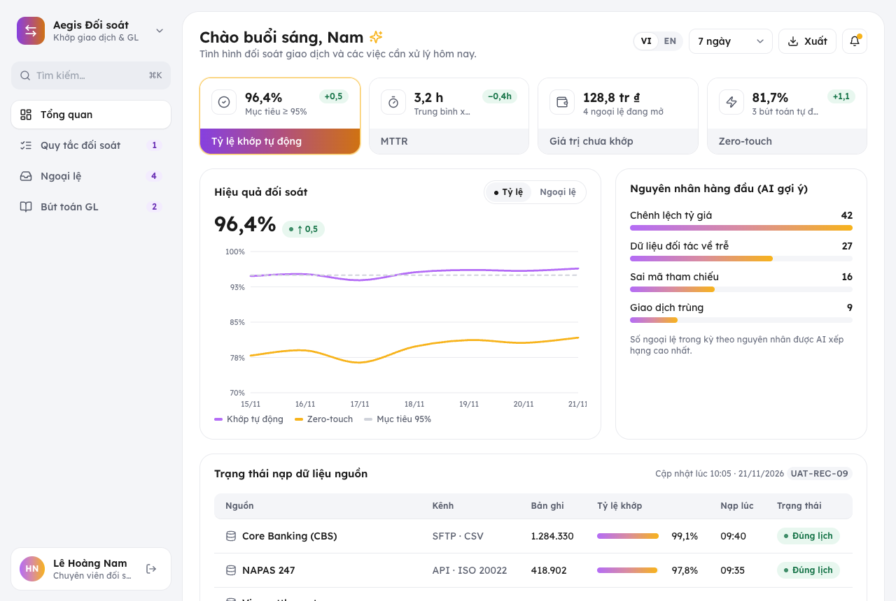
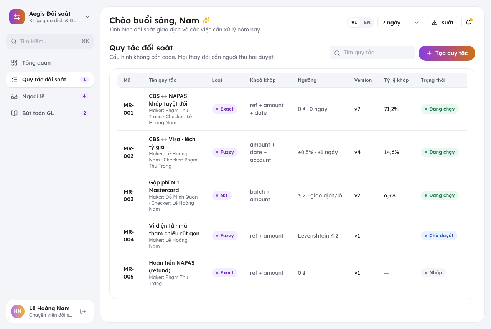
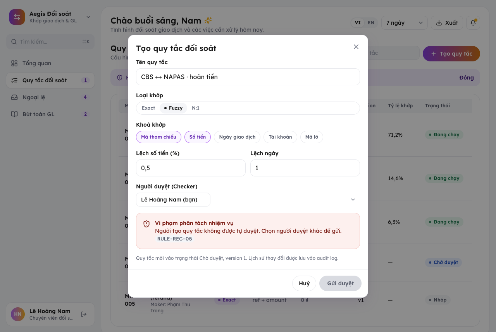
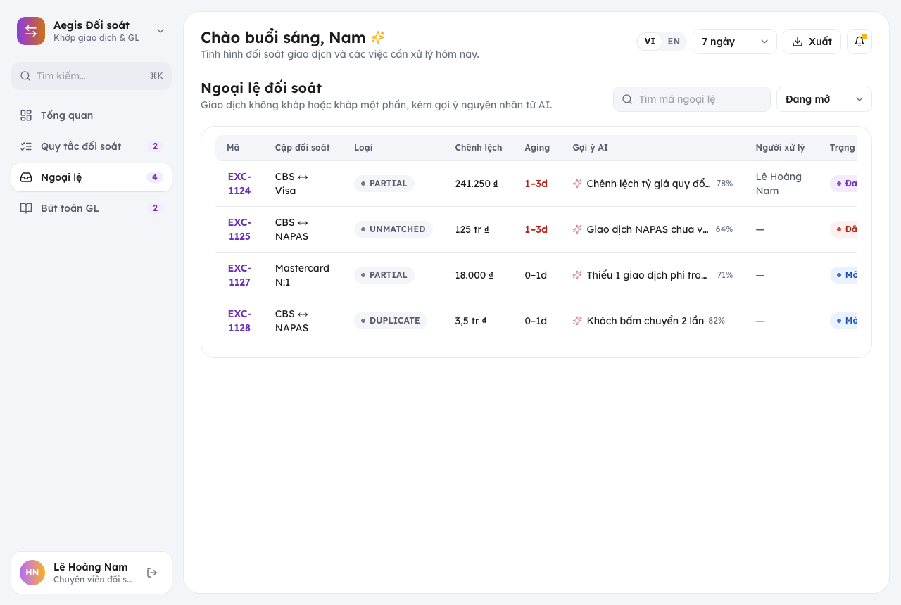
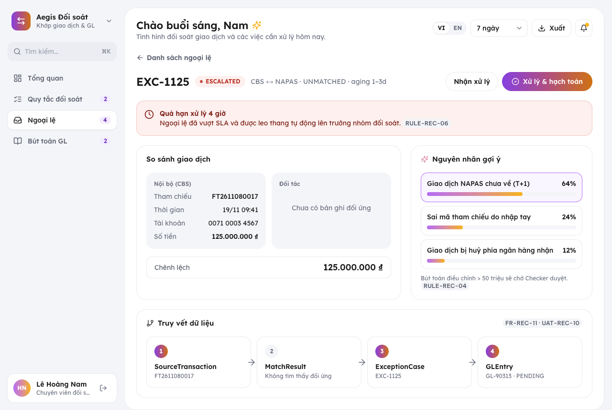
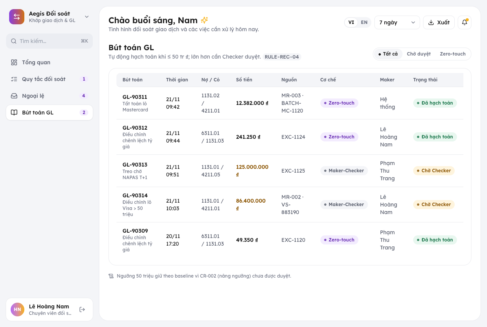

# R03 · Đặc tả giao diện – Aegis Đối soát (REC-01 → REC-06)

| | |
|---|---|
| Người dùng | Chuyên viên đối soát (Maker), Kiểm soát viên (Checker), Trưởng nhóm đối soát, Kế toán trưởng / Quản lý vận hành (xem dashboard) |
| Jira | [SCRUM-49](https://baohandao2303.atlassian.net/browse/SCRUM-49) (FE REC-01 → 06), [SCRUM-50](https://baohandao2303.atlassian.net/browse/SCRUM-50) (truy vết) |
| Bản chạy | [/reconciliation/](https://handao2303.github.io/aegis-ekyc-ui/reconciliation/) – dữ liệu hư cấu, chưa nối backend |
| Mã nguồn | `src/ops/Reconciliation.tsx`, khung dùng chung `src/ops/kit.tsx` |
| Ảnh | 1280 × 860, tiếng Việt, chụp tự động bằng `tools/diagrams/rec-screens.mjs` |
| Phiên bản | 1.0 · 24/11/2026 · Han Dao |

Quy tắc nghiệp vụ và điểm lệch baseline: [R02](R02-requirements-gap-rtm.md). Kết quả chạy thử trên giao diện: [R04](R04-test-plan-cases.md).

## 1. Khung ứng dụng

| Vùng | Nội dung |
|---|---|
| Menu trái | Logo "Aegis Đối soát · Khớp giao dịch & GL" · ô tìm kiếm (⌘K) · Tổng quan · Quy tắc đối soát (số quy tắc chờ duyệt) · Ngoại lệ (số đang mở) · Bút toán GL (số chờ Checker) · thẻ người dùng + vai trò + đăng xuất |
| Thanh trên | Lời chào theo tên · mô tả ngắn · VI/EN · kỳ báo cáo (Hôm nay / 7 ngày / Tháng) · **Xuất** · chuông cảnh báo |
| Cảnh báo mẫu | File ví điện tử bị cách ly · ngoại lệ quá hạn đã leo thang · bút toán > 50 triệu chờ Checker |
| Nhãn quy tắc | Mỗi chỗ áp dụng quy tắc có nhãn xám (vd. `RULE-REC-04`, `UAT-REC-09`) để tester và kiểm toán đối chiếu |

### Phân quyền hiển thị (đề xuất – UI mẫu chỉ có một người dùng)

| Chức năng | Chuyên viên | Checker | Trưởng nhóm | Kế toán trưởng / QL vận hành |
|---|---|---|---|---|
| Xem REC-01 | ✅ | ✅ | ✅ | ✅ |
| Tạo / sửa quy tắc (Maker) | ✅ | ✅ | ✅ | — |
| Duyệt quy tắc (khác người tạo) | — | ✅ | ✅ | ✅ |
| Nhận, xử lý ngoại lệ | ✅ | ✅ | ✅ | — |
| Duyệt bút toán > 50 triệu (khác Maker, khác người tạo rule – RULE-REC-05) | — | ✅ | ✅ | ✅ |
| Xem số tài khoản đầy đủ (ghi audit – D-REC-09) | — | — | ✅ | ✅ |

## 2. REC-01 Tổng quan

| Mục | Nội dung | Quy tắc |
|---|---|---|
| 4 thẻ chỉ số | Tỷ lệ khớp tự động (mục tiêu ≥ 95%) · MTTR · Giá trị chưa khớp (tổng chênh lệch ngoại lệ đang mở) · Zero-touch. Bấm thẻ MTTR / Giá trị chưa khớp → REC-04; Zero-touch → REC-06 | KPI-03 → 06 |
| Biểu đồ hiệu quả | Đổi giữa "Tỷ lệ" (khớp tự động, zero-touch, đường mục tiêu 95%) và "Ngoại lệ" (mới / đã xử lý) theo kỳ đã chọn | UC-REC-06 |
| Nguyên nhân hàng đầu | Số ngoại lệ trong kỳ theo nguyên nhân AI xếp hạng cao nhất | BR-REC-05 |
| Trạng thái nạp nguồn | Nguồn · kênh · số bản ghi · tỷ lệ khớp · giờ nạp · trạng thái **Đúng lịch / Trễ / Cách ly** kèm ghi chú lý do. Có nhãn "Cập nhật lúc …" | UAT-REC-02, UAT-REC-09 |
| Ngoại lệ cần chú ý | 3 ngoại lệ đang mở có tỷ lệ tuổi / hạn cao nhất; bấm để mở REC-05 | — |

**Còn thiếu so với baseline:** lọc theo nguồn và loại rule, xuất báo cáo (nút Xuất chưa làm gì) – REQ-REC-17; ngưỡng cảnh báo tuỳ chỉnh – REQ-REC-18; xem và nạp lại file bị cách ly – REQ-REC-13; Zero-touch chưa hiện mục tiêu ≥ 30% (D-REC-07).

## 3. REC-02 Quy tắc đối soát

| Cột | Nội dung |
|---|---|
| Mã · Tên | Mã MR-xxx; dưới tên ghi Maker và Checker |
| Loại | Exact · Fuzzy · N:1 |
| Khoá khớp · Ngưỡng | vd. `ref + amount + date` · `±0,5% · ±1 ngày`; N:1 ghi số giao dịch tối đa mỗi lô |
| Version · Tỷ lệ khớp | Version tăng mỗi lần sửa; tỷ lệ giao dịch khớp bằng rule này |
| Trạng thái | Đang chạy · Chờ duyệt · Nháp. Dòng "Chờ duyệt" có nút **Duyệt** |

| Hành vi | Kết quả |
|---|---|
| Bấm Duyệt quy tắc do chính mình tạo | Chặn, thông báo "Không thể duyệt MR-xxx: bạn là người tạo quy tắc" |
| Bấm Duyệt quy tắc người khác tạo | Chuyển "Đang chạy", ghi Checker, "áp dụng từ lần chạy tiếp theo" |

**Còn thiếu:** từ chối / trả lại quy tắc chờ duyệt, sửa quy tắc đang chạy (tạo version mới), ngừng dùng, sao chép – REQ-REC-09, REQ-REC-12.

## 4. REC-03 Tạo quy tắc

| Trường | Ràng buộc |
|---|---|
| Tên quy tắc | Bắt buộc, ≥ 4 ký tự |
| Loại khớp | Exact · Fuzzy · N:1. Exact khoá 2 ô ngưỡng; N:1 ẩn 2 ô ngưỡng |
| Khoá khớp | Chọn ít nhất 1: Mã tham chiếu · Số tiền · Ngày giao dịch · Tài khoản · Mã lô |
| Lệch số tiền (%) · Lệch ngày | Chỉ cho Fuzzy |
| Người duyệt (Checker) | Chọn từ danh sách. Chọn chính mình → banner đỏ "Vi phạm phân tách nhiệm vụ", nút **Gửi duyệt** bị khoá |
| Sau khi gửi | Quy tắc mới ở "Chờ duyệt", version 1, có trong REC-02 |

**Lưu ý thiết kế:** baseline gọi Exact là khớp `reference_no + amount + currency` (RULE-REC-02); form chưa có khoá "Tiền tệ". Đề nghị thêm khoá này và mặc định bật cho Exact.

## 5. REC-04 Danh sách ngoại lệ

| Mục | Nội dung |
|---|---|
| Bộ lọc | Tìm theo mã / cặp đối soát · trạng thái (Đang mở – mặc định, Tất cả, Đã leo thang, Đã xử lý) |
| Cột | Mã · cặp đối soát · loại (`UNMATCHED` / `PARTIAL` / `DUPLICATE`) · chênh lệch · aging (đỏ khi quá hạn) · gợi ý AI cao nhất kèm % · người xử lý · trạng thái |
| Bấm dòng | Mở REC-05 |

Aging trên UI chia 4 nhóm, BRD chia 3 nhóm – chờ quyết định D-REC-02.

## 6. REC-05 Chi tiết ngoại lệ

| Vùng | Nội dung | Quy tắc |
|---|---|---|
| Đầu trang | Mã, trạng thái, cặp, loại, aging · nút **Nhận xử lý** (khi chưa có người), **Leo thang**, **Xử lý & hạch toán** | — |
| Banner quá hạn | "Quá hạn xử lý N giờ – đã leo thang tự động lên trưởng nhóm" | RULE-REC-06 (D-REC-03) |
| So sánh giao dịch | Hai thẻ Nội bộ (CBS) và Đối tác: tham chiếu, thời gian, tài khoản, số tiền; thẻ đối tác trống ghi "Chưa có bản ghi đối ứng". Ô chênh lệch | — |
| Nguyên nhân gợi ý | Top-3 nguyên nhân kèm % và thanh mức; chọn 1 trước khi hạch toán. Ghi chú ngưỡng: > 50 triệu chờ Checker, ≤ 50 triệu zero-touch | BR-REC-05, RULE-REC-04 |
| Truy vết dữ liệu | 4 bước SourceTransaction → MatchResult → ExceptionCase → GLEntry; bước chưa có ghi "Không tìm thấy đối ứng" / "Chưa hạch toán" | FR-REC-11, UAT-REC-10 |

| Hành vi | Hiện tại | Cần có |
|---|---|---|
| Xử lý & hạch toán | Luôn tạo bút toán điều chỉnh bằng đúng số chênh lệch, đóng ngoại lệ ngay | Chọn cách xử lý (REQ-REC-02); khoá khi đã có bút toán chờ duyệt (REQ-REC-08, DEF-REC-01); chỉ đóng khi bút toán đã post (DEF-REC-06) |
| Chọn nguyên nhân | Chỉ 3 gợi ý | Thêm danh mục chuẩn + "Khác" có ghi chú (REQ-REC-01) |
| Số tài khoản nội bộ | Hiện đầy đủ | Che giữa số (D-REC-09) |

## 7. REC-06 Bút toán GL

| Mục | Nội dung | Quy tắc |
|---|---|---|
| Bộ lọc | Tất cả · Chờ duyệt · Zero-touch | — |
| Cột | Bút toán + diễn giải · thời gian · Nợ / Có · số tiền (màu cam khi > 50 triệu) · nguồn (rule hoặc ngoại lệ) · cơ chế Zero-touch / Maker-Checker · Maker · trạng thái | BR-REC-06 |
| Dòng chờ duyệt | Nút **Từ chối** và **Duyệt** | RULE-REC-04 |
| Maker bấm Duyệt / Từ chối bút toán của mình | Chặn: "bạn là Maker của bút toán này" | BR-REC-07 |
| Chân trang | "Ngưỡng 50 triệu giữ theo baseline vì CR-002 chưa được duyệt" | ASM-07, DEC-01 |

**Còn thiếu:** lý do khi từ chối (REQ-REC-05), trả về Maker (REQ-REC-06), chuyển cấp (REQ-REC-10), kiểm tra người tạo rule không được duyệt (REQ-REC-07).

## 8. Trạng thái và thông điệp

| Đối tượng | Nhãn trên UI | Mã |
|---|---|---|
| Nguồn | Đúng lịch · Trễ · Cách ly | `ok` · `delayed` · `quarantine` |
| Quy tắc | Đang chạy · Chờ duyệt · Nháp | `ACTIVE` · `PENDING` · `DRAFT` |
| Ngoại lệ | Mới · Đang xử lý · Đã leo thang · Đã xử lý | `OPEN` · `IN_PROGRESS` · `ESCALATED` · `RESOLVED` |
| Bút toán | Đã hạch toán · Chờ Checker · Từ chối | `POSTED` · `PENDING` · `REJECTED` |

Trạng thái luôn có chữ đi kèm màu, không chỉ dùng màu (WCAG 2.2 tiêu chí 1.4.1). Banner chặn dùng `role="alert"`, thông báo kết quả dùng `role="status"`.

## Lịch sử phiên bản

| Phiên bản | Ngày | Người | Thay đổi |
|---|---|---|---|
| 1.0 | 24/11/2026 | Han Dao | Bản đầu, có ảnh 6 màn, ghi phần còn thiếu so với baseline |
