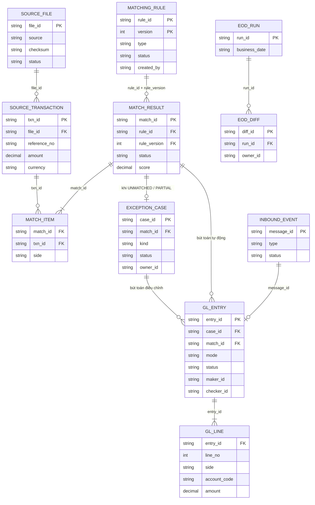

# R05 · Đối soát – đặc tả API và từ điển dữ liệu (thiết kế đề xuất)

| | |
|---|---|
| Mã tài liệu | AEG-REC-R05 |
| Phiên bản | 0.4 |
| Ngày phát hành | 26/11/2026 |
| Trạng thái | ✅ Đã hiện thực bản tham chiếu `reconciliation-service` v1.0 ([services/reconciliation](../../services/reconciliation/README.md)), 56/56 test đạt (R04 §4). Thiết kế vẫn chờ Tech Lead và Kế toán trưởng xác nhận các chỗ **[D-REC-xx]** |
| Phân loại | Nội bộ |
| Tác giả | Han Dao (BA) |
| Người duyệt | Tech Lead · Kế toán trưởng · QA Lead · InfoSec – chưa duyệt |
| Mục đích và phạm vi | Đặc tả API và từ điển dữ liệu reconciliation-service |
| Chuẩn tham chiếu | OpenAPI 3.1 (cấu trúc API), RFC 9110 (mã HTTP), BABOK v3 §10.15 (Data Dictionary), ISO 20022 camt.053/054 (sao kê), ISO 4217 (mã tiền tệ) |
| Thuật ngữ | [G02 Thuật ngữ và chữ viết tắt](../00-overview/G02-glossary.md) |
| Epic | [SCRUM-7](https://baohandao2303.atlassian.net/browse/SCRUM-7) · story SCRUM-22 → 26 (backend), [SCRUM-50](https://baohandao2303.atlassian.net/browse/SCRUM-50) (truy vết), [SCRUM-53](https://baohandao2303.atlassian.net/browse/SCRUM-53) (EOD) |
| Nguồn | BAS-BRD-v1.2 §3.4 (mô hình dữ liệu) qua [R02 §5](R02-requirements-gap-rtm.md) · ERD [R01 §5](R01-reconciliation-flow.md) · 20 yêu cầu [R02 §4](R02-requirements-gap-rtm.md) · kiểu dữ liệu UI mẫu `src/ops/Reconciliation.tsx` |
| Liên quan | [R01](R01-reconciliation-flow.md) luồng & trạng thái · [R03](R03-ui-spec.md) giao diện · [R04](R04-test-plan-cases.md) test case backend TC-REC-B01 → B09 · Module 1: [A03](../01-ekyc/1.6-api-data/A03-api-specification.md), [D01](../01-ekyc/1.6-api-data/D01-data-dictionary.md) (cùng quy ước) |

> ⚠️ Tài liệu này là **thiết kế đề xuất để đội backend bắt đầu**, không mô tả hệ thống đang chạy. Tên trạng thái theo UI mẫu và R01 v1.1; các chỗ phụ thuộc quyết định của Kế toán trưởng (D-REC-01 → 09, [R02 §3](R02-requirements-gap-rtm.md)) được đánh dấu **[D-REC-xx]** và phải sửa theo kết quả quyết định. Thời hạn lưu trữ ở §4.3 cần Kế toán trưởng và Pháp chế xác nhận.

Dev dùng tài liệu này để dựng lược đồ và API; QA dùng để viết test API và chạy TC-REC-B01 → B09; FE dùng §7 để thay dữ liệu mẫu trong UI bằng lời gọi API.

## 1. Quy ước chung

| Mục | Quy ước |
|---|---|
| Base URL | `/api/v1/rec` sau API Gateway (có phiên bản ngay từ đầu – bài học từ A03 §7) |
| Định dạng | JSON UTF-8. Body tối đa 1 MB. File sao kê **không** gửi qua API này mà vào qua SFTP/API đối tác (§5.1) |
| Số tiền | **Chuỗi thập phân** (vd. `"125000000.00"`) kèm `currency` ISO 4217. Không dùng số thực (float) để tránh sai làm tròn |
| Thời gian | Trường `*_at` là epoch mili-giây UTC (như A03). Ngày nghiệp vụ (`value_date`, `business_date`) là `YYYY-MM-DD` theo giờ Việt Nam |
| Phương thức | `GET` đọc, `POST` ghi. Không có `PUT`/`DELETE` cho bút toán, quyết định và audit. Bút toán đã post chỉ đảo bằng bút toán mới (REQ-REC-11) |
| Chống gọi lặp | Mọi `POST` thay đổi trạng thái nhận header `Idempotency-Key`; gọi lại cùng khoá trả kết quả lần đầu, không tạo bản ghi mới |
| Che dữ liệu | Số tài khoản che giữa, giữ 4 số cuối **[D-REC-09]**; số thẻ chỉ lưu dạng đã che (PCI DSS). Xem đầy đủ số tài khoản: `?unmask=1`, chỉ vai trò được phép, ghi audit `VIEW_ACCOUNT` |
| Ghi chú bắt buộc | Mọi lý do / ghi chú (từ chối, trả về, nguyên nhân khác, yêu cầu chứng từ) tối thiểu **10 ký tự** sau khi bỏ khoảng trắng hai đầu |
| Lỗi | Cùng dạng A03: `{ "error": { "code": "…", "message": "…" } }`. Mã lỗi ở §6 |

### 1.1 Vai trò

Danh tính lấy từ SSO ở API Gateway. Vai trò đề xuất khớp 3 người dùng UAT của UI mẫu (R03 §1):

| Vai trò | Người dùng UAT | Quyền chính |
|---|---|---|
| `REC_OFFICER` | Lê Hoàng Nam | Tạo quy tắc (Maker), nhận và xử lý ngoại lệ, tạo bút toán điều chỉnh |
| `REC_CHECKER` | Phạm Thu Trang | Như `REC_OFFICER` + duyệt quy tắc, duyệt / trả về / từ chối bút toán |
| `REC_LEAD` | Đỗ Minh Quân | Như `REC_CHECKER` + nhận ngoại lệ đã leo thang, phân công lệch EOD, xem số tài khoản đầy đủ |
| `FIN_VIEWER` | Kế toán trưởng, Quản lý vận hành | Xem REC-01, báo cáo, duyệt quy tắc; xem số tài khoản đầy đủ |

Kiểm soát phân tách nhiệm vụ (SoD) **luôn** kiểm ở server, không dựa vào việc UI ẩn nút:

| Mã | Kiểm soát | Áp dụng ở |
|---|---|---|
| SoD-1 | Người duyệt bút toán ≠ Maker của bút toán (BR-REC-07) | API-34, 35, 36 |
| SoD-2 | Người duyệt bút toán > ngưỡng ≠ người tạo hoặc người sửa gần nhất của quy tắc sinh ra giao dịch (RULE-REC-05, REQ-REC-07) **[D-REC-04]** | API-34 |
| SoD-3 | Người duyệt quy tắc ≠ người tạo version đó (REQ-REC-09) | API-14 |

## 2. Mô hình dữ liệu



Khác R01 §5 ở bốn chỗ, đều để đáp ứng yêu cầu đã có:

| Thay đổi | Lý do |
|---|---|
| Thêm `SOURCE_FILE` | Biết giao dịch thuộc file nào để cách ly và nạp lại (REQ-REC-13), loại file trùng theo checksum (REQ-REC-14) |
| Tách `MATCH_ITEM` thay cho mảng `txn_ids[]` | Khớp N:1 có nhiều giao dịch; bảng nối cho phép truy vết ngược từ giao dịch (REQ-REC-19) |
| Tách `GL_LINE` khỏi `GL_ENTRY` | Kiểm được tổng Nợ = tổng Có (RULE-REC-08, REQ-REC-11). UI mẫu hiện 1 cặp Nợ/Có = 2 dòng |
| Thêm `INBOUND_EVENT`, `EOD_RUN`, `EOD_DIFF` | Không hạch toán trùng khi sự kiện từ Hạn mức gửi lại, và lưu kết quả đối chiếu cuối ngày (REQ-REC-20) |

## 3. Từ điển dữ liệu

**Mức phân loại** dùng chung với [D01 §1](../01-ekyc/1.6-api-data/D01-data-dictionary.md): 🔴 **S** nhạy cảm · 🟠 **P** cá nhân · 🟡 **I** nội bộ · ⚪ **N** không nhạy cảm. Số tài khoản và giao dịch của khách xếp 🟠 P cho tới khi DPO trả lời câu hỏi 4 của D01 (NĐ 356/2025 có thể xếp tài khoản và lịch sử giao dịch vào nhóm nhạy cảm).

**Bảo vệ:** `mask` che khi hiển thị · `enc` mã hoá cột ở production · `imm` bất biến (trigger chặn `UPDATE`/`DELETE`).

### 3.1 `source_files` – lô file / message đã nhận

| Trường | Kiểu | Bắt buộc | Ý nghĩa | Mức | Ví dụ | Yêu cầu |
|---|---|---|---|---|---|---|
| `file_id` | TEXT | ✅ | Mã lô | I | `F-20261121-WAL-01` | REQ-REC-13 |
| `source` | TEXT | ✅ | `CBS` · `NAPAS` · `VISA` · `MASTERCARD` · `WALLET` | N | `WALLET` | BR-REC-01 |
| `format` | TEXT | ✅ | `CSV` · `CAMT053` · `CAMT054` · `TC33` · `IPM` · `JSON` | N | `JSON` | BR-REC-01 |
| `file_name` | TEXT | ✅ | Tên file / mã message gốc | I | — | — |
| `checksum` | TEXT | ✅ | SHA-256 nội dung, **duy nhất** theo `source` | I | — | REQ-REC-14 |
| `status` | TEXT | ✅ | `RECEIVED` · `LOADED` · `QUARANTINED` · `RELOADED` | I | `QUARANTINED` | UAT-REC-02 |
| `quarantine_reason` | TEXT | | Lý do cách ly, hiển thị cho vận hành | I | `Sai định dạng trường amount dòng 12` | REQ-REC-13 |
| `record_count` / `duplicate_count` / `invalid_count` | INTEGER | ✅ | Số bản ghi đọc được / bị loại vì trùng / không hợp lệ | N | `0 / 0 / 0` | REQ-REC-14 |
| `expected_at` | ms | | Giờ dự kiến theo lịch của nguồn, để gắn nhãn "Trễ" | N | — | UC-REC-01 |
| `received_at`, `loaded_at` | ms | ✅ / | Lúc nhận, lúc nạp xong | I | — | UAT-REC-09 |

### 3.2 `source_transactions` – giao dịch đã chuẩn hoá

| Trường | Kiểu | Bắt buộc | Ý nghĩa | Mức | Bảo vệ | Ví dụ | Yêu cầu |
|---|---|---|---|---|---|---|---|
| `txn_id` | TEXT | ✅ | Mã nội bộ, duy nhất | I | — | `T-01J…` | — |
| `file_id` | TEXT | ✅ | Lô nạp | I | — | — | REQ-REC-13 |
| `source` | TEXT | ✅ | Như §3.1 | N | — | `NAPAS` | — |
| `side` | TEXT | ✅ | `INTERNAL` (sổ của ngân hàng) · `EXTERNAL` (đối tác) | N | — | `INTERNAL` | — |
| `reference_no` | TEXT | ✅ | Mã tham chiếu đã chuẩn hoá (bỏ khoảng trắng, viết hoa) | I | — | `FT2611080017` | RULE-REC-02 |
| `amount` | DECIMAL(18,2) | ✅ | Số tiền, luôn dương | P | — | `125000000.00` | — |
| `currency` | TEXT(3) | ✅ | ISO 4217 | N | — | `VND` | RULE-REC-02 |
| `direction` | TEXT | ✅ | `DEBIT` · `CREDIT` | N | — | `CREDIT` | — |
| `txn_at` | ms | ✅ | Thời điểm giao dịch | P | — | — | — |
| `value_date` | DATE | | Ngày giá trị | N | — | `2026-11-20` | — |
| `account_no` | TEXT | | Số tài khoản nội bộ | P | mask, enc | `1903 •••• 2025` | D-REC-09 |
| `counterparty_account` | TEXT | | Tài khoản / thẻ phía đối tác; thẻ chỉ lưu dạng đã che | P | mask, enc | `4111 •••• 1234` | — |
| `batch_id` | TEXT | | Mã lô của tổ chức thẻ, cho khớp N:1 | N | — | `BATCH-MC-1120` | RULE-REC-03 |
| `dq_status` | TEXT | ✅ | `VALID` · `INVALID` (thiếu trường, sai định dạng) | I | — | `VALID` | TC-REC-B01 |
| `match_status` | TEXT | ✅ | `NEW` · `MATCHED` · `IN_EXCEPTION` – chỉ để truy vấn nhanh, nguồn sự thật là `match_items` | I | — | — | — |
| `created_at` | ms | ✅ | Lúc nạp | I | — | — | — |

Khoá duy nhất `(source, reference_no, amount, currency, txn_at)` để loại trùng nghiệp vụ trong cùng nguồn; trùng khác checksum vẫn có thể là `DUPLICATE` thật **[D-REC-06]**.

### 3.3 `matching_rules` – quy tắc khớp (mỗi dòng là một version)

| Trường | Kiểu | Bắt buộc | Ý nghĩa | Ví dụ | Yêu cầu |
|---|---|---|---|---|---|
| `rule_id`, `version` | TEXT, INTEGER | ✅ | Khoá chính kép. Sửa quy tắc = thêm version | `MR-002`, `4` | REQ-REC-09 |
| `name` | TEXT | ✅ | ≥ 4 ký tự | `CBS ↔ Visa · lệch tỷ giá` | R03 §4 |
| `source_pair` | TEXT | ✅ | Cặp đối soát | `CBS↔VISA` | — |
| `type` | TEXT | ✅ | `EXACT` · `FUZZY` · `N1` | `FUZZY` | BR-REC-03, 04 |
| `match_keys` | json | ✅ | Ít nhất 1 trong `REF`, `AMOUNT`, `CURRENCY`, `DATE`, `ACCOUNT`, `BATCH`. `EXACT` mặc định có `CURRENCY` (R03 §4) | `["AMOUNT","DATE","ACCOUNT"]` | RULE-REC-02 |
| `amount_tolerance_pct`, `date_tolerance_days` | DECIMAL, INTEGER | | Chỉ cho `FUZZY` | `0.5`, `1` | — |
| `fuzzy_threshold` | DECIMAL | | Điểm tối thiểu để khớp, mặc định `0.95` | `0.95` | RULE-REC-01 |
| `fuzzy_gap` | DECIMAL | | Hai ứng viên cách nhau dưới mức này → `PARTIAL`, mặc định `0.02` | `0.02` | REQ-REC-16 |
| `n1_max_items`, `n1_timeout_ms` | INTEGER | | Giới hạn tổ hợp và thời gian tìm subset-sum, mặc định `20`, `2000` | `20`, `2000` | RULE-REC-03, REQ-REC-15 |
| `status` | TEXT | ✅ | `DRAFT` · `PENDING` · `ACTIVE` · `RETIRED` **[D-REC-05]** | `ACTIVE` | REQ-REC-09 |
| `created_by`, `updated_by` | TEXT | ✅ | Người tạo version, người sửa gần nhất – **dùng cho SoD-2** | `u-quan` | RULE-REC-05 |
| `checker_id` | TEXT | | Người được chọn duyệt (khác `created_by`) | `u-trang` | UAT-REC-08 |
| `approved_by`, `approved_at` | TEXT, ms | | Người duyệt thực tế | — | REQ-REC-09 |
| `reject_reason` | TEXT | | Lý do khi trả lại bản `PENDING` về `DRAFT` (≥ 10 ký tự) | — | REQ-REC-09 |
| `effective_from`, `retired_at` | ms | | Version mới có hiệu lực từ lần chạy sau khi duyệt; version cũ `RETIRED` cùng lúc | — | REQ-REC-09 |

Mức phân loại: cả bảng ⚪ N / 🟡 I.

### 3.4 `match_results` và `match_items` – kết quả khớp

| Bảng | Trường | Kiểu | Ý nghĩa | Yêu cầu |
|---|---|---|---|---|
| `match_results` | `match_id` | TEXT | Khoá | — |
| | `rule_id`, `rule_version` | TEXT, INTEGER | Quy tắc **đúng version** đã sinh kết quả – để truy SoD-2 và kiểm toán | RULE-REC-05 |
| | `status` | TEXT | `MATCHED` · `UNMATCHED` · `PARTIAL` | BR-REC-03 |
| | `score` | DECIMAL(4,3) | Điểm Fuzzy; `1.000` với `EXACT` | RULE-REC-01 |
| | `run_id`, `matched_at` | TEXT, ms | Lần chạy engine | — |
| `match_items` | `match_id`, `txn_id`, `side` | TEXT | Giao dịch tham gia kết quả. N:1 có nhiều dòng `EXTERNAL` | REQ-REC-19 |

`match_results` và `match_items` 🟡 I, bất biến (imm): chạy lại engine tạo kết quả mới, không sửa kết quả cũ.

### 3.5 `exception_cases` – ngoại lệ

| Trường | Kiểu | Bắt buộc | Ý nghĩa | Mức | Ví dụ | Yêu cầu |
|---|---|---|---|---|---|---|
| `case_id` | TEXT | ✅ | `EXC-NNNN` | I | `EXC-1125` | — |
| `match_id` | TEXT | ✅ | Kết quả khớp sinh ra ngoại lệ | I | — | R02 §5 |
| `kind` | TEXT | ✅ | `UNMATCHED` · `PARTIAL` · `DUPLICATE` **[D-REC-06]** | I | `UNMATCHED` | — |
| `status` | TEXT | ✅ | `OPEN` · `IN_PROGRESS` · `ESCALATED` · `PENDING_POSTING` · `RESOLVED` (`CLOSED` nếu D-REC-01 duyệt) **[D-REC-01]** | I | `PENDING_POSTING` | R01 §3 |
| `amount`, `diff_amount`, `currency` | DECIMAL, DECIMAL, TEXT | ✅ | Số tiền giao dịch nội bộ, chênh lệch, tiền tệ | P | `125000000.00` | — |
| `opened_at` | ms | ✅ | Lúc tạo – mốc tính aging | I | — | REQ-REC-04 |
| `due_at` | ms | ✅ | Hạn xử lý = `opened_at` + ngưỡng leo thang **[D-REC-03]** | I | — | RULE-REC-06 |
| `aging_bucket` | TEXT | — | Tính khi đọc, không lưu: `0-1D` · `1-3D` · `>3D` **[D-REC-02]** | I | `1-3D` | — |
| `owner_id`, `claimed_at` | TEXT, ms | | Người đang xử lý | I | `u-nam` | — |
| `escalated_at`, `escalation_reason` | ms, TEXT | | Leo thang tự động hoặc bấm tay | I | — | REQ-REC-03 |
| `ai_causes` | json | ✅ | Top-3 `{code, label, probability}` từ mô hình | I | — | BR-REC-05 |
| `root_cause_code` | TEXT | | Nguyên nhân đã chọn (từ top-3 hoặc danh mục chuẩn) | I | `FX_DIFF` | REQ-REC-01 |
| `root_cause_override` | bool | ✅ | `true` khi chọn ngoài top-3 | I | 0 | REQ-REC-01 |
| `root_cause_note` | TEXT | | Bắt buộc ≥ 10 ký tự khi override | I | — | REQ-REC-01 |
| `resolution_type` | TEXT | | `ADJUSTMENT` · `MANUAL_MATCH` · `REQUEST_DOCS` | I | `ADJUSTMENT` | REQ-REC-02 |
| `manual_match_txn_id` | TEXT | | Giao dịch đối ứng khi khớp thủ công | I | — | REQ-REC-02 |
| `docs_request_note` | TEXT | | Nội dung yêu cầu chứng từ (≥ 10 ký tự) | I | — | REQ-REC-02 |
| `auto_healed` | bool | ✅ | Đóng bằng "tự chữa" ngoại lệ lặp lại (RULE-REC-07) **[D-REC-08]** | I | 0 | — |
| `closed_at` | ms | | Lúc đóng – mốc kết thúc MTTR | I | — | REQ-REC-04 |

**Ràng buộc:** tối đa **một** `gl_entries` có `status IN ('PENDING','RETURNED')` cho mỗi `case_id` (REQ-REC-08, DEF-REC-01) – dùng unique index một phần.

### 3.6 `gl_entries` và `gl_lines` – bút toán

| Bảng | Trường | Kiểu | Bắt buộc | Ý nghĩa | Ví dụ | Yêu cầu |
|---|---|---|---|---|---|---|
| `gl_entries` | `entry_id` | TEXT | ✅ | `GL-NNNNN`, giữ nguyên khi trình lại | `GL-90313` | REQ-REC-06 |
| | `case_id` / `match_id` | TEXT | một trong hai | Nguồn: ngoại lệ (điều chỉnh) hoặc kết quả khớp (tất toán tự động) | `EXC-1125` | BR-REC-10 |
| | `source_rule_id`, `source_rule_version` | TEXT, INTEGER | ✅ | Quy tắc sinh giao dịch – server tự điền từ `match_results`, client không gửi | `MR-001`, `7` | SoD-2 |
| | `amount`, `currency` | DECIMAL, TEXT | ✅ | Bằng tổng dòng Nợ | `125000000.00` | — |
| | `memo` | TEXT | ✅ | Diễn giải | `Treo chờ NAPAS T+1` | — |
| | `mode` | TEXT | ✅ | `ZERO_TOUCH` (≤ ngưỡng, tự post) · `MAKER_CHECKER` | `MAKER_CHECKER` | RULE-REC-04, KPI-05 |
| | `status` | TEXT | ✅ | `PENDING` · `RETURNED` · `REJECTED` · `POSTED` · `ESCALATED` (REQ-REC-10, Should) | `PENDING` | R01 §4 |
| | `maker_id` | TEXT | ✅ | Người tạo; `system` với bút toán tự động | `u-trang` | BR-REC-07 |
| | `checker_id` | TEXT | | Người duyệt / trả về / từ chối gần nhất | — | — |
| | `submit_count` | INTEGER | ✅ | Số lần trình, bắt đầu 1 | `2` | REQ-REC-06 |
| | `return_note` / `reject_reason` | TEXT | | ≥ 10 ký tự | — | REQ-REC-05, 06 |
| | `reversal_of` | TEXT | | Bút toán đảo của bút toán nào | — | REQ-REC-11 |
| | `created_at`, `posted_at` | ms | ✅ / | — | — | — |
| `gl_lines` | `entry_id`, `line_no` | TEXT, INTEGER | ✅ | Khoá | — | — |
| | `side` | TEXT | ✅ | `DEBIT` · `CREDIT` | — | RULE-REC-08 |
| | `account_code` | TEXT | ✅ | Mã tài khoản GL theo hệ thống tài khoản của ngân hàng | `1131.01` | — |
| | `amount` | DECIMAL(18,2) | ✅ | > 0 | — | — |

**Ràng buộc:** tổng `DEBIT` = tổng `CREDIT` cho mỗi `entry_id` (kiểm khi tạo và khi trình lại – RULE-REC-08). Khi `status = POSTED`, cả `gl_entries` và `gl_lines` của bút toán đó bất biến (imm, REQ-REC-11). Mã tài khoản trong UI mẫu (`1131.01`, `4211.05`, `6311.01`) là ví dụ, Kế toán trưởng cung cấp danh mục thật.

### 3.7 `inbound_events` – sự kiện nhận từ module khác

| Trường | Kiểu | Ý nghĩa | Yêu cầu |
|---|---|---|---|
| `message_id` | TEXT, khoá chính | `messageId` của Pub/Sub – **khoá chống trùng** | REQ-REC-20 |
| `type` | TEXT | `limit.authorization.processed` | L01 |
| `payload` | json | Nội dung sự kiện (§5.8). Không chứa số thẻ đầy đủ | — |
| `status` | TEXT | `RECEIVED` · `PROCESSED` · `FAILED` | — |
| `entry_id` | TEXT | Bút toán đã sinh (nếu có) | BR-REC-10 |
| `received_at`, `processed_at` | ms | — | KPI-09 (độ trễ) |

### 3.8 `eod_runs` và `eod_diffs` – đối chiếu cuối ngày với Hạn mức

| Bảng | Trường | Ý nghĩa | Yêu cầu |
|---|---|---|---|
| `eod_runs` | `run_id`, `business_date`, `started_at`, `finished_at` | Lần chạy | SCRUM-53 |
| | `ledger_count`, `ledger_total`, `gl_count`, `gl_total`, `diff_count` | Tổng hai phía và số dòng lệch | REQ-REC-20 |
| `eod_diffs` | `diff_id`, `run_id`, `auth_id`, `entry_id` | Dòng lệch: có ở Ledger Hạn mức mà không có GLEntry, hoặc ngược lại | REQ-REC-20 |
| | `diff_type` | `MISSING_GL` · `MISSING_LEDGER` · `AMOUNT_MISMATCH` | — |
| | `owner_id`, `status`, `note` | Người phụ trách, `OPEN` / `RESOLVED`, ghi chú | REQ-REC-20 ("mọi dòng có người phụ trách") |

### 3.9 `audit_event` và `config`

`audit_event` dùng cùng cấu trúc với Module 1 ([D01 §3.5](../01-ekyc/1.6-api-data/D01-data-dictionary.md)): chỉ thêm, trigger chặn sửa xoá. Mã thao tác của Đối soát:

`RULE_CREATED` · `RULE_SUBMITTED` · `RULE_APPROVED` · `RULE_REJECTED` · `RULE_RETIRED` · `FILE_QUARANTINED` · `FILE_RELOADED` · `CASE_CLAIMED` · `CASE_RELEASED` · `CASE_ESCALATED` · `CASE_RESOLVED` · `ROOT_CAUSE_OVERRIDE` · `GL_CREATED` · `GL_APPROVED` · `GL_RETURNED` · `GL_REJECTED` · `GL_RESUBMITTED` · `GL_REVERSED` · `SOD_BLOCKED` · `VIEW_ACCOUNT` · `EOD_DIFF_ASSIGNED` · `CONFIG_CHANGE_*`

Tham số `config` (đổi qua Maker-Checker như Module 1):

| Tham số | Mặc định | Giới hạn | Nguồn |
|---|---|---|---|
| `gl_threshold` | 50 000 000 VND | 1 000 000 – 1 000 000 000 | RULE-REC-04 · giữ 50 triệu tới khi CR-002 được duyệt (ASM-07, DEC-01) |
| `escalation_after_hours` | 72 | 1 – 720 | RULE-REC-06 **[D-REC-03]** |
| `fuzzy_threshold` / `fuzzy_gap` | 0.95 / 0.02 | 0.80–1.00 / 0–0.10 | RULE-REC-01, REQ-REC-16 |
| `n1_timeout_ms` / `n1_max_items` | 2000 / 20 | 100–10 000 / 2–200 | RULE-REC-03, REQ-REC-15 |
| `min_note_length` | 10 | 10 – 200 | REQ-REC-01, 05, 06 |
| `unmatched_value_alert` | không đặt | ≥ 0 | REQ-REC-18 (Could) |
| `zero_touch_target_pct` | 30 | 0 – 100 | KPI-05, D-REC-07 |

## 4. Trạng thái, vòng đời và lưu trữ

### 4.1 Bảng mã trạng thái

| Đối tượng | Mã | Sơ đồ |
|---|---|---|
| File | `RECEIVED` → `LOADED` / `QUARANTINED` → `RELOADED` | — |
| Quy tắc | `DRAFT` → `PENDING` → `ACTIVE` → `RETIRED`; `PENDING` → `DRAFT` khi bị trả lại | R01 §2 |
| Ngoại lệ | `OPEN` → `IN_PROGRESS` → `PENDING_POSTING` → `RESOLVED`; `ESCALATED` từ `OPEN` / `IN_PROGRESS` | R01 §3 |
| Bút toán | `PENDING` → `POSTED` / `RETURNED` / `REJECTED`; `RETURNED` → `PENDING` khi trình lại | R01 §4 |

### 4.2 Chuyển trạng thái ngoại lệ ↔ bút toán (server bảo đảm trong một giao dịch DB)

| Sự kiện | Bút toán | Ngoại lệ |
|---|---|---|
| Điều chỉnh ≤ ngưỡng | tạo `POSTED`, `mode = ZERO_TOUCH` | `RESOLVED` |
| Điều chỉnh > ngưỡng | tạo `PENDING`, `mode = MAKER_CHECKER` | `PENDING_POSTING` |
| Checker duyệt | `POSTED` | `RESOLVED` |
| Checker trả về | `RETURNED` | `IN_PROGRESS` |
| Checker từ chối | `REJECTED` | `IN_PROGRESS` |
| Maker trình lại | `PENDING`, `submit_count + 1` | `PENDING_POSTING` |
| Khớp thủ công | không tạo | `RESOLVED` |
| Yêu cầu chứng từ | không tạo | giữ `IN_PROGRESS` |

### 4.3 Thời hạn lưu (đề xuất – cần Kế toán trưởng và Pháp chế xác nhận)

| Dữ liệu | Đề xuất | Căn cứ cần đối chiếu |
|---|---|---|
| `gl_entries`, `gl_lines`, `audit_event` | Không xoá ở tầng ứng dụng; lưu trữ theo chế độ lưu tài liệu kế toán | Luật Kế toán 2015 và văn bản hướng dẫn về thời hạn lưu tài liệu kế toán (*cần xác minh số năm áp dụng*) |
| `source_transactions`, `match_*`, `exception_cases` | Cùng thời hạn với bút toán liên quan, vì là chứng từ truy vết | BR-REC-10 |
| `source_files` nội dung gốc | Lưu trên Cloud Storage có khoá đối tượng; file bị cách ly giữ tới khi nạp lại thành công + thời hạn trên | REQ-REC-13 |
| `inbound_events.payload` | 90 ngày sau khi `PROCESSED` (đủ cho đối chiếu và điều tra), giữ `message_id` lâu dài để chống trùng | REQ-REC-20 (*đề xuất của BA*) |

## 5. API

### 5.1 Nạp dữ liệu và nguồn (UC-REC-01)

File và message của đối tác đi vào qua SFTP / API đối tác tới job nạp nội bộ, **không qua web**. Web chỉ xem và nạp lại:

| # | Phương thức | Đường dẫn | Vai trò | Mô tả | Yêu cầu |
|---|---|---|---|---|---|
| API-01 | GET | `/sources` | mọi vai trò | Trạng thái từng nguồn: số bản ghi, tỷ lệ khớp, lần nạp cuối, `Đúng lịch` / `Trễ` / `Cách ly`, `last_updated_at` | UAT-REC-02, 09 |
| API-02 | GET | `/files?status=QUARANTINED&source=` | `REC_*` | Danh sách lô, lọc theo trạng thái | REQ-REC-13 |
| API-03 | GET | `/files/:file_id` | `REC_*` | Chi tiết lô và lý do cách ly | REQ-REC-13 |
| API-04 | POST | `/files/:file_id/reload` | `REC_LEAD` | Nạp lại lô đã cách ly sau khi nguồn gửi lại file. Body `{ "replacement_file_id": "…" }` | REQ-REC-13 |

### 5.2 Quy tắc khớp (UC-REC-02, REC-02/03)

| # | Phương thức | Đường dẫn | Vai trò | Điều kiện | Yêu cầu |
|---|---|---|---|---|---|
| API-10 | GET | `/rules?status=` | mọi vai trò | — | — |
| API-11 | GET | `/rules/:rule_id` | mọi vai trò | Trả mọi version | REQ-REC-09 |
| API-12 | POST | `/rules` | `REC_*` | Tạo `DRAFT` version 1 | UC-REC-02 |
| API-13 | POST | `/rules/:rule_id/submit` | người tạo version | Body `{ "version": 2, "checker_id": "u-trang" }`; `checker_id ≠ created_by` → `RULE_SELF_APPROVAL` | UAT-REC-08 |
| API-14 | POST | `/rules/:rule_id/approve` · `/reject` | `REC_CHECKER`, `REC_LEAD`, `FIN_VIEWER` | Version đang `PENDING`; người duyệt ≠ người tạo (SoD-3). `reject` bắt buộc `reason` | REQ-REC-09 |
| API-15 | POST | `/rules/:rule_id/versions` | `REC_*` | Sửa quy tắc `ACTIVE` → version mới `DRAFT`; version cũ vẫn chạy | REQ-REC-09 |
| API-16 | POST | `/rules/:rule_id/retire` | `REC_*` | Tạo yêu cầu ngừng dùng, cũng phải qua duyệt | REQ-REC-09 |
| API-17 | POST | `/rules/:rule_id/copy` | `REC_*` | Bản sao `DRAFT` version 1, người tạo là người gọi | REQ-REC-12 |

**Thân API-12 / API-15**

| Trường | Kiểu | Bắt buộc | Ràng buộc |
|---|---|---|---|
| `name` | string | ✅ | ≥ 4 ký tự |
| `source_pair` | string | ✅ | Một cặp nguồn có trong `/sources` |
| `type` | `EXACT` \| `FUZZY` \| `N1` | ✅ | — |
| `match_keys` | string[] | ✅ | ≥ 1 khoá; `EXACT` tự thêm `CURRENCY` nếu thiếu |
| `amount_tolerance_pct`, `date_tolerance_days` | number | chỉ `FUZZY` | Gửi kèm với `EXACT` / `N1` → `VALIDATION` |
| `fuzzy_threshold`, `n1_max_items`, `n1_timeout_ms` | number | | Trong giới hạn §3.9 |

### 5.3 Ngoại lệ (UC-REC-04, REC-04/05)

| # | Phương thức | Đường dẫn | Vai trò | Điều kiện | Yêu cầu |
|---|---|---|---|---|---|
| API-20 | GET | `/exceptions?status=open\|all\|ESCALATED\|RESOLVED&kind=&source=&q=` | mọi vai trò | `open` = mọi trạng thái trừ `RESOLVED` (gồm `PENDING_POSTING`) | TC-REC-08, 21 |
| API-21 | GET | `/exceptions/:case_id[?unmask=1]` | mọi vai trò; `unmask` chỉ `REC_LEAD`, `FIN_VIEWER` | Trả so sánh 2 phía, `ai_causes`, `pending_entry` nếu có, tóm tắt truy vết | R03 §6 |
| API-22 | POST | `/exceptions/:case_id/claim` · `/release` | `REC_*` | `claim`: chưa ai giữ. `release`: người giữ hoặc `REC_LEAD` | — |
| API-23 | POST | `/exceptions/:case_id/escalate` | người giữ | Body `{ "reason": "…" }` ≥ 10 ký tự | REQ-REC-03 |
| API-24 | POST | `/exceptions/:case_id/resolution` | người giữ | `IN_PROGRESS` hoặc `ESCALATED` (với `REC_LEAD`) | REQ-REC-01, 02, 08 |

**Thân API-24**

```json
{
  "root_cause": { "code": "NAPAS_T1_PENDING", "override": false, "note": null },
  "type": "ADJUSTMENT",
  "adjustment": {
    "memo": "Treo chờ NAPAS T+1",
    "lines": [
      { "side": "DEBIT",  "account_code": "1131.01", "amount": "125000000.00" },
      { "side": "CREDIT", "account_code": "4211.05", "amount": "125000000.00" }
    ]
  }
}
```

| `type` | Trường thêm | Kết quả |
|---|---|---|
| `ADJUSTMENT` | `adjustment.memo`, `adjustment.lines` (Nợ = Có) | Tạo bút toán; ngoại lệ `RESOLVED` (≤ ngưỡng) hoặc `PENDING_POSTING` (> ngưỡng). Đã có bút toán `PENDING`/`RETURNED` → `ADJUSTMENT_PENDING` |
| `MANUAL_MATCH` | `manual_match_txn_id` | Tạo `match_results` mới `MATCHED` với giao dịch đối ứng; ngoại lệ `RESOLVED`; không tạo bút toán |
| `REQUEST_DOCS` | `docs_request_note` ≥ 10 ký tự | Ngoại lệ giữ `IN_PROGRESS`, có cờ chờ chứng từ |

`root_cause.override = true` bắt buộc `note` ≥ 10 ký tự và `code` thuộc danh mục chuẩn (câu hỏi mở 3 của R02).

### 5.4 Bút toán (UC-REC-05, REC-06)

| # | Phương thức | Đường dẫn | Vai trò | Điều kiện | Yêu cầu |
|---|---|---|---|---|---|
| API-30 | GET | `/gl-entries?status=&mode=` | mọi vai trò | Mỗi dòng có `source_rule_id` và người tạo quy tắc để Checker thấy trước | R03 §7 |
| API-31 | GET | `/gl-entries/:entry_id` | mọi vai trò | Kèm `gl_lines`, lịch sử duyệt | — |
| API-34 | POST | `/gl-entries/:entry_id/approve` | `REC_CHECKER`, `REC_LEAD` | `PENDING`; SoD-1; SoD-2 khi `amount` > `gl_threshold` | BR-REC-07, REQ-REC-07 |
| API-35 | POST | `/gl-entries/:entry_id/return` | `REC_CHECKER`, `REC_LEAD` | `PENDING`; SoD-1; body `{ "note": "…" }` ≥ 10 ký tự | REQ-REC-06 |
| API-36 | POST | `/gl-entries/:entry_id/reject` | `REC_CHECKER`, `REC_LEAD` | `PENDING`; SoD-1; body `{ "reason": "…" }` ≥ 10 ký tự | REQ-REC-05 |
| API-37 | POST | `/gl-entries/:entry_id/resubmit` | Maker của bút toán | `RETURNED`; body có thể sửa `memo`, `lines` (vẫn Nợ = Có) | REQ-REC-06 |
| API-38 | POST | `/gl-entries/:entry_id/escalate` | `REC_CHECKER`, `REC_LEAD` | `PENDING`; body `{ "to": "COMPLIANCE" \| "HIGHER_APPROVER", "reason": "…" }` | REQ-REC-10 (Should) |
| API-39 | POST | `/gl-entries/:entry_id/reverse` | `REC_LEAD` | `POSTED`; tạo bút toán đảo mới, cũng qua Maker-Checker nếu > ngưỡng | REQ-REC-11 |

Không có API sửa bút toán `POSTED`. Lệnh `UPDATE` / `DELETE` trực tiếp trên DB bị trigger chặn (TC-REC-B06).

### 5.5 Truy vết (BR-REC-10, SCRUM-50)

| # | Phương thức | Đường dẫn | Vai trò | Yêu cầu |
|---|---|---|---|---|
| API-40 | GET | `/lineage?entry_id=` \| `?case_id=` \| `?txn_id=` | mọi vai trò | REQ-REC-19 |

```json
{
  "chain": [
    { "step": "SOURCE_TRANSACTION", "id": "T-01J…", "ref": "FT2611080017", "source": "CBS" },
    { "step": "MATCH_RESULT", "id": null, "status": "UNMATCHED", "note": "Không tìm thấy đối ứng" },
    { "step": "EXCEPTION_CASE", "id": "EXC-1125", "status": "PENDING_POSTING" },
    { "step": "GL_ENTRY", "id": "GL-90313", "status": "PENDING" }
  ],
  "integrity": { "ok": true, "orphans": [] }
}
```

`integrity.ok = false` kèm danh sách bản ghi thiếu khoá liên kết (TC-REC-B08).

### 5.6 Báo cáo (UC-REC-06, REC-01)

| # | Phương thức | Đường dẫn | Vai trò | Yêu cầu |
|---|---|---|---|---|
| API-50 | GET | `/reports/kpi?from=&to=&source=&rule_type=` | mọi vai trò | Tỷ lệ khớp tự động, MTTR, giá trị chưa khớp, zero-touch kèm mục tiêu – REQ-REC-04, 17, KPI-03 → 06 |
| API-51 | GET | `/reports/kpi/export?…` | mọi vai trò | CSV cùng bộ lọc – REQ-REC-17 |
| API-52 | GET | `/reports/causes?from=&to=` | mọi vai trò | Số ngoại lệ theo nguyên nhân – BR-REC-05 |

Công thức theo R01 §7. Zero-touch = bút toán `mode = ZERO_TOUCH` ÷ tổng bút toán đã `POSTED` trong kỳ **[D-REC-08]**.

### 5.7 Đối chiếu cuối ngày với Hạn mức (SCRUM-53)

| # | Phương thức | Đường dẫn | Vai trò | Yêu cầu |
|---|---|---|---|---|
| API-60 | GET | `/eod-runs?business_date=` | mọi vai trò | REQ-REC-20 |
| API-61 | GET | `/eod-runs/:run_id/diffs?status=` | `REC_*` | REQ-REC-20 |
| API-62 | POST | `/eod-runs/:run_id/diffs/:diff_id/assign` | `REC_LEAD` | Body `{ "owner_id": "…" }` – REQ-REC-20 |

### 5.8 Sự kiện

**Nhận vào** (Pub/Sub, không phải HTTP):

| Sự kiện | Từ | Payload tối thiểu đề xuất | Xử lý |
|---|---|---|---|
| `limit.authorization.processed` | `limit-service` (L01) | `messageId`, `auth_id`, `card_id`, `account_ref`, `amount`, `currency`, `result` (`APPROVE` / `DECLINE` / `REVERSED`), `fallback` (`HOLD`/`SETTLED`/`RELEASED`/null), `processed_at` – khớp [L05 §5.6](../03-credit-limit/L05-api-data-dictionary.md); phong bì chung ở [X01 §4](../00-overview/X01-end-to-end-flow-check.md) | Ghi `inbound_events` theo `message_id`; đã có → bỏ qua, trả ack (TC-REC-B09) |

Payload trên là **đề xuất của BA**, đã thống nhất với thiết kế phía Hạn mức ở L05 §5.6 (26/11/2026); còn chờ Tech Lead hai đội chốt.

**Phát ra:**

| Sự kiện | Khi nào | Dùng cho |
|---|---|---|
| `rec.file.quarantined` | File bị cách ly | Cảnh báo vận hành (UAT-REC-02) |
| `rec.exception.created` / `escalated` | Tạo / leo thang ngoại lệ | Thông báo người phụ trách, trưởng nhóm |
| `rec.gl.pending_approval` | Bút toán > ngưỡng chờ Checker | Chuông thông báo REC-06 |
| `rec.gl.posted` | Bút toán đã post | Báo cáo, sổ cái |
| `rec.eod.completed` | Xong đối chiếu cuối ngày | Báo cáo KPI-09 |

## 6. Mã lỗi

Mã chung giống [A03 §4](../01-ekyc/1.6-api-data/A03-api-specification.md): `BAD_JSON` 400 · `UNAUTHENTICATED` 401 · `FORBIDDEN` 403 · `NOT_FOUND` 404 · `INVALID_STATE` 409 · `TOO_LARGE` 413 · `VALIDATION` 422 · `INTERNAL` 500. Mã riêng của Đối soát:

| HTTP | `code` | Ý nghĩa | API | Thông điệp trên UI (R03) |
|---|---|---|---|---|
| 403 | `SOD_MAKER_SAME` | Người duyệt / trả về / từ chối là Maker | API-34 → 36 | "Không thể duyệt GL-xxx: bạn là Maker của bút toán này" |
| 403 | `SOD_RULE_CREATOR` | Người duyệt là người tạo / sửa quy tắc sinh giao dịch (RULE-REC-05) | API-34 | "Không thể duyệt GL-xxx: bạn là người tạo quy tắc MR-xxx sinh ra giao dịch này" |
| 403 | `RULE_SELF_APPROVAL` | Tự chọn mình làm Checker hoặc tự duyệt quy tắc | API-13, 14 | "Vi phạm phân tách nhiệm vụ" / "bạn là người tạo quy tắc" |
| 403 | `NOT_ASSIGNEE` | Xử lý ngoại lệ chưa nhận | API-23, 24 | Gợi ý bấm "Nhận xử lý" |
| 403 | `NOT_MAKER` | Trình lại bút toán không phải của mình | API-37 | Ẩn nút Trình lại |
| 409 | `ALREADY_CLAIMED` | Ngoại lệ đang do người khác giữ | API-22 | Báo tên người giữ |
| 409 | `ADJUSTMENT_PENDING` | Ngoại lệ đã có bút toán `PENDING` / `RETURNED`; kèm `entry_id` | API-24 | "Đã có bút toán GL-xxx đang chờ Checker" |
| 409 | `ENTRY_IMMUTABLE` | Thao tác trên bút toán đã `POSTED` (ngoài đảo) | API-34 → 38 | Tải lại trạng thái |
| 409 | `FILE_NOT_QUARANTINED` | Nạp lại lô không bị cách ly | API-04 | — |
| 422 | `NOTE_TOO_SHORT` | Lý do / ghi chú < 10 ký tự | API-14, 23, 24, 35, 36, 38 | Nút xác nhận bị khoá |
| 422 | `UNBALANCED_ENTRY` | Tổng Nợ ≠ tổng Có | API-24, 37 | Báo tại bảng dòng bút toán |
| 422 | `UNKNOWN_CAUSE` | Mã nguyên nhân không thuộc top-3 hoặc danh mục chuẩn | API-24 | — |
| 422 | `OUT_OF_RANGE` | Tham số quy tắc hoặc cấu hình ngoài giới hạn §3.9 | API-12, 15 | Hiện giới hạn hợp lệ |

Mọi lần bị chặn bởi SoD ghi audit `SOD_BLOCKED` kèm mã lỗi.

## 7. Ánh xạ màn hình UI mẫu → API

Dùng khi thay dữ liệu mẫu (`SOURCES`, `RULES0`, `EX0`, `GL0` trong `src/ops/Reconciliation.tsx`) bằng lời gọi thật:

| Màn | Đọc | Ghi |
|---|---|---|
| REC-01 Tổng quan | API-01, 50, 52, 20 (3 ngoại lệ cần chú ý) | — (Xuất: API-51) |
| REC-02 Quy tắc | API-10, 11 | API-14 (Duyệt), 15, 16, 17 |
| REC-03 Tạo quy tắc | `/me` (danh sách Checker hợp lệ) | API-12, 13 |
| REC-04 Ngoại lệ | API-20 | — |
| REC-05 Chi tiết | API-21, 40 | API-22, 23, 24 |
| REC-06 Bút toán | API-30, 31 | API-34 → 38 |

| Kiểu trong UI mẫu | Bảng / trường |
|---|---|
| `Rule.maker` / `Rule.checker` | `matching_rules.created_by` / `approved_by` |
| `Ex.rule` | `match_results.rule_id` qua `exception_cases.match_id` |
| `Ex.resolution.{type, cause, override, note, ref}` | `resolution_type`, `root_cause_code`, `root_cause_override`, `root_cause_note`, `manual_match_txn_id` |
| `Ex.waitingDocs` | `docs_request_note` |
| `GL.debit` / `GL.credit` | 2 dòng `gl_lines` |
| `GL.rejectReason` / `returnNote` / `submits` | `reject_reason` / `return_note` / `submit_count` |
| `Ex.ageH` / `Ex.dueH` | tính từ `opened_at` / `due_at` |

## 8. Truy vết tới test backend (R04 §4)

| Test | Bảng | API / thành phần | Kiểm tra chính |
|---|---|---|---|
| TC-REC-B01 | `source_files`, `source_transactions` | Job nạp | Chuẩn hoá đủ trường, `dq_status = VALID` |
| TC-REC-B02 | `source_files` | Job nạp, API-02, 04 | Unique `checksum`; `duplicate_count`; `QUARANTINED` + `rec.file.quarantined` |
| TC-REC-B03 | `match_results` | Engine | `EXACT` trên `REF + AMOUNT + CURRENCY` → `MATCHED`, không gọi Fuzzy |
| TC-REC-B04 | `match_results` | Engine | `fuzzy_threshold`, `fuzzy_gap` → `PARTIAL` |
| TC-REC-B05 | `match_results`, `exception_cases` | Engine | `n1_timeout_ms` |
| TC-REC-B06 | `gl_lines`, trigger | API-24, 37 | `UNBALANCED_ENTRY`; `UPDATE` bị chặn |
| TC-REC-B07 | `matching_rules`, `gl_entries` | API-34 | `SOD_RULE_CREATOR` |
| TC-REC-B08 | mọi bảng truy vết | API-40 | `integrity.orphans` |
| TC-REC-B09 | `inbound_events`, `eod_*` | Consumer, API-60, 61 | Không bút toán trùng theo `message_id`; lệch EOD có người phụ trách |

## 9. Câu hỏi mở

| # | Câu hỏi | Gửi | Ảnh hưởng |
|---|---|---|---|
| 1 | Giữ `*_at` dạng epoch ms như A03 hay chuyển RFC 3339 cho toàn bộ dự án? | Tech Lead | §1 |
| 2 | Lỗi theo RFC 9457 hay giữ dạng hiện tại (cùng câu hỏi A03 §7) | Tech Lead | §6 |
| 3 | Danh mục tài khoản GL thật và quy tắc định khoản cho từng loại điều chỉnh | Kế toán trưởng | §3.6 |
| 4 | Thời hạn lưu tài liệu đối soát và bút toán theo quy định kế toán áp dụng cho ngân hàng | Kế toán trưởng + Pháp chế | §4.3 |
| 5 | Payload sự kiện `limit.authorization.processed` | Đội Hạn mức (L01) | §5.8 |
| 6 | Danh mục nguyên nhân chuẩn (dùng chung cho AI và lựa chọn "Nguyên nhân khác") | Kế toán + Data | §3.5, API-24 |
| 7 | D-REC-01 → 09 (R02 §3) – các chỗ đánh dấu **[D-REC-xx]** | Kế toán trưởng, Ops, InfoSec | Toàn tài liệu |

## 10. Kiểm soát tài liệu

### Tài liệu tham chiếu

| Mã | Tài liệu |
|---|---|
| R02 | [R02 · Đối soát – yêu cầu bổ sung, điểm lệch baseline & RTM](R02-requirements-gap-rtm.md) |
| R01 | [R01 · Đối soát giao dịch – luồng, trạng thái và kiểm soát](R01-reconciliation-flow.md) |
| R03 | [R03 · Đặc tả giao diện – Aegis Đối soát (REC-01 → REC-06)](R03-ui-spec.md) |
| R04 | [R04 · Đối soát – kế hoạch kiểm thử, test case và kết quả](R04-test-plan-cases.md) |
| A03 | [A03 · Đặc tả API & mã lỗi – Module 1 eKYC](../01-ekyc/1.6-api-data/A03-api-specification.md) |
| D01 | [D01 · Từ điển dữ liệu – Module 1 eKYC](../01-ekyc/1.6-api-data/D01-data-dictionary.md) |
| L05 | [L05 · Hạn mức – đặc tả API và từ điển dữ liệu (thiết kế đề xuất)](../03-credit-limit/L05-api-data-dictionary.md) |
| X01 | [X01 · Kiểm tra luồng end-to-end và độ đầy đủ tài liệu 3 module](../00-overview/X01-end-to-end-flow-check.md) |

Chuẩn quốc tế: xem trường *Chuẩn tham chiếu* ở đầu trang.

### Lịch sử phiên bản

| Phiên bản | Ngày | Người sửa | Commit | Thay đổi |
|---|---|---|---|---|
| 0.1 | 25/11/2026 | Han Dao | `6c7b79b` | Bản đầu: mô hình dữ liệu 11 bảng, từ điển dữ liệu, 32 API, 13 mã lỗi riêng, sự kiện vào/ra, ánh xạ UI mẫu và test backend |
| 0.2 | 26/11/2026 | Han Dao | — | Payload `limit.authorization.processed` thêm `card_id`, giá trị `result` khớp L05 (X01 F-11); bảng nhật ký đổi tên `audit_event` (F-06) |
| 0.3 | 26/11/2026 | Han Dao | — | Có bản hiện thực tham chiếu: 16 bảng (thêm `staff`, `config_changes`, `idempotency`, `limit_ledger`, `gl_approvals`, cột `channel` cho giao dịch nội bộ và `auth_id` cho bút toán từ Hạn mức), 40 endpoint gồm API-01 → 62 và cấu hình Maker-Checker |
| 0.4 | 26/11/2026 | Han Dao | — | Chuẩn hoá cấu trúc theo ISO/IEC/IEEE 15289: khối thuộc tính đầu trang, tài liệu tham chiếu, thuật ngữ dùng chung (G02), mục kiểm soát tài liệu thống nhất |

### Phê duyệt

| Vai trò | Người | Ngày | Kết luận |
|---|---|---|---|
| BA (soạn) | Han Dao | 25/11/2026 | Trình duyệt |
| Tech Lead |  |  |  |
| Kế toán trưởng |  |  |  |
| QA Lead |  |  |  |
| InfoSec |  |  |  |
