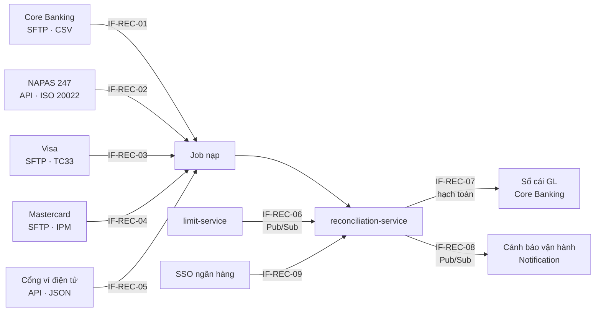
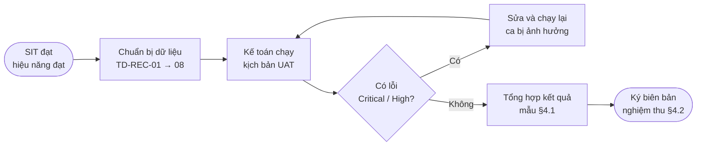

# R07 · Đối soát – kế hoạch SIT, kiểm thử hiệu năng, bộ UAT và biên bản nghiệm thu

| | |
|---|---|
| Phiên bản | 0.1 · 25/11/2026 · Han Dao (BA) |
| Trạng thái | ⛔ Kế hoạch xong · chưa chạy được: chưa có `reconciliation-service` và sandbox đối tác |
| Epic | [SCRUM-7](https://baohandao2303.atlassian.net/browse/SCRUM-7) · story SCRUM-22 → 26, 50, 53 |
| Khung tài liệu | ISO/IEC/IEEE 29119-3:2021 – Test Plan (SIT, hiệu năng, UAT) và mẫu Test Completion Report cho UAT |
| Cơ sở | [R02](R02-requirements-gap-rtm.md) yêu cầu & RTM · [R05](R05-api-data-dictionary.md) API & dữ liệu · [R06](R06-nfr-kpi.md) NFR & KPI · ca backend [R04 §4](R04-test-plan-cases.md) |
| Liên quan | Module 1: [C15](../01-ekyc/1.4-testing/C15-performance-test-plan.md) hiệu năng, [C16](../01-ekyc/1.4-testing/C16-sit-plan.md) SIT, [C17](../01-ekyc/1.4-testing/C17-uat-pack.md) UAT (cùng cấu trúc) |

> ⚠️ Bộ UAT gốc của baseline (BAS-UTR-v1.2) **không có trên Confluence**; các tài liệu R chỉ nhắc 6 mã UAT-REC-01, 02, 07, 08, 09, 10. Tài liệu này giữ nguyên 6 mã đó và đặt kịch bản BA bổ sung là **UAT-REC-P01 → P12** để không đè lên các mã 03 → 06 chưa biết nội dung. Khi có BAS-UTR, đối chiếu và gộp lại.

Thứ tự các vòng: kiểm thử hệ thống của đội Dev (TC-REC-B01 → B09, R04) → **SIT** với đối tác (§1) → **hiệu năng** (§2) → **UAT** với Kế toán (§3) → ký biên bản (§4).

## 1. Kiểm thử tích hợp hệ thống (SIT)

### 1.1 Bản đồ tích hợp

| Mã | Giao diện | Bên phụ trách | Dữ liệu thử cần có | Trạng thái |
|---|---|---|---|---|
| IF-REC-01 | CBS → file giao dịch nội bộ | Đội Core Banking | File CSV mẫu 1 ngày, có giao dịch khớp / lệch / thiếu | Chưa có |
| IF-REC-02 | NAPAS 247 → camt.053 / camt.054 | Solution Owner + NAPAS | File mẫu theo đặc tả mới (ISS-01) | Chưa có |
| IF-REC-03 | Visa → BASE II / TC33 | Solution Owner + Visa | File settlement mẫu, có chênh lệch tỷ giá | Chưa có |
| IF-REC-04 | Mastercard → IPM | Solution Owner + Mastercard | File IPM mẫu có lô gộp phí (N:1) | Chưa có |
| IF-REC-05 | Ví điện tử → JSON | Đối tác ví | File hợp lệ và một file sai định dạng | Chưa có |
| IF-REC-06 | `limit.authorization.processed` | Đội Hạn mức (L01) | Payload đã chốt (R05 câu hỏi 5) | Chưa chốt payload |
| IF-REC-07 | Hạch toán bút toán vào sổ cái | Đội Core Banking + Kế toán | Đặc tả API hạch toán, danh mục tài khoản GL | **Chưa có đặc tả** – xem câu hỏi 1 ở §6 |
| IF-REC-08 | Sự kiện `rec.*` → cảnh báo | Đội Notification | Kênh nhận cảnh báo vận hành | Chưa có |
| IF-REC-09 | SSO → vai trò `REC_*`, `FIN_VIEWER` | IAM / InfoSec | 4 tài khoản thử, mỗi vai trò một tài khoản | Chưa có |

### 1.2 Kịch bản SIT

| Mã | Giao diện | Kịch bản | Kỳ vọng | Truy vết |
|---|---|---|---|---|
| SIT-REC-01 | IF-REC-01 | Nạp file CBS hợp lệ | `source_files.LOADED`, đủ bản ghi, `dq_status = VALID`; checksum ghi nhận | BR-REC-01, NFR-REC-15, 21 · TC-REC-B01 |
| SIT-REC-02 | IF-REC-02 | Nạp camt.053 và camt.054 của NAPAS | Chuẩn hoá đúng `reference_no`, `amount`, `currency`, `value_date` | NFR-REC-21 · UAT-REC-01 |
| SIT-REC-03 | IF-REC-03, 04 | Nạp TC33 và IPM | Đọc được lô (`batch_id`) cho khớp N:1 | NFR-REC-21 · RULE-REC-03 |
| SIT-REC-04 | IF-REC-01 | Engine khớp lỗi giữa chừng rồi chạy lại | Không phải nạp lại file; không mất / trùng bản ghi | NFR-REC-08, 11 |
| SIT-REC-05 | IF-REC-05, 08 | Ví điện tử gửi file sai định dạng; một nguồn trễ quá 60 phút | File `QUARANTINED`; cảnh báo vận hành trong 5 phút cho cả hai trường hợp | NFR-REC-23 · UAT-REC-02 |
| SIT-REC-06 | IF-REC-01, 02 | Cặp CBS ↔ NAPAS trùng `reference_no + amount + currency` | `MATCHED`, không qua Fuzzy | RULE-REC-02 · TC-REC-B03 |
| SIT-REC-07 | IF-REC-01, 03 | Cặp CBS ↔ Visa lệch tỷ giá trong ngưỡng | Fuzzy khớp nếu điểm ≥ 0.95; dưới ngưỡng → ngoại lệ `PARTIAL` | RULE-REC-01 · TC-REC-B04 |
| SIT-REC-08 | IF-REC-07 | Điều chỉnh ≤ 50 triệu và > 50 triệu sau khi Checker duyệt | Bút toán xuất hiện ở sổ cái đúng tài khoản Nợ / Có, đúng số tiền, một lần | RULE-REC-04, BR-REC-06 |
| SIT-REC-09 | IF-REC-07 | Gọi hạch toán lại cùng bút toán (mạng chập chờn) | Sổ cái chỉ có một bút toán (`Idempotency-Key`) | NFR-REC-08 |
| SIT-REC-10 | IF-REC-07 | Sổ cái từ chối bút toán (tài khoản đóng) | Bút toán không chuyển `POSTED`; ngoại lệ vẫn mở; cảnh báo vận hành | BR-REC-06 |
| SIT-REC-11 | IF-REC-06 | Sự kiện từ Hạn mức về đúng hạn | Ghi `inbound_events`, độ trễ < 10 giây | NFR-REC-05 · KPI-09 |
| SIT-REC-12 | IF-REC-06 | Gửi lại cùng `messageId` 3 lần; chạy EOD | 0 bút toán trùng; `eod_diffs` chỉ chứa lệch thật | NFR-REC-09 · TC-REC-B09 |
| SIT-REC-13 | IF-REC-09 | Đăng nhập 4 vai trò; gọi API ngoài quyền | Mỗi vai trò chỉ làm được đúng quyền ở R05 §1.1; ngoài quyền → 403 | NFR-REC-12 |

### 1.3 Điều kiện vào / ra SIT

| | Tiêu chí |
|---|---|
| **Vào** | TC-REC-B01 → B09 đạt trên môi trường Dev · có file mẫu IF-REC-01 → 05 · IF-REC-06, 07 đã có đặc tả được ký · có 4 tài khoản SSO thử |
| **Ra** | 100% kịch bản SIT đã chạy · 0 lỗi Critical / High mở · lỗi Medium có kế hoạch xử lý · giao diện chưa có sandbox ghi vào RAID và **thành điều kiện của UAT** |

## 2. Kiểm thử hiệu năng

### 2.1 Khối lượng dữ liệu thử

Lấy theo bảng nạp nguồn của UI mẫu (một ngày), nhân **hệ số 2** cho tăng trưởng – *đề xuất, chờ Ops xác nhận khối lượng thật (R06 câu hỏi 2)*:

| Nguồn | Bản ghi / ngày (UI mẫu) | Khối lượng thử |
|---|---|---|
| Core Banking | 1 284 330 | 2,6 triệu |
| NAPAS 247 | 418 902 | 840 nghìn |
| Visa | 96 114 | 200 nghìn |
| Mastercard | 71 506 | 150 nghìn |
| Ví điện tử | — (file bị cách ly) | 100 nghìn |

Dữ liệu tổng hợp, sinh bằng script; tỷ lệ lệch 3–5% để có ngoại lệ thật. **Không dùng dữ liệu khách hàng thật.**

### 2.2 Kịch bản

| Mã | Kịch bản | Cách đo | Ngưỡng (R06) | Môi trường |
|---|---|---|---|---|
| PERF-REC-01 | Nạp file CBS 2,6 triệu bản ghi | Thời gian từ `received_at` tới `loaded_at` | NFR-REC-01 (định cỡ theo 1,3 triệu → ≤ 30 phút; báo cáo cả số đo ở 2,6 triệu) | Staging, cấu hình như production |
| PERF-REC-02 | Khớp lô CBS ↔ NAPAS sau khi nạp | Thời gian chạy engine | NFR-REC-02 | Staging |
| PERF-REC-03 | 200 lô N:1, mỗi lô 200 giao dịch | Thời gian mỗi lô; số lô chuyển ngoại lệ do quá giờ | NFR-REC-03 (≤ 2 giây / lô) | Staging |
| PERF-REC-04 | 50 người dùng đồng thời mở REC-01 → REC-06, 10 000 ngoại lệ mở | k6 hoặc JMeter, 15 phút | NFR-REC-04 (P95 < 2 giây, lỗi < 1%) | Staging |
| PERF-REC-05 | 200 sự kiện / giây từ Hạn mức trong 10 phút | Độ trễ phát → ghi nhận | NFR-REC-05 (< 10 giây) | Staging |
| PERF-REC-06 | Đối chiếu EOD với 1 ngày dữ liệu Hạn mức | Thời gian chạy | NFR-REC-06 (xong trước 06:00) | Staging |

**Quy tắc đánh giá** (như C15): báo cáo P50 / P95 / P99 và số mẫu thực tế; vượt ngưỡng phải ghi nguyên nhân và tạo ticket, không tự coi là đạt.

| Mã | Số mẫu | P50 | P95 | P99 | Ngưỡng | Kết luận |
|---|---|---|---|---|---|---|
| PERF-REC-01 | | | | | ≤ 30 phút / 1,3 triệu | |
| PERF-REC-04 | | | | | P95 < 2 giây | |
| PERF-REC-05 | | | | | < 10 giây | |

## 3. Kiểm thử chấp nhận (UAT)

### 3.1 Quy trình và vai trò

| Vai trò | Người | Việc |
|---|---|---|
| Chuyên viên đối soát (Maker) | Kế toán – nhóm đối soát | Chạy kịch bản xử lý ngoại lệ, tạo bút toán |
| Kiểm soát viên (Checker) | Kế toán – kiểm soát | Chạy kịch bản duyệt / trả về / từ chối |
| Trưởng nhóm | Trưởng nhóm đối soát | Kịch bản leo thang, EOD, xem số tài khoản đầy đủ |
| Người nghiệm thu | Kế toán trưởng, PO | Ký biên bản |
| Quan sát | InfoSec, QA Lead | Xác nhận kịch bản SoD, audit |
| Hỗ trợ | BA, Dev | Chuẩn bị dữ liệu, ghi lỗi |

### 3.2 Điều kiện

| | Tiêu chí |
|---|---|
| **Vào** | SIT đạt (§1.3) · PERF-REC-01 → 06 đạt hoặc được PO chấp nhận bằng văn bản · Kế toán trưởng đã chốt D-REC-01 → 09 (R02 §3) và UI đã sửa theo · dữ liệu UAT sẵn sàng |
| **Ra** | 100% ca Must đã chạy · ≥ 95% ca đạt · 0 lỗi Critical / High mở · lỗi Medium / Low được PO và Kế toán trưởng chấp nhận bằng văn bản |

### 3.3 Dữ liệu UAT

| Mã | Mô tả | Dùng cho |
|---|---|---|
| TD-REC-01 | Một ngày CBS ↔ NAPAS khớp hoàn toàn | UAT-REC-01, P07 |
| TD-REC-02 | File ví điện tử sai định dạng | UAT-REC-02, P11 |
| TD-REC-03 | Giao dịch CBS 125 triệu không có đối ứng NAPAS (T+1) | UAT-REC-07, P02, P03 |
| TD-REC-04 | Lệch tỷ giá Visa 241 250 ₫ | UAT-REC-P01 |
| TD-REC-05 | Khách chuyển hai lần (trùng nghiệp vụ) | UAT-REC-P01 |
| TD-REC-06 | Quy tắc MR-002 do Trưởng nhóm tạo, sinh bút toán 86,4 triệu | UAT-REC-P04 |
| TD-REC-07 | Ngoại lệ tạo lùi 73 giờ | UAT-REC-P05 |
| TD-REC-08 | Một ngày Ledger Hạn mức có 2 giao dịch không có GL | UAT-REC-P06 |

Dữ liệu dựng lại từ dữ liệu mẫu của UI (`src/ops/Reconciliation.tsx`) để kịch bản UAT khớp với ảnh trong R03. **Không dùng dữ liệu khách hàng thật.**

### 3.4 Kịch bản

| Mã | Kịch bản | Dữ liệu | Kỳ vọng | BR / REQ | Ưu tiên |
|---|---|---|---|---|---|
| UAT-REC-01 | Nạp camt.053 hợp lệ và xem kết quả khớp | TD-REC-01 | Nguồn "Đúng lịch", tỷ lệ khớp tự động hiển thị đúng | BR-REC-01 | Must |
| UAT-REC-02 | File lỗi bị cách ly | TD-REC-02 | Nguồn "Cách ly" kèm lý do; có cảnh báo vận hành | BR-REC-01, NFR-REC-23 | Must |
| UAT-REC-07 | Điều chỉnh > 50 triệu phải qua Checker | TD-REC-03 | Bút toán "Chờ Checker", ngoại lệ "Chờ hạch toán" | BR-REC-07, RULE-REC-04 | Must |
| UAT-REC-08 | Không gửi được quy tắc khi chọn chính mình làm Checker | — | Banner SoD, nút Gửi duyệt khoá | BR-REC-02, REQ-REC-09 | Must |
| UAT-REC-09 | Mọi số liệu có thời điểm cập nhật | TD-REC-01 | Nhãn "Cập nhật lúc …" trên REC-01 | BR-REC-09 | Must |
| UAT-REC-10 | Truy vết bút toán về giao dịch gốc | TD-REC-03 | Đủ 4 bước; bước thiếu ghi rõ | BR-REC-10 | Must |
| UAT-REC-P01 | Xử lý ngoại lệ bằng 3 cách: điều chỉnh (lệch tỷ giá), khớp thủ công (trùng nghiệp vụ), yêu cầu chứng từ | TD-REC-04, 05 | Đúng trạng thái theo R05 §4.2; khớp thủ công không sinh bút toán | REQ-REC-02 | Must |
| UAT-REC-P02 | Chọn nguyên nhân ngoài gợi ý AI | TD-REC-03 | Ghi chú < 10 ký tự bị chặn; lưu cờ override | REQ-REC-01 | Must |
| UAT-REC-P03 | Checker trả về → Maker trình lại → Checker khác duyệt; thử từ chối không lý do | TD-REC-03 | Trả về / từ chối bắt buộc ghi chú ≥ 10 ký tự; trình lại giữ mã, tăng số lần; chỉ 1 bút toán chờ duyệt cho mỗi ngoại lệ | REQ-REC-05, 06, 08 | Must |
| UAT-REC-P04 | Người tạo quy tắc duyệt bút toán lớn sinh từ quy tắc đó | TD-REC-06 | Bị chặn theo RULE-REC-05, có audit `SOD_BLOCKED` | BR-REC-08, REQ-REC-07 | Must |
| UAT-REC-P05 | Ngoại lệ tồn đọng quá ngưỡng tự leo thang | TD-REC-07 | Trạng thái "Đã leo thang", trưởng nhóm nhận thông báo | REQ-REC-03 | Must |
| UAT-REC-P06 | Đối chiếu cuối ngày với Hạn mức có lệch | TD-REC-08 | 2 dòng lệch; trưởng nhóm phân công được người phụ trách | REQ-REC-20 | Must |
| UAT-REC-P07 | Số trên REC-01 khớp truy vấn kiểm chứng; lọc theo nguồn và xuất báo cáo | TD-REC-01, 03 | Sai lệch 0 so với R06 §3; file xuất cùng số | BR-REC-09, REQ-REC-17 | Should |
| UAT-REC-P08 | Đổi ngưỡng Fuzzy qua Maker-Checker | — | Cần người thứ hai duyệt; áp dụng từ lần chạy sau; có audit | NFR-REC-22 | Should |
| UAT-REC-P09 | Kiểm audit và che số tài khoản | TD-REC-03 | Số tài khoản che 4 số cuối; xem đầy đủ chỉ Trưởng nhóm / Kế toán trưởng, có audit `VIEW_ACCOUNT` | D-REC-09, NFR-REC-14, 16 | Must |
| UAT-REC-P10 | Đổi ngôn ngữ VI / EN | — | Toàn bộ nhãn đổi, giữ lựa chọn | NFR-REC-20 | Could |
| UAT-REC-P11 | Nạp lại file đã cách ly sau khi đối tác gửi file đúng | TD-REC-02 | Nguồn về "Đúng lịch"; không trùng bản ghi | REQ-REC-13, 14 | Should |
| UAT-REC-P12 | Đảo bút toán đã hạch toán sai | TD-REC-03 | Tạo bút toán đảo mới; bút toán cũ không sửa được | REQ-REC-11 | Should |

Ánh xạ kịch bản UAT với ca giao diện đã đạt trên UI mẫu (R04 §3): UAT-REC-P01 ↔ TC-REC-14, 15 · P02 ↔ TC-REC-12 · P03 ↔ TC-REC-18 → 20, 24 · P04 ↔ TC-REC-23 · UAT-REC-07 ↔ TC-REC-13, 21. Các ca này mới chạy trên dữ liệu hư cấu, UAT phải chạy lại trên hệ thống thật.

## 4. Mẫu kết quả và biên bản nghiệm thu

### 4.1 Mẫu ghi kết quả

| Mã | Ngày chạy | Người chạy | Kết quả | Lỗi (Jira) | Ghi chú |
|---|---|---|---|---|---|
| UAT-REC-01 | | | ☐ Đạt ☐ Không đạt | | |

### 4.2 Biên bản nghiệm thu

> **BIÊN BẢN NGHIỆM THU UAT – MODULE ĐỐI SOÁT (Aegis)**
>
> Phiên bản phát hành: ______ · Môi trường: UAT · Thời gian: từ ……/……/………… đến ……/……/…………
>
> | Chỉ số | Kết quả |
> |---|---|
> | Tổng số ca / đã chạy | ___ / ___ |
> | Đạt / Không đạt | ___ / ___ |
> | Lỗi mở (Critical / High / Medium / Low) | ___ / ___ / ___ / ___ |
> | KPI-03 / KPI-05 đo trong UAT | ___ % / ___ % |
> | PERF-REC đạt / tổng | ___ / 6 |
>
> Điểm lệch baseline đã chốt (D-REC-01 → 09): ☐ Đủ ☐ Còn: ___________
>
> Lỗi được chấp nhận chuyển sang phiên bản sau: ___________________
>
> Kết luận: ☐ Đồng ý phát hành ☐ Đồng ý có điều kiện ☐ Không đồng ý
>
> | Vai trò | Họ tên | Chữ ký | Ngày |
> |---|---|---|---|
> | Kế toán trưởng | | | |
> | Product Owner | | | |
> | Quản lý vận hành | | | |
> | InfoSec | | | |
> | BA | | | |

## 5. Rủi ro kiểm thử

| Rủi ro | Ảnh hưởng | Giảm thiểu |
|---|---|---|
| Chưa có đặc tả hạch toán vào sổ cái (IF-REC-07) | Không kiểm được hạch toán thật; UAT-REC-07, P03, P12 chỉ kiểm tới `POSTED` trong `reconciliation-service` | Chốt đặc tả với đội Core Banking trước SIT; tới lúc đó dùng stub có contract test |
| File mẫu đối tác (NAPAS ISS-01, Visa, Mastercard) chưa có | SIT-REC-02, 03 không chạy được | Ghi RAID, thành điều kiện UAT; sinh file tổng hợp theo đặc tả để kiểm sớm |
| D-REC-01 → 09 chưa chốt | Tên trạng thái, aging, leo thang có thể đổi → kịch bản UAT phải sửa | Không vào UAT trước khi chốt (§3.2) |
| Khối lượng dữ liệu thật chưa biết | Ngưỡng hiệu năng có thể sai | Hỏi Ops (R06 câu hỏi 2); đo ở 2 mức khối lượng |
| BAS-UTR chưa có trên Confluence | Bộ UAT có thể thiếu hoặc trùng ca baseline | Gộp lại khi có UTR; giữ mã P cho ca bổ sung |

## 6. Câu hỏi mở

| # | Câu hỏi | Gửi |
|---|---|---|
| 1 | `reconciliation-service` hạch toán vào sổ cái bằng cách nào (API Core Banking, file lô, hay chỉ sinh bút toán để kế toán nhập)? Cần đặc tả IF-REC-07 | Kế toán trưởng + đội Core Banking |
| 2 | Có staging với cấu hình như production cho kiểm thử hiệu năng không? | Tech Lead |
| 3 | Lịch cấp sandbox và file mẫu của NAPAS, Visa, Mastercard, ví điện tử | Solution Owner |
| 4 | BAS-UTR-v1.2 (nội dung UAT-REC-03 → 06) ở đâu? | PO |

## 7. Kiểm soát tài liệu

### Lịch sử phiên bản

| Phiên bản | Ngày | Người sửa | Commit | Thay đổi |
|---|---|---|---|---|
| 0.1 | 25/11/2026 | Han Dao | — | Bản đầu: 9 giao diện tích hợp, 13 kịch bản SIT, 6 kịch bản hiệu năng, 18 kịch bản UAT (6 baseline + 12 bổ sung), dữ liệu UAT, mẫu biên bản nghiệm thu |

### Phê duyệt

| Vai trò | Người | Ngày | Kết luận |
|---|---|---|---|
| BA (soạn) | Han Dao | 25/11/2026 | Trình duyệt |
| QA Lead | | | |
| Tech Lead | | | |
| Kế toán trưởng | | | |
| Product Owner | | | |
