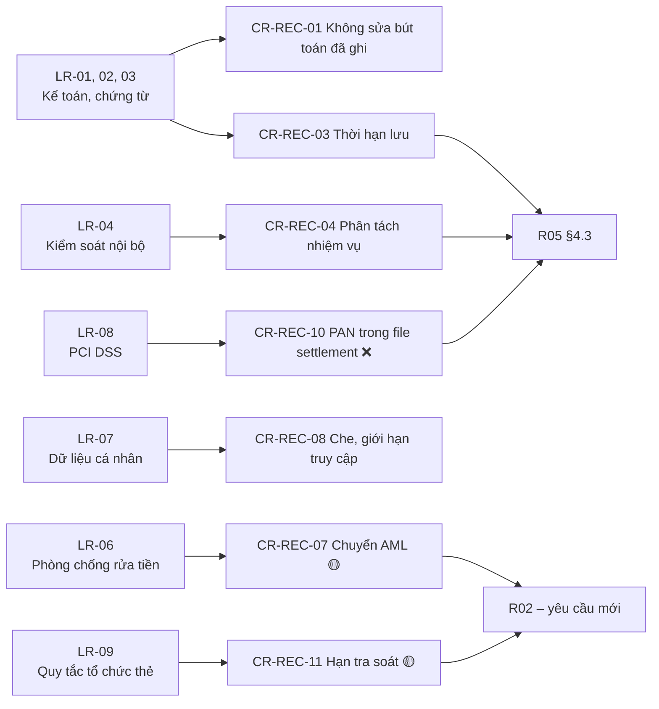

# R08 · Đối soát – đối chiếu tuân thủ, cơ sở pháp lý và dữ liệu cá nhân

| | |
|---|---|
| Phiên bản | 0.1 · 26/11/2026 · Han Dao (BA) |
| Trạng thái | 📝 Bản nháp – chờ Kế toán trưởng, Compliance, Pháp chế và InfoSec xác nhận |
| Epic | [SCRUM-7](https://baohandao2303.atlassian.net/browse/SCRUM-7) |
| Tương đương Module 1 | [C02](../01-ekyc/1.2-compliance-legal/C02-compliance-mapping.md) (compliance mapping) và [P01](../01-ekyc/1.2-compliance-legal/P01-terms-privacy.md) (cơ sở pháp lý, dữ liệu cá nhân) |
| Chuẩn tham chiếu | ISO/IEC/IEEE 29148:2018 (yêu cầu từ ràng buộc pháp lý) · ISO/IEC 29100 (quyền riêng tư) · PCI DSS v4.0 · BABOK v3 *Business Rules Analysis* |
| Đầu vào | BAS-BRD-v1.2 §2.2, §5.2 · BAS-RAID-v1.2 (RSK-05 → 07, 15) · [R02](R02-requirements-gap-rtm.md) · [R05](R05-api-data-dictionary.md) · [R06](R06-nfr-kpi.md) |

> ⚠️ Số hiệu, điều khoản và thời hạn dưới đây là **điểm khởi đầu để rà soát**, viết theo hiểu biết chung về quy định Việt Nam và chuẩn ngành, chưa đối chiếu bản gốc. Mọi dòng có cột **Cần xác minh** phải được Pháp chế / Compliance kiểm trên cổng văn bản chính thức (vbpl.vn, sbv.gov.vn) trước khi đưa vào BRD hoặc hợp đồng. Không dùng tài liệu này làm ý kiến pháp lý.

## 1. Phạm vi văn bản

| Mã | Văn bản | Chủ đề liên quan Đối soát | Cần xác minh |
|---|---|---|---|
| LR-01 | Luật Kế toán 88/2015/QH13 và Nghị định 174/2016/NĐ-CP hướng dẫn | Chứng từ kế toán, sửa chữa sổ kế toán (không xoá, chỉ ghi bút toán điều chỉnh), thời hạn lưu tài liệu kế toán | Thời hạn lưu cho từng loại tài liệu (dự kiến tối thiểu 10 năm với tài liệu dùng ghi sổ) |
| LR-02 | Luật Giao dịch điện tử 20/2023/QH15 | Giá trị pháp lý của chứng từ, file sao kê và bút toán điện tử; chữ ký / xác thực điện tử của Maker, Checker | Yêu cầu về toàn vẹn và lưu trữ thông điệp dữ liệu |
| LR-03 | Quy định NHNN về hệ thống tài khoản kế toán và chế độ chứng từ kế toán của tổ chức tín dụng | Tài khoản treo, hạch toán điều chỉnh, phê duyệt bút toán | Văn bản hiện hành và các sửa đổi |
| LR-04 | Quy định NHNN về hệ thống kiểm soát nội bộ của ngân hàng (ví dụ Thông tư 13/2018/TT-NHNN) | Phân tách nhiệm vụ, kiểm soát kép, ba tuyến bảo vệ | Số hiệu văn bản còn hiệu lực, điều khoản cụ thể |
| LR-05 | Quy định NHNN về an toàn hệ thống thông tin trong hoạt động ngân hàng (ví dụ Thông tư 09/2020/TT-NHNN) | Phân quyền, nhật ký truy cập, sao lưu, khôi phục | Số hiệu văn bản còn hiệu lực |
| LR-06 | Luật Phòng, chống rửa tiền 14/2022/QH15 và văn bản hướng dẫn | Chuyển ngoại lệ bất thường cho bộ phận AML; lưu hồ sơ giao dịch | Có nghĩa vụ báo cáo từ kết quả đối soát hay không; thời hạn lưu |
| LR-07 | Luật Bảo vệ dữ liệu cá nhân 91/2025/QH15 và Nghị định 356/2025/NĐ-CP | Số tài khoản, giao dịch, tên khách trong file sao kê là dữ liệu cá nhân; quyền truy cập, mục đích, thời hạn | Dữ liệu tài chính có thuộc nhóm nhạy cảm; cơ sở xử lý không cần đồng ý (nghĩa vụ pháp lý, hợp đồng) |
| LR-08 | PCI DSS v4.0 (chuẩn ngành thẻ, ràng buộc qua hợp đồng với tổ chức thẻ) | File settlement Visa (TC33) và Mastercard (IPM) chứa số thẻ đầy đủ | Phạm vi đánh giá PCI (SAQ / ROC) của hệ thống đối soát – DEP-10 |
| LR-09 | Quy tắc thành viên NAPAS, Visa, Mastercard (hợp đồng) | Thời hạn tra soát, khiếu nại, xử lý chênh lệch quyết toán | Thời hạn cụ thể theo từng tổ chức |

## 2. Ma trận đối chiếu

Trạng thái: ✅ Đáp ứng trong thiết kế (R01 → R07 và UI mẫu) · 🟡 Một phần · ❌ Chưa có

| Mã | Nguồn | Yêu cầu (tóm tắt) | Hiện trạng Aegis | Trạng thái | Hành động |
|---|---|---|---|---|---|
| CR-REC-01 | LR-01, LR-03 | Bút toán đã ghi sổ không được sửa / xoá; sai thì ghi bút toán đảo hoặc điều chỉnh | RULE-REC-08, REQ-REC-11, NFR-REC-17 (DB chặn `UPDATE` / `DELETE`), UAT-REC-P12 | ✅ | — |
| CR-REC-02 | LR-01, LR-02 | Mỗi bút toán có chứng từ gốc và người lập, người duyệt xác định được | Truy vết 4 bước (BR-REC-10), `maker_id`, `checker_id`, lineage API | ✅ | — |
| CR-REC-03 | LR-01 | Lưu tài liệu kế toán đủ thời hạn luật định | Thời hạn ở R05 §4.3 là *đề xuất*, chưa được duyệt | 🟡 | Kế toán trưởng + Pháp chế chốt (câu hỏi 1) |
| CR-REC-04 | LR-04 | Người lập ≠ người duyệt; người tạo quy tắc không duyệt bút toán lớn sinh từ quy tắc đó | SoD-1 → 3 kiểm ở server (R05 §1.1), TC-REC-16, 23, UAT-REC-P04 | ✅ | — |
| CR-REC-05 | LR-04, LR-05 | Thay đổi tham số nghiệp vụ (ngưỡng 50 triệu, Fuzzy, leo thang) phải có phê duyệt và nhật ký | NFR-REC-22, R05 §3.9 `config` có version + người duyệt | ✅ | — |
| CR-REC-06 | LR-05 | Nhật ký truy cập và thao tác không sửa được; sao lưu, khôi phục | NFR-REC-16, 10 (RPO / RTO *đề xuất*) | 🟡 | Ops chốt RPO / RTO theo kế hoạch BCP |
| CR-REC-07 | LR-06 | Giao dịch bất thường phát hiện qua đối soát (trùng lặp nhiều lần, tiền về tài khoản treo không rõ nguồn) được chuyển cho bộ phận AML | Chưa có luồng chuyển; ngoại lệ chỉ leo thang trong nhóm đối soát | 🟡 | REQ-REC-21 (mới, §4) |
| CR-REC-08 | LR-07 | Số tài khoản che khi hiển thị; xem đầy đủ chỉ người có quyền, có nhật ký | D-REC-09, NFR-REC-14, audit `VIEW_ACCOUNT`, UAT-REC-P09 | ✅ | — |
| CR-REC-09 | LR-07 | Dữ liệu cá nhân trong file sao kê chỉ dùng cho mục đích đối soát, xoá / lưu trữ theo thời hạn | Mục đích đã ghi; chưa có job lưu trữ / xoá file gốc | 🟡 | REQ-REC-22 (mới, §4) |
| CR-REC-10 | LR-08 | Không lưu số thẻ đầy đủ ngoài vùng PCI; che hoặc token hoá ngay khi nạp file TC33 / IPM | NFR-REC-14 nói "không lưu số thẻ đầy đủ" nhưng R05 chưa mô tả bước xử lý file gốc có PAN | ❌ | REQ-REC-23 (mới, §4); InfoSec xác định phạm vi PCI |
| CR-REC-11 | LR-09 | Chênh lệch với tổ chức thẻ phải được tra soát trong thời hạn của tổ chức đó | Aging và leo thang theo giờ nội bộ (D-REC-03), chưa gắn hạn tra soát của từng tổ chức | 🟡 | REQ-REC-24 (mới, §4) |
| CR-REC-12 | LR-07 | Bên thứ ba nhận dữ liệu (đối tác lưu trữ, nhà cung cấp AI gợi ý nguyên nhân) có hợp đồng xử lý dữ liệu | Chưa có danh sách bên nhận | 🟡 | §3; câu hỏi 4 |

**Tổng hợp:** 6 ✅ · 5 🟡 · 1 ❌. **Chặn go-live:** CR-REC-10 (PAN trong file settlement), CR-REC-03 (thời hạn lưu).

## 3. Dữ liệu cá nhân trong Đối soát

| Nhóm dữ liệu | Nằm ở (R05) | Cơ sở xử lý (đề xuất, *cần Pháp chế xác nhận*) | Thời hạn lưu (*đề xuất*) | Ai được xem |
|---|---|---|---|---|
| Số tài khoản, tên khách trong giao dịch | `source_transactions`, `exception_cases` | Thực hiện hợp đồng tài khoản; nghĩa vụ kế toán (LR-01) | Theo thời hạn lưu tài liệu kế toán | `REC_*` (che), `REC_LEAD`, `FIN_VIEWER` (đầy đủ, có nhật ký) |
| Số thẻ | File gốc TC33 / IPM | Hợp đồng với tổ chức thẻ | Không lưu PAN rõ ngoài vùng PCI (CR-REC-10) | Không ai trên UI |
| File sao kê gốc | Cloud Storage có khoá đối tượng (R05 §4.3); R05 chưa có trường lưu đường dẫn file – bổ sung `storage_uri` vào `source_files` | Như trên | Theo R05 §4.3; *đề xuất* thêm mốc chuyển sang lưu trữ lạnh sau 13 tháng (REQ-REC-22) | Chỉ job nạp, InfoSec |
| Ghi chú xử lý, lý do từ chối | `exception_cases`, `gl_entries` | Nghĩa vụ kế toán, kiểm soát nội bộ | Như bút toán | Người xử lý, Checker, kiểm toán |
| Nhật ký thao tác | `audit_event` | Nghĩa vụ an toàn thông tin (LR-05) | Không xoá trong thời hạn lưu | InfoSec, kiểm toán |

**Bên nhận dữ liệu (dự thảo):** NAPAS, Visa, Mastercard, đối tác ví (gửi file đến, không nhận lại dữ liệu cá nhân) · nhà cung cấp mô hình gợi ý nguyên nhân nếu chạy ngoài hạ tầng ngân hàng (*cần xác định* – BR-REC-05) · đơn vị kiểm toán độc lập. Không có chuyển dữ liệu ra nước ngoài nếu kho dữ liệu và mô hình AI đặt tại Việt Nam – phụ thuộc quyết định chung ở P01 §4.1.

## 4. Yêu cầu mới phát sinh

Bổ sung vào [R02 §4](R02-requirements-gap-rtm.md) khi được duyệt.

| Mã | Yêu cầu | Nguồn | Ưu tiên |
|---|---|---|---|
| REQ-REC-21 | Hệ thống phải cho trưởng nhóm đánh dấu một ngoại lệ là "nghi vấn AML" và chuyển sang hàng đợi của bộ phận AML, giữ liên kết tới giao dịch gốc; người chuyển không xem được kết quả xử lý AML. | CR-REC-07, LR-06 | Should |
| REQ-REC-22 | Hệ thống phải chuyển file sao kê gốc sang kho lưu trữ sau thời gian trực tuyến cấu hình được và xoá khi hết thời hạn lưu, có nhật ký. | CR-REC-09, LR-01, LR-07 | Should |
| REQ-REC-23 | Hệ thống phải che hoặc token hoá số thẻ ngay ở bước nạp file TC33 / IPM; file gốc chứa PAN chỉ nằm trong vùng lưu trữ thuộc phạm vi PCI, mã hoá, có kiểm soát truy cập riêng. | CR-REC-10, LR-08 | Must |
| REQ-REC-24 | Mỗi nguồn đối tác có tham số hạn tra soát; ngoại lệ của nguồn đó cảnh báo trước hạn tra soát *3 ngày làm việc* (*đề xuất*). | CR-REC-11, LR-09 | Should |

## 5. Câu hỏi cho Pháp chế, Compliance, InfoSec

| # | Câu hỏi | Gửi |
|---|---|---|
| 1 | Thời hạn lưu cho file sao kê gốc, bút toán, ngoại lệ đã đóng, nhật ký thao tác? | Kế toán trưởng, Pháp chế |
| 2 | Kết quả đối soát có phát sinh nghĩa vụ báo cáo giao dịch đáng ngờ không? Ai là đầu mối nhận ở bộ phận AML? | Compliance |
| 3 | Hệ thống đối soát có nằm trong phạm vi đánh giá PCI DSS không? Có cần nhận PAN đầy đủ từ tổ chức thẻ hay đối tác gửi được PAN đã che? | InfoSec |
| 4 | Mô hình AI gợi ý nguyên nhân (BR-REC-05) chạy ở đâu? Nếu là dịch vụ ngoài, có gửi dữ liệu giao dịch ra ngoài không? | Solution Owner, DPO |
| 5 | Chữ ký / xác thực của Checker trên bút toán điện tử cần mức nào để có giá trị chứng từ (LR-02)? | Pháp chế, Kế toán trưởng |

## 6. Kiểm soát tài liệu

### Lịch sử phiên bản

| Phiên bản | Ngày | Người sửa | Commit | Thay đổi |
|---|---|---|---|---|
| 0.1 | 26/11/2026 | Han Dao | — | Bản đầu: 9 nhóm văn bản, 12 yêu cầu tuân thủ (6 ✅ · 5 🟡 · 1 ❌), bảng dữ liệu cá nhân, 4 yêu cầu mới REQ-REC-21 → 24, câu hỏi mở |

### Phê duyệt

| Vai trò | Người | Ngày | Kết luận |
|---|---|---|---|
| BA (soạn) | Han Dao | 26/11/2026 | Trình duyệt |
| Kế toán trưởng | | | |
| Compliance | | | |
| Pháp chế / DPO | | | |
| InfoSec | | | |
