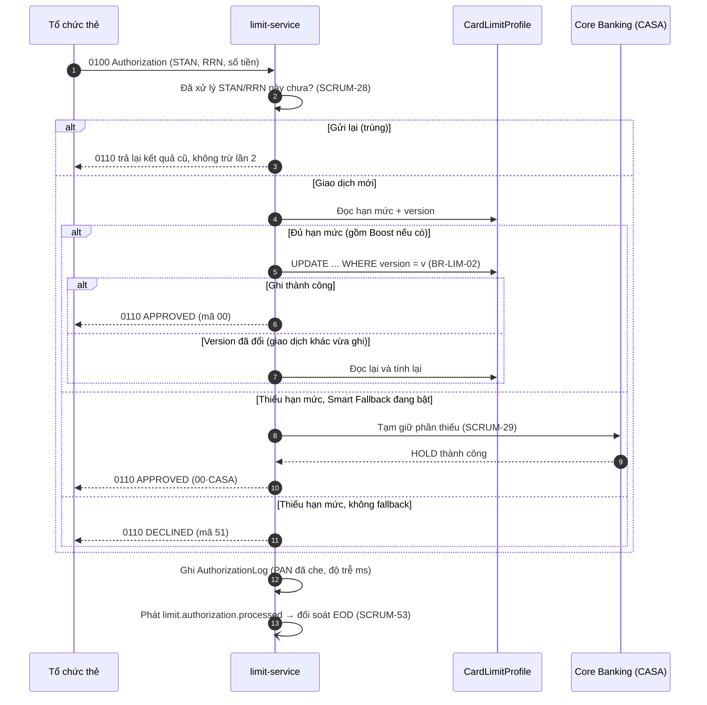
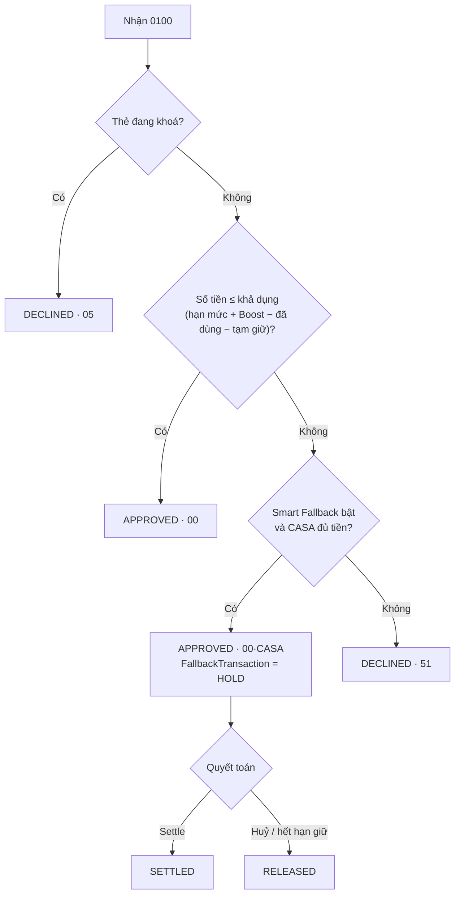
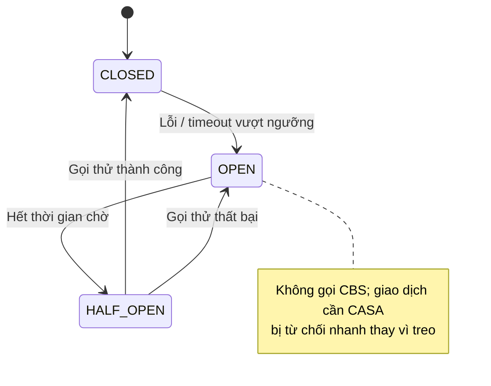
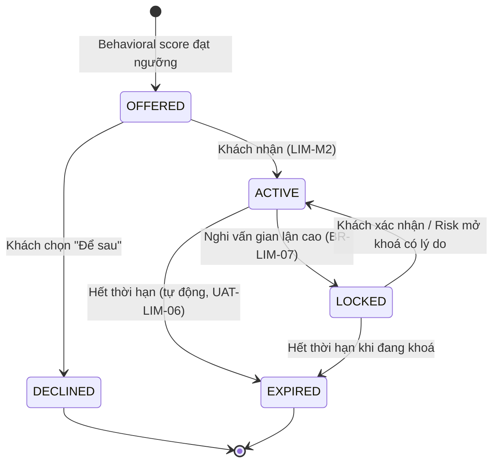
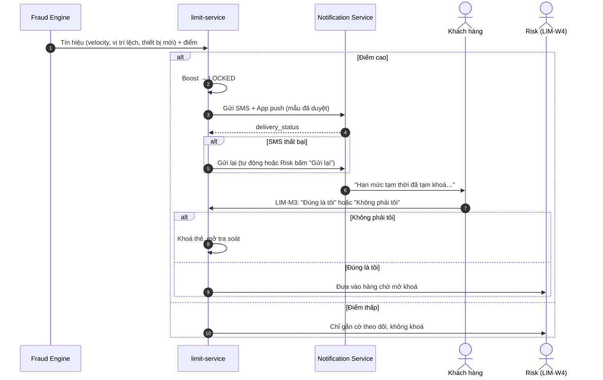
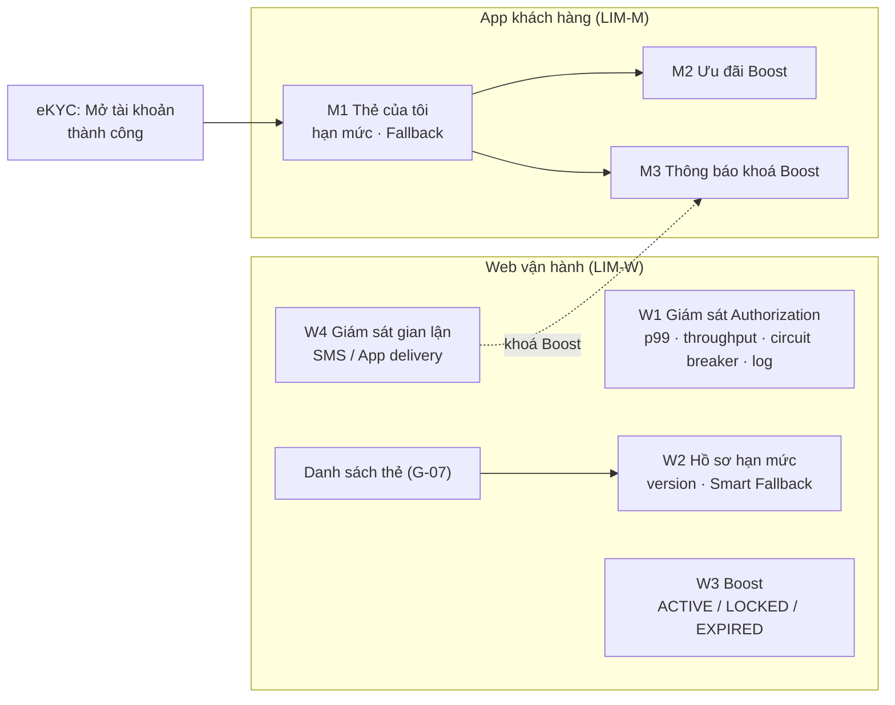

# L01 · Hạn mức tín dụng thời gian thực – authorization, Boost và gian lận

| | |
|---|---|
| Epic | [SCRUM-8](https://baohandao2303.atlassian.net/browse/SCRUM-8) · Real-time Credit Limit |
| Story | SCRUM-27 → 30, 38 (backend), [SCRUM-51](https://baohandao2303.atlassian.net/browse/SCRUM-51) (FE mobile LIM-M1 → M3), [SCRUM-52](https://baohandao2303.atlassian.net/browse/SCRUM-52) (FE web LIM-W1 → W4), SCRUM-53 (đối chiếu EOD), SCRUM-54 (Notification) |
| UI mẫu | Web: [/credit-limit/](https://handao2303.github.io/aegis-ekyc-ui/credit-limit/) · Mobile: [/app/?screen=cardHome](https://handao2303.github.io/aegis-ekyc-ui/app/?screen=cardHome) |
| Quy tắc chính | BR-LIM-02 (khoá lạc quan), BR-LIM-07 (khoá Boost), SLA p99 < 2s, NFR-SEC-04 (che PAN) |

## 1. Xử lý một giao dịch thẻ (ISO 8583)

Mỗi yêu cầu authorization phải trả lời trong 2 giây (p99), không bị trừ hạn mức 2 lần khi tổ chức thẻ gửi lại, và không vượt hạn mức khi 2 giao dịch đến cùng lúc.

Huỷ giao dịch (MTI 0400 – reversal) giải phóng đúng số đã trừ, kể cả phần tạm giữ ở CASA (UAT-LIM-05).

## 2. Cây quyết định

## 3. Ngắt mạch kết nối Core Banking (circuit breaker)

## 4. Vòng đời Temporary Limit Boost

| Quy tắc | Chi tiết |
|---|---|
| Thời hạn | Boost luôn có giờ kết thúc (mẫu: 72 giờ). Hết hạn thì tự trở về hạn mức gốc, không cần thao tác |
| Hiển thị cho khách | Hạn mức mới, thời hạn, tự trở về, phí. Phải tick "hiểu điều kiện khoá" mới nhận được |
| Mở khoá phía ngân hàng | Bắt buộc nhập lý do (≥ 10 ký tự), ghi audit |

## 5. Phát hiện bất thường → khoá Boost → báo khách

Nội dung SMS/App hiện là bản giữ chỗ, chờ Risk/Legal/CSKH duyệt; Notification Service thật chưa sẵn sàng (DEP-07, SCRUM-54).

## 6. Bản đồ màn hình

## 7. Truy vết UAT

| UAT | Kiểm tra trên UI mẫu |
|---|---|
| UAT-LIM-01 | Màn W2 báo xung đột version khi giao dịch khác cập nhật trước |
| UAT-LIM-03/04 | Lịch sử FallbackTransaction HOLD / SETTLED / RELEASED; công tắc Smart Fallback ở M1 |
| UAT-LIM-05 | Log có MTI 0400 (reversal) |
| UAT-LIM-06 | M1 đếm ngược tới lúc Boost hết hạn; W3 có tab EXPIRED |
| UAT-LIM-07 | W4 có trạng thái gửi SMS/App và gửi lại; M3 cho khách xác nhận |
| UAT-LIM-10 | PAN luôn che ở mọi màn |
