# L03 · Đặc tả giao diện – Aegis Hạn mức (LIM-W1 → W4, LIM-M1 → M3)

| | |
|---|---|
| Mã tài liệu | AEG-LIM-L03 |
| Phiên bản | 0.4 |
| Ngày phát hành | 26/11/2026 |
| Trạng thái | 📝 Mô tả UI mẫu như đang có, kèm điểm phải sửa (cột **Ghi chú**). Chờ quyết định ở [L02 §3](L02-requirements-gap-rtm.md) |
| Phân loại | Nội bộ |
| Tác giả | Han Dao (BA) |
| Người duyệt | Product Owner · UX / FE Lead · Risk tín dụng · Vận hành thẻ – chưa duyệt |
| Mục đích và phạm vi | Đặc tả giao diện Aegis Hạn mức: web vận hành LIM-W1 → W4 và app LIM-M1 → M3 |
| Chuẩn tham chiếu | WCAG 2.2 mức AA · PCI DSS 3.4 (che PAN) |
| Thuật ngữ | [G02 Thuật ngữ và chữ viết tắt](../00-overview/G02-glossary.md) |
| Người dùng | Web: Vận hành thẻ, Risk tín dụng / Fraud analyst · Mobile: chủ thẻ |
| Jira | [SCRUM-52](https://baohandao2303.atlassian.net/browse/SCRUM-52) (FE web W1 → W4, danh sách thẻ G-07) · [SCRUM-51](https://baohandao2303.atlassian.net/browse/SCRUM-51) (FE mobile M1 → M3) |
| Bản chạy | Web [/credit-limit/](https://handao2303.github.io/aegis-ekyc-ui/credit-limit/) · Mobile [/app/?screen=cardHome](https://handao2303.github.io/aegis-ekyc-ui/app/?screen=cardHome) – dữ liệu hư cấu, chưa nối backend |
| Mã nguồn | `src/ops/CreditLimit.tsx` (khung chung `src/ops/kit.tsx`) · `src/mobile/cardScreens.tsx` |
| Ảnh | Web 1280 × 860, mobile 390 × 844 @2x, tiếng Việt, chụp tự động bằng `tools/diagrams/lim-screens.mjs` (chụp lại 26/11/2026) |

Luồng nghiệp vụ: [L01](L01-credit-limit-flow.md). Kết quả chạy thử trên giao diện: [L04](L04-test-plan-cases.md). API sau mỗi thao tác: [L05 §7](L05-api-data-dictionary.md).

## 1. Khung ứng dụng web

| Vùng | Nội dung |
|---|---|
| Menu trái | Logo "Aegis Hạn mức · Authorization & Boost" (bấm để đổi sang Compliance, Đối soát) · ô tìm màn hình (⌘K) · Giám sát Authorization · Hồ sơ hạn mức thẻ · Boost (số Boost đang khoá) · Giám sát gian lận (số case đang mở) · thẻ người dùng "Trần Bảo Ngọc · Vận hành thẻ · Risk" |
| Thanh trên | Lời chào · mô tả · VI/EN · kỳ báo cáo (Hôm nay / 7 ngày / Tháng này) · **Xuất** · chuông cảnh báo |
| Cảnh báo mẫu | SMS khoá Boost gửi thất bại (FR-2196) · p99 chạm 1,71 s ngày 17/11 · circuit breaker CBS về CLOSED |
| Nhãn quy tắc | Nhãn xám như `BR-LIM-02`, `UAT-LIM-10` cạnh chỗ áp dụng quy tắc |
| Che PAN | Mọi số thẻ dạng `4111 •••• •••• 1234` hoặc `•••• 1234` (REQ-LIM-19) |

### Phân quyền hiển thị (đề xuất – UI mẫu chưa phân vai trò)

| Chức năng | Vận hành thẻ | Risk tín dụng / Fraud | Quản lý (xem) |
|---|---|---|---|
| W1 giám sát, xuất báo cáo | ✅ | ✅ | ✅ |
| W2 xem hồ sơ thẻ | ✅ | ✅ | ✅ |
| W2 điều chỉnh hạn mức gốc | Lập (Maker) | Duyệt (Checker) – nếu giữ chức năng (D-LIM-09) | — |
| W3 khoá / mở khoá Boost | — | ✅ (người mở ≠ người khoá – REQ-LIM-18) | — |
| W4 gửi lại thông báo, đóng case | — | ✅ | — |
| Xem PAN đầy đủ | Không ai trên các màn này | | |

## 2. LIM-W1 Giám sát Authorization

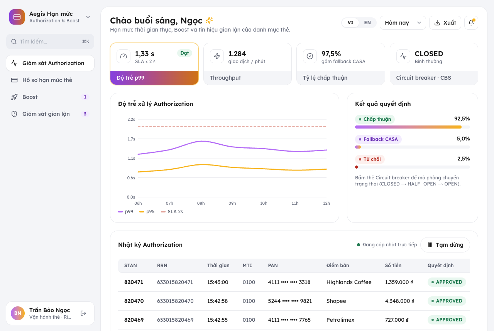

| Mục | Nội dung | Quy tắc | Ghi chú |
|---|---|---|---|
| 4 thẻ chỉ số | Độ trễ p99 (so SLA < 2 s, nhãn Đạt / Không đạt) · Throughput giao dịch/phút · Tỷ lệ chấp thuận (gồm fallback) · Circuit breaker CBS | RULE-LIM-01, KPI-07, BR-LIM-09 | Bấm thẻ circuit breaker để mô phỏng chuyển trạng thái – chỉ có ở bản mẫu. D-LIM-06: cần một dòng trạng thái cho mỗi phụ thuộc |
| Biểu đồ độ trễ | p99, p95, đường SLA 2 s nét đứt; theo kỳ báo cáo | KPI-07 | Nên thêm "% giao dịch < 2 s" để khớp định nghĩa KPI-07 ([L06](L06-nfr-kpi.md)) |
| Kết quả quyết định | Thanh tỷ lệ Chấp thuận / Fallback CASA / Từ chối | — | |
| Nhật ký Authorization | 12 dòng mới nhất, tự cập nhật 2,4 giây/lần; nút Tạm dừng / Tiếp tục. Cột: STAN, RRN, thời gian, MTI, PAN, điểm bán, số tiền, quyết định, độ trễ (> 1 500 ms tô cam), mã F39 | BR-LIM-01, 03 · REQ-LIM-01 | RRN thêm 26/11 (DEF-LIM-07 đã sửa). Reversal đang ghi MTI 0400 + DECLINED (DEF-LIM-01) |
| Thiếu | Hàng chờ "Reversal không khớp" | REQ-LIM-03 | Chưa có |

## 3. Danh sách thẻ (gap G-07) và LIM-W2 Hồ sơ hạn mức

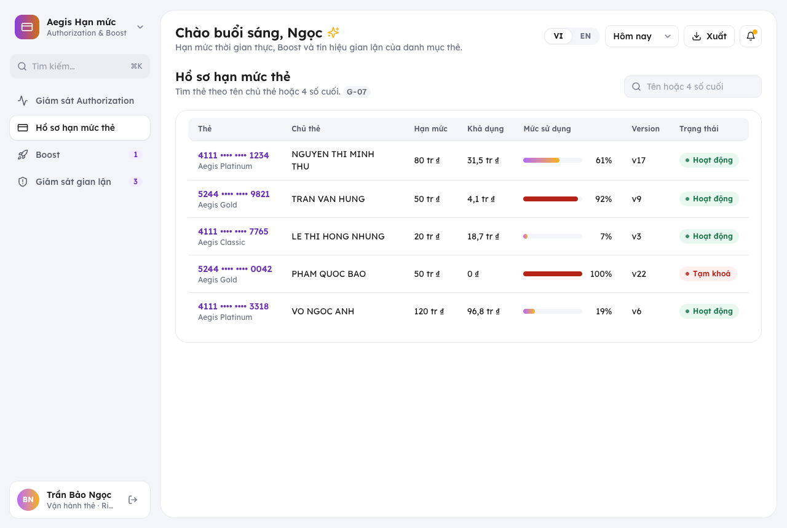

| Mục | Nội dung | Quy tắc |
|---|---|---|
| Tìm kiếm | Theo tên chủ thẻ hoặc 4 số cuối | G-07 |
| Cột | Thẻ (PAN che + sản phẩm) · Chủ thẻ · Hạn mức · Khả dụng · Mức sử dụng (thanh, > 90% tô đỏ) · Version · Trạng thái (Hoạt động / Tạm khoá) | BRD §3.5 CardLimitProfile |
| Thao tác | Bấm số thẻ hoặc cả dòng → hồ sơ | — |

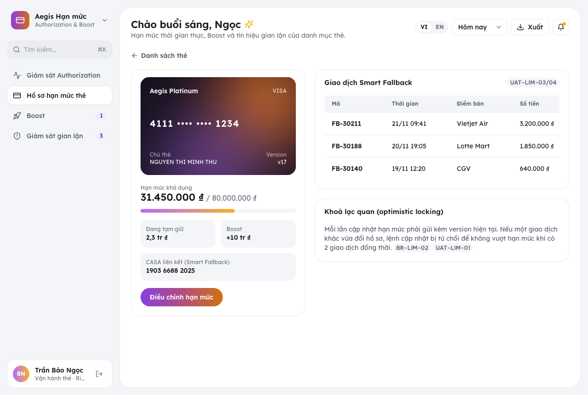

| Mục | Nội dung | Quy tắc | Ghi chú |
|---|---|---|---|
| Thẻ | Sản phẩm, VISA/MC, PAN che, chủ thẻ, version | NFR-SEC-04 | |
| Hạn mức | Khả dụng / hạn mức, thanh sử dụng · Đang tạm giữ · Boost · CASA liên kết | BR-LIM-04 | |
| Giao dịch Smart Fallback | Mã, thời gian, điểm bán, số tiền, trạng thái HOLD / SETTLED / RELEASED | UAT-LIM-03/04 | Hiện đủ 5 cột ở 1280 px, mã và số tiền không ngắt dòng (DEF-LIM-04 đã sửa 26/11) |
| Khoá lạc quan | Giải thích ngắn về version | BR-LIM-02 | Theo D-LIM-02 |
| Điều chỉnh hạn mức | Nút mở hộp thoại | D-LIM-09 | Chức năng ngoài baseline |

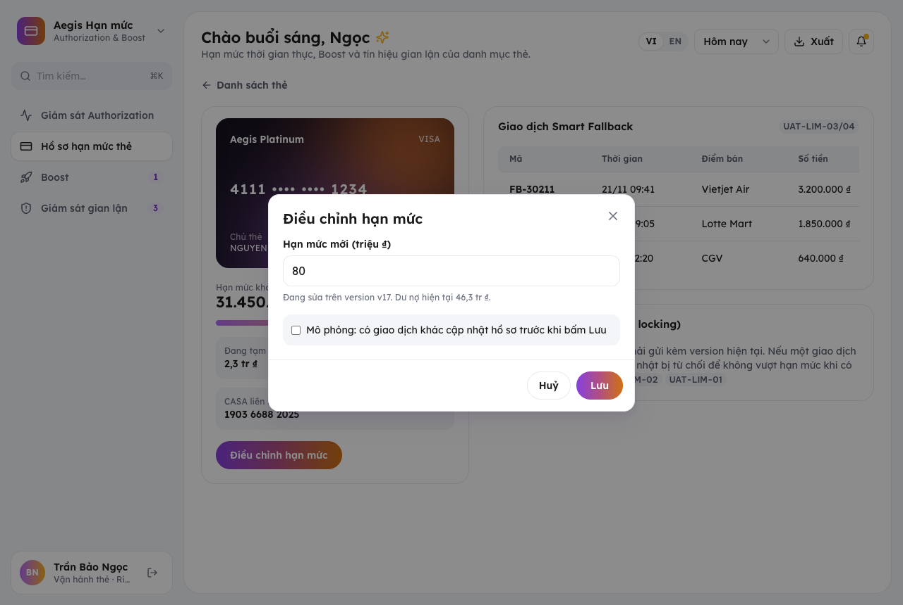

| Trường / nút | Quy tắc |
|---|---|
| Hạn mức mới (triệu ₫) | Bắt buộc; phải lớn hơn dư nợ hiện tại, nếu không báo "Hạn mức mới phải lớn hơn dư nợ hiện tại." |
| Dòng nhắc | "Đang sửa trên version vN. Dư nợ hiện tại …" |
| Ô "Mô phỏng: có giao dịch khác cập nhật hồ sơ trước khi bấm Lưu" | Chỉ ở bản mẫu, để kiểm UAT-LIM-01 |
| Lưu | Thành công: "Đã cập nhật hạn mức, version vN+1." · Xung đột: thông báo đỏ bên dưới |

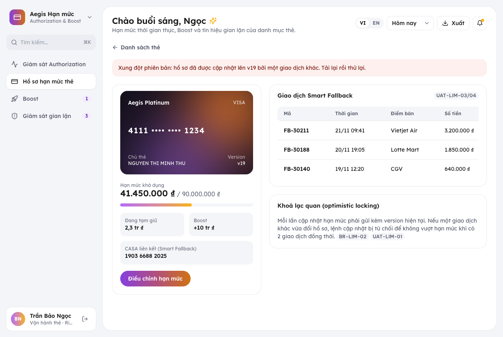

## 4. LIM-W3 Temporary Limit Boost

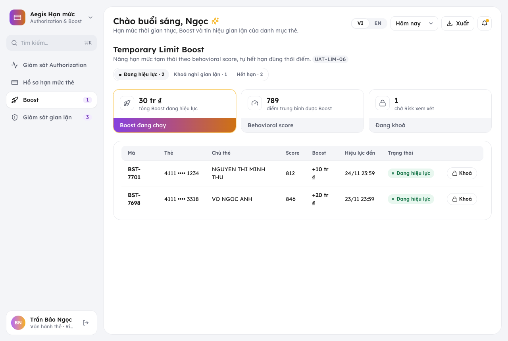

| Mục | Nội dung | Quy tắc | Ghi chú |
|---|---|---|---|
| Tab trạng thái | Đang hiệu lực · Khoá nghi gian lận · Hết hạn, kèm số lượng | UAT-LIM-06 | `OFFERED`, `DECLINED` không có ở đây – thuộc lời mời (D-LIM-04) |
| 3 thẻ chỉ số | Tổng Boost đang chạy · điểm hành vi trung bình · số Boost đang khoá | BR-LIM-05 | |
| Bảng | Mã, thẻ, chủ thẻ (+ lý do khoá màu đỏ), score, số tiền Boost, hiệu lực đến, trạng thái | BR-LIM-06 | Thiếu cột % hạn mức gốc (REQ-LIM-08) |
| Khoá | Nút trên dòng đang hiệu lực, khoá ngay | — | **D-LIM-08:** phải hỏi lý do và gửi thông báo khách |
| Mở khoá | Hộp thoại lý do bắt buộc ≥ 10 ký tự, ghi audit | — | |

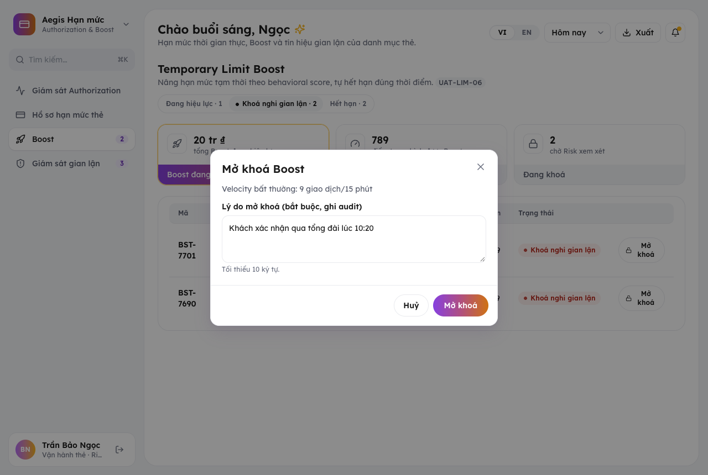

## 5. LIM-W4 Giám sát gian lận

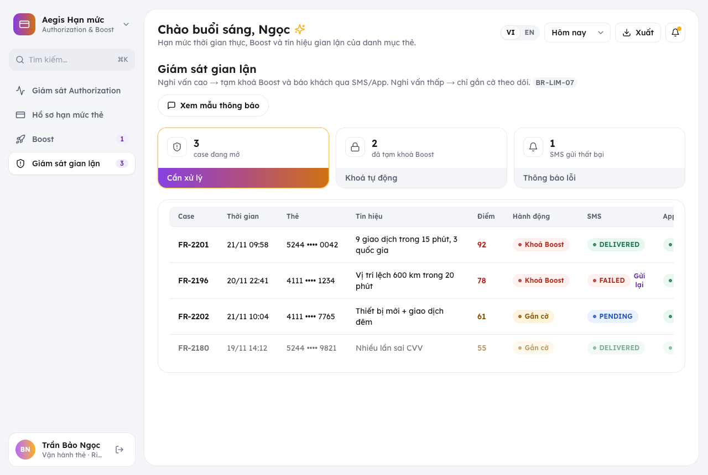

| Mục | Nội dung | Quy tắc | Ghi chú |
|---|---|---|---|
| 3 thẻ chỉ số | Case đang mở · đã tự khoá Boost · SMS gửi thất bại | BR-LIM-07 | |
| Bảng | Case, thời gian, thẻ, tín hiệu, điểm (≥ 75 đỏ), hành động (Khoá Boost / Gắn cờ), SMS, App, trạng thái | UC-LIM-06 | Ngưỡng 75 là tạm (D-LIM-07). Case mở lên trên, điểm cao trước |
| Gửi lại | Hiện cạnh SMS `FAILED`; FAILED → PENDING → DELIVERED | REQ-LIM-14 | |
| Đóng case | Hộp thoại: chọn 1 trong 3 kết luận (`CONFIRMED_FRAUD` Xác nhận gian lận · `FALSE_POSITIVE` Cảnh báo nhầm · `CUSTOMER_CONFIRMED` Khách xác nhận là mình) + ghi chú ≥ 10 ký tự; nút Đóng case khoá tới khi đủ. Sau khi đóng, cột Trạng thái hiện kết luận | REQ-LIM-17 | DEF-LIM-06 đã sửa 26/11. Bản thật ghi `closed_by`, `close_note` (L05 §3.5) |
| Xem mẫu thông báo | Hộp thoại nội dung SMS + cảnh báo "Nội dung giữ chỗ – chờ Risk/Legal/CSKH duyệt … (DEP-07)" | ISS-03 | |

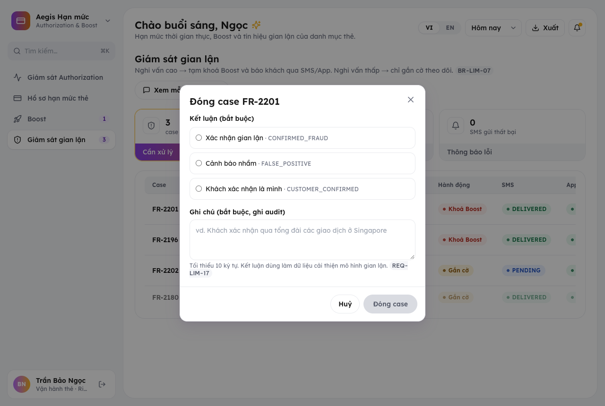 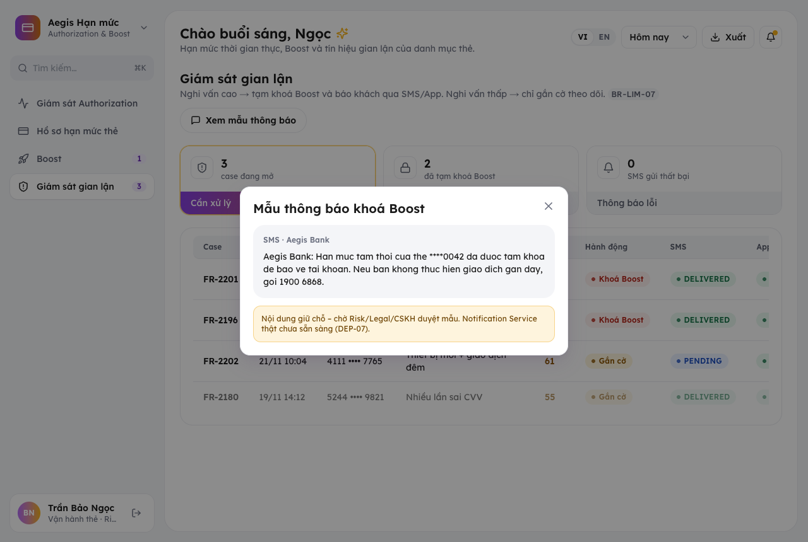

## 6. App khách hàng

Đi từ màn "Mở tài khoản thành công" của eKYC → "Vào trang chủ" → M1. Ba màn dùng chung trạng thái trong bộ nhớ (Boost, Fallback, khoá thẻ).

| LIM-M1 Thẻ của tôi | LIM-M2 Ưu đãi Boost | LIM-M3 Thông báo khoá Boost |
|---|---|---|
| 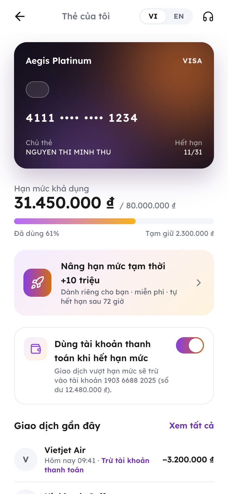 | 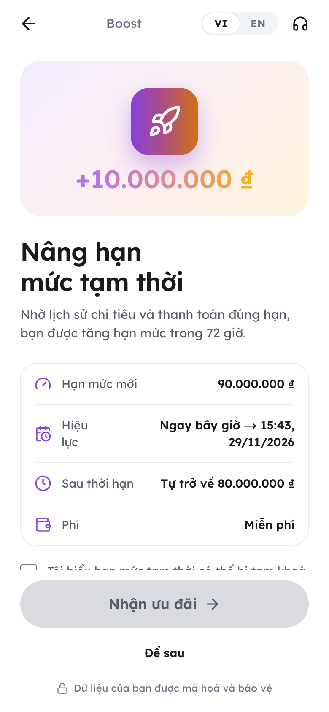 | 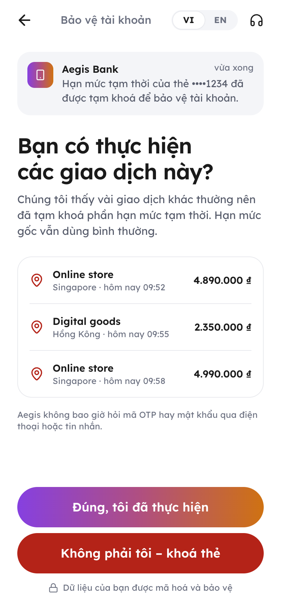 |

### 6.1 LIM-M1 Thẻ của tôi

| Mục | Nội dung | Quy tắc |
|---|---|---|
| Thẻ | Ảnh thẻ, PAN che, chủ thẻ, hạn; huy hiệu "Đang khoá" khi khách đã khoá thẻ | NFR-SEC-04 |
| Hạn mức khả dụng | = hạn mức (+ Boost nếu đang hiệu lực) − đã dùng − tạm giữ; thanh % đã dùng; số tạm giữ | TC-LIM-24 |
| Thẻ Boost | 3 dạng: lời mời (bấm → M2) · đang hiệu lực + đếm ngược · đang tạm khoá (bấm → M3) | BR-LIM-06, 07 |
| Smart Fallback | Công tắc `role=switch` có nhãn; mô tả CASA và số dư. **UI mẫu bật sẵn và ghi cứng CASA `1903 6688 2025`** – phải mặc định tắt, bật mới hiện điều khoản trích nợ (DEF-LIM-09) và lấy CASA thật của khách (DEF-LIM-10) | BR-LIM-04, REQ-LIM-07, 23 |
| Giao dịch gần đây | Giao dịch fallback ghi "Trừ tài khoản thanh toán" | UAT-LIM-03 |
| Nút demo | "Demo: mô phỏng thông báo khoá Boost…" – chỉ có ở bản mẫu | — |

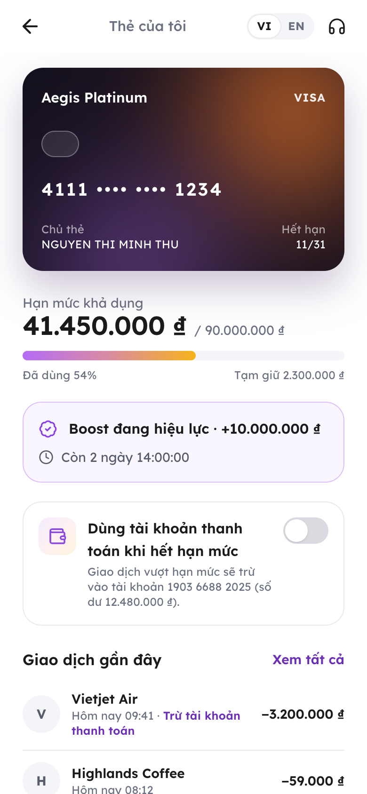

### 6.2 LIM-M2 Ưu đãi Boost

| Mục | Nội dung | Quy tắc | Ghi chú |
|---|---|---|---|
| Số tiền | +10.000.000 ₫ | RULE-LIM-05 | |
| 4 dòng | Hạn mức mới · Hiệu lực · Sau thời hạn tự trở về · Phí | REQ-LIM-11 | Hiệu lực = lúc nhận + 72 giờ, cùng một mốc với đếm ngược M1 (DEF-LIM-03 đã sửa 26/11). Còn lệch baseline "hết chu kỳ sao kê" – D-LIM-01, DEF-LIM-02 |
| Ô xác nhận | "Tôi hiểu hạn mức tạm thời có thể bị tạm khoá…" – bắt buộc trước khi bấm Nhận | CR-003 | |
| Nút | Nhận ưu đãi → màn "Đã nâng hạn mức" · Để sau → về M1 (lời mời `DECLINED`) | D-LIM-04 | |

### 6.3 LIM-M3 Thông báo khoá Boost

| Mục | Nội dung | Quy tắc | Ghi chú |
|---|---|---|---|
| Thông báo đẩy | "Hạn mức tạm thời của thẻ ••••1234 đã được tạm khoá để bảo vệ tài khoản." | REQ-LIM-15 | Mẫu chưa duyệt (ISS-03) |
| Câu hỏi | "Bạn có thực hiện các giao dịch này?" + 3 giao dịch bất thường (nơi, giờ, số tiền); nói rõ hạn mức gốc vẫn dùng | UC-LIM-06 bước 4 | |
| Đúng, tôi đã thực hiện | → "Cảm ơn bạn đã xác nhận", hẹn mở lại trong 30 phút | — | Cam kết 30 phút chưa có nguồn (D-LIM-05) |
| Không phải tôi – khoá thẻ | → "Thẻ đã được khoá", tra soát, liên hệ trong 24 giờ | — | Ngoài baseline (D-LIM-05) |
| Lưu ý an toàn | "Aegis không bao giờ hỏi mã OTP hay mật khẩu…" · nút gọi 1900 6868 | — | |

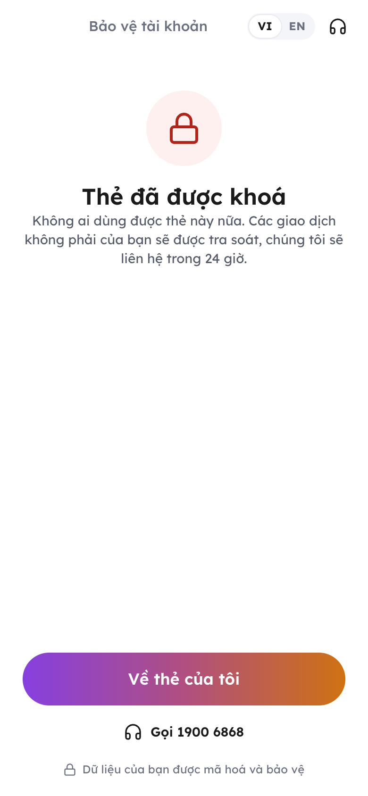

## 7. Khả năng tiếp cận (WCAG 2.2 AA)

| Tiêu chí | Hiện trạng |
|---|---|
| 1.4.3 Tương phản | Chữ chính đạt; nhãn xám nhạt (`text-fg-tertiary`) cần đo lại trên nền trắng |
| 4.1.2 Tên, vai trò, giá trị | Công tắc Smart Fallback có `role=switch`, `aria-checked`, `aria-label` (TC-LIM-26) · thanh mức sử dụng có `role=meter` · ảnh thẻ có `aria-label` |
| 2.2.2 Tạm dừng, dừng, ẩn | Log tự cập nhật có nút Tạm dừng (TC-LIM-05) |
| 4.1.3 Thông báo trạng thái | Kết quả lưu W2 dùng `role=status`; đếm ngược Boost đặt `aria-live=off` để không đọc liên tục |
| 1.4.10 Reflow | Bảng rộng phải cuộn ngang – chấp nhận cho bảng dữ liệu, nhưng cột trạng thái phải nhìn thấy không cần cuộn (W2 đã đạt sau khi sửa DEF-LIM-04) |

## 8. Kiểm soát tài liệu

### Tài liệu tham chiếu

| Mã | Tài liệu |
|---|---|
| L02 | [L02 · Hạn mức – yêu cầu bổ sung, điểm lệch baseline & RTM](L02-requirements-gap-rtm.md) |
| L01 | [L01 · Hạn mức tín dụng thời gian thực – authorization, Boost và gian lận](L01-credit-limit-flow.md) |
| L04 | [L04 · Hạn mức – kế hoạch kiểm thử, test case và kết quả](L04-test-plan-cases.md) |
| L05 | [L05 · Hạn mức – đặc tả API và từ điển dữ liệu (thiết kế đề xuất)](L05-api-data-dictionary.md) |
| L06 | [L06 · Hạn mức – yêu cầu phi chức năng và từ điển chỉ số KPI](L06-nfr-kpi.md) |

Chuẩn quốc tế: xem trường *Chuẩn tham chiếu* ở đầu trang.

### Lịch sử phiên bản

| Phiên bản | Ngày | Người sửa | Commit | Thay đổi |
|---|---|---|---|---|
| 0.1 | 25/11/2026 | Han Dao | 273d6b3 | Bản đầu: khung web, 4 màn web + danh sách thẻ, 3 màn mobile, 15 ảnh chụp tự động, phân quyền đề xuất, WCAG |
| 0.2 | 26/11/2026 | Han Dao | — | W1 thêm cột RRN; W2 bảng Smart Fallback hiện đủ cột; W4 hộp thoại kết luận khi đóng case (ảnh mới); M1 ghi rõ DEF-LIM-09, 10. Ảnh chụp lại 26/11 |
| 0.3 | 26/11/2026 | Han Dao | — | M2: hạn Boost tính từ một mốc (DEF-LIM-03); vùng chạm 44 px ở thanh đầu app (DEF-13 – T03) |
| 0.4 | 26/11/2026 | Han Dao | — | Chuẩn hoá cấu trúc theo ISO/IEC/IEEE 15289: khối thuộc tính đầu trang, tài liệu tham chiếu, thuật ngữ dùng chung (G02), mục kiểm soát tài liệu thống nhất |

### Phê duyệt

| Vai trò | Người | Ngày | Kết luận |
|---|---|---|---|
| BA (soạn) | Han Dao | 25/11/2026 | Trình duyệt |
| Product Owner |  |  |  |
| UX / FE Lead |  |  |  |
| Risk tín dụng |  |  |  |
| Vận hành thẻ |  |  |  |
