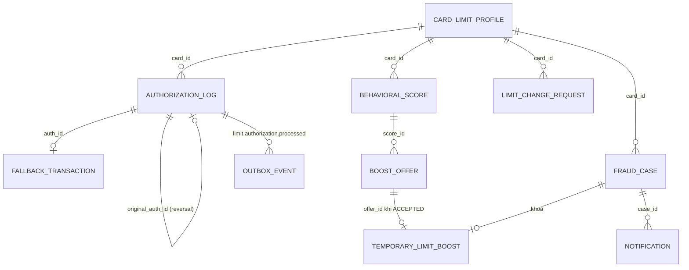

# L05 · Hạn mức – đặc tả API và từ điển dữ liệu (thiết kế đề xuất)

| | |
|---|---|
| Mã tài liệu | AEG-LIM-L05 |
| Phiên bản | 0.3 |
| Ngày phát hành | 26/11/2026 |
| Trạng thái | 📝 Bản đề xuất (to-be). Chưa thấy mã `limit-service` trong repo (L02 §1). Chờ Tech Lead, Vận hành thẻ và Risk tín dụng xác nhận |
| Phân loại | Nội bộ |
| Tác giả | Han Dao (BA) |
| Người duyệt | Tech Lead · Vận hành thẻ · Risk tín dụng · InfoSec – chưa duyệt |
| Mục đích và phạm vi | Đặc tả API và từ điển dữ liệu limit-service (thiết kế đề xuất) |
| Chuẩn tham chiếu | ISO 8583:1987 (bản tin thẻ) · OpenAPI 3.1 · RFC 9110 (mã HTTP) · PCI DSS v4.0 yêu cầu 3 (bảo vệ dữ liệu thẻ) · ISO 4217 · BABOK v3 §10.15 (Data Dictionary) |
| Thuật ngữ | [G02 Thuật ngữ và chữ viết tắt](../00-overview/G02-glossary.md) |
| Epic | [SCRUM-8](https://baohandao2303.atlassian.net/browse/SCRUM-8) · SCRUM-27 (ISO 8583), 28 (idempotency, cập nhật nguyên tử), 29 (Smart Fallback), 30 (Boost, khoá gian lận), 38 (repository, subscriber), 53 (EOD), 54 (Notification) |
| Nguồn | BAS-BRD-v1.2 §3.5 (5 entity) + phần bổ sung ở [L02 §5](L02-requirements-gap-rtm.md) · luồng [L01](L01-credit-limit-flow.md) · kiểu dữ liệu UI mẫu `src/ops/CreditLimit.tsx`, `src/mobile/cardScreens.tsx` |
| Liên quan | Module 2 [R05](../02-reconciliation/R05-api-data-dictionary.md) (sự kiện nhận và EOD) · Module 1 [A03](../01-ekyc/1.6-api-data/A03-api-specification.md) (quy ước chung) |

> ⚠️ Đây là **thiết kế đề xuất để đội backend bắt đầu**, không mô tả hệ thống đang chạy. Chỗ phụ thuộc quyết định ở [L02 §3](L02-requirements-gap-rtm.md) đánh dấu **[D-LIM-xx]**. Mã F39 cho fail-safe và cách ghép khoá chống trùng **cần Vận hành thẻ xác minh** với tổ chức thẻ.

## 1. Quy ước chung

| Mục | Quy ước |
|---|---|
| Hai cổng vào | (1) **Cổng thẻ**: bản tin ISO 8583 từ switch/tổ chức thẻ qua TCP, không đi qua API Gateway (§5.1). (2) **API REST** `/api/v1/limits` cho web vận hành và app khách, sau API Gateway |
| Định dạng REST | JSON UTF-8. Số tiền là chuỗi thập phân (`"10000000.00"`) kèm `currency` ISO 4217. Thời gian `*_at` là epoch mili-giây UTC |
| Chống gọi lặp | `POST` đổi trạng thái nhận header `Idempotency-Key`. Bản tin thẻ chống trùng theo khoá ở §3.2 |
| Ghi có điều kiện | Mọi thao tác vận hành sửa hồ sơ thẻ gửi `If-Match: <version>`; sai version → `409 VERSION_CONFLICT` (UAT-LIM-01) |
| Che PAN | Không lưu PAN rõ. Lưu `pan_token` (token từ vault của tổ chức thẻ hoặc HSM) và `pan_masked` (`411111******1234`). API và sự kiện chỉ trả `pan_masked` dạng `•••• 1234` (REQ-LIM-19) |
| Ghi chú bắt buộc | Lý do khoá / mở khoá Boost, điều chỉnh hạn mức, kết luận case: ≥ 10 ký tự sau khi bỏ khoảng trắng |
| Lỗi | `{ "error": { "code": "…", "message": "…" } }` như A03. Mã ở §6 |

### 1.1 Vai trò

| Vai trò | Ai | Quyền chính |
|---|---|---|
| `CARD_OPS` | Vận hành thẻ | Xem W1, W2; xử lý reversal không khớp; lập yêu cầu điều chỉnh hạn mức **[D-LIM-09]** |
| `CREDIT_RISK` | Risk tín dụng / Fraud analyst | Xem W3, W4; khoá / mở khoá Boost; gửi lại thông báo; đóng case; duyệt điều chỉnh hạn mức |
| `LIM_VIEWER` | Quản lý | Chỉ xem, xuất báo cáo |
| `CUSTOMER` | Chủ thẻ (token app) | Chỉ thẻ của mình: xem hạn mức, bật/tắt Fallback, nhận / từ chối Boost, xác nhận giao dịch |
| `svc-*` | Dịch vụ nội bộ (Fraud Engine, scheduler) | API nội bộ, xác thực mTLS |

| Mã | Kiểm soát (luôn kiểm ở server) | Áp dụng ở |
|---|---|---|
| SoD-L1 | Người mở khoá Boost ≠ người đã khoá thủ công (REQ-LIM-18) | API-L24 |
| SoD-L2 | Người duyệt điều chỉnh hạn mức ≠ người lập **[D-LIM-09]** | API-L14 |

## 2. Mô hình dữ liệu

Bảng gốc của BRD §3.5: `card_limit_profiles`, `authorization_logs`, `fallback_transactions`, `behavioral_scores`, `temporary_limit_boosts`. Bảng **đề xuất thêm**: `boost_offers` (D-LIM-04), `fraud_cases`, `notifications`, `limit_change_requests` (D-LIM-09), `outbox_events`, `audit_event`, `config`.

## 3. Từ điển dữ liệu

Cột **Nguồn**: *BRD* = có trong BRD §3.5; *L02* = bổ sung ở L02 §5; *Đề xuất* = BA thêm để chạy được. Cột **PII**: P = dữ liệu cá nhân, C = dữ liệu thẻ (PCI).

### 3.1 `card_limit_profiles`

| Trường | Kiểu | Bắt buộc | Mô tả | PII | Nguồn |
|---|---|---|---|---|---|
| `card_id` | TEXT PK | ✅ | Mã thẻ nội bộ (vd. `C-0001`) | — | BRD |
| `customer_id` | TEXT | ✅ | Khách hàng (từ eKYC `ekyc.decision.completed`) | P | Đề xuất |
| `pan_token`, `pan_masked` | TEXT | ✅ | Token PAN; PAN che 6 đầu + 4 cuối | C | Đề xuất |
| `product_code` | TEXT | ✅ | `PLATINUM` · `GOLD` · `CLASSIC` | — | L02 |
| `credit_limit` | DECIMAL(18,2) | ✅ | Hạn mức gốc | — | BRD |
| `available_limit` | DECIMAL(18,2) | ✅ | Khả dụng = `credit_limit` + `boost_amount_active` − dư nợ − `hold_amount`. Ràng buộc `CHECK (available_limit >= 0)` trừ trường hợp REQ-LIM-09 | — | BRD |
| `hold_amount` | DECIMAL(18,2) | ✅ | Tổng tạm giữ chưa quyết toán | — | L02 |
| `boost_amount_active` | DECIMAL(18,2) | ✅ | Boost đang hiệu lực (0 nếu không có hoặc đang khoá) | — | L02 |
| `linked_account_id` | TEXT | — | CASA liên kết, che giữa khi trả ra | P | BRD |
| `fallback_enabled` | BOOL | ✅ | Khách bật Smart Fallback | — | L02 |
| `fallback_mode` | TEXT | ✅ | `FULL_ONLY` · `PARTIAL_ALLOWED` (REQ-LIM-05) | — | Đề xuất |
| `statement_day` | INT 1–28 | ✅ | Ngày chốt sao kê – tính hạn Boost **[D-LIM-01]** | — | L02 |
| `version` | INT | ✅ | Tăng mỗi lần cập nhật | — | BRD |
| `status` | TEXT | ✅ | `ACTIVE` · `BLOCKED` | — | BRD |
| `blocked_reason` | TEXT | — | `CUSTOMER_REPORTED_FRAUD` (M3) · `OPS` · … **[D-LIM-05]** | — | Đề xuất |
| `updated_at` | ms | ✅ | — | — | BRD |

### 3.2 `authorization_logs`

| Trường | Kiểu | Bắt buộc | Mô tả | Nguồn |
|---|---|---|---|---|
| `auth_id` | UUID PK | ✅ | — | BRD |
| `card_id` | TEXT FK | ✅ | — | BRD |
| `mti_code` | CHAR(4) | ✅ | `0100` · `0120` · `0420` (bản tin vào) **[D-LIM-03]** | BRD |
| `message_type` | TEXT | ✅ | `AUTH` · `ADVICE` · `REVERSAL` – tách khỏi quyết định (DEF-LIM-01) | L02 |
| `pan_masked` | TEXT | ✅ | F2 đã che | BRD |
| `amount`, `currency` | DECIMAL(18,2), CHAR(3) | ✅ | F4, F49 | BRD |
| `stan` | CHAR(6) | ✅ | F11 | BRD |
| `rrn` | CHAR(12) | ✅ | F37 | BRD |
| `transmission_at` | ms | ✅ | F7 | L02 |
| `terminal_id`, `merchant_id`, `mcc` | TEXT | — | F41, F42, F18 | BRD (F41) · Đề xuất |
| `dedup_key` | TEXT UNIQUE | ✅ | `stan + rrn + terminal_id + MMDD(F7) + message_type` – khoá chống trùng (REQ-LIM-01, *cần xác minh*) | Đề xuất |
| `original_auth_id` | UUID | — | Giao dịch gốc của reversal / advice | L02 |
| `decision` | TEXT | ✅ | `APPROVE` · `DECLINE` (BRD). Reversal: `REVERSED` hoặc `UNMATCHED` | BRD |
| `response_code` | CHAR(2) | ✅ | F39 – xem §5.2 | BRD |
| `decline_reason` | TEXT | — | `INSUFFICIENT_LIMIT` · `CARD_BLOCKED` · `TIMEOUT_FAILSAFE` · `LOCK_TIMEOUT` · `CB_OPEN` | L02 |
| `fallback_id` | UUID | — | Có khi duyệt qua CASA (thay cho quyết định `FALLBACK` của UI) | L02 |
| `response_time_ms` | INT | ✅ | Từ lúc nhận tới lúc gửi 0110 – nguồn KPI-07 | BRD |
| `step_timings` | JSONB | — | Thời gian từng bước (đọc, CASA, ghi) – theo dõi ngân sách **[D-LIM-06]** | Đề xuất |
| `is_duplicate` | BOOL | ✅ | Bản tin gửi lại được trả kết quả cũ | Đề xuất |
| `created_at` | ms | ✅ | — | BRD |

### 3.3 `fallback_transactions`

| Trường | Kiểu | Mô tả | Nguồn |
|---|---|---|---|
| `fallback_id` PK, `card_id`, `auth_id` | UUID, TEXT, UUID | — | BRD + L02 |
| `linked_account_id` | TEXT | CASA bị giữ tiền | BRD |
| `fallback_amount` | DECIMAL | Tổng phần trừ CASA | BRD |
| `fallback_type` | TEXT | `FULL` · `PARTIAL` | BRD |
| `card_part_amount`, `casa_part_amount` | DECIMAL | Phần trừ hạn mức thẻ, phần trừ CASA | L02 |
| `hold_ref` | TEXT | Mã tạm giữ trả về từ CASA | L02 |
| `status` | TEXT | `HOLD` · `SETTLED` · `RELEASED` | BRD |
| `gl_ref` | TEXT | Bút toán đối ứng thẻ ↔ CASA (REQ-LIM-06) | Đề xuất |
| `created_at`, `settled_at`, `released_at` | ms | — | BRD + L02 |

### 3.4 `behavioral_scores`, `boost_offers`, `temporary_limit_boosts`

| Bảng | Trường | Mô tả | Nguồn |
|---|---|---|---|
| `behavioral_scores` | `score_id`, `card_id`, `model_version`, `score_value` DECIMAL(5,2), `utilization_rate`, `last_updated` | Theo BRD. Thang điểm của UI mẫu (701 – 846) khác `DECIMAL(5,2)` – **Risk chốt thang** | BRD |
| `boost_offers` | `offer_id`, `card_id`, `score_id`, `amount`, `percentage`, `status` (`OFFERED` · `ACCEPTED` · `DECLINED` · `EXPIRED`), `offered_at`, `responded_at`, `offer_expires_at` | Lời mời hiện ở M1/M2 **[D-LIM-04]** | L02 |
| `temporary_limit_boosts` | `boost_id`, `card_id`, `offer_id`, `boost_amount`, `boost_percentage`, `granted_at`, `expires_at`, `status` (`ACTIVE` · `EXPIRED` · `LOCKED_SUSPECTED_FRAUD`) | Theo BRD; `expires_at` = ngày chốt sao kê kế tiếp 23:59 giờ Việt Nam **[D-LIM-01]** | BRD |
| | `locked_reason`, `locked_by`, `locked_at`, `unlocked_by`, `unlock_reason`, `unlocked_at` | Audit khoá / mở khoá (D-LIM-08, SoD-L1) | L02 |

### 3.5 `fraud_cases` và `notifications`

| Bảng | Trường | Mô tả | Nguồn |
|---|---|---|---|
| `fraud_cases` | `case_id`, `card_id`, `boost_id`, `signal_code`, `signal_text`, `score`, `action` (`LOCK_BOOST` · `FLAG`), `status` (`OPEN` · `CLOSED`), `opened_at` | Từ Fraud Engine; `action` theo ngưỡng **[D-LIM-07]** | L02 |
| | `customer_response` (`CONFIRMED_MINE` · `NOT_MINE` · null), `conclusion` (`CONFIRMED_FRAUD` · `FALSE_POSITIVE` · `CUSTOMER_CONFIRMED`), `closed_by`, `close_note`, `closed_at` | REQ-LIM-17, M3 | L02 |
| `notifications` | `notification_id`, `case_id`, `customer_id`, `channel` (`SMS` · `APP`), `template_id`, `template_version`, `delivery_status` (`PENDING` · `DELIVERED` · `FAILED`), `attempts`, `next_retry_at`, `provider_ref`, `sent_at` | CR-003, REQ-LIM-13, 14. Không lưu nội dung đã điền (chỉ mã mẫu + tham số đã che) | L02 |

### 3.6 Bảng hỗ trợ

| Bảng | Trường | Mô tả |
|---|---|---|
| `limit_change_requests` | `request_id`, `card_id`, `old_limit`, `new_limit`, `reason`, `maker_id`, `checker_id`, `status` (`PENDING` · `APPROVED` · `REJECTED`), `base_version` | Chỉ cần nếu giữ chức năng W2 **[D-LIM-09]** |
| `outbox_events` | `event_id` (= `messageId`), `type`, `payload`, `created_at`, `published_at` | Ghi cùng giao dịch DB với thay đổi hạn mức, sau đó phát lên Pub/Sub/Kafka – không mất, không phát trùng `messageId` |
| `audit_event` | `audit_id`, `actor`, `action`, `target`, `before`, `after`, `reason`, `at` | Chỉ thêm, không sửa. Hành động: `LIMIT_CHANGE`, `BOOST_LOCK`, `BOOST_UNLOCK`, `CASE_CLOSE`, `NOTIFY_RETRY`, `FALLBACK_TOGGLE`, `CARD_BLOCK`, `SOD_BLOCKED` |
| `config` | Khoá → giá trị, có version và người duyệt | `boost.min_score`, `boost.max_pct`, `fraud.lock_threshold` (UI tạm 75), `auth.budget_ms` (2000), `cb.*`, `notify.retry_schedule` (1, 5, 15 phút), `reversal.window_h` (24) – đóng băng trước UAT (DEP-12) |

## 4. Trạng thái và vòng đời

| Đối tượng | Trạng thái | Ai đổi |
|---|---|---|
| Hồ sơ thẻ | `ACTIVE` ↔ `BLOCKED` | Khách (M3 – D-LIM-05), vận hành |
| Fallback | `HOLD` → `SETTLED` / `RELEASED` | Quyết toán, reversal, hết hạn giữ |
| Lời mời Boost | `OFFERED` → `ACCEPTED` / `DECLINED` / `EXPIRED` | Khách, scheduler |
| Boost | `ACTIVE` → `EXPIRED`; `ACTIVE` ↔ `LOCKED_SUSPECTED_FRAUD`; `LOCKED_SUSPECTED_FRAUD` → `EXPIRED` | Scheduler, Fraud Engine, Risk |
| Case gian lận | `OPEN` → `CLOSED` | Risk |
| Thông báo | `PENDING` → `DELIVERED` / `FAILED` → (gửi lại) `PENDING` | Notification Service, scheduler, Risk |

**Thứ tự trong một giao dịch DB khi khoá Boost** (REQ-LIM-13): đổi trạng thái Boost → giảm `boost_amount_active` và `available_limit` → tạo `fraud_cases` (nếu thủ công) → tạo 2 dòng `notifications` `PENDING` → ghi `outbox_events` → commit. Việc gửi thật do worker đọc `notifications`.

**Thời hạn lưu (đề xuất, cần Pháp chế và Vận hành thẻ xác nhận):** `authorization_logs`, `fallback_transactions` theo thời hạn lưu chứng từ kế toán; `notifications` 5 năm; `audit_event` không xoá.

## 5. Giao diện

### 5.1 Cổng thẻ ISO 8583 (SCRUM-27)

| MTI vào | Trả | Ý nghĩa | Xử lý |
|---|---|---|---|
| 0100 | 0110 | Yêu cầu authorization | Cây quyết định L01 §2, ngân sách 2 giây |
| 0120 | 0130 | Authorization advice (stand-in đã duyệt thay) | Ghi nhận, trừ hạn mức, không từ chối được |
| 0420 | 0430 | Reversal advice từ acquirer | Tìm gốc theo F90 / STAN + RRN; giải phóng; không có gốc → hàng chờ tay (REQ-LIM-03) |

| Trường | Tên | Dùng |
|---|---|---|
| F2 | PAN | Đổi sang `pan_token` ngay tại cổng, không ghi log rõ |
| F3 | Processing code | Loại giao dịch (mua hàng, rút tiền) |
| F4, F49 | Số tiền, mã tiền tệ | `amount`, `currency` |
| F7 | Transmission date & time | `transmission_at`, một phần `dedup_key` |
| F11 | STAN | `stan` |
| F18, F41, F42 | MCC, Terminal ID, Merchant ID | Fraud Engine, log |
| F37 | RRN | `rrn` |
| F38 | Mã chuẩn chi | Sinh khi duyệt |
| F39 | Mã phản hồi | §5.2 |
| F90 | Original data elements | Nhận diện giao dịch gốc của 0420 |

### 5.2 Mã F39 dùng

| F39 | Khi nào | Ghi chú |
|---|---|---|
| `00` | Duyệt (kể cả qua CASA – có `fallback_id`) | UI hiển thị `00·CASA` chỉ là nhãn |
| `51` | Không đủ hạn mức, không fallback được | BRD |
| `05` | Thẻ bị khoá / từ chối chung | BRD |
| `91` *(cần xác minh)* | Hết ngân sách thời gian, không lấy được khoá, breaker mở | REQ-LIM-02 – Vận hành thẻ chốt với tổ chức thẻ |

### 5.3 API REST cho web vận hành (`/api/v1/limits`)

| Mã | Phương thức, đường dẫn | Vai trò | Mô tả | Màn |
|---|---|---|---|---|
| API-L01 | `GET /monitor/summary?period=` | Web | p99, p95, throughput, tỷ lệ chấp thuận, trạng thái breaker từng phụ thuộc | W1 |
| API-L02 | `GET /monitor/latency?period=` | Web | Chuỗi p99/p95 theo giờ hoặc ngày, % giao dịch < 2 s | W1 |
| API-L03 | `GET /authorizations?cursor=&type=&decision=` | Web | Log, mới nhất trước, PAN che, có RRN | W1 |
| API-L04 | `GET /authorizations/stream` (SSE) | Web | Dòng mới theo thời gian thực; client tự tạm dừng hiển thị | W1 |
| API-L05 | `GET /reversals/unmatched` · `POST /reversals/{id}/resolve` | `CARD_OPS` | Hàng chờ reversal không khớp (REQ-LIM-03) | W1 |
| API-L10 | `GET /cards?q=` | Web | Tìm theo tên hoặc 4 số cuối (G-07) | Danh sách thẻ |
| API-L11 | `GET /cards/{cardId}` | Web | Hồ sơ, version, tạm giữ, Boost, CASA che | W2 |
| API-L12 | `GET /cards/{cardId}/fallbacks` | Web | Giao dịch Smart Fallback | W2 |
| API-L13 | `POST /cards/{cardId}/limit-change-requests` (`If-Match`) | `CARD_OPS` | Lập yêu cầu điều chỉnh, kiểm `new_limit` > dư nợ **[D-LIM-09]** | W2 |
| API-L14 | `POST /limit-change-requests/{id}/approve` · `/reject` | `CREDIT_RISK` | Duyệt / từ chối, SoD-L2 | W2 |
| API-L20 | `GET /boosts?status=` | Web | Danh sách Boost, có % hạn mức gốc | W3 |
| API-L21 | `GET /boosts/summary` | Web | Tổng Boost đang chạy, điểm trung bình, số đang khoá | W3 |
| API-L23 | `POST /boosts/{id}/lock` `{reason}` | `CREDIT_RISK` | Khoá thủ công + tạo thông báo (D-LIM-08) | W3 |
| API-L24 | `POST /boosts/{id}/unlock` `{reason}` | `CREDIT_RISK` | Mở khoá, SoD-L1 | W3 |
| API-L30 | `GET /fraud-cases?status=` | Web | Case, sắp xếp mở trước, điểm giảm dần | W4 |
| API-L31 | `POST /fraud-cases/{id}/close` `{conclusion, note}` | `CREDIT_RISK` | Đóng case có kết luận (REQ-LIM-17) | W4 |
| API-L32 | `POST /notifications/{id}/retry` | `CREDIT_RISK` | Gửi lại thủ công | W4 |
| API-L33 | `GET /notification-templates/{id}/preview` | Web | Xem mẫu đã duyệt (ISS-03) | W4 |

### 5.4 API cho app khách (`/api/v1/limits/me`)

| Mã | Phương thức, đường dẫn | Mô tả | Màn |
|---|---|---|---|
| API-L40 | `GET /me/card` | Hạn mức, khả dụng, tạm giữ, Boost (kèm `expires_at`), lời mời đang mở, Fallback, 3 giao dịch gần nhất | M1 |
| API-L41 | `PUT /me/card/fallback` `{enabled}` | Bật/tắt Smart Fallback (REQ-LIM-07) | M1 |
| API-L42 | `GET /me/boost-offers/{id}` | Chi tiết lời mời: số tiền, hạn mức mới, `expires_at`, phí, điều kiện | M2 |
| API-L43 | `POST /me/boost-offers/{id}/accept` `{acknowledged: true}` · `/decline` | Nhận (bắt buộc `acknowledged`) / để sau | M2 |
| API-L44 | `GET /me/fraud-cases/{id}` | Lý do khoá, giao dịch nghi vấn | M3 |
| API-L45 | `POST /me/fraud-cases/{id}/respond` `{response: CONFIRMED_MINE \| NOT_MINE}` | Khách xác nhận; `NOT_MINE` khoá thẻ **[D-LIM-05]** | M3 |

### 5.5 API nội bộ

| Mã | Đường dẫn | Từ | Mô tả |
|---|---|---|---|
| API-L50 | `POST /internal/fraud-signals` | Fraud Engine | Tín hiệu + điểm; tạo case, khoá Boost hoặc gắn cờ theo `fraud.lock_threshold` |
| API-L51 | `POST /internal/scores` | Mô hình hành vi | Ghi `behavioral_scores`, sinh `boost_offers` nếu đủ ngưỡng |
| API-L52 | `POST /internal/notifications/{id}/status` | Notification Service | Callback `delivery_status` |
| API-L53 | `POST /internal/jobs/boost-expiry` | Scheduler | Hết hạn Boost và lời mời (RULE-LIM-06) |
| API-L54 | `GET /internal/eod/ledger?business_date=` | `reconciliation-service` | Ledger cuối ngày cho đối chiếu chéo (RULE-LIM-08) |

### 5.6 Sự kiện

**Phát ra** (qua `outbox_events`):

| Sự kiện | Khi nào | Payload tối thiểu | Người nhận |
|---|---|---|---|
| `limit.authorization.processed` | Sau mỗi 0100 duyệt, 0120, 0420 xử lý xong, fallback đổi trạng thái | `messageId`, `auth_id`, `card_id`, `account_ref` (CASA che, nếu fallback), `amount`, `currency`, `result` (`APPROVE` / `DECLINE` / `REVERSED`), `fallback` (`HOLD` / `SETTLED` / `RELEASED` / null), `processed_at` | Module 2 ([R05 §5.8](../02-reconciliation/R05-api-data-dictionary.md)) – khớp với payload R05 đề xuất |
| `limit.updated` | Mỗi lần `available_limit` đổi | `card_id`, `available_limit`, `version`, `reason` | Fraud Engine (UC-LIM-06 bước 1, tên theo BRD "Limit updated") |
| `limit.boost.locked` / `unlocked` / `expired` | Đổi trạng thái Boost | `boost_id`, `card_id`, `reason`, `actor` | App push, báo cáo |

**Nhận vào:** `ekyc.decision.completed` từ `ekyc-service` (khách `APPROVED` → tạo `card_limit_profiles` theo sản phẩm). Đã có ở `server/test/customer-flow.test.ts`.

## 6. Mã lỗi REST

Mã chung như A03: `BAD_JSON` 400 · `UNAUTHENTICATED` 401 · `FORBIDDEN` 403 · `NOT_FOUND` 404 · `INVALID_STATE` 409 · `VALIDATION` 422 · `INTERNAL` 500. Mã riêng:

| HTTP | `code` | Ý nghĩa | API | Thông điệp trên UI |
|---|---|---|---|---|
| 409 | `VERSION_CONFLICT` | `If-Match` khác version hiện tại; kèm `current_version` | API-L13 | "Xung đột phiên bản: hồ sơ đã được cập nhật lên vN…" |
| 422 | `LIMIT_BELOW_BALANCE` | Hạn mức mới ≤ dư nợ | API-L13 | "Hạn mức mới phải lớn hơn dư nợ hiện tại." |
| 422 | `NOTE_TOO_SHORT` | Lý do < 10 ký tự | API-L13, 23, 24, 31 | Nút xác nhận khoá |
| 403 | `SOD_SELF_UNLOCK` | Mở khoá Boost do chính mình khoá | API-L24 | "Không thể mở khoá: bạn đã khoá Boost này" |
| 403 | `SOD_MAKER_SAME` | Tự duyệt điều chỉnh hạn mức | API-L14 | — |
| 409 | `BOOST_NOT_ACTIVE` | Khoá Boost không ở `ACTIVE`, hoặc mở khoá không ở `LOCKED_SUSPECTED_FRAUD` | API-L23, 24 | Tải lại |
| 409 | `OFFER_NOT_OPEN` | Nhận / từ chối lời mời đã hết hạn hoặc đã trả lời | API-L43 | "Ưu đãi đã hết hạn" |
| 422 | `ACK_REQUIRED` | Nhận Boost mà chưa xác nhận điều kiện | API-L43 | Nút Nhận ưu đãi khoá |
| 422 | `BOOST_CAP_EXCEEDED` | Số tiền > trần % | API-L51 | — |
| 422 | `CASA_NOT_ELIGIBLE` | Bật Fallback với CASA không active / không đứng tên khách | API-L41 | "Tài khoản này chưa dùng được cho Smart Fallback" |
| 409 | `CASE_CLOSED` | Thao tác trên case đã đóng | API-L31, 32, 45 | — |
| 422 | `CONCLUSION_REQUIRED` | Đóng case thiếu kết luận | API-L31 | — |

## 7. Ánh xạ màn hình UI mẫu → API

| Màn / thao tác | Dữ liệu mẫu hiện tại | API |
|---|---|---|
| W1 thẻ chỉ số, biểu đồ | `LAT`, số cứng `1.284` | API-L01, L02 |
| W1 log trực tiếp | `makeAuth()` sinh ngẫu nhiên | API-L03, L04 |
| Danh sách thẻ, W2 | `CARDS0`, `FALLBACK` | API-L10 → L12 |
| W2 Lưu điều chỉnh | `save()` tăng version tại chỗ; ô "mô phỏng" | API-L13 (+ L14) – bỏ ô mô phỏng ở bản thật |
| W3 | `BOOST0`; nút Khoá / Mở khoá | API-L20, 21, 23, 24 |
| W4 | `FRAUD0`; `retry()` giả 1,6 giây | API-L30 → L33 |
| M1 | `LIMIT`, `USED`, `HOLD`, `BOOST` cứng; `store` trong bộ nhớ | API-L40, L41 |
| M2 | Hạn = lúc chạy + 72 giờ, một hằng số dùng chung với M1 (DEF-LIM-03 đã sửa 26/11) | API-L42, L43 – thay hằng số bằng `expires_at` |
| M3 | 3 giao dịch cứng | API-L44, L45 |

## 8. Truy vết tới test backend ([L04 §4](L04-test-plan-cases.md))

| Ca | Phần của tài liệu này |
|---|---|
| TC-LIM-B01 | §5.1, §5.2, `authorization_logs.response_time_ms` |
| TC-LIM-B02 | `dedup_key`, `is_duplicate` |
| TC-LIM-B03 | Ràng buộc `available_limit >= 0`, cập nhật nguyên tử **[D-LIM-02]** |
| TC-LIM-B04 | `fallback_transactions`, §5.1 |
| TC-LIM-B05 | MTI 0420, F90, API-L05 |
| TC-LIM-B06 | API-L51, `boost_offers`, `config.boost.*` |
| TC-LIM-B07 | API-L53, `expires_at` |
| TC-LIM-B08 | API-L50, `notifications`, thứ tự §4 |
| TC-LIM-B09 | `decline_reason = CB_OPEN / TIMEOUT_FAILSAFE`, `step_timings` |
| TC-LIM-B10 | `outbox_events`, `limit.authorization.processed`, API-L54 |

## 9. Câu hỏi mở

| # | Câu hỏi | Người trả lời |
|---|---|---|
| 1 | Khoá chống trùng gồm những trường nào (STAN lặp theo ngày, nhiều terminal)? | Vận hành thẻ |
| 2 | Có dùng token PAN của tổ chức thẻ hay tự token hoá qua HSM? | InfoSec |
| 3 | Thang điểm hành vi (UI 701 – 846 vs BRD `DECIMAL(5,2)`) | Risk tín dụng |
| 4 | Event bus là Pub/Sub (MVP) hay Kafka (target) – ISS-06 | Solution Owner |
| 5 | Thời hạn lưu `authorization_logs` | Pháp chế, Vận hành thẻ |

## 10. Kiểm soát tài liệu

### Tài liệu tham chiếu

| Mã | Tài liệu |
|---|---|
| L02 | [L02 · Hạn mức – yêu cầu bổ sung, điểm lệch baseline & RTM](L02-requirements-gap-rtm.md) |
| L01 | [L01 · Hạn mức tín dụng thời gian thực – authorization, Boost và gian lận](L01-credit-limit-flow.md) |
| R05 | [R05 · Đối soát – đặc tả API và từ điển dữ liệu (thiết kế đề xuất)](../02-reconciliation/R05-api-data-dictionary.md) |
| A03 | [A03 · Đặc tả API & mã lỗi – Module 1 eKYC](../01-ekyc/1.6-api-data/A03-api-specification.md) |
| L04 | [L04 · Hạn mức – kế hoạch kiểm thử, test case và kết quả](L04-test-plan-cases.md) |

Chuẩn quốc tế: xem trường *Chuẩn tham chiếu* ở đầu trang.

### Lịch sử phiên bản

| Phiên bản | Ngày | Người sửa | Commit | Thay đổi |
|---|---|---|---|---|
| 0.1 | 25/11/2026 | Han Dao | `273d6b3` | Bản đầu: ERD, 12 bảng (5 BRD + 7 đề xuất), ISO 8583 MTI/trường/F39, 29 mã API (web, app, nội bộ), 3 nhóm sự kiện, 12 mã lỗi, ánh xạ UI → API |
| 0.2 | 26/11/2026 | Han Dao | — | Bảng nhật ký đổi tên `audit_event` cho khớp D01 (X01 F-06) |
| 0.3 | 26/11/2026 | Han Dao | — | Chuẩn hoá cấu trúc theo ISO/IEC/IEEE 15289: khối thuộc tính đầu trang, tài liệu tham chiếu, thuật ngữ dùng chung (G02), mục kiểm soát tài liệu thống nhất |

### Phê duyệt

| Vai trò | Người | Ngày | Kết luận |
|---|---|---|---|
| BA (soạn) | Han Dao | 25/11/2026 | Trình duyệt |
| Tech Lead |  |  |  |
| Vận hành thẻ |  |  |  |
| Risk tín dụng |  |  |  |
| InfoSec |  |  |  |
