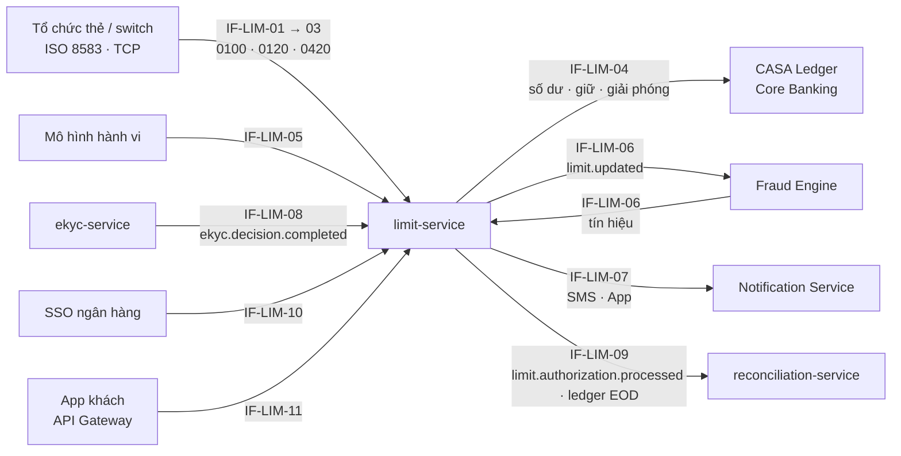
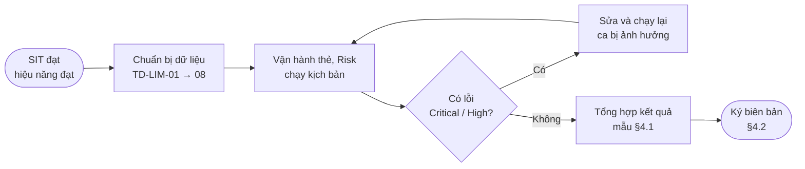

# L07 · Hạn mức – kế hoạch SIT, kiểm thử hiệu năng, bộ UAT và biên bản nghiệm thu

| | |
|---|---|
| Phiên bản | 0.1 · 25/11/2026 · Han Dao (BA) |
| Trạng thái | ⛔ Kế hoạch xong · chưa chạy được: chưa xác minh được `limit-service`, chưa có simulator ISO 8583 (DEP-05), mock CASA (DEP-06), Notification Service (DEP-07) |
| Epic | [SCRUM-8](https://baohandao2303.atlassian.net/browse/SCRUM-8) · SCRUM-27 → 30, 38, 51 → 54 |
| Khung tài liệu | ISO/IEC/IEEE 29119-3:2021 – Test Plan (SIT, hiệu năng, UAT) và mẫu Test Completion Report cho UAT |
| Cơ sở | [L02](L02-requirements-gap-rtm.md) yêu cầu & RTM · [L05](L05-api-data-dictionary.md) API & dữ liệu · [L06](L06-nfr-kpi.md) NFR & KPI · ca backend [L04 §4](L04-test-plan-cases.md) · BAS-RAID-v1.2 (DEP-05 → 07, 10, ISS-03, 04, DEC-02, 04) |
| Liên quan | Module 2 [R07](../02-reconciliation/R07-sit-perf-uat.md) (IF-REC-06 = IF-LIM-09) · Module 1 [C16](../01-ekyc/1.4-testing/C16-sit-plan.md), [C17](../01-ekyc/1.4-testing/C17-uat-pack.md) |

> ⚠️ BAS-UTR-v1.2 **không có trên Confluence**. Các nguồn hiện có nhắc UAT-LIM-01, 03, 04, 05, 06, 07, 08, 10 và UAT-NFR-01. Tài liệu này giữ nguyên các mã đó, điền nội dung *đề xuất* cho UAT-LIM-02 và 09 (chưa biết nội dung gốc), và đặt kịch bản BA bổ sung là **UAT-LIM-P01 → P10**. Khi có BAS-UTR, đối chiếu và gộp lại.

Thứ tự: kiểm thử hệ thống của Dev (TC-LIM-B01 → B10) → **SIT** (§1) → **hiệu năng** (§2) → **UAT** với Vận hành thẻ và Risk (§3) → ký biên bản (§4). Theo DEC-04, UAT được dùng simulator / mock cho hệ thống ngoài nếu chưa có sandbox, miễn mô phỏng đủ thành công, timeout, trùng, từ chối, reversal.

## 1. Kiểm thử tích hợp hệ thống (SIT)

### 1.1 Bản đồ tích hợp

| Mã | Giao diện | Bên phụ trách | Dữ liệu thử / môi trường | Trạng thái |
|---|---|---|---|---|
| IF-LIM-01 | 0100 / 0110 authorization | Vận hành thẻ + switch | Simulator hỗ trợ MTI 0100/0110/0120/0420 (DEP-05) | Chưa có |
| IF-LIM-02 | 0120 / 0130 advice | Vận hành thẻ | Như trên | Chưa có |
| IF-LIM-03 | 0420 / 0430 reversal | Vận hành thẻ | Như trên, có reversal không khớp gốc | Chưa có |
| IF-LIM-04 | CASA: số dư, tạm giữ, giải phóng, quyết toán | Đội Core/CASA | Sandbox hoặc mock có độ trễ cấu hình được (DEP-06) | Chưa có |
| IF-LIM-05 | Điểm hành vi → `limit-service` | Risk / Data | Bộ điểm mẫu trên / dưới ngưỡng | Chưa có, thang điểm chưa chốt (L05 câu hỏi 3) |
| IF-LIM-06 | `limit.updated` → Fraud Engine; tín hiệu → `limit-service` | Risk / Fraud | Tín hiệu mẫu điểm 92, 78, 61 như UI mẫu | Chưa có |
| IF-LIM-07 | Notification Service SMS / App (IF-11 của FSD) | Notification / CRM | Mock có `delivery_status` và lỗi giả lập (DEP-07, SCRUM-54) | Chưa có · mẫu nội dung chưa duyệt (ISS-03) |
| IF-LIM-08 | `ekyc.decision.completed` → tạo hồ sơ hạn mức | Đội eKYC | Đã có phía phát trong `ekyc-service` (`server/test/customer-flow.test.ts`) | Phía nhận chưa có |
| IF-LIM-09 | Sự kiện + ledger EOD → Module 2 | Đội Hạn mức + Đối soát | Payload theo L05 §5.6 = R05 §5.8 | Payload đã khớp ở mức đề xuất, chờ Tech Lead chốt |
| IF-LIM-10 | SSO → `CARD_OPS`, `CREDIT_RISK`, `LIM_VIEWER` | IAM / InfoSec | 3 tài khoản thử + 1 tài khoản Risk thứ hai để kiểm SoD-L1 | Chưa có |
| IF-LIM-11 | App → API-L40 → L45 | Đội mobile | Token khách thử, 3 thẻ mẫu | Chưa có |

### 1.2 Kịch bản SIT

| Mã | Kịch bản | Kết quả mong đợi | Giao diện | Truy vết |
|---|---|---|---|---|
| SIT-LIM-01 | Gửi 0100 hợp lệ qua simulator, đủ hạn mức | 0110 F39 00, F38 có mã chuẩn chi, log đủ trường, PAN đã token hoá | IF-LIM-01 | BR-LIM-01, TC-LIM-B01 |
| SIT-LIM-02 | Simulator gửi lại cùng 0100 ba lần (mô phỏng retry) | Ba lần đều nhận cùng 0110; hạn mức trừ một lần | IF-LIM-01 | BR-LIM-03, UAT-LIM-02 |
| SIT-LIM-03 | Gửi 0420 cho giao dịch đã duyệt; gửi 0420 không có gốc; gửi 0120 | Giải phóng ≤ 5 giây, trả 0430 · không có gốc → hàng chờ W1 · 0120 trừ hạn mức không từ chối | IF-LIM-02, 03 | BR-LIM-08, UAT-LIM-05 |
| SIT-LIM-04 | Thiếu hạn mức, Fallback bật; CASA đủ / thiếu / trả lỗi / trễ 3 giây | Đủ: duyệt 00 + HOLD · thiếu: 51 · lỗi hoặc trễ: breaker CASA mở, từ chối fail-safe trước 1 800 ms | IF-LIM-04 | BR-LIM-04, 09, UAT-LIM-03, 09 |
| SIT-LIM-05 | Quyết toán và huỷ giao dịch fallback | HOLD → SETTLED / RELEASED khớp với CASA; bút toán đối ứng có `gl_ref` | IF-LIM-04 | REQ-LIM-06, UAT-LIM-04 |
| SIT-LIM-06 | Nạp điểm hành vi trên / dưới ngưỡng, thẻ có cờ gian lận | Chỉ thẻ đủ điểm, không cờ có lời mời; số tiền ≤ trần % | IF-LIM-05 | BR-LIM-05, 06 |
| SIT-LIM-07 | Fraud Engine gửi tín hiệu điểm 92 sau khi khách dùng Boost | Boost `LOCKED_SUSPECTED_FRAUD`, khả dụng giảm, 2 thông báo `PENDING` ≤ 60 giây, `limit.boost.locked` phát ra | IF-LIM-06, 07 | BR-LIM-07, UAT-LIM-07 |
| SIT-LIM-08 | Mock Notification trả SMS lỗi 2 lần rồi thành công; callback trễ | Gửi lại theo lịch 1 / 5 phút; trạng thái cuối DELIVERED; W4 hiện đúng từng bước | IF-LIM-07 | REQ-LIM-14, RSK-14 |
| SIT-LIM-09 | Phát 1 000 sự kiện, gửi lại 100 sự kiện trùng `messageId`; chạy EOD | Module 2 nhận đủ, 0 GLEntry trùng, báo cáo lệch = 0 | IF-LIM-09 | BR-LIM-10, UAT-LIM-08, SIT-REC-12 |
| SIT-LIM-10 | Quét DB, log ứng dụng, log gateway, sự kiện, file xuất sau SIT-LIM-01 → 09 | 0 PAN đầy đủ (regex 13–19 chữ số liền) | Tất cả | NFR-LIM-15, UAT-LIM-10 |
| SIT-LIM-11 | Gọi API web bằng 3 vai trò; Risk A khoá Boost, Risk A mở khoá | Đúng quyền theo L05 §1.1; mở khoá bị `SOD_SELF_UNLOCK` | IF-LIM-10 | NFR-LIM-17 |
| SIT-LIM-12 | Hoàn tất eKYC một khách `APPROVED` | Có hồ sơ hạn mức đúng sản phẩm, app M1 hiện hạn mức | IF-LIM-08, 11 | A01 luồng tổng |

### 1.3 Điều kiện vào / ra SIT

| | Tiêu chí |
|---|---|
| **Vào** | TC-LIM-B01 → B10 đạt trên môi trường Dev · simulator ISO 8583, mock CASA, mock Notification sẵn sàng (ACT-01) · D-LIM-01 → 03 đã chốt · payload IF-LIM-09 đã chốt với đội Đối soát |
| **Ra** | 12/12 kịch bản SIT đạt · 0 lỗi Critical / High mở · SIT-LIM-10 sạch |

## 2. Kiểm thử hiệu năng

### 2.1 Mô hình tải

| Hạng mục | Giá trị | Nguồn |
|---|---|---|
| Danh mục thẻ thử | 200 000 thẻ, 5% có Boost, 30% bật Fallback | *Đề xuất* |
| Tải nền | 21 giao dịch/giây (≈ 1 284 / phút như W1) | UI mẫu |
| Tải đỉnh | 300 giao dịch/giây | NFR-LIM-02 *đề xuất* |
| Tỷ lệ bản tin | 0100: 94% · 0420: 3% · 0120: 1% · gửi lại: 2% | *Đề xuất* |
| Thẻ "nóng" cho race condition | 500 thẻ nhận 2 giao dịch cùng lúc liên tục | ISS-04, ACT-06 |

### 2.2 Kịch bản

| Mã | Kịch bản | Tiêu chí đạt | Truy vết |
|---|---|---|---|
| PERF-LIM-01 | Tăng dần 21 → 300 giao dịch/giây trong 30 phút | p99 < 2 000 ms ở mọi mức; KPI-07 ≥ 99% | NFR-LIM-01, KPI-07, UAT-NFR-01 |
| PERF-LIM-02 | Giữ 300 giao dịch/giây trong 60 phút, có 500 thẻ nóng nhận giao dịch song song | Lỗi < 0,1%; **0** thẻ có `available_limit` < 0; p99 < 2 000 ms | NFR-LIM-02, 10, KPI-08, UAT-LIM-01 |
| PERF-LIM-03 | 50 người dùng web + 1 000 người dùng app trong khi chạy PERF-LIM-01 | API đọc p95 < 2 giây; không làm p99 authorization vượt ngưỡng | NFR-LIM-06 |
| PERF-LIM-04 | Mock CASA trễ 3 giây cho 20% lời gọi ở tải đỉnh | Breaker CASA mở; giao dịch cần CASA bị từ chối ở ≤ 1 800 ms; giao dịch không cần CASA không bị ảnh hưởng | NFR-LIM-03, 12 |
| PERF-LIM-05 | 1 000 tín hiệu gian lận trong 1 phút | 100% khoá + thông báo `PENDING` ≤ 60 giây | NFR-LIM-05 |
| PERF-LIM-06 | Đo độ trễ sự kiện tới Module 2 trong PERF-LIM-02 | p95 < 10 giây; 0 sự kiện mất | NFR-LIM-07, 14 |

Công cụ *đề xuất*: bộ sinh tải ISO 8583 (ví dụ jPOS) cho cổng thẻ, k6 cho API REST. Kết quả lưu kèm cấu hình, phiên bản và biểu đồ p50 / p95 / p99.

## 3. Kiểm thử chấp nhận (UAT)

### 3.1 Quy trình và vai trò

| Vai trò | Người | Việc |
|---|---|---|
| Vận hành thẻ | Chuyên viên vận hành thẻ | Kịch bản authorization, reversal, fallback, W1, W2 |
| Risk tín dụng (2 người) | Chuyên viên Risk / Fraud | Kịch bản Boost, khoá / mở khoá (2 người để kiểm SoD-L1), W3, W4 |
| Đại diện khách hàng | CSKH hoặc nhân viên đóng vai khách | Kịch bản app M1 → M3, đọc thông báo |
| Người nghiệm thu | PO, Trưởng Risk tín dụng, Trưởng vận hành thẻ | Ký biên bản |
| Quan sát | InfoSec, Compliance / Legal, QA Lead | PAN, nội dung thông báo, audit |
| Hỗ trợ | BA, Dev | Dữ liệu, simulator, ghi lỗi |

### 3.2 Điều kiện

| | Tiêu chí |
|---|---|
| **Vào** | SIT đạt (§1.3) · PERF-LIM-01, 02 đạt (bắt buộc), PERF-LIM-03 → 06 đạt hoặc được PO chấp nhận bằng văn bản · Risk đã duyệt và đóng băng ngưỡng (D-LIM-07, DEP-12) · mẫu SMS/App đã duyệt (ISS-03, ACT-05) nếu go-live Boost (DEC-02) · dữ liệu UAT đã che (ASM-04) |
| **Ra** | 100% ca Must đã chạy · ≥ 95% ca đạt · 0 lỗi Critical / High mở · UAT-LIM-01 và UAT-NFR-01 bắt buộc đạt (go-live gate theo RAID §4.1) · bằng chứng không chứa PAN (RSK-16) |

### 3.3 Dữ liệu UAT

| Mã | Dữ liệu | Dùng cho |
|---|---|---|
| TD-LIM-01 | Thẻ Platinum 80 triệu, dư nợ 46,25 triệu, tạm giữ 2,3 triệu, Fallback bật, CASA 12,48 triệu | UAT-LIM-03, 04, P02, P03 |
| TD-LIM-02 | Thẻ Gold 50 triệu còn 4,12 triệu khả dụng, Fallback tắt | UAT-LIM-P02 |
| TD-LIM-03 | Thẻ `BLOCKED` | UAT-LIM-P04 |
| TD-LIM-04 | Thẻ có lời mời Boost +10 triệu, ngày chốt sao kê sau 3 ngày | UAT-LIM-06, P05 |
| TD-LIM-05 | Thẻ có Boost đang hiệu lực + tín hiệu gian lận điểm 92 dựng sẵn | UAT-LIM-07, P06, P10 |
| TD-LIM-06 | Cặp giao dịch POS + online cùng thẻ, tổng vượt khả dụng 1 triệu | UAT-LIM-01 |
| TD-LIM-07 | Bộ giao dịch đã duyệt + 1 reversal khớp + 1 reversal không khớp | UAT-LIM-05 |
| TD-LIM-08 | Một ngày giao dịch có 2 dòng lệch EOD dựng sẵn (thiếu GL, lệch số tiền) | UAT-LIM-08 |

### 3.4 Kịch bản

| Mã | Kịch bản | Kết quả mong đợi | Ưu tiên | Truy vết |
|---|---|---|---|---|
| UAT-LIM-01 | Gửi đồng thời 2 giao dịch TD-LIM-06 | Một giao dịch duyệt, một từ chối 51; khả dụng không âm; W2 version tăng đúng 1 | Must | BR-LIM-02, KPI-08 |
| UAT-LIM-02 *(đề xuất)* | Simulator gửi lại một giao dịch đã duyệt | Khách bị trừ một lần; W1 đánh dấu bản tin trùng | Must | BR-LIM-03 |
| UAT-LIM-03 | Giao dịch 35 triệu trên TD-LIM-01 (vượt khả dụng) | Duyệt qua CASA; M1 ghi "Trừ tài khoản thanh toán"; W2 có giao dịch HOLD | Must | BR-LIM-04 |
| UAT-LIM-04 | Quyết toán và huỷ giao dịch fallback ở UAT-LIM-03 | HOLD → SETTLED (lần 1), HOLD → RELEASED (lần 2); số dư CASA đúng | Must | BR-LIM-04 |
| UAT-LIM-05 | Gửi reversal TD-LIM-07 | Hạn mức giải phóng đúng; reversal không khớp vào hàng chờ W1 | Must | BR-LIM-08 |
| UAT-LIM-06 | Nhận Boost TD-LIM-04, đẩy đồng hồ qua ngày chốt sao kê | M2 hiện ngày hết hạn đúng; sau mốc Boost `EXPIRED`, khả dụng về hạn mức gốc không thao tác tay | Must | BR-LIM-06, RULE-LIM-06 |
| UAT-LIM-07 | Kích hoạt tín hiệu TD-LIM-05 | Boost khoá; khách nhận SMS và App đúng mẫu đã duyệt; W4 hiện trạng thái gửi; SMS lỗi gửi lại được | Must (nếu go-live Boost) | BR-LIM-07, CR-003 |
| UAT-LIM-08 | Chạy EOD với TD-LIM-08 | Báo cáo có 2 dòng lệch, mỗi dòng giao người phụ trách và giải trình được | Should | BR-LIM-10, KPI-09 |
| UAT-LIM-09 *(đề xuất)* | Tắt mock CASA trong 2 phút ở giờ thử | Breaker mở; giao dịch cần CASA từ chối nhanh; giao dịch khác bình thường; W1 hiện trạng thái breaker | Must | BR-LIM-09 |
| UAT-LIM-10 | Rà mọi màn W1 → W4, M1 → M3, file xuất, mẫu thông báo | Không thấy PAN đầy đủ | Must | NFR-SEC-04 |
| UAT-NFR-01 | Xem báo cáo PERF-LIM-01, 02 và W1 trong tuần UAT | p99 < 2 s; KPI-07 ≥ 99% | Must | NFR-LIM-01 |
| UAT-LIM-P01 | Đối chiếu số W1 (p99, tỷ lệ chấp thuận) với truy vấn L06 §3 | Sai lệch 0 | Should | KPI-07 |
| UAT-LIM-P02 | Giao dịch vượt khả dụng trên TD-LIM-02 | Từ chối 51, không gọi CASA | Must | UC-LIM-03 ngoại lệ |
| UAT-LIM-P03 | Khách tắt Smart Fallback trên M1 rồi giao dịch vượt khả dụng | Từ chối 51 | Should | REQ-LIM-07 |
| UAT-LIM-P04 | Giao dịch trên TD-LIM-03 | Từ chối 05 | Must | L01 §2 |
| UAT-LIM-P05 | Khách chọn "Để sau" ở M2; thử nhận khi chưa tick điều kiện | Lời mời `DECLINED`; không nhận được khi chưa tick | Should | REQ-LIM-11 |
| UAT-LIM-P06 | Risk khoá thủ công một Boost | Bắt lý do; khách nhận thông báo; audit ghi người khoá | Must | D-LIM-08 |
| UAT-LIM-P07 | Risk A mở khoá Boost do Risk A khoá; Risk B mở khoá | A bị chặn; B mở được với lý do ≥ 10 ký tự | Should | REQ-LIM-18 |
| UAT-LIM-P08 | Đổi ngưỡng khoá gian lận qua cấu hình có duyệt | Hiệu lực sau khi duyệt; có lịch sử version | Should | NFR-LIM-22 |
| UAT-LIM-P09 | Rà audit sau toàn bộ UAT | Mọi thao tác ở L05 §3.6 có bản ghi, không sửa được | Must | NFR-LIM-20 |
| UAT-LIM-P10 | Khách trả lời ở M3 "Đúng là tôi" và "Không phải tôi" | Case ghi `customer_response`; "Không phải tôi" khoá thẻ, mở tra soát **[D-LIM-05]** | Should | UC-LIM-06 |

## 4. Mẫu kết quả và biên bản nghiệm thu

### 4.1 Mẫu ghi kết quả

| Mã | Ngày chạy | Người chạy | Kết quả | Lỗi (Jira) | Bằng chứng (đã che PAN) | Ghi chú |
|---|---|---|---|---|---|---|
| UAT-LIM-01 | | | ☐ Đạt ☐ Không đạt | | | |

### 4.2 Biên bản nghiệm thu

> **BIÊN BẢN NGHIỆM THU UAT – MODULE HẠN MỨC TÍN DỤNG THỜI GIAN THỰC (Aegis)**
>
> Phiên bản phát hành: ______ · Môi trường: UAT · Thời gian: từ ……/……/………… đến ……/……/…………
>
> | Chỉ số | Kết quả |
> |---|---|
> | Tổng số ca / đã chạy | ___ / ___ |
> | Đạt / Không đạt | ___ / ___ |
> | Lỗi mở (Critical / High / Medium / Low) | ___ / ___ / ___ / ___ |
> | p99 authorization (PERF-LIM-01) / KPI-07 | ___ ms / ___ % |
> | Sự cố vượt hạn mức (KPI-08) | ___ |
> | PERF-LIM đạt / tổng | ___ / 6 |
>
> Điểm lệch baseline đã chốt (D-LIM-01 → 09): ☐ Đủ ☐ Còn: ___________
>
> Go-live Boost (DEC-02): ☐ Có – mẫu thông báo đã duyệt, Notification Service sẵn sàng ☐ Không – tắt tính năng Boost
>
> PCI DSS / SAQ (DEP-10): ☐ Đạt ☐ Chưa – không go-live phân hệ thẻ
>
> Kết luận: ☐ Đồng ý phát hành ☐ Đồng ý có điều kiện ☐ Không đồng ý
>
> | Vai trò | Họ tên | Chữ ký | Ngày |
> |---|---|---|---|
> | Product Owner | | | |
> | Trưởng Risk tín dụng | | | |
> | Trưởng Vận hành thẻ | | | |
> | InfoSec | | | |
> | Compliance / Legal | | | |
> | BA | | | |

## 5. Rủi ro kiểm thử

| Rủi ro | Ảnh hưởng | Giảm thiểu | RAID |
|---|---|---|---|
| Chưa có simulator ISO 8583 | Không chạy được SIT-LIM-01 → 03, PERF-LIM-01, 02 | Dựng simulator nội bộ (DEC-04) | DEP-05 |
| Chưa có bộ dữ liệu race condition | UAT-LIM-01 không có bằng chứng | Chuẩn bị TD-LIM-06 và thẻ nóng của PERF-LIM-02 | ISS-04, ACT-06 |
| Mẫu thông báo chưa duyệt | UAT-LIM-07 không đạt | Duyệt trước tuần UAT; nếu không, tắt Boost khi go-live | ISS-03, RSK-14, DEC-02 |
| Đổi ngưỡng sau khi UAT bắt đầu | Phải chạy lại UAT-LIM-06, 07, P06 → P08 | Đóng băng cấu hình trước UAT Entry | RSK-13, DEP-12 |
| Bằng chứng UAT chứa PAN | Vi phạm PCI DSS | Chỉ dùng thẻ thử; rà bằng chứng trước khi lưu | RSK-16 |
| Chưa xác minh được mã `limit-service` | Toàn bộ kế hoạch trễ | Tech Lead trả lời L02 câu hỏi 1 | — |

## 6. Câu hỏi mở

| # | Câu hỏi | Người trả lời |
|---|---|---|
| 1 | Nội dung UAT-LIM-02 và UAT-LIM-09 trong BAS-UTR-v1.2 | QA Lead |
| 2 | Tổ chức thẻ có cung cấp môi trường chứng nhận (certification) không, hay chỉ dùng simulator? | Vận hành thẻ |
| 3 | Có được đẩy đồng hồ hệ thống trên UAT để kiểm hết hạn Boost không, hay cần thẻ có ngày chốt sao kê gần? | Tech Lead |

## 7. Kiểm soát tài liệu

### Lịch sử phiên bản

| Phiên bản | Ngày | Người sửa | Commit | Thay đổi |
|---|---|---|---|---|
| 0.1 | 25/11/2026 | Han Dao | — | Bản đầu: 11 giao diện, 12 kịch bản SIT, 6 kịch bản hiệu năng, 21 kịch bản UAT (10 mã baseline + UAT-NFR-01 + 10 bổ sung), 8 bộ dữ liệu, biên bản nghiệm thu |

### Phê duyệt

| Vai trò | Người | Ngày | Kết luận |
|---|---|---|---|
| BA (soạn) | Han Dao | 25/11/2026 | Trình duyệt |
| QA Lead | | | |
| Product Owner | | | |
| Risk tín dụng | | | |
| Vận hành thẻ | | | |
| InfoSec | | | |
