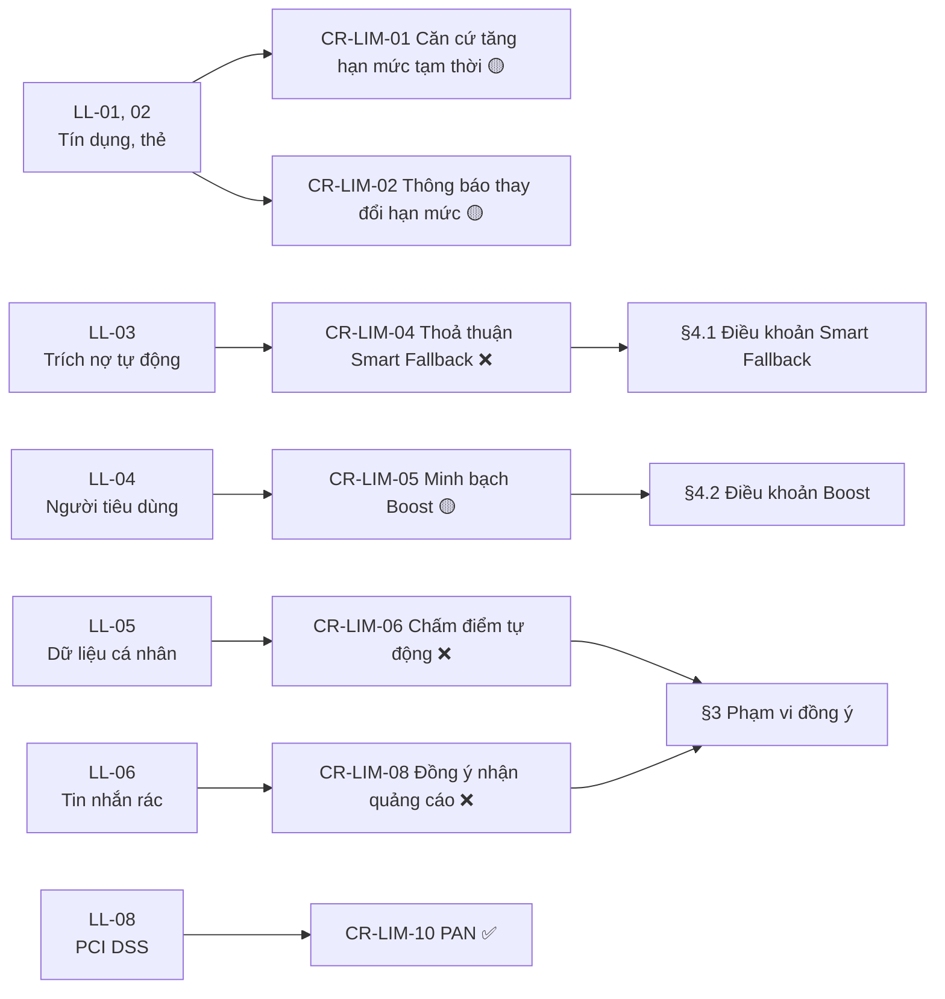

# L08 · Hạn mức – đối chiếu tuân thủ, điều khoản cho khách và dữ liệu cá nhân

| | |
|---|---|
| Mã tài liệu | AEG-LIM-L08 |
| Phiên bản | 0.3 |
| Ngày phát hành | 26/11/2026 |
| Trạng thái | 📝 Bản nháp – chờ Compliance, Pháp chế, Risk tín dụng, InfoSec và CSKH xác nhận |
| Phân loại | Nội bộ |
| Tác giả | Han Dao (BA) |
| Người duyệt | Pháp chế / DPO · Compliance · Risk tín dụng · CSKH · InfoSec – chưa duyệt |
| Mục đích và phạm vi | Đối chiếu tuân thủ, điều khoản cho khách và dữ liệu cá nhân cho Hạn mức |
| Chuẩn tham chiếu | ISO/IEC/IEEE 29148:2018 · ISO/IEC 29100 · PCI DSS v4.0 · BABOK v3 *Business Rules Analysis* · WCAG 2.2 (ngôn ngữ dễ hiểu cho khách) |
| Thuật ngữ | [G02 Thuật ngữ và chữ viết tắt](../00-overview/G02-glossary.md) |
| Epic | [SCRUM-8](https://baohandao2303.atlassian.net/browse/SCRUM-8) · liên quan [SCRUM-54](https://baohandao2303.atlassian.net/browse/SCRUM-54) (thông báo) |
| Tương đương Module 1 | [C02](../01-ekyc/1.2-compliance-legal/C02-compliance-mapping.md) (compliance mapping) và [P01](../01-ekyc/1.2-compliance-legal/P01-terms-privacy.md) (điều khoản, quyền riêng tư) |
| Đầu vào | BAS-BRD-v1.2 §2.3, §4.3 · CR-003 · BAS-RAID-v1.2 (RSK-03, 11, 14, 16, DEP-07, 10, ISS-03) · [L02](L02-requirements-gap-rtm.md) · [L03](L03-ui-spec.md) · [L05](L05-api-data-dictionary.md) |

> ⚠️ Số hiệu, điều khoản và nội dung pháp lý dưới đây là **điểm khởi đầu để rà soát**, chưa đối chiếu bản gốc. Dòng nào ghi **cần xác minh** phải được Pháp chế kiểm trên cổng văn bản chính thức trước khi dùng. Điều khoản ở §4 là **dự thảo của BA** để Pháp chế và CSKH sửa, không phải văn bản phát hành.

## 1. Phạm vi văn bản

| Mã | Văn bản | Chủ đề liên quan Hạn mức | Cần xác minh |
|---|---|---|---|
| LL-01 | Luật Các tổ chức tín dụng 32/2024/QH15 | Cấp tín dụng qua thẻ, thẩm quyền quyết định và thay đổi hạn mức | Điều khoản về thay đổi hạn mức tín dụng, nghĩa vụ thông báo |
| LL-02 | Quy định NHNN về hoạt động thẻ ngân hàng (ví dụ Thông tư 18/2024/TT-NHNN) | Hợp đồng phát hành thẻ, hạn mức tín dụng thẻ, thông báo cho chủ thẻ, khoá thẻ, tra soát khiếu nại | Số hiệu văn bản hiện hành; thời hạn tra soát; yêu cầu khi tạm tăng hạn mức |
| LL-03 | Quy định về thanh toán không dùng tiền mặt (ví dụ Nghị định 52/2024/NĐ-CP) | Trích nợ tự động tài khoản thanh toán (Smart Fallback) cần thoả thuận của chủ tài khoản | Hình thức thoả thuận hợp lệ trên kênh điện tử |
| LL-04 | Luật Bảo vệ quyền lợi người tiêu dùng 19/2023/QH15 | Minh bạch điều kiện Boost (thời hạn, phí, điều kiện khoá); hợp đồng theo mẫu, điều kiện giao dịch chung | Nghĩa vụ đăng ký hợp đồng theo mẫu với cơ quan quản lý |
| LL-05 | Luật Bảo vệ dữ liệu cá nhân 91/2025/QH15 và Nghị định 356/2025/NĐ-CP | Chấm điểm hành vi (xử lý tự động, lập hồ sơ), giám sát gian lận, dữ liệu tài chính và vị trí | Quy định về quyết định tự động và quyền phản đối; dữ liệu tài chính có là nhạy cảm |
| LL-06 | Quy định chống tin nhắn rác (ví dụ Nghị định 91/2020/NĐ-CP) | Tin nhắn mời Boost là quảng cáo (cần đồng ý nhận); tin khoá Boost là tin dịch vụ | Phân loại tin, giờ được gửi, cú pháp từ chối |
| LL-07 | Luật Phòng, chống rửa tiền 14/2022/QH15 | Case gian lận xác nhận → chuyển AML; lưu hồ sơ | Ngưỡng và thời hạn báo cáo |
| LL-08 | PCI DSS v4.0 (hợp đồng với tổ chức thẻ) | Không lưu PAN rõ, token hoá, che khi hiển thị, nhật ký, phạm vi đánh giá | Mức tuân thủ áp dụng (SAQ / ROC) – DEP-10 |
| LL-09 | Quy tắc của tổ chức thẻ (Visa, Mastercard, NAPAS) | Thời gian trả lời authorization, stand-in, mã phản hồi, reversal | Mã F39 cho fail-safe (L02 REQ-LIM-02); quy định stand-in |

## 2. Ma trận đối chiếu

Trạng thái: ✅ Đáp ứng trong thiết kế · 🟡 Một phần · ❌ Chưa có

| Mã | Nguồn | Yêu cầu (tóm tắt) | Hiện trạng Aegis | Trạng thái | Hành động |
|---|---|---|---|---|---|
| CR-LIM-01 | LL-01, 02 | Tăng hạn mức tạm thời phải có căn cứ thẩm định và nằm trong thẩm quyền đã phê duyệt | Boost theo điểm hành vi + trần % (BR-LIM-05, 06); ngưỡng chưa được Risk duyệt (D-LIM-07) | 🟡 | Risk chốt chính sách Boost như một quy định nội bộ có thẩm quyền |
| CR-LIM-02 | LL-02 | Thông báo cho chủ thẻ khi hạn mức thay đổi (tăng tạm, hết hạn, khoá phần Boost) | Có thông báo khi khoá (CR-003); **chưa có** thông báo khi Boost hết hạn và khi điều chỉnh hạn mức gốc (W2) | 🟡 | REQ-LIM-21, 22 (§5) |
| CR-LIM-03 | LL-02 | Chủ thẻ được tra soát, khiếu nại và khoá thẻ khi nghi bị lộ | M3 "Không phải tôi – khoá thẻ" (D-LIM-05), REQ-LIM-16 | 🟡 | Chốt D-LIM-05 và thời hạn tra soát |
| CR-LIM-04 | LL-03 | Trích tiền CASA tự động chỉ khi chủ tài khoản đã đồng ý bằng thoả thuận hợp lệ, có quyền huỷ | Công tắc ở M1 bật sẵn trong UI mẫu, không có điều khoản, không lưu bằng chứng đồng ý | ❌ | §4.1, REQ-LIM-23; mặc định **tắt** |
| CR-LIM-05 | LL-04 | Công bố đầy đủ: số tiền, thời điểm hết hạn, phí, việc tự trở về, điều kiện bị khoá, trước khi khách nhận | M2 có 4 dòng + ô xác nhận (REQ-LIM-11); thời hạn còn lệch baseline (DEF-LIM-02; DEF-LIM-03 đã sửa 26/11); chưa có link điều khoản đầy đủ | 🟡 | §4.2; sửa DEF-LIM-02 sau D-LIM-01 |
| CR-LIM-06 | LL-05 | Chấm điểm hành vi để cấp Boost là xử lý tự động dữ liệu cá nhân → thông báo mục đích, cơ sở, quyền phản đối / yêu cầu xem xét lại | Chưa có trong điều khoản Module 1 (P01 §3 chỉ có phạm vi eKYC) | ❌ | §3 phạm vi `limit_scoring`; REQ-LIM-24 |
| CR-LIM-07 | LL-05, 07 | Giám sát gian lận (vị trí, thiết bị, hành vi chi tiêu) có cơ sở và giới hạn mục đích | Fraud Engine dùng tín hiệu vị trí, thiết bị (W4) – chưa ghi cơ sở | 🟡 | §3 phạm vi `fraud_monitoring` (cơ sở: nghĩa vụ pháp lý / lợi ích hợp pháp – *cần xác minh*) |
| CR-LIM-08 | LL-06 | Tin mời Boost qua SMS / push là quảng cáo → chỉ gửi khi khách đồng ý nhận, có cách từ chối | Lời mời chỉ hiện trong app (M1); chưa định nghĩa kênh SMS cho lời mời | ❌ | Quy định: lời mời **chỉ trong app** cho tới khi có phạm vi `marketing` (§3) |
| CR-LIM-09 | LL-07 | Case gian lận xác nhận được chuyển AML | Chưa có | 🟡 | REQ-LIM-25 (§5) |
| CR-LIM-10 | LL-08 | Không lưu / hiển thị PAN đầy đủ | REQ-LIM-19, NFR-LIM-15, TC-LIM-04, 22, 25 đạt trên UI mẫu | ✅ | Giữ; SIT-LIM-10 kiểm log, sự kiện |
| CR-LIM-11 | LL-09 | Trả lời authorization đúng hạn, xử lý reversal và stand-in theo quy tắc tổ chức thẻ | NFR-LIM-01 → 04, MTI 0120 / 0420 trong L05 | 🟡 | Chờ Vận hành thẻ xác nhận F39 fail-safe và quy định stand-in |
| CR-LIM-12 | LL-01, Bộ luật Dân sự | Chỉ cấp sản phẩm tín dụng cho người đủ năng lực theo quy định (eKYC đặt 18 tuổi cho `credit` – C05) | Hạn mức khởi tạo từ `ekyc.decision.completed` có `product`; L05 chưa ghi điều kiện | 🟡 | REQ-LIM-26 (§5) |

**Tổng hợp:** 1 ✅ · 7 🟡 · 4 ❌. **Chặn go-live Boost / Smart Fallback:** CR-LIM-04, 06, 08 (cần điều khoản và phạm vi đồng ý), CR-LIM-05 (thời hạn đúng baseline).

## 3. Phạm vi đồng ý và cơ sở xử lý dữ liệu

Mở rộng bảng phạm vi đồng ý của [P01 §3](../01-ekyc/1.2-compliance-legal/P01-terms-privacy.md) (đang có `identity`, `screening`, `marketing` – viết thường, cùng quy ước). `marketing` dùng lại phạm vi sẵn có của Module 1, không tạo mới. Cơ sở xử lý là *đề xuất của BA*, Pháp chế quyết định.

> Bảng `consents` của Module 1 ([D01 §3.2](../01-ekyc/1.6-api-data/D01-data-dictionary.md)) gắn với `session_id` của phiên eKYC. Đồng ý của Module 3 phát sinh sau khi đã có tài khoản, nên cần khoá theo khách hàng (`customer_id`) – đề xuất thêm cột `customer_id` vào `consents` dùng chung thay vì tạo bảng riêng (xem [X01](../00-overview/X01-end-to-end-flow-check.md) F-07).

| Phạm vi | Mục đích | Dữ liệu | Cơ sở xử lý (đề xuất) | Bắt buộc? | Rút lại |
|---|---|---|---|---|---|
| `card_service` | Duyệt giao dịch thẻ, quản lý hạn mức | PAN (token), giao dịch, điểm bán, số dư | Thực hiện hợp đồng thẻ | Có (gắn hợp đồng) | Khi đóng thẻ |
| `fraud_monitoring` | Phát hiện gian lận, khoá Boost, bảo vệ tài khoản | Vị trí giao dịch, thiết bị, tần suất | Nghĩa vụ pháp lý / bảo vệ khách (*cần xác minh*) | Có | Không rút được khi còn dùng thẻ – phải nói rõ trong điều khoản |
| `limit_scoring` | Chấm điểm hành vi để mời Boost | Lịch sử thanh toán, tỷ lệ sử dụng hạn mức | Đồng ý | **Không** – không đồng ý thì không nhận lời mời Boost | Có, trong app; dừng chấm điểm từ kỳ sau |
| `smart_fallback` | Trích CASA khi hết hạn mức | Số dư CASA, giao dịch | Thoả thuận trích nợ (LL-03) | Không | Có – tắt công tắc M1, hiệu lực giao dịch kế tiếp |
| `marketing` | Gửi lời mời Boost qua SMS / push | Số điện thoại, token app | Đồng ý (LL-06) | Không | Có |

**Bên nhận dữ liệu (dự thảo):** tổ chức thẻ / switch (Visa, Mastercard, NAPAS) · nhà cung cấp Fraud Engine nếu là bên ngoài (*cần xác định*) · nhà cung cấp SMS và dịch vụ push (APNs / FCM ở nước ngoài – như P01 §4.1, nội dung push **không** chứa số thẻ hay số tiền) · Core Banking (CASA).

## 4. Dự thảo điều khoản cho khách (chờ Pháp chế, CSKH sửa)

Viết ngôn ngữ thường, câu ngắn, như P01 §2. Hiển thị ở M1 (Smart Fallback) và M2 (Boost) qua liên kết "Điều khoản" trước nút xác nhận.

### 4.1 Điều khoản Smart Fallback – dùng tài khoản thanh toán khi hết hạn mức

1. Khi bạn bật Smart Fallback, nếu một giao dịch thẻ vượt hạn mức khả dụng, Aegis Bank sẽ **tạm giữ** phần còn thiếu trong tài khoản thanh toán [số tài khoản che] của bạn để giao dịch được duyệt.
2. Số tiền tạm giữ được trừ hẳn khi giao dịch quyết toán, hoặc được trả lại nếu giao dịch bị huỷ.
3. Chúng tôi chỉ dùng tài khoản thanh toán đứng tên bạn. Nếu số dư không đủ, giao dịch bị từ chối như bình thường.
4. Phí: [Miễn phí / mức phí – *Product điền*].
5. Bạn tắt được Smart Fallback bất cứ lúc nào trong app. Việc tắt áp dụng cho giao dịch tiếp theo.
6. Mặc định: **tắt**. Bạn chỉ bật khi đã đọc điều khoản này.

### 4.2 Điều khoản Temporary Limit Boost – nâng hạn mức tạm thời

1. Boost là khoản tăng hạn mức tạm thời [số tiền] (tối đa [X]% hạn mức hiện tại), dành cho bạn dựa trên lịch sử chi tiêu và thanh toán.
2. Boost có hiệu lực ngay khi bạn nhận và **tự kết thúc vào 23:59 ngày [ngày chốt sao kê kế tiếp]**. Sau đó hạn mức trở về [hạn mức gốc] mà bạn không cần làm gì.
3. Nếu khi Boost kết thúc, dư nợ của bạn lớn hơn hạn mức gốc, các giao dịch đã duyệt vẫn giữ nguyên; bạn chưa dùng thêm được cho tới khi thanh toán bớt. [*Risk / Pháp chế xác nhận có phí vượt hạn mức không* – L02 REQ-LIM-09.]
4. Phí: [Miễn phí / mức phí].
5. Để bảo vệ bạn, nếu hệ thống thấy giao dịch bất thường, phần Boost có thể bị **tạm khoá**. Chúng tôi sẽ báo ngay qua SMS và thông báo trong app, nêu lý do và cách liên hệ. Hạn mức gốc vẫn dùng bình thường.
6. Bạn có quyền không nhận Boost, và có quyền yêu cầu chúng tôi không dùng điểm hành vi để mời Boost (tắt trong Cài đặt quyền riêng tư).

### 4.3 Mẫu thông báo (thay bản giữ chỗ ở W4 và M3 – ISS-03)

Mã `LIM-N0x` là mã tài liệu. Trong Notification Service dùng cùng quy ước với Module 1 (`EKYC_APPROVED`…): `LIM_BOOST_LOCKED` (N01, N02), `LIM_BOOST_EXPIRED` (N03), `LIM_LIMIT_CHANGED` (N04) – X01 F-12.

| Mã | Kênh | Loại | Nội dung đề xuất (không dấu cho SMS) |
|---|---|---|---|
| LIM-N01 | SMS | Dịch vụ | `Aegis Bank: Phan han muc tam thoi cua the ****{last4} da duoc tam khoa luc {hh:mm} do co giao dich bat thuong. Han muc goc van dung binh thuong. Neu ban khong thuc hien, goi 1900 6868. Aegis khong bao gio hoi ma OTP.` |
| LIM-N02 | Push | Dịch vụ | "Phần hạn mức tạm thời của thẻ đã được tạm khoá để bảo vệ bạn. Mở app để xác nhận giao dịch." (không có số thẻ, số tiền – vì đi qua APNs / FCM) |
| LIM-N03 | SMS | Dịch vụ | `Aegis Bank: Han muc tam thoi cua the ****{last4} da ket thuc. Han muc hien tai: {limit} VND.` (CR-LIM-02) |
| LIM-N04 | Push | Dịch vụ | "Hạn mức thẻ của bạn đã được điều chỉnh. Mở app để xem chi tiết." (CR-LIM-02, khi W2 điều chỉnh) |
| LIM-N05 | Trong app | Quảng cáo | Thẻ lời mời Boost ở M1 – không gửi SMS cho tới khi có phạm vi `marketing` (CR-LIM-08) |

## 5. Yêu cầu mới phát sinh

Bổ sung vào [L02 §4](L02-requirements-gap-rtm.md) khi được duyệt.

| Mã | Yêu cầu | Nguồn | Tiêu chí nghiệm thu | Ưu tiên |
|---|---|---|---|---|
| REQ-LIM-21 | Khi Boost hết hạn, hệ thống phải gửi LIM-N03 cho chủ thẻ trong vòng *15 phút* (*đề xuất*). | CR-LIM-02 | Đẩy đồng hồ qua `expires_at` → LIM-N03 gửi trong ≤ 15 phút, có `notifications` tương ứng | Should |
| REQ-LIM-22 | Khi hạn mức gốc được điều chỉnh (nếu giữ W2 – D-LIM-09), hệ thống phải gửi LIM-N04 và lưu bằng chứng đã gửi. | CR-LIM-02 | Duyệt điều chỉnh hạn mức gốc → LIM-N04 gửi, `notifications.delivery_status` được lưu | Should |
| REQ-LIM-23 | Smart Fallback mặc định tắt; khi khách bật, hệ thống phải lưu bằng chứng đồng ý (phiên bản điều khoản §4.1, thời điểm, thiết bị) như `consents` của Module 1. | CR-LIM-04, LL-03 | Thẻ mới: công tắc ở trạng thái tắt; bật → hiện điều khoản §4.1, sau xác nhận có dòng `consents` (scope `smart_fallback`, `terms_version`, thời điểm, thiết bị) | Must |
| REQ-LIM-24 | Hệ thống chỉ chấm điểm hành vi và mời Boost cho khách có phạm vi `limit_scoring` còn hiệu lực; khách rút lại thì dừng từ kỳ đánh giá kế tiếp và huỷ lời mời đang mở. | CR-LIM-06, LL-05 | Khách rút `limit_scoring` → kỳ đánh giá kế tiếp không chấm điểm thẻ đó, lời mời `OFFERED` chuyển `EXPIRED` | Must |
| REQ-LIM-25 | Risk đóng case với kết luận `CONFIRMED_FRAUD` thì hệ thống phải tạo yêu cầu cho bộ phận AML, giữ liên kết tới giao dịch. | CR-LIM-09, LL-07 | Đóng case `CONFIRMED_FRAUD` → có yêu cầu mới ở hàng đợi AML, liên kết `case_id` và giao dịch | Should |
| REQ-LIM-26 | Hệ thống chỉ tạo hồ sơ hạn mức từ `ekyc.decision.completed` khi `decision` là `STP_APPROVED` / `APPROVED` **và** `product = credit`; sự kiện `payment` hoặc `REJECTED` bị bỏ qua có ghi log. | CR-LIM-12, C05 | Phát `ekyc.decision.completed` với `product = payment` hoặc `REJECTED` → không tạo `card_limit_profiles`, log ghi lý do bỏ qua; `STP_APPROVED` + `credit` → tạo đúng 1 hồ sơ | Must |

## 6. Câu hỏi cho Pháp chế, Compliance, Risk, CSKH

| # | Câu hỏi | Gửi |
|---|---|---|
| 1 | Văn bản NHNN hiện hành về thẻ ngân hàng có yêu cầu gì riêng cho tạm tăng hạn mức (thẩm quyền, thông báo, ghi vào hợp đồng)? | Pháp chế |
| 2 | Hình thức đồng ý trên app (tick + phiên bản điều khoản) có đủ là thoả thuận trích nợ tự động cho Smart Fallback không? | Pháp chế |
| 3 | Chấm điểm hành vi để mời Boost có phải xin đồng ý riêng không, hay dựa được vào hợp đồng thẻ? | DPO |
| 4 | Giám sát gian lận dùng vị trí giao dịch: cơ sở xử lý nào, có cần thông báo riêng? | DPO, Compliance |
| 5 | Hợp đồng / điều kiện giao dịch chung của thẻ có phải đăng ký theo Luật Bảo vệ quyền lợi người tiêu dùng không? | Pháp chế |
| 6 | Duyệt 5 mẫu thông báo LIM-N01 → N05 (ISS-03, ACT-05) | Risk, Legal, CSKH |

## 7. Kiểm soát tài liệu

### Tài liệu tham chiếu

| Mã | Tài liệu |
|---|---|
| C02 | [C02 · Compliance Mapping – eKYC](../01-ekyc/1.2-compliance-legal/C02-compliance-mapping.md) |
| P01 | [P01 · Điều khoản, quyền riêng tư và cơ sở pháp lý – Module 1 eKYC](../01-ekyc/1.2-compliance-legal/P01-terms-privacy.md) |
| L02 | [L02 · Hạn mức – yêu cầu bổ sung, điểm lệch baseline & RTM](L02-requirements-gap-rtm.md) |
| L03 | [L03 · Đặc tả giao diện – Aegis Hạn mức (LIM-W1 → W4, LIM-M1 → M3)](L03-ui-spec.md) |
| L05 | [L05 · Hạn mức – đặc tả API và từ điển dữ liệu (thiết kế đề xuất)](L05-api-data-dictionary.md) |
| D01 | [D01 · Từ điển dữ liệu – Module 1 eKYC](../01-ekyc/1.6-api-data/D01-data-dictionary.md) |
| X01 | [X01 · Kiểm tra luồng end-to-end và độ đầy đủ tài liệu 3 module](../00-overview/X01-end-to-end-flow-check.md) |

Chuẩn quốc tế: xem trường *Chuẩn tham chiếu* ở đầu trang.

### Lịch sử phiên bản

| Phiên bản | Ngày | Người sửa | Commit | Thay đổi |
|---|---|---|---|---|
| 0.1 | 26/11/2026 | Han Dao | — | Bản đầu: 9 nhóm văn bản, 12 yêu cầu tuân thủ (1 ✅ · 7 🟡 · 4 ❌), 5 phạm vi đồng ý, dự thảo điều khoản Smart Fallback và Boost, 5 mẫu thông báo, 6 yêu cầu mới REQ-LIM-21 → 26 |
| 0.2 | 26/11/2026 | Han Dao | — | Thêm cột Tiêu chí nghiệm thu cho REQ-LIM-21 → 26 |
| 0.3 | 26/11/2026 | Han Dao | — | Chuẩn hoá cấu trúc theo ISO/IEC/IEEE 15289: khối thuộc tính đầu trang, tài liệu tham chiếu, thuật ngữ dùng chung (G02), mục kiểm soát tài liệu thống nhất |

### Phê duyệt

| Vai trò | Người | Ngày | Kết luận |
|---|---|---|---|
| BA (soạn) | Han Dao | 26/11/2026 | Trình duyệt |
| Pháp chế / DPO |  |  |  |
| Compliance |  |  |  |
| Risk tín dụng |  |  |  |
| CSKH |  |  |  |
| InfoSec |  |  |  |
