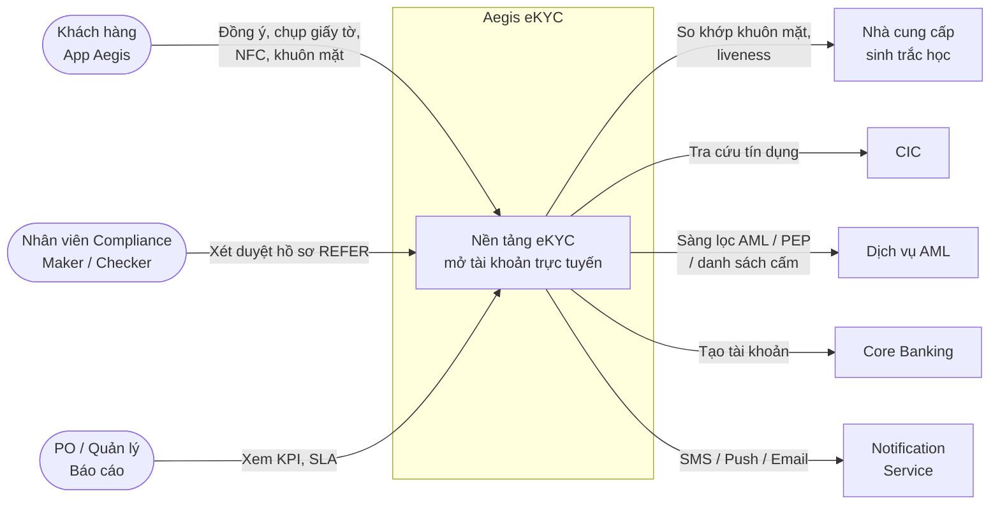
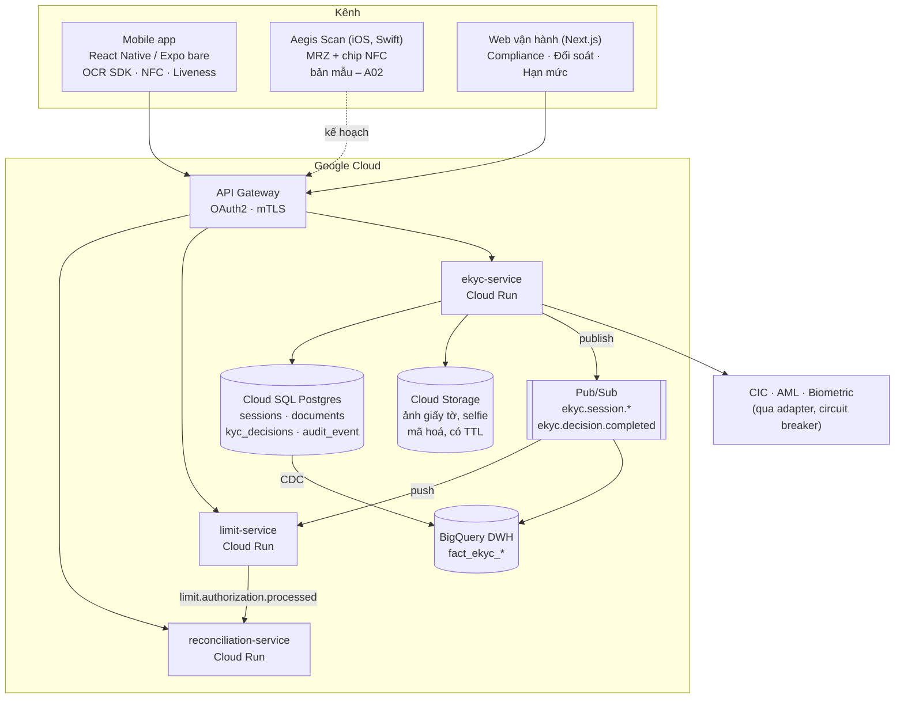
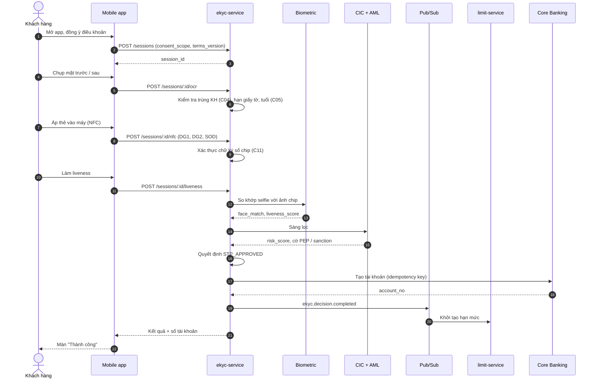
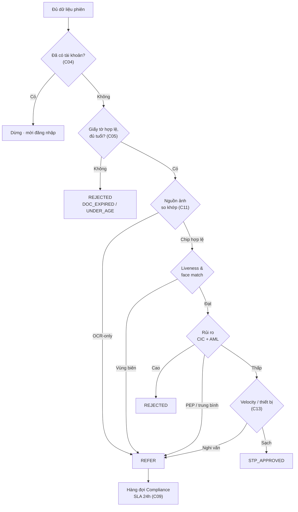
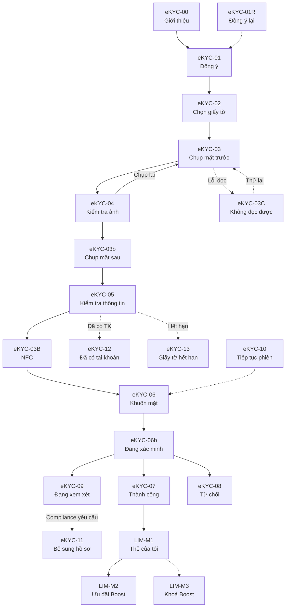
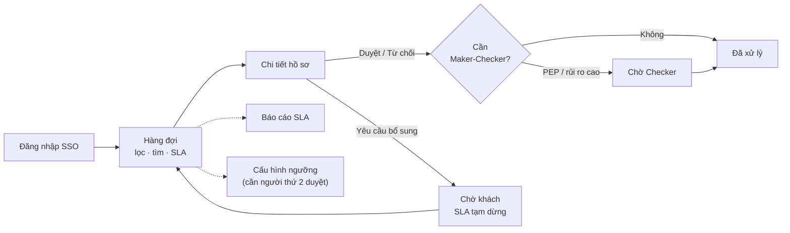
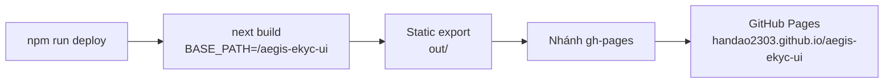

# A01 · Tổng quan giải pháp eKYC – kiến trúc, luồng và điều hướng UI

| | |
|---|---|
| Epic | [SCRUM-69](https://baohandao2303.atlassian.net/browse/SCRUM-69) · nền tảng cho C04–C18 |
| UI | [Bản chạy thật](https://handao2303.github.io/aegis-ekyc-ui/) · mã nguồn `src/` |
| Mục đích | Một chỗ nhìn toàn cảnh trước khi đọc từng tài liệu C-xx, R01, L01, A02 |

## 1. Bối cảnh hệ thống (System Context)

Ai dùng hệ thống, hệ thống nói chuyện với bên ngoài nào.

## 2. Thành phần (Container)

Chi tiết từng phần: vòng đời phiên ở [C06](../01-business/C06-session-lifecycle.md), audit ở [C10](../01-business/C10-maker-checker-audit.md), đo lường ở [C18](../04-analytics/C18-kpi-metric-dictionary.md), đối soát ở [R01](../06-reconciliation/R01-reconciliation-flow.md), hạn mức ở [L01](../07-credit-limit/L01-credit-limit-flow.md), app quét giấy tờ ở [A02](A02-ios-document-scan.md).

## 3. Luồng end-to-end – mở tài khoản thành công (STP)

Nhánh REFER và REJECTED: xem [C07–C09](../01-business/C07-C09-refer-handling.md).

## 4. Cây quyết định tổng

## 5. Bản đồ màn hình – App khách hàng

22 màn hình (19 eKYC + 3 Hạn mức thẻ), mã khớp với cột "Mã" trong UI Kit.

Nét liền: luồng chính. Nét đứt: ngoại lệ. Sau khi mở tài khoản thành công, "Vào trang chủ" dẫn sang nhóm Hạn mức thẻ (22 màn tổng cộng). Chi tiết Hạn mức ở [L01](../07-credit-limit/L01-credit-limit-flow.md).

## 6. Bản đồ màn hình – Aegis Compliance

## 7. Triển khai UI

| Trang | Đường dẫn |
|---|---|
| UI Kit & tài liệu thiết kế | `/` |
| App khách hàng | `/app/` |
| Aegis Compliance | `/compliance/` |
| Aegis Đối soát (REC-01 → 06) | `/reconciliation/` |
| Aegis Hạn mức (LIM-W1 → W4) | `/credit-limit/` |
| App iPhone native – quét CCCD/hộ chiếu | `ios/AegisScan` (cài qua Xcode) |

Bản demo dùng dữ liệu giả, không gọi API thật. Hướng đi khi nối backend:

| Phần | Hướng đi |
|---|---|
| Web vận hành (Compliance, Đối soát, Hạn mức) | Giữ Next.js, thay dữ liệu mẫu bằng API qua API Gateway |
| App khách hàng | `mobile-app` (React Native / Expo bare) dùng lại token Aurora và cấu trúc màn hình của bản web |
| Đọc chip CCCD / hộ chiếu | Logic MRZ + NFC của Aegis Scan (A02) đưa vào app thật dưới dạng native module, hoặc thay bằng SDK eKYC của đối tác |
