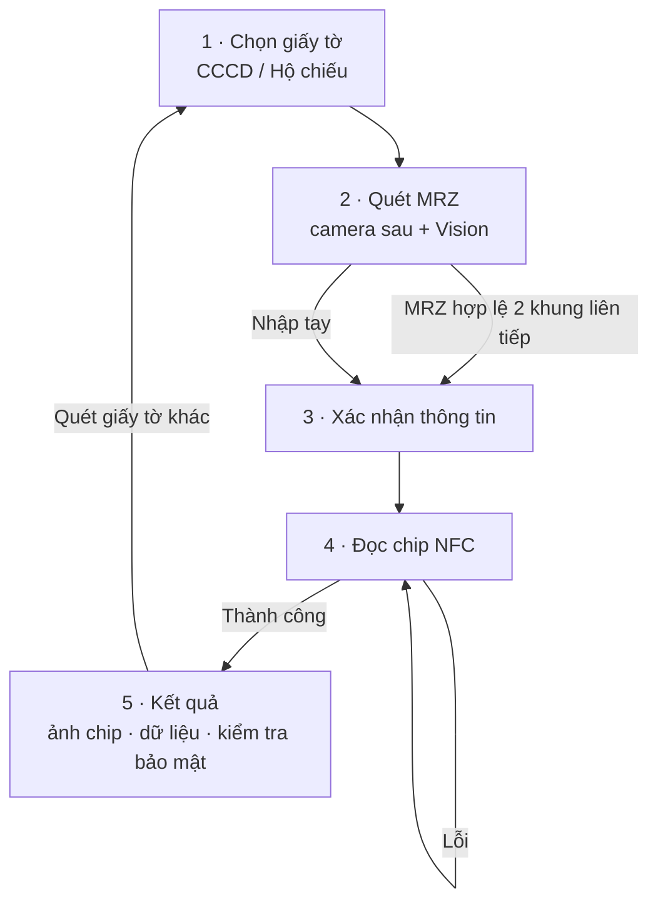
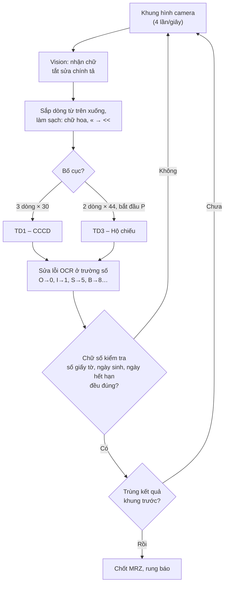
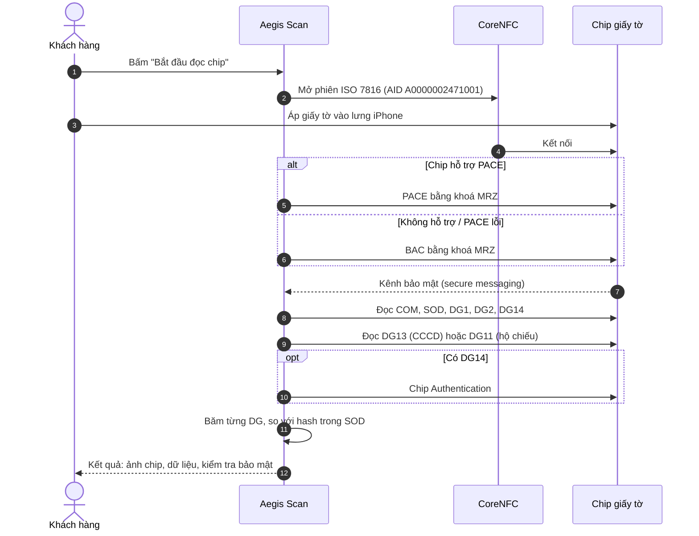
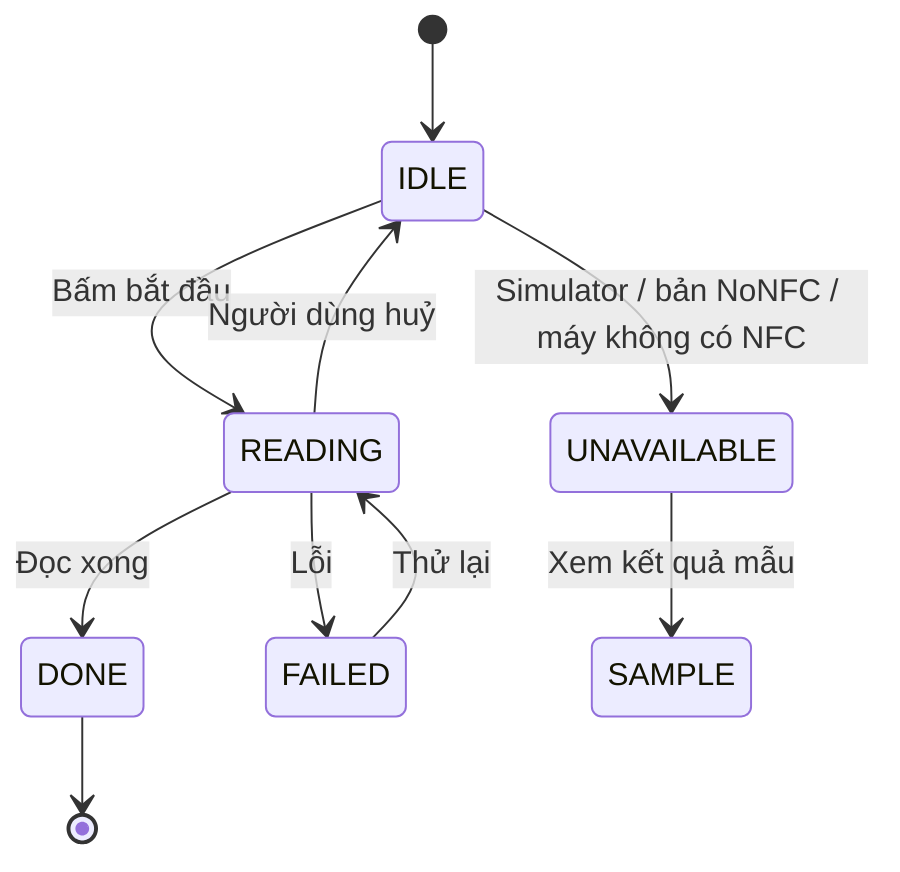

# A02 · App iPhone Aegis Scan – quét MRZ và đọc chip CCCD / hộ chiếu

| | |
|---|---|
| Liên quan | SCRUM-18 (OCR/NFC), [SCRUM-80](https://baohandao2303.atlassian.net/browse/SCRUM-80) (C11 nguồn sinh trắc học), C15 (hiệu năng) |
| Mã nguồn | [`ios/AegisScan`](../../ios/AegisScan/README.md) – SwiftUI, iOS 16+, NFCPassportReader 3.0.1 (MIT) |
| Chuẩn | ICAO 9303: MRZ TD1/TD3, BAC, PACE, Passive Authentication (SOD), Chip Authentication |
| Trạng thái | Bản mẫu chạy được trên iPhone. Chưa có xác thực CSCA, liveness và so khớp khuôn mặt |

## 1. Vì sao cần app native

| | Web (PWA) | App native (Swift) |
|---|---|---|
| Camera | Có (`getUserMedia`) | Có, kèm Vision OCR trên máy |
| Đọc chip NFC | **Không** – Safari trên iPhone không có Web NFC | Có (CoreNFC, ISO 7816) |
| Ảnh khuôn mặt trong chip (DG2) | Không lấy được | Lấy được, dùng để so selfie (C11) |

## 2. Luồng màn hình

## 3. Đọc MRZ bằng camera

| Trường | TD1 (CCCD) | TD3 (hộ chiếu) |
|---|---|---|
| Số giấy tờ | Dòng 1, ký tự 6–14 (9 số cuối của số CCCD) | Dòng 2, ký tự 1–9 |
| Ngày sinh (YYMMDD) | Dòng 2, ký tự 1–6 | Dòng 2, ký tự 14–19 |
| Ngày hết hạn | Dòng 2, ký tự 9–14 | Dòng 2, ký tự 22–27 |
| Số định danh 12 số | Dòng 1, vùng tuỳ chọn | — |

Khoá mở chip = số giấy tờ + chữ số kiểm tra + ngày sinh + chữ số kiểm tra + ngày hết hạn + chữ số kiểm tra (đã kiểm bằng mẫu ICAO trong unit test).

## 4. Đọc chip NFC

| Nhóm dữ liệu | Nội dung | Dùng ở đâu |
|---|---|---|
| DG1 | Dữ liệu MRZ trong chip | Đối chiếu với MRZ đã quét |
| DG2 | Ảnh khuôn mặt (JPEG2000) | Hiển thị; so selfie ở bước sau (C11) |
| DG11 | Họ tên đầy đủ, nơi sinh (hộ chiếu) | Màn kết quả |
| DG13 | Dữ liệu riêng CCCD Việt Nam: quê quán, nơi thường trú… | Màn kết quả. Nhãn trường cần đối chiếu đặc tả chính thức |
| DG14 | Khoá cho Chip Authentication | Chống chip nhân bản |
| SOD | Hash các DG + chữ ký của nước cấp | Kiểm tra dữ liệu không bị sửa |

## 5. Trạng thái màn đọc chip

| Lỗi | Thông báo cho người dùng | Cách xử lý |
|---|---|---|
| `InvalidMRZKey` | Chip không chấp nhận thông tin MRZ | Kiểm tra lại số giấy tờ, ngày sinh, ngày hết hạn |
| `ConnectionError`, `TimeOutError`, `TagNotValid` | Mất kết nối với chip | Giữ yên thẻ sát phần trên lưng máy, thử lại |
| `MoreThanOneTagFound` | Phát hiện nhiều thẻ | Chỉ để 1 thẻ gần máy |
| `NFCNotSupported` | Máy không hỗ trợ NFC | Cần iPhone 7 trở lên |
| `UserCanceled` | (không báo lỗi) | Quay về trạng thái chờ |

## 6. Kiểm tra bảo mật trên màn kết quả

| Kiểm tra | Ý nghĩa | Trạng thái bản mẫu |
|---|---|---|
| Mở khoá chip | PACE hoặc BAC thành công | Có |
| Dữ liệu không bị sửa | Hash từng DG khớp SOD | Có |
| Chữ ký số tới CSCA | SOD được ký bởi chứng thư gốc của nước cấp | **Chưa** – cần danh sách CSCA (master list); với CCCD, ngân hàng xác thực thêm qua hệ thống của Bộ Công an |
| Chip Authentication | Chip có khoá riêng, chống nhân bản | Có nếu chip hỗ trợ |

## 7. Ký và cài đặt

| Scheme | Tài khoản Apple | Đọc NFC |
|---|---|---|
| AegisScan | Apple Developer Program (trả phí) | Có |
| AegisScan-NoNFC | Apple ID miễn phí | Không – vẫn quét MRZ, nhập tay, xem kết quả mẫu |

Toàn bộ xử lý nằm trên máy, không lưu và không gửi ảnh hay dữ liệu chip đi đâu.

## 8. Việc tiếp theo

1. Nạp master list CSCA để xác minh chữ ký (`PassportReader(masterListURL:)`).
2. Thêm selfie + liveness, so với ảnh DG2 (C11 – `match_source = CHIP_DG2`).
3. Gửi kết quả đọc chip lên `ekyc-service` (thay cho bước OCR/NFC của web).
4. Đo P95 thời gian đọc chip trên 2 dòng máy (C15, đóng SCRUM-57).
