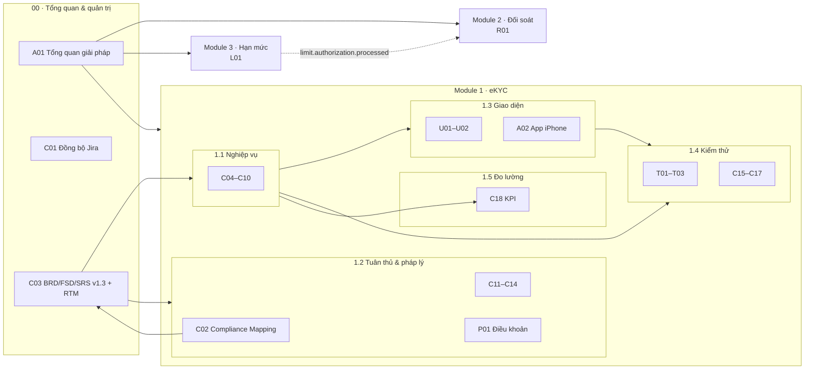

# Tài liệu Aegis – eKYC, Đối soát, Hạn mức

Bộ tài liệu cho 3 module: **eKYC** (18 hạng mục của Epic [SCRUM-69 – eKYC Completion & Production Readiness](https://baohandao2303.atlassian.net/browse/SCRUM-69), kèm giao diện, kiểm thử và pháp lý), [Đối soát (SCRUM-7)](https://baohandao2303.atlassian.net/browse/SCRUM-7), [Hạn mức (SCRUM-8)](https://baohandao2303.atlassian.net/browse/SCRUM-8).
Tổng quan và kế hoạch: [Gap Analysis & Delivery Plan (Confluence)](https://baohandao2303.atlassian.net/wiki/spaces/SCRUM/pages/15106049).

Các diagram viết bằng Mermaid, GitHub tự hiển thị. Tổng cộng 47 diagram, tất cả đã được kiểm tra cú pháp.

**Bắt đầu từ đây:** [A01 Tổng quan giải pháp](00-overview/A01-solution-overview.md) – bối cảnh hệ thống, thành phần, luồng end-to-end, cây quyết định, bản đồ màn hình và cách triển khai UI.

## Cấu trúc thư mục

Tài liệu chia theo **module**. Mã tài liệu giữ nguyên để không vỡ liên kết Jira: **A** kiến trúc · **C** hạng mục eKYC Completion · **P** pháp lý · **U** giao diện · **T** kiểm thử · **R** đối soát · **L** hạn mức.

```
docs/
├── 00-overview/                 Tổng quan & quản trị (dùng chung)
├── 01-ekyc/                     Module 1 · eKYC
│   ├── 1.1-business/            Nghiệp vụ
│   ├── 1.2-compliance-legal/    Tuân thủ & pháp lý
│   ├── 1.3-ui/                  Giao diện
│   ├── 1.4-testing/             Kiểm thử
│   └── 1.5-analytics/           Đo lường
├── 02-reconciliation/           Module 2 · Đối soát
└── 03-credit-limit/             Module 3 · Hạn mức
```

## Bức tranh tổng thể



## Mục lục

### 00 · Tổng quan & quản trị

| Tài liệu | Jira | Diagram | Trạng thái |
|---|---|---|---|
| [A01 Tổng quan giải pháp](00-overview/A01-solution-overview.md) | SCRUM-69 | Context, Container, Sequence, Flowchart ×4 | ✅ Hoàn tất |
| [C01 Nhật ký đồng bộ Jira](00-overview/C01-jira-hygiene-log.md) | SCRUM-70 | — | ✅ Hoàn tất |
| [C03 Requirements Addendum v1.3 & RTM](00-overview/C03-requirements-addendum-v1.3.md) | SCRUM-72 | State | 📝 Chờ PO & Compliance duyệt |

### Module 1 · eKYC

| Nhóm | Tài liệu | Jira | Diagram | Trạng thái |
|---|---|---|---|---|
| 1.1 Nghiệp vụ | [C04–C05 Trùng khách hàng & hợp lệ giấy tờ](01-ekyc/1.1-business/C04-C05-identity-validation.md) | SCRUM-73, 74 | Flowchart | ✅ Đặc tả + UI + backend, có test UAT |
| | [C06 Vòng đời phiên](01-ekyc/1.1-business/C06-session-lifecycle.md) | SCRUM-75 | State, Sequence | ✅ Đặc tả + UI + backend, có test UAT |
| | [C07–C09 Xử lý hồ sơ REFER](01-ekyc/1.1-business/C07-C09-refer-handling.md) | SCRUM-76, 77, 78 | Swimlane, Sequence, State | ✅ Đặc tả + UI + backend, có test UAT |
| | [C10 Maker-Checker & Audit](01-ekyc/1.1-business/C10-maker-checker-audit.md) | SCRUM-79 | Flowchart, ERD | ✅ Đặc tả + UI + backend, có test UAT |
| 1.2 Tuân thủ & pháp lý | [C02 Compliance Mapping](01-ekyc/1.2-compliance-legal/C02-compliance-mapping.md) | SCRUM-71 | Flowchart (truy vết) | 📝 Chờ Compliance xác nhận |
| | [C11 Nguồn ảnh sinh trắc học](01-ekyc/1.2-compliance-legal/C11-biometric-source.md) | SCRUM-80 | Flowchart | 🔧 Đặc tả xong, chờ C02 |
| | [C12 Rút lại đồng ý & lưu trữ](01-ekyc/1.2-compliance-legal/C12-consent-retention.md) | SCRUM-81 | Flowchart, Sequence | ✅ Đặc tả + màn Quyền riêng tư + backend |
| | [C13–C14 Chống gian lận](01-ekyc/1.2-compliance-legal/C13-C14-fraud-controls.md) | SCRUM-82, 83 | Flowchart, Sequence | 🔧 Velocity có backend; spike C14 chưa chạy |
| | [P01 Điều khoản, quyền riêng tư & cơ sở pháp lý](01-ekyc/1.2-compliance-legal/P01-terms-privacy.md) | SCRUM-17, 71, 81 | Flowchart | 📝 Chờ Pháp chế & Compliance duyệt |
| 1.3 Giao diện | [U01 Đặc tả giao diện app khách (20 màn)](01-ekyc/1.3-ui/U01-customer-app-ui-spec.md) | SCRUM-47 | Flowchart | ✅ v1.0, có ảnh từng màn |
| | [U02 Đặc tả giao diện Aegis Compliance](01-ekyc/1.3-ui/U02-compliance-ui-spec.md) | SCRUM-48 | — | ✅ v1.0, có ảnh từng màn |
| | [A02 App iPhone quét giấy tờ](01-ekyc/1.3-ui/A02-ios-document-scan.md) | SCRUM-18, 80 | Flowchart ×2, Sequence, State | 🔧 Bản mẫu chạy được, chưa có CSCA & liveness |
| 1.4 Kiểm thử | [T01 Kế hoạch kiểm thử tổng thể](01-ekyc/1.4-testing/T01-test-plan.md) | SCRUM-69 | — | ✅ v1.0 |
| | [T02 Bộ 106 test case](01-ekyc/1.4-testing/T02-test-cases.md) | SCRUM-69, 86 | — | ✅ v1.0 |
| | [T03 Báo cáo kết quả vòng 1](01-ekyc/1.4-testing/T03-test-report.md) | SCRUM-69 | — | ✅ 91 đạt · 0 lỗi mở · chưa đủ điều kiện UAT |
| | [C15 Kế hoạch hiệu năng](01-ekyc/1.4-testing/C15-performance-test-plan.md) | SCRUM-84 | Flowchart | 🔧 Kế hoạch xong, chờ thiết bị/môi trường |
| | [C16 Kế hoạch SIT](01-ekyc/1.4-testing/C16-sit-plan.md) | SCRUM-85 | Flowchart, Sequence | ⛔ Kế hoạch xong, bị chặn bởi SCRUM-56 |
| | [C17 Bộ UAT & biên bản](01-ekyc/1.4-testing/C17-uat-pack.md) | SCRUM-86 | Flowchart | ⛔ Bộ case xong, chờ C03 + C16 |
| 1.5 Đo lường | [C18 KPI & từ điển chỉ số](01-ekyc/1.5-analytics/C18-kpi-metric-dictionary.md) | SCRUM-87 | Flowchart | ✅ Đặc tả + báo cáo SLA/KPI có backend |

### Module 2 · Đối soát

| Tài liệu | Jira | Diagram | Trạng thái |
|---|---|---|---|
| [R01 Luồng, trạng thái & kiểm soát](02-reconciliation/R01-reconciliation-flow.md) | SCRUM-7, 49, 50 | Flowchart ×2, State ×2, Sequence, ERD | 🔧 Đặc tả + UI mẫu xong, chờ backend |

### Module 3 · Hạn mức

| Tài liệu | Jira | Diagram | Trạng thái |
|---|---|---|---|
| [L01 Authorization, Boost & gian lận](03-credit-limit/L01-credit-limit-flow.md) | SCRUM-8, 51, 52, 54 | Sequence ×2, Flowchart ×2, State ×2 | 🔧 Đặc tả + UI mẫu xong, chờ Notification thật |

## Việc còn lại ngoài tài liệu

| Việc | Ai | Chặn |
|---|---|---|
| Xác minh văn bản pháp lý, trả lời 4 câu hỏi mở | Compliance | C03, C05, C11, C12 |
| Duyệt BRD/FSD/SRS v1.3 | PO + Compliance | C17 |
| Thay adapter giả lập bằng kết nối thật CIC/AML/CBS/Notification; Postgres, SSO | Dev | C16 |
| Sandbox đối tác DEP-01→04, 07–09 | Solution Owner | C16 |
| Thiết bị NFC thứ hai để đo hiệu năng | Dev/QA | C15 |
| Master list CSCA, tài khoản Apple Developer để đọc chip | Dev | A02 |
| Duyệt mẫu SMS/App khoá Boost, Notification Service thật | Risk/Legal/CSKH, Solution Owner | L01 (SCRUM-54) |
| Backend reconciliation-service: lineage API (SCRUM-50), EOD cross-ledger (SCRUM-53) | Dev | R01, L01 |
