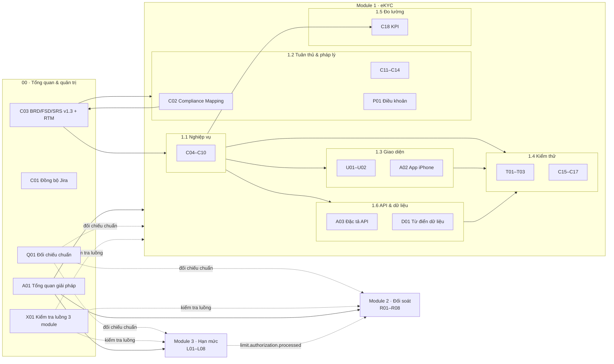

# Tài liệu Aegis – eKYC, Đối soát, Hạn mức

Bộ tài liệu cho 3 module: **eKYC** (18 hạng mục của Epic [SCRUM-69 – eKYC Completion & Production Readiness](https://baohandao2303.atlassian.net/browse/SCRUM-69), kèm giao diện, kiểm thử và pháp lý), [Đối soát (SCRUM-7)](https://baohandao2303.atlassian.net/browse/SCRUM-7), [Hạn mức (SCRUM-8)](https://baohandao2303.atlassian.net/browse/SCRUM-8).
Tổng quan và kế hoạch: [Gap Analysis & Delivery Plan (Confluence)](https://baohandao2303.atlassian.net/wiki/spaces/SCRUM/pages/15106049).

Các diagram viết bằng Mermaid, GitHub tự hiển thị. Tổng cộng 58 diagram, tất cả đã được kiểm tra cú pháp.

**Bắt đầu từ đây:** [A01 Tổng quan giải pháp](00-overview/A01-solution-overview.md) – bối cảnh hệ thống, thành phần, luồng end-to-end, cây quyết định, bản đồ màn hình và cách triển khai UI.

## Cấu trúc thư mục

Tài liệu chia theo **module**. Mã tài liệu giữ nguyên để không vỡ liên kết Jira: **A** kiến trúc · **C** hạng mục eKYC Completion · **P** pháp lý · **U** giao diện · **T** kiểm thử · **Q** chất lượng tài liệu · **R** đối soát · **L** hạn mức. Chuẩn áp dụng cho từng loại tài liệu: [Q01](00-overview/Q01-standards-conformance.md) (ISO/IEC/IEEE 29148, 29119-3, BABOK v3, C4, BPMN 2.0, UML 2.5, WCAG 2.2, ISO/IEC 29100).

```
docs/
├── 00-overview/                 Tổng quan & quản trị (dùng chung)
├── 01-ekyc/                     Module 1 · eKYC
│   ├── 1.1-business/            Nghiệp vụ
│   ├── 1.2-compliance-legal/    Tuân thủ & pháp lý
│   ├── 1.3-ui/                  Giao diện
│   ├── 1.4-testing/             Kiểm thử
│   ├── 1.5-analytics/           Đo lường
│   └── 1.6-api-data/            API & dữ liệu
├── 02-reconciliation/           Module 2 · Đối soát
└── 03-credit-limit/             Module 3 · Hạn mức
```

## Bức tranh tổng thể



## Mục lục

### 00 · Tổng quan & quản trị

| Tài liệu | Jira | Diagram | Trạng thái |
|---|---|---|---|
| [A01 Tổng quan giải pháp](00-overview/A01-solution-overview.md) | SCRUM-69 | Context, Container, Sequence, Flowchart ×4 | ✅ v1.1 · mở rộng cho cả 3 module |
| [C01 Nhật ký đồng bộ Jira](00-overview/C01-jira-hygiene-log.md) | SCRUM-70 | — | ✅ v1.1 · thêm quy ước cho Module 2, 3 (X01 F-14) |
| [C03 Requirements Addendum v1.3 & RTM](00-overview/C03-requirements-addendum-v1.3.md) | SCRUM-72 | State | 📝 draft3 · chờ PO & Compliance duyệt |
| [Q01 Đối chiếu chuẩn quốc tế](00-overview/Q01-standards-conformance.md) | SCRUM-69 | — | ✅ v1.1 · M1: 4 đạt · 9 một phần · M2, M3: 5 đạt · 4 một phần · 0 thiếu |
| [X01 Kiểm tra luồng end-to-end 3 module](00-overview/X01-end-to-end-flow-check.md) | SCRUM-7, 8, 69 | Sequence | 🔧 v1.2 · 14 chặng · 14 điểm lệch (6 đã sửa, 8 chờ quyết định) · đã chạy thử trên app 26/11 |

### Module 1 · eKYC

| Nhóm | Tài liệu | Jira | Diagram | Trạng thái |
|---|---|---|---|---|
| 1.1 Nghiệp vụ | [C04–C05 Trùng khách hàng & hợp lệ giấy tờ](01-ekyc/1.1-business/C04-C05-identity-validation.md) | SCRUM-73, 74 | Flowchart | ✅ Đặc tả + UI + backend, có test UAT |
| | [C06 Vòng đời phiên](01-ekyc/1.1-business/C06-session-lifecycle.md) | SCRUM-75 | State, Sequence | ✅ Đặc tả + UI + backend, có test UAT |
| | [C07–C09 Xử lý hồ sơ REFER](01-ekyc/1.1-business/C07-C09-refer-handling.md) | SCRUM-76, 77, 78 | Swimlane, Sequence, State | ✅ Đặc tả + UI + backend, có test UAT |
| | [C10 Maker-Checker & Audit](01-ekyc/1.1-business/C10-maker-checker-audit.md) | SCRUM-79 | Flowchart, ERD | ✅ Đặc tả + UI + backend, có test UAT |
| 1.2 Tuân thủ & pháp lý | [C02 Compliance Mapping](01-ekyc/1.2-compliance-legal/C02-compliance-mapping.md) | SCRUM-71 | Flowchart (truy vết) | 📝 Chờ Compliance xác nhận |
| | [C11 Nguồn ảnh sinh trắc học](01-ekyc/1.2-compliance-legal/C11-biometric-source.md) | SCRUM-80 | Flowchart | 🔧 Đặc tả xong, chờ C02 |
| | [C12 Rút lại đồng ý & lưu trữ](01-ekyc/1.2-compliance-legal/C12-consent-retention.md) | SCRUM-81 | Flowchart, Sequence | ✅ Đặc tả + màn Quyền riêng tư + backend |
| | [C13–C14 Chống gian lận](01-ekyc/1.2-compliance-legal/C13-C14-fraud-controls.md) | SCRUM-82, 83 | Flowchart, Sequence | 🔧 Velocity có backend; spike C14 chưa chạy |
| | [P01 Điều khoản, quyền riêng tư & cơ sở pháp lý](01-ekyc/1.2-compliance-legal/P01-terms-privacy.md) | SCRUM-17, 71, 81 | Flowchart | 📝 v0.4 · rà soát theo Luật 91/2025, 13 phát hiện (2 nghiêm trọng), chờ Pháp chế duyệt |
| 1.3 Giao diện | [U01 Đặc tả giao diện app khách (20 màn)](01-ekyc/1.3-ui/U01-customer-app-ui-spec.md) | SCRUM-47 | Flowchart | ✅ v1.1, có ảnh từng màn |
| | [U02 Đặc tả giao diện Aegis Compliance](01-ekyc/1.3-ui/U02-compliance-ui-spec.md) | SCRUM-48 | — | ✅ v1.1, có ảnh từng màn |
| | [A02 App iPhone quét giấy tờ](01-ekyc/1.3-ui/A02-ios-document-scan.md) | SCRUM-18, 80 | Flowchart ×2, Sequence, State | 🔧 Bản mẫu chạy được, chưa có CSCA & liveness |
| 1.4 Kiểm thử | [T01 Kế hoạch kiểm thử tổng thể](01-ekyc/1.4-testing/T01-test-plan.md) | SCRUM-69 | — | ✅ v1.2 (theo ISO 29119-3) |
| | [T02 Bộ 108 test case](01-ekyc/1.4-testing/T02-test-cases.md) | SCRUM-69, 86 | — | ✅ v1.1 |
| | [T03 Báo cáo kết quả vòng 1](01-ekyc/1.4-testing/T03-test-report.md) | SCRUM-69 | — | ✅ v1.3 · vòng 2 (26/11): 108 ca – 103 đạt · 4 một phần · 1 chưa chạy · 0 lỗi mở (13 lỗi đã sửa) · còn 5 ca cần thiết bị thật · chưa đủ điều kiện UAT |
| | [C15 Kế hoạch hiệu năng](01-ekyc/1.4-testing/C15-performance-test-plan.md) | SCRUM-84 | Flowchart | 🔧 Kế hoạch xong, chờ thiết bị/môi trường |
| | [C16 Kế hoạch SIT](01-ekyc/1.4-testing/C16-sit-plan.md) | SCRUM-85 | Flowchart, Sequence | ⛔ Kế hoạch xong, bị chặn bởi SCRUM-56 |
| | [C17 Bộ UAT & biên bản](01-ekyc/1.4-testing/C17-uat-pack.md) | SCRUM-86 | Flowchart | ⛔ Bộ case xong, chờ C03 + C16 |
| 1.5 Đo lường | [C18 KPI & từ điển chỉ số](01-ekyc/1.5-analytics/C18-kpi-metric-dictionary.md) | SCRUM-87 | Flowchart | ✅ Đặc tả + báo cáo SLA/KPI có backend |
| 1.6 API & dữ liệu | [A03 Đặc tả API & mã lỗi](01-ekyc/1.6-api-data/A03-api-specification.md) | SCRUM-69, 85 | — | 📝 v1.2 · 27 API · 21 mã lỗi, chờ Tech Lead |
| | [D01 Từ điển dữ liệu](01-ekyc/1.6-api-data/D01-data-dictionary.md) | SCRUM-69, 81 | ERD | 📝 v1.2 · 14 bảng, phân loại theo Luật 91/2025 + NĐ 356/2025, chờ DPO |

### Module 2 · Đối soát

| Tài liệu | Jira | Diagram | Trạng thái |
|---|---|---|---|
| [R01 Luồng, trạng thái & kiểm soát](02-reconciliation/R01-reconciliation-flow.md) | SCRUM-7, 49, 50 | Flowchart ×2, State ×2, Sequence, ERD | 🔧 v1.1 · Đặc tả + UI mẫu xong, chờ backend |
| [R02 Yêu cầu bổ sung, điểm lệch baseline & RTM](02-reconciliation/R02-requirements-gap-rtm.md) | SCRUM-7, 23, 26, 50, 53 | State | 📝 v0.6 · 9 điểm chờ Kế toán trưởng quyết định · 20 yêu cầu |
| [R03 Đặc tả giao diện REC-01 → 06](02-reconciliation/R03-ui-spec.md) | SCRUM-49 | — | ✅ v1.3, có ảnh từng màn |
| [R04 Kiểm thử: kế hoạch, test case, kết quả vòng 1–2](02-reconciliation/R04-test-plan-cases.md) | SCRUM-7, 49 | — | ✅ v1.4 · 25 ca UI đạt 25 (hồi quy 26/11) · 6 lỗi đã sửa · 9 ca backend chờ service |
| [R05 Đặc tả API & từ điển dữ liệu (đề xuất)](02-reconciliation/R05-api-data-dictionary.md) | SCRUM-7, 22–26, 50, 53 | ERD | 📝 v0.2 · 11 bảng · 32 API · 13 mã lỗi riêng, chờ Tech Lead & Kế toán trưởng |
| [R06 Yêu cầu phi chức năng & từ điển KPI](02-reconciliation/R06-nfr-kpi.md) | SCRUM-7, 53 | — | 📝 v0.2 · 23 NFR theo ISO/IEC 25010 · 5 KPI đã đối chiếu BRD §1.9, chờ Tech Lead & Ops chốt ngưỡng |
| [R07 SIT, hiệu năng, UAT & biên bản nghiệm thu](02-reconciliation/R07-sit-perf-uat.md) | SCRUM-7, 22–26, 50, 53 | Flowchart ×2 | ⛔ v0.1 · 13 SIT · 6 hiệu năng · 18 UAT, chờ backend và sandbox đối tác |
| [R08 Tuân thủ, cơ sở pháp lý & dữ liệu cá nhân](02-reconciliation/R08-compliance-mapping.md) | SCRUM-7 | Flowchart | 📝 v0.1 · 12 yêu cầu tuân thủ (6 ✅ · 5 🟡 · 1 ❌) · chờ Pháp chế, Kế toán trưởng |

### Module 3 · Hạn mức

| Tài liệu | Jira | Diagram | Trạng thái |
|---|---|---|---|
| [L01 Authorization, Boost & gian lận](03-credit-limit/L01-credit-limit-flow.md) | SCRUM-8, 51, 52, 54 | Sequence ×2, Flowchart ×2, State ×2 | 🔧 v1.2 · Đã đối chiếu BRD (MTI 0420, trạng thái Boost), chờ Notification thật |
| [L02 Yêu cầu bổ sung, điểm lệch baseline & RTM](03-credit-limit/L02-requirements-gap-rtm.md) | SCRUM-8, 27–30, 53, 54 | — | 📝 v0.2 · 9 điểm chờ PO, Risk, Vận hành thẻ quyết định · 20 yêu cầu |
| [L03 Đặc tả giao diện LIM-W1 → W4, M1 → M3](03-credit-limit/L03-ui-spec.md) | SCRUM-51, 52 | — | 📝 v0.3 · 16 ảnh chụp tự động (chụp lại 26/11) |
| [L04 Kiểm thử: kế hoạch, test case, kết quả vòng 1–2](03-credit-limit/L04-test-plan-cases.md) | SCRUM-8, 51, 52 | — | ✅ v1.3 · vòng 2: 36 ca UI, đạt 34 · 4 lỗi đã sửa · 6 lỗi mở (chờ quyết định) · 10 ca backend chờ service |
| [L05 Đặc tả API & từ điển dữ liệu (đề xuất)](03-credit-limit/L05-api-data-dictionary.md) | SCRUM-27–30, 38, 53, 54 | ERD | 📝 v0.2 · 12 bảng · ISO 8583 · 29 API · 12 mã lỗi riêng |
| [L06 Yêu cầu phi chức năng & KPI-07 → 09](03-credit-limit/L06-nfr-kpi.md) | SCRUM-8 | — | 📝 v0.2 · 22 NFR theo ISO/IEC 25010 · 3 KPI + 8 chỉ số vận hành |
| [L07 SIT, hiệu năng, UAT & biên bản nghiệm thu](03-credit-limit/L07-sit-perf-uat.md) | SCRUM-8, 27–30, 51–54 | Flowchart ×2 | ⛔ v0.1 · 12 SIT · 6 hiệu năng · 21 UAT, chờ `limit-service` và simulator ISO 8583 |
| [L08 Tuân thủ, điều khoản cho khách & dữ liệu cá nhân](03-credit-limit/L08-compliance-terms.md) | SCRUM-8, 54 | Flowchart | 📝 v0.1 · 12 yêu cầu tuân thủ (1 ✅ · 7 🟡 · 4 ❌) · dự thảo điều khoản Boost, Smart Fallback, 5 mẫu thông báo |

## Việc còn lại ngoài tài liệu

| Việc | Ai | Chặn |
|---|---|---|
| Xác định bước phát hành thẻ và hạn mức ban đầu giữa eKYC và Hạn mức (X01 F-01) | PO | X01, L05, UAT Module 3 |
| Ai lập bút toán Smart Fallback; đặc tả hạch toán sổ cái IF-REC-07 (X01 F-09, F-13) | Kế toán trưởng, đội Core Banking | R05, L05, R07, L07 |
| Phong bì sự kiện chung, Pub/Sub hay Kafka (X01 F-03, F-05) | Tech Lead, Solution Owner | A01, R05, L05 |
| Đối chiếu bản gốc văn bản pháp lý ở R08, L08; duyệt điều khoản Boost / Smart Fallback | Pháp chế, DPO, Compliance | R08, L08 |
| Xác minh văn bản pháp lý, trả lời 4 câu hỏi mở | Compliance | C03, C05, C11, C12 |
| Duyệt BRD/FSD/SRS v1.3 | PO + Compliance | C17 |
| Thay adapter giả lập bằng kết nối thật CIC/AML/CBS/Notification; Postgres, SSO | Dev | C16 |
| Sandbox đối tác DEP-01→04, 07–09 | Solution Owner | C16 |
| Thiết bị NFC thứ hai để đo hiệu năng | Dev/QA | C15 |
| Master list CSCA, tài khoản Apple Developer để đọc chip | Dev | A02 |
| Duyệt mẫu SMS/App khoá Boost, Notification Service thật | Risk/Legal/CSKH, Solution Owner | L01, L07 (SCRUM-54) |
| Xác minh mã `limit-service` (SCRUM-27 → 30, 38); simulator ISO 8583, mock CASA | Tech Lead, Vận hành thẻ | L04 (TC-LIM-B01 → B10), L07 |
| Chốt 9 điểm lệch baseline của Hạn mức (thời hạn Boost, MTI reversal, kiểm soát đồng thời…) | PO, Risk tín dụng, Vận hành thẻ, Tech Lead | L02, UI Hạn mức |
| Backend reconciliation-service: lineage API (SCRUM-50), EOD cross-ledger (SCRUM-53) | Dev | R01, R04 (TC-REC-B01 → B09), L01 |
| Chốt 9 điểm lệch baseline của Đối soát (trạng thái ngoại lệ, aging, leo thang, RULE-REC-05…) | Kế toán trưởng, Ops, InfoSec | R02, UI Đối soát |
